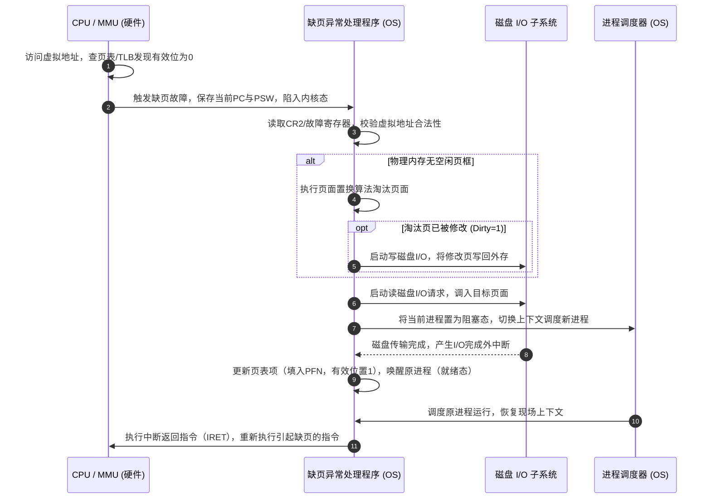

# 408 计算机考研 · 操作系统近十年（2016~2025）高频考点精讲

> **学科归属**：全国硕士研究生招生考试 · 408 计算机学科专业基础综合（操作系统）  
> **考查周期**：2016 ~ 2025 年（近十年真题全覆盖）  
> **筛选门槛**：近十年考查频次 $\ge 3$ 次的高频核心考点（共计 24 个）  
> **编撰原则**：严谨学术教研规范，严禁表情符号，精析全部真题，详尽机制推导与考法归纳。  

---

## 全局考点导航目录

| 序号 | 考点名称 | 知识模块 | 近十年考频 | 历年总考频 | 考查形式 | 锚点链接 |
| :---: | :--- | :--- | :---: | :---: | :--- | :--- |
| 01 | **虚拟页式管理** | 操作系统 · 内存管理 | **14 次** | 20 次 | 解答题、选择题 | [跳转精讲](#topic-1-虚拟页式管理) |
| 02 | **处理机调度算法** | 操作系统 · 进程管理 | **11 次** | 16 次 | 解答题、选择题 | [跳转精讲](#topic-2-处理机调度算法) |
| 03 | **地址翻译** | 操作系统 · 内存管理 | **7 次** | 12 次 | 解答题、选择题 | [跳转精讲](#topic-3-地址翻译) |
| 04 | **进程状态** | 操作系统 · 进程管理 | **6 次** | 9 次 | 选择题 | [跳转精讲](#topic-4-进程状态) |
| 05 | **操作系统概念** | 操作系统 · 操作系统引论 | **6 次** | 8 次 | 选择题 | [跳转精讲](#topic-5-操作系统概念) |
| 06 | **同步问题设计** | 操作系统 · 进程管理 | **5 次** | 10 次 | 解答题 | [跳转精讲](#topic-6-同步问题设计) |
| 07 | **用户态和内核态** | 操作系统 · 操作系统引论 | **5 次** | 10 次 | 解答题、选择题 | [跳转精讲](#topic-7-用户态和内核态) |
| 08 | **页表** | 操作系统 · 内存管理 | **5 次** | 10 次 | 解答题、选择题 | [跳转精讲](#topic-8-页表) |
| 09 | **缺页异常** | 操作系统 · 内存管理 | **5 次** | 9 次 | 解答题、选择题 | [跳转精讲](#topic-9-缺页异常) |
| 10 | **系统调用** | 操作系统 · 操作系统引论 | **5 次** | 7 次 | 选择题 | [跳转精讲](#topic-10-系统调用) |
| 11 | **inode** | 操作系统 · 文件管理 | **4 次** | 7 次 | 选择题 | [跳转精讲](#topic-11-inode) |
| 12 | **外存空间管理** | 操作系统 · 文件管理 | **4 次** | 6 次 | 选择题 | [跳转精讲](#topic-12-外存空间管理) |
| 13 | **页面置换算法** | 操作系统 · 内存管理 | **4 次** | 5 次 | 选择题 | [跳转精讲](#topic-13-页面置换算法) |
| 14 | **文件物理结构** | 操作系统 · 文件管理 | **3 次** | 10 次 | 解答题、选择题 | [跳转精讲](#topic-14-文件物理结构) |
| 15 | **IO软件层次** | 操作系统 · I/O管理 | **3 次** | 6 次 | 解答题、选择题 | [跳转精讲](#topic-15-IO软件层次) |
| 16 | **磁盘调度算法** | 操作系统 · I/O管理 | **3 次** | 6 次 | 选择题 | [跳转精讲](#topic-16-磁盘调度算法) |
| 17 | **银行家算法** | 操作系统 · 进程管理 | **3 次** | 6 次 | 选择题 | [跳转精讲](#topic-17-银行家算法) |
| 18 | **信号量** | 操作系统 · 进程管理 | **3 次** | 4 次 | 解答题、选择题 | [跳转精讲](#topic-18-信号量) |
| 19 | **动态内存管理** | 操作系统 · 内存管理 | **3 次** | 4 次 | 选择题 | [跳转精讲](#topic-19-动态内存管理) |
| 20 | **目录** | 操作系统 · 文件管理 | **3 次** | 4 次 | 解答题、选择题 | [跳转精讲](#topic-20-目录) |
| 21 | **进程概念** | 操作系统 · 进程管理 | **3 次** | 4 次 | 解答题、选择题 | [跳转精讲](#topic-21-进程概念) |
| 22 | **clock算法** | 操作系统 · 内存管理 | **3 次** | 3 次 | 解答题、选择题 | [跳转精讲](#topic-22-clock算法) |
| 23 | **时间片轮转** | 操作系统 · 进程管理 | **3 次** | 3 次 | 选择题 | [跳转精讲](#topic-23-时间片轮转) |
| 24 | **进程文件管理** | 操作系统 · 文件管理 | **3 次** | 3 次 | 选择题 | [跳转精讲](#topic-24-进程文件管理) |

---

<a id="topic-1-虚拟页式管理"></a>

# 【考点 01】虚拟页式管理（近十年考查 14 次）

[ [返回目录](#全局考点导航目录) ]

> **模块归属**：操作系统 · 内存管理  
> **考点层级**：微观细分考点（近十年考查 $\ge 3$ 次）  
> **适用对象**：408 计算机考研备考学生  

---

## 一、 考情档案

### 1. 历年考查频次与题号清单
- **近十年考查频次**：14 次（2016~2025 年）
- **近十年真题清单**：
  - 2016 年：第 45 题（综合解答题，14 分）
  - 2018 年：第 44 题（综合解答题，13 分）
  - 2020 年：第 46 题（综合解答题，15 分）
  - 2023 年：第 28 题（单项选择题，2 分）、第 30 题（单项选择题，2 分）、第 43 题（综合解答题，15 分）
  - 2024 年：第 16 题（单项选择题，2 分）、第 18 题（单项选择题，2 分）、第 25 题（单项选择题，2 分）、第 44 题（综合解答题，5 分）、第 45 题（综合解答题，7 分）
  - 2025 年：第 23 题（单项选择题，2 分）、第 27 题（单项选择题，2 分）、第 43 题（综合解答题，15 分）
- **历年总考查频次**：20 次（2009~2025 年）
- **出题形式**：单项选择题与综合解答题并重。近五年呈现出“高频选择题 + 跨学科（计算机组成原理/操作系统）超大分值综合解答题”的深度考查趋势。

### 2. 命题特点分析
1. **多层次软硬件协同贯通**：统考命题极度偏好将操作系统中的虚拟页式管理与计算机组成原理中的 Cache 映射、TLB（快表）、MMU 硬件地址翻译、指令寻址及流水线异常处理进行一体化考查（如 2016#45、2018#44、2023#43、2024#44、2025#43）。
2. **地址翻译计算精度要求极高**：深入考查虚拟地址二进制切分、多级页表索引、页表项物理定位、页表自映射、跨页边界判定等定量计算（如 2020#46、2024#45、2025#43）。
3. **程序执行局部性与性能量化**：结合二维数组行优先/列优先遍历、循环嵌套展开，考查缺页率、Cache 缺失率以及平均访存时间的精确推导。
4. **底层运行机制辨析深入**：针对进程上下文切换（CR3/PTBR 更新）、TLB 缺失 vs 缺页异常 vs Cache 缺失的处理主体与时序、硬件寻址方式对最少页框数的约束等原理进行深度设问。

### 3. 近十年考查年份分布表格

```text
+------+------------+-------------------------------------------------------+----------+
| 年份 | 题号       | 考查主题 / 核心考点                                   | 题型     |
+------+------------+-------------------------------------------------------+----------+
| 2016 | 第 45 题   | 页式虚拟存储与 Cache/TLB 联合映射、写策略及缺失开销   | 综合解答 |
| 2018 | 第 44 题   | 二级页表、TLB 与 2 路组相联 Cache 协同翻译与容量计算   | 综合解答 |
| 2020 | 第 46 题   | 二级页表地址转换、页表项物理寻址与数组遍历局部性      | 综合解答 |
| 2023 | 第 28 题   | 进程虚拟地址空间特征与容量决定因素                    | 单项选择 |
| 2023 | 第 30 题   | 进程间共享数据的页号与页框号对应关系                  | 单项选择 |
| 2023 | 第 43 题   | 请求分页缺页分析、Cache 组映射与循环遍历命中率计算    | 综合解答 |
| 2024 | 第 16 题   | 存储层次结构对比（Cache-主存 vs 主存-外存）           | 单项选择 |
| 2024 | 第 18 题   | MMU 硬件地址转换过程中的异常检测范围                  | 单项选择 |
| 2024 | 第 25 题   | 页式存储管理进程上下文切换需更新的寄存器集合          | 单项选择 |
| 2024 | 第 44 题   | 汇编指令寻址、小端存储与页式虚拟内存跨页定位          | 综合解答 |
| 2024 | 第 45 题   | 4MB 大页管理、缺页异常处理与页表自映射物理定位        | 综合解答 |
| 2025 | 第 23 题   | 进程上下文切换中的内核寄存器状态保持与更新判定        | 单项选择 |
| 2025 | 第 27 题   | 进程运行所需最少页框数的硬件约束条件（寻址方式）      | 单项选择 |
| 2025 | 第 43 题   | 虚拟分页与 Cache 联合访问性能评估、访存周期与缺页计算 | 综合解答 |
+------+------------+-------------------------------------------------------+----------+
```

---

## 二、 具体考察内容

### 1. 核心概念与机制原理

#### (1) 虚拟存储器与局部性原理
- **虚拟存储器定义**：基于局部性原理，在具有调页功能和页面置换功能的支持下，将离散分配的物理主存与辅存（如磁盘交换区）结合，为进程提供一个容量远大于实际物理主存的逻辑存储空间。
- **局部性原理**：
  - **时间局部性**：最近被访问的指令或数据在不久的将来很可能再次被访问（典型场景：循环结构、临时变量）。
  - **空间局部性**：一旦某个存储单元被访问，其相邻的存储单元在不久的将来也很可能被访问（典型场景：数组顺序遍历、顺序执行指令流）。

#### (2) 页式虚拟存储系统数据结构
虚拟页式管理依赖**页表（Page Table）**实现虚拟页号（VPN, Virtual Page Number）到物理页框号（PFN, Physical Frame Number）的映射。请求分页系统中，页表项（PTE, Page Table Entry）包含以下核心控制字段：

```text
+----------+---------------+--------+--------+--------+--------+
| 物理页框号 | 有效位/存在位 | 访问位 | 修改位 | 保护位 | 外存块号 |
+----------+---------------+--------+--------+--------+--------+
```

- **物理页框号（PFN）**：该虚拟页驻留主存时的物理基址高位部分。
- **有效位 / 存在位（Valid / Present Bit）**：指示该页面是否已调入物理主存（$1$ 表示在主存中；$0$ 表示未调入，引发缺页异常）。
- **访问位 / 引用位（Access / Reference Bit）**：记录该页最近是否被访问过，供页面置换算法（如 CLOCK、LRU 近似算法）决策使用。
- **修改位 / 脏位（Dirty / Modified Bit）**：指示该页面调入主存后内容是否被修改。若页面被置换淘汰且修改位为 $1$，必须写回辅存；若为 $0$，可直接丢弃，无需写回。
- **保护位（Protection Bits）**：定义该页面的访问权限（只读、读写、可执行等）。

#### (3) 地址映射与多级页表
- **单级页表机制**：页表必须在物理内存中连续存放。虚拟地址划分为虚拟页号 $VPN$ 与页内偏移量 $Offset$。若虚拟地址空间过大（如 32 位系统且页大小为 4KB，虚拟页数多达 $2^{20}$），连续存放页表将消耗 $2^{20} \times 4\text{B} = 4\text{MB}$ 连续主存空间，违背离散分配初衷。
- **多级页表机制**：将单级页表离散分配，建立页目录与二级/多级页表结构。
  - 各级页表项中记录的是下一级页表的起始物理地址。
  - **关键特性**：只有根页表（顶级页目录）必须常驻内存，且进程的页表基址寄存器（PTBR / CR3）存放根页目录的物理基地址；下级页表可以按需动态创建或调入，大幅降低常驻内存开销。

#### (4) 快表（TLB, Translation Lookaside Buffer）机制
- **概念**：设在 MMU 内部的高速缓存（通常采用相联存储器 CAM 或静态 RAM 构建），用于存放近期频繁访问的高频页表项副本。
- **查找时序**：CPU 发出虚拟地址后，MMU 首先根据虚页号并行检索 TLB：
  - **TLB 命中**：直接获取物理页框号，无须访问主存页表，将物理页框号与页内偏移拼接即得物理地址。
  - **TLB 缺失**：MMU 或操作系统异常处理程序访问主存中的多级页表，若页表项有效，则将该项装入 TLB 并完成地址转换；若页表项指示不在主存，则触发缺页异常。

#### (5) 缺页异常处理全流程
缺页异常（Page Fault）属于 CPU 内部异常中的**故障（Fault）**。其标准处理流程如下：
1. **硬件检测与陷入**：MMU 检索页表项发现有效位为 $0$，硬件产生缺页中断向量，保护断点现场（保存发生异常的指令 PC 及 CPU 状态），陷入内核态。
2. **缺页中断处理程序执行**：
   - 检查虚拟地址合法性（是否越界、是否越权）。若非法，则向进程发送 SIGSEGV 信号终止进程。
   - 检查物理主存是否有空闲页框。若无，调用页面置换算法（如 LRU、CLOCK）选出牺牲页。若牺牲页被修改（脏位为 $1$），必须调用设备驱动将其写回外存交换区。
   - 启动磁盘 I/O，将所需页面自外存交换区读入空闲页框，进程转入阻塞态。
   - 页面载入完成后，磁盘中断唤醒该进程，操作系统更新相应页表项（有效位置 $1$，填入 PFN，清除修改位），并将该进程置为就绪态。
3. **恢复执行**：调度器重新调度该进程，恢复 CPU 现场，**重新执行发生缺页的那一条指令**。

---

### 2. 核心定理推导与计算模型

#### (1) 地址空间划分与多级页表计算模型
设系统按字节编址，虚拟地址位宽为 $V$ 位，物理地址位宽为 $M$ 位，页面大小为 $P = 2^p$ 字节，则：
- **页内偏移量位数**：$p$ 位。
- **虚拟页号（VPN）位数**：$k = V - p$ 位，虚拟地址空间最大包含 $2^{V - p}$ 个逻辑页面。
- **物理页框号（PFN）位数**：$m = M - p$ 位，物理内存最大包含 $2^{M - p}$ 个物理页框。
- **页表项大小设计约束**：页表项至少需容纳 $m$ 位物理页框号及若干状态控制位（有效位、脏位、引用位、保护位等）。设页表项大小为 $e$ 字节，通常向上对齐为 $2$ 的幂次（如 4 字节或 8 字节）。
- **多级页表级数推导**：为保证每个页表块恰好占用一个物理页面（便于离散分配），每个页面可容纳的页表项数为 $N = P / e = 2^p / 2^s = 2^{p - s}$ 个。此时每级页表索引占 $p - s$ 位。多级页表的级数 $L$ 满足：
  $$L = \left\lceil \frac{V - p}{p - s} \right\rceil$$

#### (2) 有效访存时间（EAT, Effective Access Time）推导
设主存单次访问时间为 $t_m$，TLB 查找时间为 $t_{tlb}$，TLB 命中率为 $\alpha$：
- **含 TLB 的单级页表系统**：
  $$EAT = t_{tlb} + \alpha \cdot t_m + (1 - \alpha) \cdot (t_m + t_m) = t_{tlb} + t_m + (1 - \alpha) \cdot t_m$$
  *(注：缺失时访问一次主存页表获取物理地址，再访问一次主存获取数据)*
- **含 TLB 的 $n$ 级页表系统**：
  $$EAT = t_{tlb} + \alpha \cdot t_m + (1 - \alpha) \cdot (n \cdot t_m + t_m)$$
- **考虑缺页异常开销的完整模型**：设缺页率为 $f$，缺页中断处理与磁盘 I/O 平均开销为 $t_{fault}$：
  $$EAT = (1 - f) \cdot EAT_{hit} + f \cdot t_{fault}$$

#### (3) 经典页面置换算法模型
- **最佳置换算法（OPT）**：淘汰未来最长时间内不再被访问的页面。理想算法，无法实际实现，作为性能评价基准。
- **先进先出算法（FIFO）**：淘汰最早进入主存的页面。存在 **Belady 异常**（分配的物理页框数增加，缺页次数反而增加）。
- **最近最久未使用算法（LRU）**：淘汰自上次被访问以来经历时间最长的页面。性能优异，需硬件堆栈或计数器支持。
- **简单时钟算法（CLOCK / NRU）**：为每页设置 1 位访问位 $A$。指针循环扫描，遇 $A=1$ 置 $0$，遇 $A=0$ 淘汰。
- **改进型时钟算法**：结合访问位 $A$ 和修改位 $M$，按优先级分四轮扫描（首选无访问且无修改的页）：
  1. **第一轮**：寻找 $(A=0, M=0)$，不修改任何位。
  2. **第二轮**：若失败，寻找 $(A=0, M=1)$，将所经过的所有页的 $A$ 置为 $0$。
  3. **第三轮**：若仍失败，指针重新循环寻找 $(A=0, M=0)$，不修改任何位。
  4. **第四轮**：寻找 $(A=0, M=1)$。

#### (4) 工作集与颠簸（抖动）模型
- **工作集 $W(t, \Delta)$**：某进程在时间段 $[t - \Delta, t]$ 内实际访问的逻辑页面集合，$\Delta$ 称为工作集窗口大小。
- **驻留集（Resident Set）**：操作系统当前实际分配给该进程的物理页框集合。
- **颠簸（Thrashing）发生的充要条件**：系统中所有活跃进程的工作集大小之和超过了系统可用的实际物理页框总数，导致进程频繁缺页、CPU 极度闲置、磁盘 I/O 队列极度饱和。

#### (5) 硬件指令集对最少物理页框数的约束模型
进程运行所需的最少页框数与进程大小、虚拟地址空间无关，完全由**计算机硬件指令系统架构与寻址方式**决定。
- 若指令系统支持双操作数指令，且操作数支持跨页访问与多级间接寻址：
  - 指令自身跨页：最多占用 $2$ 个页框。
  - 源操作数间接寻址及数据跨页：指针可能跨页（$2$ 个页框），最终操作数跨页（$2$ 个页框）。
  - 目的操作数间接寻址及数据跨页：同理可能占用多个页框。
  - **结论**：若系统必须保证一条指令执行中不发生由于页框不足导致的前后页面反复颠簸置换，硬件必须为该进程提供至少满足单条指令最大可能并发引用页面数的物理页框。

---

### 3. 核心对比辨析

#### (1) 异常与缺失机制三维度对比

| 比较维度 | TLB 缺失 (TLB Miss) | 缺页异常 (Page Fault) | Cache 缺失 (Cache Miss) |
| :--- | :--- | :--- | :--- |
| **发生阶段** | MMU 进行虚拟地址翻译阶段 | 虚拟地址转换查询页表阶段 | 得到物理地址后访问主存数据阶段 |
| **检测主体** | MMU 硬件逻辑 | MMU 硬件检测到有效位为 0 | Cache 控制器硬件匹配 Tag |
| **处理主体** | 硬件自动遍历页表或软中断填充 | 操作系统缺页异常处理程序（软件） | Cache 控制器硬件自动调度总线 |
| **处理开销** | 极小（几纳秒至几十纳秒，访问主存） | 极大（数毫秒至数十毫秒，磁盘 I/O） | 很小（几十纳秒，访问主存） |
| **是否引发中断**| 软硬件相关（x86为硬件，MIPS为异常） | 必然触发 CPU 内部异常（Fault） | 不触发中断，CPU 流水线暂停等待 |
| **现场恢复** | 重新进行 TLB 检索 | 重新执行触发缺页的指令 | 恢复流水线继续执行 |

#### (2) 存储体系两级层次结构对比

| 对比维度 | Cache - 主存层次 | 主存 - 外存层次（虚拟页式存储） |
| :--- | :--- | :--- |
| **设置目标** | 解决 CPU 与主存之间的速度失配问题 | 解决主存容量不足及离散保护问题 |
| **数据交换单位** | 主存块（Cache Line，通常 32B ~ 128B） | 页面（Page，通常 4KB ~ 4MB） |
| **映射方式** | 直接映射、全相联映射或组相联映射 | **全相联映射**（任意逻辑页可放入任意物理页框） |
| **替换控制实现** | 完全由**专用硬件**高速实现 | **操作系统软件**配合硬件标志位实现 |
| **写策略** | 直写策略（Write-Through）或回写策略（Write-Back） | **仅采用回写策略**（磁盘写入开销巨大，严禁直写） |
| **未命中损失** | 几十到上百个 CPU 时钟周期 | 数十万到数百万个 CPU 时钟周期 |

---

## 三、 近十年真题精讲（2016~2025）

### 【真题 1】2016 年 408 第 45 题 · 虚拟分页系统与 Cache/TLB 联合访存综合分析

**题目**：
某计算机采用页式虚拟存储管理方式，按字节编址，虚拟地址为 32 位，物理地址为 24 位，页大小为 8KB；TLB 采用全相联映射；Cache 数据区大小为 64KB，按 2 路组相联方式组织，主存块大小为 64B。存储访问过程的示意图如下。

```text
虚拟地址:  [  A  位 (虚页号)  ] [  D  位 (页内地址)  ]
TLB 项:    [ B 标记 ][ 页框号 ][ 存在位 ]
物理地址:  [  C  位 (页框号)  ] [  D  位 (页内地址)  ]
Cache 寻址:[ E 标记 ][ F 组号 ][ G 块内地址 ]
           Cache 比较器输入: E 标记 与 H 字段
```

请回答下列问题。
(1) 图中字段 A～G 的位数各是多少？TLB 标记字段 B 中存放的是什么信息？
(2) 将块号为 4099 的主存块装入到 Cache 中时，所映射的 Cache 组号是多少？对应的 H 字段内容是什么？
(3) Cache 缺失处理的时间开销大还是缺页处理的时间开销大？为什么？
(4) 为什么 Cache 可以采用直写（Write Through）策略，而修改页面内容时总是采用回写（Write Back）策略？

#### 【解析】
1. **字段 A～G 位数推导及 B 字段含义**：
   - 页大小为 $8\text{KB} = 2^{13}\text{B}$，因此页内偏移量位数 $D = 13$ 位。
   - 虚拟地址总长 32 位，故虚页号字段 $A = 32 - 13 = 19$ 位。
   - TLB 采用全相联映射，存放虚拟页号到页框号的映射，故 TLB 标记字段 $B$ 对应虚页号，$B = A = 19$ 位，存放的内容是**虚页号**。
   - 物理地址总长 24 位，页内偏移 $D = 13$ 位，故物理页框号字段 $C = 24 - 13 = 11$ 位。
   - 主存块大小为 $64\text{B} = 2^6\text{B}$，故 Cache 块内地址字段 $G = 6$ 位。
   - Cache 数据区容量为 64KB，按 2 路组相联组织，每组容量为 $2 \times 64\text{B} = 128\text{B}$。
   - Cache 组数 $= 64\text{KB} / 128\text{B} = 512 = 2^9$ 组，故组号字段 $F = 9$ 位。
   - 物理地址总长 24 位，Cache 标记字段 $E = 24 - F - G = 24 - 9 - 6 = 9$ 位。
2. **块号 4099 映射组号与 H 字段计算**：
   - 物理地址划分为：Tag（9 位）+ 组号（9 位）+ 块内地址（6 位）。
   - 主存块号由 Tag 与组号拼接而成，共 $9 + 9 = 18$ 位。主存块号为 4099，转换为 18 位二进制数：
     $$4099 = 4096 + 3 = 000001000000000011_2$$
   - 低 9 位为 Cache 组号：$000000011_2 = 3$。
   - 高 9 位为 Tag（即 H 字段内容）：$000001000_2$（十六进制为 $008\text{H}$ 或二进制 $000001000_2$）。
3. **Cache 缺失与缺页处理时间开销对比**：
   - **缺页处理开销远大于 Cache 缺失开销**。
   - **原因**：Cache 缺失只需访问物理主存（纳秒级开销），且完全由硬件逻辑自动控制；而缺页处理需要通过软中断陷入操作系统内核，涉及磁盘 I/O 操作将页面自外存交换区调入内存（毫秒级开销），二者相差数十万倍。
4. **写策略差异原因**：
   - 直写策略需要在更新当前存储层时同时同步写入下一级慢速存储层。
   - 在 Cache-主存层级，主存为半导体存储器，写入速度快，采用直写策略开销在可容忍范围内，且硬件实现简单；
   - 在主存-外存层级，外存为机械硬盘或低速闪存，写磁盘的时间开销极其高昂。若每次修改内存页面都同步直写磁盘，系统性能将急剧恶化崩溃。因此修改页面时必须采用回写（Write Back）策略，仅当页面被换出且脏位为 1 时才执行磁盘写入。

**正确答案**：
(1) $A = 19$，$B = 19$，$C = 11$，$D = 13$，$E = 9$，$F = 9$，$G = 6$。TLB 标记字段 B 中存放的是**虚拟页号（虚页号）**。  
(2) 映射的 Cache 组号为 **3**；对应的 H 字段内容为 **$000001000_2$（或 $008\text{H}$）**。  
(3) **缺页处理的时间开销大**。因为缺页处理涉及磁盘 I/O 且需要操作系统软件干预，而 Cache 缺失只需访问主存且由硬件自动完成。  
(4) 因为直写策略需要同时写下一层存储器，写磁盘的速度远慢于写主存的速度。为避免极高的时间开销，主存-外存层级必须采用回写策略。

---

### 【真题 2】2018 年 408 第 44 题 · 二级页表、TLB 与组相联 Cache 协同翻译与容量计算

**题目**：
某计算机采用页式虚拟存储管理方式，按字节编址。CPU 进行存储访问的过程如题图所示。

```text
CPU 给出虚拟地址: [ 虚页号: 20 位 (页目录号 10 位, 页表号 10 位) ] [ 页内地址: 12 位 ]
TLB: 全相联映射, Tag 匹配有效则直接输出 16 位实页号.
二级页表查找: PDBR -> 页目录项 (10位) -> 二级页表项 (10位) -> 16 位实页号.
物理地址拼接: [ 16 位实页号 ] [ 12 位页内地址 ] = 28 位物理地址.
Cache 寻址: 物理地址划分为 [ Tag: 20 位 ] [ 组号: 3 位 ] [ 块内地址: 5 位 ]
Cache 结构: 8 个组, 每组 2 行 (2 路组相联), 采用 LRU 与回写 (Write Back) 策略.
```

根据题图回答下列问题。
(1) 主存物理地址占多少位？
(2) TLB 采用什么映射方式？TLB 用 SRAM 还是 DRAM 实现？
(3) Cache 采用什么映射方式？若 Cache 采用 LRU 替换算法和回写（Write Back）策略，则 Cache 每行中除数据（Data）、Tag 和有效位外，还应有哪些附加位？Cache 总容量是多少？Cache 中有效位的作用是什么？
(4) 若 CPU 给出的虚拟地址为 0008C040H，则对应的物理地址是多少？是否在 Cache 中命中？说明理由。若 CPU 给出的虚拟地址为 0007C260H，则该地址所在主存块映射到的 Cache 组号是多少？

#### 【解析】
1. **物理地址位数**：
   - 由图可知，TLB 或二级页表输出的实页号（物理页框号）占 16 位，虚拟地址中的页内地址占 12 位。
   - 物理地址由实页号与页内地址直接拼接而成，故物理地址位数 $= 16 + 12 = 28$ 位。
   - 验证：Cache 寻址划分为 Tag（20 位）+ 组号（3 位）+ 块内地址（5 位），$20 + 3 + 5 = 28$ 位，完全吻合。
2. **TLB 映射方式与实现介质**：
   - 映射方式：TLB 能够将任意虚页项装入任意项中，检索时各表项同时与虚页号通过比较器并行比对，为**全相联映射**。
   - 物理介质：TLB 要求极高访问速度（需匹配 CPU 流水线时钟），故采用**静态随机存取存储器（SRAM）**实现。
3. **Cache 组织、附加位与总容量计算**：
   - 映射方式：图中每组包含 2 个 Cache 行，采用 **2 路组相联映射**。
   - 附加位：
     - 采用回写（Write Back）策略，每行需设 **1 位修改位（脏位 Dirty Bit）**；
     - 采用 LRU 替换算法，2 路组相联每组包含 2 行，表示先后次序仅需 **1 位 LRU 替换位**（每行 1 位或每组 1 位）。
   - 容量计算：
     - Cache 组索引占 3 位，共 $2^3 = 8$ 组；每组 2 行，共 $8 \times 2 = 16$ 行。
     - 块内地址占 5 位，每行数据区容量 $= 2^5 = 32\text{B} = 256$ 位。
     - 每行总位数 $= \text{Data}(256\text{位}) + \text{Tag}(20\text{位}) + \text{有效位}(1\text{位}) + \text{脏位}(1\text{位}) + \text{LRU位}(1\text{位}) = 279$ 位。
     - Cache 总容量 $= 16 \times 279\text{位} = 4464\text{位} = 558\text{字节}$。
   - 有效位作用：用于标识当前 Cache 行中的数据是否有效（1 有效，0 无效）。
4. **地址转换与 Cache 命中判断**：
   - 虚拟地址 `0008C040H`：虚页号为高 20 位 `0008CH`，页内地址为低 12 位 `040H`。
   - 查 TLB：虚页号 `0008CH` 存在于 TLB 项中，有效位为 1，对应的实页号为 `0040H`。
   - 物理地址拼接：实页号 `0040H`（16 位）拼接页内地址 `040H`（12 位），得物理地址为 **`0040040H`**。
   - 检验 Cache 命中：
     - 物理地址 `0040040H` 的二进制形式展开为 28 位：
       $$0000\ 0000\ 0100\ 0000\ 0000\ 0010\ 0000_2$$
     - 低 5 位块内地址：`00000`；
     - 中间 3 位组号：`010`（组号为 2）；
     - 高 20 位 Tag：`0000 0000 0100 0000 0000`（十六进制 `00400H`）。
     - 查看 Cache 组 2：组 2 中的两行，一行 Tag 为 `00400H` 但其**有效位为 0**；另一行有效位虽为 1 但 Tag 不匹配。因此**未命中 Cache**。
   - 虚拟地址 `0007C260H` 映射 Cache 组号：
     - 物理地址低 12 位与虚拟地址低 12 位完全相同，即 `260H = 0010 0110 0000_2`。
     - 物理地址低 5 位为块内地址（`00000_2`），次低 3 位即为 Cache 组号：`011_2 = 3`。
     - 故该主存块映射到的 Cache 组号为 **3**。

**正确答案**：
(1) 主存物理地址占 **28 位**。  
(2) TLB 采用**全相联映射**；TLB 用 **SRAM** 实现。  
(3) Cache 采用 **2 路组相联映射**；除 Data、Tag 和有效位外，还应有**脏位（修改位）**和 **LRU 替换位**；Cache 总容量为 **4464 位（或 558 字节）**；有效位用于**指出所在 Cache 行中的信息是否有效**。  
(4) 对应的物理地址是 **0040040H**。**不在 Cache 中命中**，理由是：物理地址对应的 Cache 组号为 2，该组中虽然有一行的 Tag 与物理地址的高 20 位匹配，但该行的有效位为 0，故不命中。虚拟地址 0007C260H 映射到的 Cache 组号是 **3**。

---

### 【真题 3】2020 年 408 第 46 题 · 二级页表地址转换、页表项物理定位与二维数组访存局部性

**题目**：
某 32 位系统采用基于二级页表的请求分页存储管理方式，按字节编址，页目录项和页表项长度均为 4 字节，虚拟地址结构如下所示。

```text
+-----------------------+-------------------+----------------------+
|   页目录号（10位）    |    页号（10位）   |   页内偏移量（12位）  |
+-----------------------+-------------------+----------------------+
```

某 C 程序中数组 `a[1024][1024]` 的起始虚拟地址为 `1080 0000H`，数组元素占 4 字节，该程序运行时，其进程的页目录起始物理地址为 `0020 1000H`，请回答下列问题。
(1) 数组元素 `a[1][2]` 的虚拟地址是什么？对应的页目录号和页号分别是什么？对应的页目录项的物理地址是什么？若该目录项中存放的页框号为 `00301H`，则 `a[1][2]` 所在页对应的页表项的物理地址是什么？
(2) 数组 a 在虚拟地址空间中所占区域是否必须连续？在物理地址空间中所占区域是否必须连续？
(3) 已知数组 a 按行优先方式存放，若对数组 a 分别按行遍历和按列遍历，则哪一种遍历方式的局部性更好？

#### 【解析】
1. **虚拟地址与物理页表项地址定量计算**：
   - 页面大小 $= 2^{12}\text{B} = 4\text{KB}$。
   - 数组元素占 4B，每行有 1024 个元素，每行占用空间 $= 1024 \times 4\text{B} = 4096\text{B} = 4\text{KB}$，恰好等于一个页面大小。
   - 起始虚拟地址为 `1080 0000H`，对应第 0 行 `a[0]`。
   - `a[1][2]` 前面有完整的 1 行（4096B）加上本行的 2 个元素（$2 \times 4\text{B} = 8\text{B}$），字节偏移量 $= 4096 + 8 = 4104\text{B} = 1008\text{H}$。
   - `a[1][2]` 的虚拟地址 $= 1080\ 0000\text{H} + 1008\text{H} = \mathbf{1080\ 1008H}$。
   - 将 `1080 1008H` 展开为 32 位二进制：
     $$0001\ 0000\ 1000\ 0000\ 0001\ 0000\ 0000\ 1000_2$$
     - 高 10 位（页目录号）：$0001\ 0000\ 10_2 = \mathbf{042H}$（十进制 66）。
     - 中间 10 位（页表号）：$00\ 0000\ 0001_2 = \mathbf{001H}$（十进制 1）。
     - 低 12 位（页内偏移）：$0000\ 0000\ 1008_2 = 008\text{H}$。
   - 页目录项物理地址：
     - 页目录起始物理地址为 `0020 1000H`，每个页目录项占 4B。
     - 物理地址 $= 0020\ 1000\text{H} + 042\text{H} \times 4 = 0020\ 1000\text{H} + 108\text{H} = \mathbf{0020\ 1108H}$。
   - 页表项物理地址：
     - 该页目录项指向的二级页表起始页框号为 `00301H`，二级页表的起始物理地址为 `0030 1000H`。
     - 页表项序号为页表号 `001H`，每个页表项占 4B。
     - 物理地址 $= 0030\ 1000\text{H} + 001\text{H} \times 4 = \mathbf{0030\ 1004H}$。
2. **虚拟与物理连续性判定**：
   - **虚拟地址空间**：必须连续。根据高级语言数组的语义以及指针运算规范，数组必须占用连续的虚拟地址空间以支持随机下标寻址。
   - **物理地址空间**：无需连续。分页存储管理的核心优势就是将进程的逻辑地址空间离散地映射到任意分散的物理页框中。
3. **局部性分析**：
   - 数组按行优先连续存放，每行正好跨越一个页面。
   - **按行遍历**：依次访问当前页面内的各个连续元素，充分利用空间局部性，每访问 1024 个元素仅可能发生一次缺页/Cache 缺失。
   - **按列遍历**：每次访问都跨越整整一行（4KB，跳跃至下一个页面），导致相邻两次访问均跨越不同页面，严重破坏空间局部性，缺页与 Cache 缺失开销极其巨大。因此按行遍历的局部性更好。

**正确答案**：
(1) `a[1][2]` 的虚拟地址为 **1080 1008H**；对应的页目录号是 **042H**，页号是 **001H**；页目录项的物理地址是 **0020 1108H**；对应页表项的物理地址是 **0030 1004H**。  
(2) 数组 a 在虚拟地址空间中所占区域**必须连续**；在物理地址空间中所占区域**不必须连续**。  
(3) **按行遍历**的局部性更好。

---

### 【真题 4】2023 年 408 第 28 题 · 进程虚拟地址空间特征与容量决定因素

**题目**：
对于采用虚拟内存管理方式的系统，下列关于进程虚拟地址空间的叙述中，错误的是（ ）。  
A. 每个进程都有自己独立的虚拟地址空间  
B. C 语言中 `malloc()` 函数返回的是虚拟地址  
C. 进程对数据段和代码段可以有不同的访问权限  
D. 虚拟地址的大小由主存和硬盘的大小决定  

#### 【解析】
- **选项 A 正确**：虚拟存储管理为每个进程提供私有的、隔离的虚拟地址空间，各进程虚拟空间互不干扰。
- **选项 B 正确**：在现代分时操作系统中，应用程序处于用户态，无法直接接触物理主存地址，`malloc()` 动态申请堆空间时返回的是进程虚拟地址空间中的逻辑地址。
- **选项 C 正确**：段页式或页式存储机制通过页表项中的保护位实现精细化权限控制。例如代码段通常设置为“只读/可执行”，数据段设置为“可读/可写/不可执行”（NX/DEP 保护）。
- **选项 D 错误**：虚拟地址空间的大小完全由**计算机硬件体系结构（CPU 寻址位数/机器字长）**和**操作系统规范**决定（例如 32 位系统虚拟地址空间固定为 $2^{32}\text{B} = 4\text{GB}$，64 位系统通常使用 48 位虚拟地址提供 256TB 空间），与物理主存和硬盘的实际物理容量无关。主存和辅存大小仅约束虚拟内存的实际可承载并发负载上限。

**正确答案**：**D**

---

### 【真题 5】2023 年 408 第 30 题 · 进程间内存共享机制与页表映射特性

**题目**：
进程 R 和 S 共享数据 data，若 data 在 R 和 S 中所在页的页号分别为 p1 和 p2，两个页所对应的页框号分别为 f1 和 f2，则下列叙述中，正确的是（ ）。  
A. p1 和 p2 一定相等，f1 和 f2 一定相等  
B. p1 和 p2 一定相等，f1 和 f2 不一定相等  
C. p1 和 p2 不一定相等，f1 和 f2 一定相等  
D. p1 和 p2 不一定相等，f1 和 f2 不一定相等  

#### 【解析】
- **虚拟页号（p1, p2）**：进程 R 和 S 具有各自独立的页表和虚拟地址空间。在链接、加载或动态映射（如 `mmap`）共享内存时，该共享数据段被映射至各进程虚拟空间中的哪个逻辑位置由各自的地址空间分配器独立决定，因此虚页号 p1 和 p2 **不一定相等**（当然也可以恰好相等）。
- **物理页框号（f1, f2）**：由于数据 data 是被两个进程共享的同一份物理实体，在物理主存中只保留一份副本，两个进程的页表项必然指向同一个物理主存页框，即 f1 和 f2 **一定相等**。

**正确答案**：**C**

---

### 【真题 6】2023 年 408 第 43 题 · 请求分页系统缺页分析、Cache 组映射与循环遍历命中率

**题目**：
已知计算机 M 字长为 32 位，按字节编址，采用请求调页策略的虚拟存储管理方式，虚拟地址为 32 位，页面大小为 4KB；数据 Cache 采用 4 路组相联映射，数据区大小为 8KB，主存块大小为 32B。现有 C 语言程序段如下：
```c
for (i = 0; i < 24; i++)
    for (j = 0; j < 64; j++)
        a[i][j] = 10;
```
已知二维数组 a 按行优先存放，在虚拟地址空间中分配的起始地址为 `0042 2000H`，`sizeof(int) = 4`，假定在 M 上执行上述程序段之前数组 a 不在主存，且在该程序段执行过程中不会发生页面置换。请回答下列问题。
(1) 数组 a 分为几个页面存储？对于数组 a 的访问，会发生几次缺页异常？页故障地址各是什么？
(2) 不考虑变量 i 和 j，该程序段的数据访问是否具有时间局部性？为什么？
(3) 计算机 M 的虚拟地址（A31~A0）中哪几位用作块内地址？哪几位用作 Cache 组号？`a[1][0]` 的虚拟地址是多少？其所在主存块对应的 Cache 组号是多少？
(4) 数组 a 占用多少主存块？假设上述程序段执行过程中数组 a 的访问不会和其他数据发生 Cache 访问冲突，则数组 a 的 Cache 命中率是多少？若将循环中 i 和 j 的次序按如下方式调换：
```c
for (j = 0; j < 64; j++)
    for (i = 0; i < 24; i++)
        a[i][j] = 10;
```
则数组 a 的 Cache 命中率又是多少？

#### 【解析】
1. **页面数量、缺页次数及页故障地址**：
   - 数组总大小 $= 24 \times 64 \times 4\text{B} = 6144\text{B}$。
   - 页面大小 $= 4\text{KB} = 4096\text{B}$。
   - 起始虚拟地址为 `0042 2000H`，由于低 12 位全为 0，数组起始地址恰与页面边界对齐。
   - 占用页面范围：
     - 第一页：`0042 2000H` ~ `0042 2FFFH`，容纳 4096B 数据；
     - 第二页：`0042 3000H` ~ `0042 37FFH`，容纳剩余 $6144 - 4096 = 2048\text{B}$ 数据。
   - 故数组 a 分布在 **2 个**页面中。
   - 由于初始时数组不在主存，执行过程中不发生置换，在首次访问两页的首元素时各触发一次缺页异常，共发生 **2 次**缺页异常。
   - 产生异常时的页故障地址即为引发缺页的访问地址：**`0042 2000H`** 和 **`0042 3000H`**。
2. **时间局部性分析**：
   - 该程序段对数组 a 的每个元素 `a[i][j]` 仅执行一次赋值写入操作，后续没有任何重复访问。因此该数据流**不具有时间局部性**。
3. **Cache 寻址字段划分及特定元素映射计算**：
   - 主存块大小 $= 32\text{B} = 2^5\text{B}$，故块内地址占低 5 位（**A4~A0**）。
   - 数据 Cache 容量为 8KB，4 路组相联，每组容量 $= 4 \times 32\text{B} = 128\text{B}$。
   - Cache 组数 $= 8\text{KB} / 128\text{B} = 64 = 2^6$ 组，故组号占 6 位。
   - 在支持虚拟存储的系统中，若采用物理索引 Cache，由于页大小为 4KB（页内地址 12 位），虚拟地址低 12 位（A11~A0）与物理地址低 12 位完全相同。
   - 块内地址占 A4~A0（5 位），紧随其后的 6 位（**A10~A5**）用于 Cache 组号。
   - `a[1][0]` 虚拟地址：
     $$\&a[1][0] = 0042\ 2000\text{H} + 1 \times 64 \times 4\text{B} = 0042\ 2000\text{H} + 100\text{H} = \mathbf{0042\ 2100H}$$
   - 将 `0042 2100H` 低 12 位展开为二进制：$0001\ 0000\ 0000_2$。
     - A4~A0（块内地址）：`00000`；
     - A10~A5（组号）：$001000_2 = \mathbf{8}$。
4. **主存块数与两类遍历顺序下的 Cache 命中率**：
   - 数组占用主存块数 $= 6144\text{B} / 32\text{B} = \mathbf{192}$ 块。
   - **顺序 1（行优先遍历）**：
     - 每个主存块 32B 容纳 $32\text{B} / 4\text{B} = 8$ 个 int 元素。
     - 顺序访问时，每个主存块中的第一个元素访问发生冷缺失（Cold Miss），调入 Cache 块后，后续 7 个元素的访问均命中 Cache。
     - 命中率 $= (8 - 1) / 8 = 7 / 8 = \mathbf{87.5\%}$。
   - **顺序 2（列优先遍历，调换循环次序）**：
     - 数组一行有 64 个元素，占 $64 \times 4\text{B} / 32\text{B} = 8$ 个主存块。
     - 数组共 24 行，连续 8 行的同列元素相隔 $8 \times 8 = 64$ 个主存块，正好绕 Cache 组索引一圈（Cache 共 64 组）。
     - 数组总共 192 块，平均映射到 64 个组中，**每个组只分配 $192 / 64 = 3$ 个主存块**。
     - 而 Cache 采用 **4 路组相联**，即每个组能容纳 4 个 Cache 行。
     - 由于 $3 < 4$，即使采用列优先跳步遍历，数组映射到任意 Cache 组中的块数都**小于组相联度**，不会发生任何冲突替换（Conflict Miss）。所有调入的块在整个程序执行期间常驻 Cache。
     - 因此总缺失次数依然只有 192 次冷缺失，总命中率仍为 $(192 \times 8 - 192) / (192 \times 8) = 7/8 = \mathbf{87.5\%}$。

**正确答案**：
(1) 数组 a 分为 **2 个**页面存储；发生 **2 次**缺页异常；页故障地址分别是 **0042 2000H** 和 **0042 3000H**。  
(2) **没有时间局部性**。因为每个数组元素在循环中只被访问一次，不存在重复访问。  
(3) **A4~A0** 用作块内地址；**A10~A5** 用作 Cache 组号；`a[1][0]` 的虚拟地址是 **0042 2100H**；所在主存块对应的 Cache 组号是 **8**。  
(4) 数组 a 占用 **192** 个主存块；行优先方式下的 Cache 命中率是 **87.5%**；调换次序后的 Cache 命中率依然是 **87.5%**。

---

### 【真题 7】2024 年 408 第 16 题 · 存储器层次结构特性对比与映射策略

**题目**：
对于页式虚拟存储管理系统，下列关于存储器层次结构的叙述中，错误的是（ ）。  
A. Cache-主存层次的交换单位为主存块，主存-外存层次的交换单位为页  
B. Cache-主存层次替换算法由硬件实现，主存-外存层次由软件实现  
C. Cache-主存层次可采用回写法写策略，主存-外存层次通常采用回写法  
D. Cache-主存层次可采用直接映射，主存-外存层次通常采用直接映射  

#### 【解析】
- **选项 A 正确**：Cache-主存层级以固定大小的 Cache 行/主存块为传输粒度；主存-外存层级以虚拟页面为传输粒度。
- **选项 B 正确**：Cache 处于微架构层面，追求纳秒级极速，替换逻辑（如 LRU、伪 LRU）完全由硬件状态机实现；主存-外存层级的缺页开销大，允许操作系统执行较为复杂的置换算法（如 CLOCK 算法家族），由内核软件调度完成。
- **选项 C 正确**：Cache-主存可选择直写或回写；而主存-外存由于外存（磁盘/SSD）写延迟极其高昂，若采用直写会导致每次内存写入都阻塞等待磁盘，因此必须采用回写（Write-Back）。
- **选项 D 错误**：Cache-主存为降低硬件开销可采用直接映射；但主存-外存层次如果采用直接映射，冲突缺失率将大幅上升，导致频繁发生缺页异常与磁盘 I/O，系统吞吐量将发生灾难性雪崩。因此主存-外存层次**必须采用全相联映射**，由页表记录任意虚页到任意物理页框的映射关系。

**正确答案**：**D**

---

### 【真题 8】2024 年 408 第 18 题 · MMU 硬件地址转换异常检测范围

**题目**：
下列事件中，不是在 MMU 地址转换过程检测的是（ ）。  
A. 访问越权  
B. Cache 缺失  
C. 页面缺失  
D. TLB 缺失  

#### 【解析】
- **MMU 的核心功能**：负责将 CPU 发出的虚拟地址（VA）翻译为物理地址（PA），并在转换过程中利用页表/TLB 中的状态控制位实施硬件检查。
- **选项 A（访问越权）**：MMU 比对页表项中的读/写/执行权限位与当前 CPU 运行级别（内核态/用户态），不匹配时检测出访问越权并产生保护异常。
- **选项 C（页面缺失）**：MMU 检索页表项时，若发现存在位/有效位为 0，则触发缺页异常。
- **选项 D（TLB 缺失）**：MMU 查询 TLB 硬件比较器，若未命中则判定为 TLB 缺失，进而转向遍历主存页表或触发软中断。
- **选项 B（Cache 缺失）**：Cache 是利用转换后生成的物理地址去匹配 Cache Tag。Cache 缺失发生在主存数据访问通路中，由 Cache 控制器硬件检测，**不属于 MMU 虚实地址转换过程**。

**正确答案**：**B**

---

### 【真题 9】2024 年 408 第 25 题 · 页式存储系统上下文切换中的寄存器更新

**题目**：
在支持页式存储管理的系统中，进程切换时 OS 要执行（ ）。  
I. 更新 PC（程序计数器）值  
II. 更新栈基址寄存器值（ebp）  
III. 更新页表基址寄存器值  
A. 仅 III  
B. 仅 I、II  
C. 仅 I、III  
D. I、II、III  

#### 【解析】
进程上下文切换（Context Switch）要求操作系统保存让出 CPU 进程的上下文，并恢复抢占 CPU 进程的上下文：
- **I 项正确**：PC 记录下一条要执行的指令地址，切换进程必须更新 PC 指向新进程上次中断时的断点地址。
- **II 项正确**：栈基址寄存器（如 x86 的 EBP/RBP）指示当前函数的栈帧基准，各进程拥有独立的用户栈和内核栈，切换时必须恢复新进程的栈指针与栈基址寄存器。
- **III 项正确**：每个进程拥有独立的虚拟地址空间和独立的页表。操作系统切换进程时，必须将新进程的页目录物理地址装入页表基址寄存器（如 x86 的 CR3 寄存器），以切换到新进程的虚拟内存映射体系。

**正确答案**：**D**

---

### 【真题 10】2024 年 408 第 44 题 · 汇编指令寻址、小端存储与页式虚拟内存跨页分析

**题目**：
对于题中的计算机 M，C 语言程序 P 包含的语句 `sum += a[i];`，在 M 中对应的指令序列 S 如下：
```assembly
slli r4, r2, 2  // R[r4] <- R[r2] << 2
add  r4, r3, r4  // R[r4] <- R[r3] + R[r4]
lw   r5, 0(r4)   // R[r5] <- M[R[r4] + 0]
add  r1, r1, r5  // R[r1] <- R[r1] + R[r5]
```
已知变量 i，sum 和数组 a 都为 int 型，通用寄存器 r1~r5 的编号为 01H~05H。请回答下列问题。
(1) 根据指令序列 S 中每条指令的功能，写出存放数组 a 的首地址、变参 i 和 sum 的通用寄存器编号。
(2) 已知 M 为小端方式，计算机采用页式存储管理方式，页大小为 4KB。若执行到指令序列 S 中第 1 条指令时，`i = 5` 且 r1 和 r3 的内容分别为 `0000 1332H` 和 `0013 DFF0H`。从地址 `0013 DFF0H` 开始存储单元内容如下表所示。
```text
地址       +0 +1 +2 +3 +4 +5 +6 +7
0013DFF0H  FF FF FF 7C 70 FE FF FF
0013DFF8H  00 00 00 00 3C 02 01 FF
0013E000H  F0 F1 00 00 DC EC FF FF
0013E008H  FF FF 01 02 00 00 01 02
```
则执行 `sum += a[i];` 语句后，`a[i]` 的地址、`a[i]` 和 sum 的机器数分别是什么（用十六进制表示）？`a[i]` 所在页的页号是多少？在此次执行中，数组 a 至少存放在几页中？
(3) 指令 `slli r4, r2, 2` 的机器码是什么（用十六进制表示，格式为 RISC-V 移位格式）？若数组 a 改为 short 类型，则指令序列 S 中 slli 指令的汇编形式应是什么？

#### 【解析】
1. **寄存器对应关系判定**：
   - `slli r4, r2, 2`：将 r2 左移 2 位（即乘以 4，对应 `sizeof(int) = 4`），故 **r2 存放变量 i**（编号 **02H**）。
   - `add r4, r3, r4`：将 r3 与偏移量 r4 相加计算数组元素地址，故 **r3 存放数组 a 的首地址**（编号 **03H**）。
   - `lw r5, 0(r4)`：从地址 r4 加载 `a[i]` 到 r5。
   - `add r1, r1, r5`：将 `a[i]` 累加到 r1 中，故 **r1 存放变量 sum**（编号 **01H**）。
2. **地址计算、小端读取与跨页分析**：
   - 首地址 `&a[0] = 0013 DFF0H`，`i = 5`。
   - `&a[5] = 0013 DFF0H + 5 \times 4\text{B} = 0013 DFF0H + 20\text{B} (14\text{H}) = \mathbf{0013\ E004H}$。
   - 查内存数据表，地址 `0013 E004H` 处的连续 4 字节为：`DC EC FF FF`。
   - 系统为**小端方式**（低位字节存放在低地址端）：
     - `+0` 字节（低地址）：`DCH` 为最低字节；
     - `+1` 字节：`ECH`；
     - `+2` 字节：`FFH`；
     - `+3` 字节（高地址）：`FFH` 为最高字节。
     - 拼接得到 `a[5]` 的机器数为 **`FFFF ECDCH`**。
   - 计算 sum 的新值：
     - 原值 `0000 1332H`，累加 `FFFF ECDCH`（其补码真值为 $-4899\text{D}$）。
     - 补码加法：
       $$0000\ 1332\text{H} + \text{FFFF\ ECDCH} = (1)\ 0000\ 000E\text{H}$$
     - 32 位溢出舍弃最高进位，结果机器数为 **`0000 000EH`**。
   - 页号计算与跨页判定：
     - 页大小为 $4\text{KB} = 2^{12}\text{B}$，低 12 位为页内偏移量，高 20 位为虚拟页号。
     - `a[5]` 的地址为 `0013 E004H`，右移 12 位得页号为 **`0013EH`**。
     - 数组首地址为 `0013 DFF0H`，其页号为 `0013DH`。
     - `0013DH` 与 `0013EH` 为不同页面，故数组 a 至少存放在 **2 个**页面中。
3. **指令机器码及汇编调整**：
   - 若数组类型改为 short，`sizeof(short) = 2`，对应下标左移 1 位，故汇编指令为 `slli r4, r2, 1`。

**正确答案**：
(1) a 的首地址存放在 **r3（03H）**；i 存放在 **r2（02H）**；sum 存放在 **r1（01H）**。  
(2) `a[i]` 的地址为 **0013 E004H**；`a[i]` 的机器数为 **FFFF ECDCH**；sum 的机器数为 **0000 000EH**；`a[i]` 所在页的页号是 **0013EH**；在此次执行中，数组 a 至少存放在 **2** 页中。  
(3) 指令机器码为 **0021 2213H**。汇编形式应为 **`slli r4, r2, 1`**。

---

### 【真题 11】2024 年 408 第 45 题 · 大页存储机制、缺页异常处理与页表自映射计算

**题目**：
某计算机按字节编址，采用页式虚拟存储管理方式，虚拟地址和物理地址的长度均为 32 位，页表项的大小为 4 字节，页大小为 4MB，虚拟地址结构如下：
```text
+-----------------------+---------------------------------------+
|     页号（10 位）     |          页内偏移量（22 位）          |
+-----------------------+---------------------------------------+
```
进程 P 的页表起始虚拟地址为 `B8C0 0000H`，被装载到从物理地址 `6540 0000H` 开始的连续主存空间中。请回答下列问题：
(1) 若 CPU 在执行进程 P 的过程中，访问虚拟地址 `1234 5678H` 时发生了缺页异常，经过缺页异常处理和 MMU 地址转换后得到的物理地址是 `BAB4 5678H`。在此次缺页异常的处理中，需要为新缺页分配页框并更新相应的页表项，则该页表项的虚拟地址和物理地址分别是什么？该页表项中的页框号更新后的值是什么？
(2) 进程 P 的页表所在页的页号是什么？该页对应的页表项的虚拟地址是什么？该页表项中的页框号是多少？

#### 【解析】
1. **缺页处理与页表项定位推导**：
   - 页大小为 $4\text{MB} = 2^{22}\text{B}$，页内偏移量占 22 位，虚页号占 $32 - 22 = 10$ 位。
   - 虚拟地址 `1234 5678H` 转换为二进制：
     $$0001\ 0010\ 0011\ 0100\ 0101\ 0110\ 0111\ 1000_2$$
     - 高 10 位虚页号：$0001\ 0010\ 00_2 = \mathbf{048H}$（十进制 72）。
     - 低 22 位页内偏移：`34 5678H`。
   - 页表项大小为 4B，虚页号 `048H` 对应的页表项在页表中的偏移量 $= 048\text{H} \times 4 = 120\text{H}$。
   - 页表项的虚拟地址：
     $$\text{VA}_{PTE} = \text{页表起始虚拟地址} + \text{偏移} = \text{B8C0\ 0000H} + 120\text{H} = \mathbf{B8C0\ 0120H}$$
   - 页表项的物理地址：
     $$\text{PA}_{PTE} = \text{页表起始物理地址} + \text{偏移} = 6540\ 0000\text{H} + 120\text{H} = \mathbf{6540\ 0120H}$$
   - 物理地址为 `BAB4 5678H`，其高 10 位为物理页框号：
     $$1011\ 1010\ 1011\ 0100\ 0101\ 0110\ 0111\ 1000_2$$
     高 10 位为 $10\ 1110\ 1010_2 = \mathbf{2EAH}$。故更新后的页框号为 **2EAH**。
2. **页表自映射与所在页分析**：
   - 进程 P 的页表起始虚拟地址为 `B8C0 0000H`。
   - 计算页表所在逻辑页的虚页号：
     - 取 `B8C0 0000H` 的高 10 位：
       $$1011\ 1000\ 1100\ 0000\ \dots_2$$
       高 10 位为 $10\ 1110\ 0011_2 = \mathbf{2E3H}$。故页表所在页的页号为 **2E3H**。
   - 该页自身对应的页表项虚拟地址：
     - 该页表项的偏移量 $= 2\text{E3H} \times 4 = \text{B8CH}$。
     - 虚拟地址 $= \text{B8C0\ 0000H} + \text{B8CH} = \mathbf{B8C0\ 0B8CH}$。
   - 该页表项中的页框号：
     - 页表存放于物理地址 `6540 0000H` 开始的主存空间中。
     - 取物理地址 `6540 0000H` 的高 10 位作为其所在页框号：
       $$0110\ 0101\ 0100\ 0000\ \dots_2$$
       高 10 位为 $01\ 1001\ 0101_2 = \mathbf{195H}$。

**正确答案**：
(1) 该页表项的虚拟地址是 **B8C0 0120H**；物理地址是 **6540 0120H**；该页表项中的页框号更新后的值是 **2EAH**。  
(2) 进程 P 的页表所在页的页号是 **2E3H**；该页对应的页表项虚拟地址是 **B8C0 0B8CH**；该页表项中的页框号是 **195H**。

---

### 【真题 12】2025 年 408 第 23 题 · 进程上下文切换中的内核寄存器状态保持

**题目**：
在采用页式虚拟存储管理方式的系统中，当发生上下文切换时，下列寄存器中操作系统不需要更新的是（ ）。  
A. 通用寄存器  
B. 页表基址寄存器  
C. 程序计数器  
D. 内核中断向量表基址寄存器  

#### 【解析】
- **进程私有上下文**：通用寄存器（保存计算中间值）、程序计数器 PC（指向进程恢复执行的断点）、页表基址寄存器 PTBR/CR3（指向进程私有虚拟空间的页表基址），均属于各进程专有的 CPU 现场，发生进程切换时操作系统**必须完整保存与更新**。
- **全局内核上下文**：中断向量表基址寄存器（如 x86 的 IDTR）指向操作系统的中断描述符表（IDT）。中断描述符表由操作系统内核在系统引导阶段统一初始化并在物理内存中常驻，服务于所有进程的中断与异常派发，属于**全系统共享的内核级数据结构**。进程切换在不同用户进程之间进行，操作系统的中断向量表基址无需改变，故**不需要更新**。

**正确答案**：**D**

---

### 【真题 13】2025 年 408 第 27 题 · 进程运行所需最少页框数的硬件约束条件

**题目**：
确定进程运行所需的最少页框数时，要考虑的指标是（ ）。  
A. 代码段长  
B. 虚拟地址空间大小  
C. 物理地址空间大小  
D. 指令系统支持的寻址方式  

#### 【解析】
- **最少页框数（Minimum Frames）的定义**：为了保证任意一条机器指令在 CPU 上能够不发生由于缺页导致的死循环颠簸而顺利完成执行，系统分配给进程的驻留集物理页框数不能低于单条指令执行过程中可能并发引用的最大页面数。
- **决定因素**：单条指令执行过程中涉及的页面引用包括：指令自身的读取（可能跨页）、源操作数寻址（间接寻址指针跨页、数据自身跨页）、目的操作数寻址（数据跨页）。这一切完全由**处理器体系结构（ISA）的指令格式与寻址方式**决定。例如，支持多级间接寻址的复杂指令集（CISC）单条指令可能引用多达 4~6 个页面，则最少页框数必须为 4~6 个。代码段长、虚拟空间与物理内存大小只决定进程分配页框的上限或工作集大小，不约束单条指令运行所需物理页框的下限。

**正确答案**：**D**

---

### 【真题 14】2025 年 408 第 43 题 · 虚拟分页与 Cache 联合访问性能评估及缺页次数推导

**题目**：
计算机 M 字长为 32 位，按字节编址，数据 Cache 的数据区大小为 32KB，采用 8 路组相联，主存块大小为 64B，Cache 命中时间为 2 个时钟周期，缺失损失为 200 个时钟周期，采用页式虚拟存储，页大小为 4KB。数组 d 的起始地址为 `0180 0020H`（VA31~VA0）。现有程序段如下：
```c
int x, d[2048], i;
for (i = 0; i < 2048; i++)
    d[i] = d[i] / x;
```
(1) 主存地址中的 Cache 组号、块内地址分别占几位？VA 中哪些位可以作为 Cache 索引？
(2) `d[100]` 的 VA 是多少？`d[100]` 所在主存块中对应的 Cache 组号是多少？
(3) 设代码已经在 Cache 中，i, x 已装入内存，但不在 Cache，则 `d[0]` 在其主存块内的偏移量是多少？执行 for 的过程中，访问 d 的 Cache 缺失率和数组元素的平均访问时间分别是多少？（缺失率用百分比表示，保留两位小数）
(4) d 分布在几个页中？若代码已在主存，d 不在主存，则执行 for 的过程中，访问 d 所引起的缺页次数是多少？

#### 【解析】
1. **Cache 结构与虚拟地址切分**：
   - 主存块大小为 $64\text{B} = 2^6\text{B}$，故块内地址占 **6 位**。
   - Cache 容量 32KB，8 路组相联，每组容量 $= 8 \times 64\text{B} = 512\text{B}$。
   - Cache 组数 $= 32\text{KB} / 512\text{B} = 64 = 2^6$ 组，故 Cache 组号占 **6 位**。
   - 页面大小为 $4\text{KB} = 2^{12}\text{B}$，虚拟地址低 12 位（VA11~VA0）为页内偏移量，在页式管理中与物理地址低 12 位（PA11~PA0）完全一致。
   - 物理地址中块内地址占 PA5~PA0，Cache 组号占 PA11~PA6。由于低 12 位虚实一致，虚拟地址中的 **VA11~VA6** 可直接用作 Cache 组索引（即虚索引物理标记 VIPT 机制）。
2. **`d[100]` 的地址与 Cache 组号**：
   - `sizeof(int) = 4`，`d[100]` 的虚拟地址：
     $$\&d[100] = 0180\ 0020\text{H} + 100 \times 4\text{B} = 0180\ 0020\text{H} + 400\text{D} (0190\text{H}) = \mathbf{0180\ 01B0H}$$
   - 取低 12 位展开为二进制：$0000\ 0001\ 1011\ 0000_2$。
     - VA5~VA0（块内偏移）：$110000_2 = 48$；
     - VA11~VA6（组号）：$000110_2 = \mathbf{6}$。
3. **Cache 缺失率与平均访问时间**：
   - `&d[0] = 0180 0020H`，块大小为 64B，低 6 位为 `0020H`（32），故 `d[0]` 块内偏移量为 **32**。
   - 数组总大小 $= 2048 \times 4\text{B} = 8192\text{B}$。
   - 每个 Cache 块 64B。首地址 `d[0]` 在块内偏移 32B 处，因此：
     - 第 1 个 Cache 块容纳 $d[0] \sim d[7]$（8 个元素，共 32B）；
     - 中间连续 127 个 Cache 块，每个块完整容纳 16 个元素（$127 \times 16 = 2032$ 个元素）；
     - 最后一个 Cache 块（第 129 块）容纳剩余的 $2048 - 8 - 2032 = 8$ 个元素（32B）。
     - 数组 d 共占用 **129 个 Cache 块**。
   - 语句 `d[i] = d[i] / x;` 对数组元素执行：**1 次读操作 + 1 次写操作**，整个循环访问 d 的总次数 $= 2048 \times 2 = 4096$ 次。
   - 访问每个 Cache 块时，仅在首次读入该块的第一个元素时产生 1 次冷缺失，随后该块内的所有读写操作均命中 Cache。
   - Cache 缺失次数 $= 129$ 次。
   - Cache 缺失率 $= 129 / 4096 \approx \mathbf{3.15\%}$。
   - 平均访问时间（AMAT）：
     $$AMAT = 2 + 3.15\% \times 200 = 2 + 6.30 = \mathbf{8.30\text{周期}}$$
     *(或按总时钟周期精确计算：$\frac{129 \times (2 + 200) + (4096 - 129) \times 2}{4096} = \frac{129 \times 200 + 4096 \times 2}{4096} = 2 + \frac{25800}{4096} \approx 8.30$ 周期)*
4. **页面分布与缺页次数**：
   - 页面大小为 4KB（4096B）。
   - 起始虚拟地址 `0180 0020H`，页内偏移为 `020H`（32B）。
   - 数组占用空间范围为 `[0180 0020H, 0180 2020H)`：
     - 第一页（页号 `01800H`）：从 `0020H` 到 `0FFFH`，容纳 $4096 - 32 = 4064\text{B}$；
     - 第二页（页号 `01801H`）：从 `1000H` 到 `1FFFH`，完整容纳 4096B；
     - 第三页（页号 `01802H`）：从 `2000H` 到 `201FH`，容纳剩余 32B。
   - 故数组 d 分布在 **3 个**页面中。
   - 初始时 d 不在主存，执行过程中按顺序线性访问，每次跨入新页面均产生一次缺页，故触发的缺页次数为 **3 次**。

**正确答案**：
(1) Cache 组号占 **6 位**，块内地址占 **6 位**；VA 中 **VA11~VA6** 可以作为 Cache 组索引。  
(2) `d[100]` 的 VA 是 **0180 01B0H**；对应 Cache 组号是 **6**。  
(3) `d[0]` 在主存块内的偏移量是 **32**；Cache 缺失率为 **3.15%**；数组元素的平均访问时间约为 **8.30 个时钟周期**。  
(4) 数组 d 分布在 **3 个**页中；访问 d 引起的缺页次数是 **3 次**。

---

## 四、 综合考法拓展

### 1. 跨层次软硬件端到端联动解题模板
408 综合大题中，最核心的考法是将虚拟分页存储与底层 Cache 体系进行串联。解题时需建立清晰的“地址流转拓扑”：

```text
CPU 虚拟地址 (VA)
   │
   ├─► [MMU/TLB 检索]
   │      ├─ 命中 ──► 获取物理页框号 (PFN)
   │      └─ 缺失 ──► 查页表 (一级/二级) ──► 是否缺页?
   │                    ├─ 有效位=1 ──► 调入 TLB ──► 获取 PFN
   │                    └─ 有效位=0 ──► 缺页中断 ──► 磁盘调页 ──► 更新页表/TLB
   ▼
拼接物理地址 (PA) = PFN + 页内偏移量
   │
   └─► [Cache 控制器检索]
          ├─ 按 PA 组号索引 Cache 组
          ├─ 并行比对该组所有 Cache 行的 Tag 与有效位
          ├─ 命中 ──► 读取/写入数据
          └─ 缺失 ──► 访主存调块 ──► 是否替换? (脏位=1写回主存) ──► 写入 Cache
```

- **定长不变量原则**：页内偏移位数由页大小决定；无论虚拟地址还是物理地址，**低 $p$ 位（页内偏移）数值完全一致**。若 Cache 组号与块内偏移之和不超过 $p$ 位，则虚拟地址对应低位可直接用于 Cache 组索引（VIPT 机制，如 2025#43）。

### 2. 二维数组访存局部性与缺失率综合推导模型
针对类似 `a[M][N]` 的嵌套循环访问大题，求解步骤标准化如下：
1. **确定单元素尺寸与空间分布**：计算每行字节数，判定一行是否跨页、是否跨 Cache 块。
2. **考察遍历顺序与存储顺序的一致性**：
   - 行优先存储 + 行遍历：空间局部性极佳。Cache 缺失主要为冷缺失，缺失率理论值为 $1 / (\text{块大小} / \text{元素大小})$。
   - 行优先存储 + 列遍历：若单行容量超过 Cache 映射总容量，相邻两次访存将导致严重的颠簸性冲突缺失；若每列元素总数未超过组相联度，则可能避免冲突缺失（如 2023#43 变式）。
3. **读写访存次数判定**：辨析指令语义，赋值语句 `a[i][j] = a[i][j] + c` 包含 **1 次读 + 1 次写**（共 2 次访存），计算缺失率时分母必须按实际访存总次数计算。

### 3. 页表自映射与逆向物理定位策略
针对 2024#45 题所展现的高级页表考法，掌握页表自映射（Self-referencing Page Table）原理：
- 页表本身也是存储在操作系统虚拟内存中的一段数据。
- 若页表首虚拟地址为 $V_{base}$，则虚页号为 $VPN$ 的页表项虚拟地址必为：
  $$VA_{PTE} = V_{base} + VPN \times \text{PTE\_Size}$$
- 若页表在物理主存中连续分配且基址为 $P_{base}$，则其物理地址必为：
  $$PA_{PTE} = P_{base} + VPN \times \text{PTE\_Size}$$

---

## 五、 考点速记清单

### 1. 核心要点速记
- 虚拟地址大小由**机器寻址字长**决定，与主存、外存容量无关。
- 进程共享数据时，**物理页框号一定相同，虚拟页号不一定相同**。
- 进程运行所需的最少页框数由**计算机体系结构指令寻址方式**决定。
- 进程上下文切换时，必须更新 **PC、通用寄存器、栈基址寄存器（EBP）与页表基址寄存器（CR3/PTBR）**；内核中断向量表基址（IDTR）不更新。
- 缺页异常属于**故障（Fault）**，异常处理结束后**重新执行发生缺页的原指令**。
- 存储层次中，主存-外存层次**必须采用全相联映射**和**回写（Write-Back）策略**。

### 2. 计算公式汇总
- **页内偏移位数**：$p = \log_2(\text{页大小})$
- **虚拟页号位数**：$k = \text{虚拟地址位数} - p$
- **物理页框号位数**：$m = \text{物理地址位数} - p$
- **单级页表总大小**：$2^k \times \text{PTE大小}$
- **Cache 组数**：$\text{Cache容量} / (\text{组相联度} \times \text{块大小})$
- **Cache 组号位数**：$g = \log_2(\text{Cache组数})$
- **有效访存时间（含 TLB）**：$EAT = t_{tlb} + \alpha \cdot t_m + (1 - \alpha) \cdot (n \cdot t_m + t_m)$

### 3. 命题避坑指南
- **陷阱 1：混淆 TLB 缺失与缺页异常**。TLB 缺失不等于缺页。若页表项在主存中，只需将页表项重新装入 TLB 即可，不产生缺页中断；只有当页表项指示页面不在物理内存（有效位为 0）时，才触发缺页异常。
- **陷阱 2：读写访存计数漏算**。在计算 Cache 缺失率时，注意语句 `d[i] = d[i] / x;` 实际上对数组元素执行了两次内存访问（一次读取，一次写回）。计算缺失率的分母是总访存次数而非元素个数。
- **陷阱 3：列优先遍历 Cache 命中率误判**。列优先不一定会导致命中率下降。当整个数组所占用的主存块数映射到同一 Cache 组的最大数量不超过组相联路数时，不会发生冲突替换，其命中率与行优先完全一致。
- **陷阱 4：主存块号与物理地址的高低位对应**。主存块号是由物理地址的高位（去掉块内偏移后的剩余位）构成，在计算 Cache 组号时，组号取自主存块号的低位部分，Tag 取自主存块号的高位部分。

### 4. 解题核心口诀
> 虚实转换偏移等，高位寻页低寻位；  
> 查表首看有效位，零为缺页故障归；  
> 进程切换换根页，中断向量稳如雷；  
> 换入换出全相联，磁盘低速必回写。

---

<a id="topic-2-处理机调度算法"></a>

# 【考点 02】处理机调度算法（近十年考查 11 次）

[ [返回目录](#全局考点导航目录) ]

> **模块归属**：操作系统 · 进程管理  
> **考点层级**：微观细分考点（近十年考查 >= 3 次）  
> **适用对象**：408 计算机考研备考学生  

---

## 一、 考情档案

### 1. 考查频次统计
- **近十年考查频次**：11 次（2016 年第 46 题、2017 年第 23 题、2017 年第 27 题、2018 年第 24 题、2019 年第 27 题、2020 年第 26 题、2021 年第 25 题、2022 年第 25 题、2023 年第 29 题、2024 年第 30 题、2025 年第 25 题）
- **历年总考查频次**：16 次（2009~2025 年统考期间，另有 2010 年第 25 题、2011 年第 26 题、2012 年第 25 题、2013 年第 26 题、2015 年第 24 题等）
- **出题形式**：单项选择题为主（占 90% 以上），兼考综合应用题（如 2016 年第 46 题）。

### 2. 命题特点与规律
处理机调度算法是操作系统考查中覆盖度最高、出题频率最稳定的核心考点之一。近十年的命题呈现出四个鲜明的学术与实战特征：
1. **指标计算精细化与工程化**：考查重心从单纯推演甘特图（Gantt Chart）计算周转时间，深化至考虑实际系统开销（如 2018 年考查包含进程上下文切换系统开销的平均周转时间计算；2024 年定量考查多进程时间片轮转的周期与周转耗时）。
2. **调度时机与次数判定细致化**：命题深入考查进程状态转换时调度发生的精确时机与调度次数统计（如 2022 年考查抢占式优先级调度的触发时间点与调度总次数）。
3. **混合调度模型与算法设计并重**：多级反馈队列（MLFQ）作为兼顾响应时间与系统吞吐量的综合调度机制，频繁考查其混合调度逻辑（如 2019 年）及设计要素（如 2020 年）；综合题考查根据系统目标设计包含惩罚项与老化项的动态优先数计算公式（如 2016 年）。
4. **内核机制与底层数据结构联动**：命题不再局限于概念表层，开始联动数据结构基础，考查进程就绪队列在内核中的组织形式（如单链表、优先队列）对插入进程、选出进程时间复杂度的决定性影响（如 2025 年）。

### 3. 近十年考查年份分布表格
```text
+------+------+------------+------+--------------------------------------------------------+
| 年份 | 题号 |  题目类型  | 分值 |                        考查主题                        |
+------+------+------------+------+--------------------------------------------------------+
| 2016 |  46  | 综合解答题 | 7分  | 静态优先数饥饿原因分析、动态优先数防饥饿公式设计       |
| 2017 |  23  | 单项选择题 | 2分  | 指定时刻(t=2)下 FCFS 与 SJF 作业调度的决策比对          |
| 2017 |  27  | 单项选择题 | 2分  | 时间片轮转机制辨析、时钟中断与进程状态转换(执行态->就绪)|
| 2018 |  24  | 单项选择题 | 2分  | 考虑进程切换系统开销(1us)的非抢占优先级调度周转时间计算|
| 2019 |  27  | 单项选择题 | 2分  | 二级反馈队列(RR+SPF)进程运行轨迹与平均等待时间推导     |
| 2020 |  26  | 单项选择题 | 2分  | 多级反馈队列调度算法设计需考虑的四大系统要素           |
| 2021 |  25  | 单项选择题 | 2分  | 分时系统实现时间片轮转调度所需的内核数据结构与程序     |
| 2022 |  25  | 单项选择题 | 2分  | 抢占式优先级调度的调度时机判定与调度总次数统计         |
| 2023 |  29  | 单项选择题 | 2分  | 抢占式优先级调度下的甘特图推导与平均周转时间计算       |
| 2024 |  30  | 单项选择题 | 2分  | 时间片轮转调度下多进程轮转周期的定量周转时间推算       |
| 2025 |  25  | 单项选择题 | 2分  | 优先权调度中单链表组织就绪队列的插入与选出时间复杂度   |
+------+------+------------+------+--------------------------------------------------------+
```

---

## 二、 具体考察内容

### 1. 处理机调度的层次、时机与切换机制

#### (1) 调度的三个层次
- **高级调度（作业调度/长程调度）**：从外存后备队列中挑选作业分配内存与资源，创建进程 PCB，进入就绪队列。发生频度最低（几分钟或几小时一次）。
- **中级调度（内存调度/交换技术）**：将暂时不能运行的进程挂起（移至外存对换区），当内存空闲且进程具备运行条件时重新调入内存，修改其状态为挂起就绪 $\to$ 就绪。发生频度中等。
- **低级调度（进程调度/短程调度）**：从就绪队列中选择一个进程为其分配处理机。发生频度极高（通常几十毫秒一次）。

#### (2) 进程调度的时机与限制
- **不能进行进程调度与切换的情形**：
  1. 在处理中断的过程中。
  2. 处于操作系统内核程序临界区中（持有内核自旋锁或访问内核共享数据结构，若此时发生调度可能导致死锁或内核数据不一致）。
  3. 执行屏蔽中断的原语操作过程中。
  > **重要概念辨析**：进程处于“内核程序临界区”不可进行调度与切换；但处于“普通临界区”（访问临界资源如打印机、用户态共享内存等）时，若互斥资源不可用，进程会主动进入阻塞态并触发调度让出 CPU，因此普通临界区内完全可以发生进程调度。
- **必须进行进程调度与切换的情形**：
  1. **主动放弃 CPU**：进程正常执行终止（Exit 系统调用）、发生异常崩溃终止、发起 I/O 请求进入阻塞态、主动执行睡眠操作（如 `sleep()`）。
  2. **被动剥夺 CPU**：分配给当前进程的时间片耗尽（时钟中断触发）、更高优先级进程进入就绪队列（抢占式系统）。

#### (3) 调度的控制方式
- **非抢占方式（非剥夺式，Non-preemptive）**：一旦把处理机分配给某进程，便一直由该进程占用，直到该进程完成或因发生某事件进入阻塞态时，才把处理机分配给其他进程。实现简单，系统开销小，但无法用于分时系统与实时系统。
- **抢占方式（剥夺式，Preemptive）**：当有更高优先级的进程进入就绪队列，或当前进程的时间片用尽时，系统可暂停正在执行的进程，将处理机重新分配给其他就绪进程。抢占原则通常依据：优先权原则、短进程优先原则、时间片原则。

---

### 2. 调度算法评价指标与数学模型

设系统中共有 $n$ 个作业或进程，对第 $i$ 个作业/进程定义如下时间标量：
- **到达时刻（Arrival Time）**：$A_i$
- **开始运行时刻（Start Time）**：$S_i$（首次获得 CPU 的时刻）
- **完成时刻（Completion Time）**：$C_i$
- **服务时间 / 运行时间（Burst Time / Service Time）**：$T_{s,i}$

各项评价指标的严格数学推导与定义如下：

#### (1) 周转时间（Turnaround Time）
作业从提交到完成所经历的全部时间跨度：
$$T_i = C_i - A_i$$

#### (2) 平均周转时间（Average Turnaround Time）
系统内所有作业周转时间的算术平均值：
$$T_{\text{avg}} = \frac{1}{n} \sum_{i=1}^n T_i = \frac{1}{n} \sum_{i=1}^n (C_i - A_i)$$

#### (3) 带权周转时间（Weighted Turnaround Time）
作业周转时间与其实际运行时间的比值，反映系统对短作业的相对响应优劣：
$$W_i = \frac{T_i}{T_{s,i}} = \frac{C_i - A_i}{T_{s,i}} \quad (W_i \ge 1)$$

#### (4) 平均带权周转时间（Average Weighted Turnaround Time）
$$W_{\text{avg}} = \frac{1}{n} \sum_{i=1}^n W_i = \frac{1}{n} \sum_{i=1}^n \frac{C_i - A_i}{T_{s,i}}$$

#### (5) 等待时间（Waiting Time）
进程在就绪队列中等待获得处理机的总时间。
- **不考虑进程切换开销时**：
  $$T_{w,i} = T_i - T_{s,i} = C_i - A_i - T_{s,i}$$
- **考虑进程切换开销 $\tau$ 时**：
  若进程在就绪队列中经历了初始等待及若干次被抢占中断后的再等待，其周转时间由“到达前等待时间 + 各次纯就绪等待时间 + 实际执行时间 + 调度与进程切换开销”共同构成。计算时必须将每次发生调度导致的系统开销 $\tau$ 计入时间轴推进。

#### (6) 响应时间（Response Time）
对于交互式系统，从用户提交请求到系统首次产生响应的这一段物理时间间隔：
$$R_i = S_i - A_i$$

---

### 3. 典型调度算法深度剖析

#### (1) 先来先服务算法（FCFS, First-Come, First-Served）
- **算法规则**：按照作业或进程进入系统的先后顺序进行调度。
- **算法性质**：属于非抢占式算法；对长作业有利，对短作业极其不利；绝对不会发生饥饿（Starvation）。
- **护航效应（Convoy Effect）**：当一个长 CPU 密集型进程占用处理机时，所有短 I/O 密集型进程均须在就绪队列中长时间等待，导致 I/O 设备与 CPU 利用率严重失衡。

#### (2) 短作业优先算法（SJF） / 短进程优先算法（SPF）
- **算法规则**：从就绪队列中选择估计运行时间（CPU Burst Time）最短的作业或进程投入运行。
- **变体分类**：
  - **非抢占式 SJF/SPF**：一旦短进程开始执行，即使有更短的进程到达，也必须等待当前进程执行结束。
  - **抢占式 SJF（最短剩余时间优先 SRTF, Shortest Remaining Time First）**：当新进程到达时，若新进程所需的运行时间短于当前正在运行进程的“剩余运行时间”，系统剥夺当前进程的处理机，改由新进程执行。
- **理论极值性**：在所有进程同时到达的前提下，SJF 算法可以获得理论上的**最小平均周转时间**与**最小平均等待时间**。
- **算法缺陷**：
  1. 必须预知进程的运行时间（现实中难以精确获知，多采用加权指数平均法预测）。
  2. 极易产生**饥饿现象**：若长作业在等待期间源源不断有短作业到达，长作业可能永远得不到调度（饿死）。

#### (3) 高响应比优先算法（HRRN, Highest Response Ratio Next）
- **响应比公式定义**：
  $$R_p = \frac{\text{等待时间} + \text{要求服务时间}}{\text{要求服务时间}} = 1 + \frac{\text{等待时间}}{\text{要求服务时间}}$$
- **机制原理**：
  - 作业服务时间短时，分母较小，响应比容易攀升，体现了短作业优先的特点。
  - 作业等待时间逐渐拉长时，分子逐渐变大，响应比随等待时间线性提高，当等待足够长时必能获得处理机，有效规避了饥饿现象。
- **算法性质**：通常采用非抢占式调度。每次调度前需要对就绪队列中的所有进程重新计算一次响应比，带来一定的算法计算开销。

#### (4) 时间片轮转调度算法（RR, Round-Robin）
- **核心机制**：
  就绪进程按 FCFS 原则排成就绪队列。系统由硬件时钟发生器周期性产生时钟中断，每隔一个固定时间片 $q$，中断处理程序介入。若当前进程在时间片内执行完成，则主动让出 CPU；若时间片用尽而未完成，操作系统剥夺其处理机，将该进程状态修改为**就绪态**（并非阻塞态！），并将其插入就绪队列末尾，随后调度队头进程运行。
- **时间片大小 $q$ 的选择与系统权衡**：
  - 若 $q \to \infty$：就绪队列中每个进程都能在单个时间片内执行完毕，算法完全退化为 **FCFS 算法**。
  - 若 $q \to 0$：每个时间片内用于进程上下文切换（Context Switch）的开销比例剧增，导致处理机有效利用率逼近于 0。
  - 确定原则：时间片大小应略大于一次典型交互所需的时间，使得 80% 的短任务能在一个时间片内完成。
- **内核底层依赖组件（2021 考点）**：
  - **进程控制块（PCB）**：用于保存时间片剩余计数、程序计数器 PC、通用寄存器上下文。
  - **时钟中断处理程序**：系统节拍的核心驱动者，在中断服务例程中对运行进程的时间片计数器执行递减操作，触发调度标志位。
  - **进程就绪队列**：按先进先出组织就绪进程，提供入队、出队操作。
  > 进程阻塞队列不参与时间片轮转的分配调度。

#### (5) 优先级调度算法（Priority Scheduling）
- **数值与等级定义**：考研题目中，优先权数值与优先级高低的关系必须严格遵循题目给定假设（有的题目规定数值越大优先级越高，有的题目规定数值越小优先级越高，审题务必看清说明）。
- **静态优先级 vs 动态优先级**：
  - **静态优先级**：创建进程时确定，在整个生命周期内固定不变。易导致低优先级进程发生**饥饿**。
  - **动态优先级**：随进程运行状态动态调整。调整原则通常为：
    - 根据等待时间调整：等待时间越长，优先级适当调高（**老化机制 Aging**）。
    - 根据 CPU 占用时间调整：已消耗 CPU 时间越长，优先级适当降低（惩罚长 CPU 密集型任务）。
    - 根据 I/O 操作频率调整：频繁进行 I/O 请求的进程应赋予高优先级，以提升 I/O 设备的并行利用率。
- **就绪队列底层数据结构与时间复杂度（2025 考点）**：
  - **单链表（按优先级降序维护，最高优先级在队头）**：
    - **插入新进程**：需在链表中从头遍历寻找适宜的插入位置以维持有序性，最坏与平均时间复杂度均为 $O(n)$。
    - **选出最高优先级进程**：直接取出单链表队头节点，时间复杂度为 $O(1)$。
  - **无序单链表（新进程直接入队尾或队头）**：
    - **插入新进程**：$O(1)$。
    - **选出最高优先级进程**：必须全表扫描寻找极值节点，$O(n)$。
  - **二叉优先队列（最大堆 / 最小堆）**：
    - **插入新进程**：堆的上浮调整，$O(\log n)$。
    - **选出最高优先级进程**：删除堆顶并下沉调整，$O(\log n)$。

#### (6) 多级反馈队列调度算法（MLFQ, Multi-Level Feedback Queue）
现代操作系统的经典通用调度模型（Unix、Linux、Windows 的前身模型），具备动态自适应能力。
- **核心体系结构设计**：
  1. 设置多个就绪队列 $Q_1, Q_2, \dots, Q_k$，队列优先级依次递减：$\text{Priority}(Q_1) > \text{Priority}(Q_2) > \dots > \text{Priority}(Q_k)$。
  2. 各队列分配的时间片大小依次递增：通常下一级队列的时间片比上一级翻倍，即 $q_{i+1} = 2 q_i$。
  3. 各队列内部的调度策略：通常高优先级队列采用时间片轮转（RR），最低级队列可采用 RR、FCFS 或 SPF。
- **工作运转流程**：
  1. 新创建的进程首先进入第一级队列 $Q_1$ 队尾，按 FCFS 获得 CPU 并执行一个时间片 $q_1$。
  2. 若该进程在时间片 $q_1$ 内执行完成，便直接退出；若未执行完成，调度程序将其强制剥夺 CPU 并降级插入第二级队列 $Q_2$ 队尾。
  3. 仅当高优先级队列为空时，系统才调度低优先级队列中的进程执行（强抢占原则）。若低优先级队列进程正在运行时有新进程进入高优先级队列，新进程立即剥夺当前处理机。
- **架构设计必须考量的四大系统要素（2020 考点）**：
  - Ⅰ. 就绪队列的数量。
  - Ⅱ. 就绪队列的优先级设定。
  - Ⅲ. 各就绪队列内部所采用的调度算法。
  - Ⅳ. 进程在不同就绪队列之间的迁移条件（降级规则与防饥饿升级规则）。

---

### 4. 核心调度算法横向对比矩阵

```text
+----------------------+----------+--------------------------------+--------------------+--------------------+----------+--------------------+
|       算法名称       | 调度方式 |            核心思想            |        优点        |        缺点        | 是否饥饿 |      适用场景      |
+----------------------+----------+--------------------------------+--------------------+--------------------+----------+--------------------+
| 先来先服务 (FCFS)    |  非抢占  | 按进入系统的先后次序调度       | 算法最简单、无饥饿 | 护航效应，不利短作业|    否    | 早期批处理系统     |
+----------------------+----------+--------------------------------+--------------------+--------------------+----------+--------------------+
| 短作业/进程优先(SJF) | 抢占/非抢| 选择估计运行时间最短的进程调度 | 平均周转时间理论最优| 长作业饥饿、需预估 |    是    | 批处理作业调度     |
+----------------------+----------+--------------------------------+--------------------+--------------------+----------+--------------------+
| 高响应比优先 (HRRN)  |  非抢占  | 结合等待时间与服务时间动态权衡 | 兼顾短作业，避免饥饿| 需动态计算响应比开销|    否    | 批处理系统作业调度 |
+----------------------+----------+--------------------------------+--------------------+--------------------+----------+--------------------+
| 时间片轮转 (RR)      |   抢占   | 循环为就绪进程分配定长时间片   | 响应及时，适合交互 | 频繁上下文切换开销 |    否    | 分时操作系统       |
+----------------------+----------+--------------------------------+--------------------+--------------------+----------+--------------------+
| 优先级调度算法       | 抢占/非抢| 按紧迫程度（优先权大小）调度   | 区分任务轻重缓急   | 静态优先级导致饥饿 |静态是/动态否| 实时操作系统/通用  |
+----------------------+----------+--------------------------------+--------------------+--------------------+----------+--------------------+
| 多级反馈队列 (MLFQ)  |   抢占   | 优先级与时间片倒数配合、自适应 | 兼顾响应、吞吐、周转| 算法实现复杂、调参多|可通过老化免| 现代主流通用系统   |
+----------------------+----------+--------------------------------+--------------------+--------------------+----------+--------------------+
```

---

## 三、 近十年真题精讲（2016~2025）

### 【真题 1】2016 年 408 第 46 题 · 动态优先数调度模型设计与防饥饿机制
**题目**  
某进程调度程序采用基于优先数（priority）的调度策略，即选择优先数最小的进程运行，进程创建时由用户指定一个 nice 作为静态优先数。为了动态调整优先数，引入运行时间 cpuTime 和等待时间 waitTime，初值均为 0。进程处于执行态时，cpuTime 定时加 1，且 waitTime 置 0；进程处于就绪态时，cpuTime 置 0，waitTime 定时加 1。请回答下列问题。  
(1) 若调度程序只将 nice 的值作为进程的优先数，即 priority = nice，则可能会出现饥饿现象，为什么？  
(2) 使用 nice、cpuTime 和 waitTime 设计一种动态优先数计算方法，以避免产生饥饿现象，并说明 waitTime 的作用。

#### 【解析】
- **知识定位**：基于优先级的处理机调度策略；静态优先权缺陷；动态优先级数学模型设计与防饥饿（老化机制）。
- **推导与分析**：
  1. **第 (1) 问分析**：  
     题目明确规定“选择优先数**最小**的进程运行”。当采用静态优先数 `priority = nice` 时，就绪队列中若持续不断地有优先数较小（即优先级较高）的新进程到达，系统将始终优先调度这些优先数较小的新进程。因此，优先数较大（即优先级较低）的就绪进程将长期无法获得处理机，从而发生饥饿现象（饿死）。
  2. **第 (2) 问分析**：  
     要避免饥饿现象，必须打破低优先级进程永久无法运行的困境，其核心手段为**老化（Aging）机制**：随着进程在就绪队列中等待时间的推移，动态降低其优先数（即动态提升其优先级）。  
     - **目标**：优先数越小越优先获得 CPU。
     - **基准值**：进程创建时的初始静态偏好 `nice`。
     - **惩罚项**：进程在运行态占用 CPU 越久，应使优先数增大（降低优先级，避免垄断 CPU），因此 `cpuTime` 项的系数应为正数，即 $+ k_1 \times \text{cpuTime}$。
     - **补偿项 / 老化项**：进程在就绪态等待越久，应使其优先数不断减小（提升优先级，防止饥饿），因此 `waitTime` 项的系数应为负数，即 $- k_2 \times \text{waitTime}$。
     - 综上，动态优先数的数学模型可设计为：
       $$\text{priority} = \text{nice} + k_1 \times \text{cpuTime} - k_2 \times \text{waitTime} \quad (k_1 > 0, \; k_2 > 0)$$
     - **waitTime 的作用**：使长期处于就绪态等待调度的进程，其优先数随等待时间的增加而逐步降低（即优先级逐步提升），直到该进程的优先数低于系统中其他正在运行或就绪的进程，从而确保其能够被调度程序选中执行，彻底避免饥饿现象。

**正确答案**：  
(1) 由于采用了静态优先数，若就绪队列中总有优先数较小（优先级较高）的进程到达，优先数较大（优先级较低）的进程将一直无法获得 CPU 运行，因而会出现饥饿现象。  
(2) 动态优先数计算方法为：$\text{priority} = \text{nice} + k_1 \times \text{cpuTime} - k_2 \times \text{waitTime}$，其中 $k_1 > 0, k_2 > 0$（用于调节 CPU 运行惩罚与等待补偿在优先级计算中的权重比例）。`waitTime` 的作用在于对长期处于就绪态等待的进程进行优先级提升（降低其优先数值），确保等待时间足够长的进程必然能获得运行机会，从而避免饥饿。

---

### 【真题 2】2017 年 408 第 23 题 · FCFS 与 SJF 在特定时刻的决策比对
**题目**  
假设 4 个作业到达系统的时刻和运行时间如下表所示。  
```text
作业    到达时刻 t    运行时间
J1         0             3
J2         1             3
J3         1             2
J4         3             1
```
系统在 $t = 2$ 时开始作业调度。若分别采用先来先服务和短作业优先调度算法，则选中的作业分别是（ ）。  
A. $J_2$、$J_3$  
B. $J_1$、$J_4$  
C. $J_2$、$J_4$  
D. $J_1$、$J_3$  

#### 【解析】
- **知识定位**：高级调度（作业调度）；FCFS 算法与 SJF 算法决策逻辑。
- **推导与分析**：
  1. 系统在 $t = 2$ 时刻才正式启动作业调度。因此，必须首先考察在 $t = 2$ 时刻，系统中**已经到达后备队列的作业集合**。
  2. 作业到达时刻核查：
     - $J_1$ 于 $t = 0$ 到达（已到达）。
     - $J_2$ 于 $t = 1$ 到达（已到达）。
     - $J_3$ 于 $t = 1$ 到达（已到达）。
     - $J_4$ 于 $t = 3$ 到达（**在 $t = 2$ 时尚未到达，绝对不可被选入考虑范围**）。
     因此，在 $t = 2$ 时刻可供调度的作业候选集仅为 $\{J_1, J_2, J_3\}$。
  3. **先来先服务（FCFS）决策**：  
     在候选集中挑选到达时刻最早的作业。$J_1$ 到达时刻为 0，$J_2, J_3$ 到达时刻为 1，故最早到达者为 $J_1$。选中的作业为 $J_1$。
  4. **短作业优先（SJF）决策**：  
     在候选集中挑选要求运行时间最短的作业。已知各候选作业运行时间为：$J_1 = 3, J_2 = 3, J_3 = 2$。运行时间最短者为 $J_3$（所需时间为 2）。选中的作业为 $J_3$。
  5. 综合以上分析，选中的作业分别为 $J_1$ 和 $J_3$。

**正确答案**：**D**

---

### 【真题 3】2017 年 408 第 27 题 · 时间片轮转调度与进程状态转换辨析
**题目**  
下列有关基于时间片的进程调度的叙述中，错误的是（ ）。  
A. 时间片越短，进程切换的次数越多，系统开销也越大  
B. 当前进程的时间片用完后，该进程状态由执行态变为阻塞态  
C. 时钟中断发生后，系统会修改当前进程在时间片内的剩余时间  
D. 影响时间片大小的主要因素包括响应时间、系统开销和进程数量等  

#### 【解析】
- **知识定位**：时间片轮转（RR）调度机制；三态模型转换；时钟中断原理。
- **逐项分析**：
  - **A 项正确**：时间片越小，单位时间内发生的时钟中断与进程上下文切换频率越高。保存与恢复硬件上下文（PC、寄存器、PSW 等）均耗费 CPU 周期，因此系统开销显著增大。
  - **B 项错误**：当前运行进程的时间片用尽，仅仅代表操作系统依据调度规则收回了其处理机使用权，该进程并未请求任何外设，亦未等待任何外部同步事件（其指令、数据与资源均完备）。因此，该进程是由**执行态转变为就绪态**，并重新排入就绪队列末尾，而不是变为阻塞态。
  - **C 项正确**：硬件时钟周期性产生时钟节拍中断，操作系统在时钟中断处理例程中对当前执行进程的剩余时间片进行递减操作，以监控该进程是否超时。
  - **D 项正确**：在分时系统中，设响应时间指标为 $T$，就绪进程数量为 $N$，系统进程切换开销为 $S$，时间片为 $q$。系统响应周期近似满足 $T \ge N(q + S)$。因此确定 $q$ 必须权衡响应时间指标要求、进程并发规模以及切换开销。

**正确答案**：**B**

---

### 【真题 4】2018 年 408 第 24 题 · 考虑上下文切换开销的非抢占优先级调度周转时间计算
**题目**  
某系统采用基于优先权的非抢占式进程调度策略，完成一次进程调度和进程切换的系统时间开销为 $1\ \mu\text{s}$。在 $T$ 时刻就绪队列中有 3 个进程 $P_1$、$P_2$ 和 $P_3$，其在就绪队列中的等待时间、需要的 CPU 时间和优先权如下表所示。  
```text
进程    等待时间    需要的 CPU 时间    优先级
 P1      30 us          12 us           10
 P2      15 us          24 us           30
 P3      18 us          36 us           20
```
若优先权值大的进程优先获得 CPU，从 $T$ 时刻起系统开始进程调度，则系统的平均周转时间为（ ）。  
A. $54\ \mu\text{s}$  
B. $73\ \mu\text{s}$  
C. $74\ \mu\text{s}$  
D. $75\ \mu\text{s}$  

#### 【解析】
- **知识定位**：非抢占式优先级调度；进程上下文切换系统开销；周转时间定义。
- **核心推导步骤**：
  1. **执行序列判定**：  
     题目明确“优先权值大者优先”，且为“非抢占式”。在 $T$ 时刻三个进程均已在就绪队列中：$P_1$ 优先权为 10，$P_2$ 优先权为 30，$P_3$ 优先权为 20。  
     因此优先级高低关系为：$P_2 (30) > P_3 (20) > P_1 (10)$。  
     进程调度执行顺序严格为：$P_2 \to P_3 \to P_1$。
  2. **时间轴推进（设 $T = 0\ \mu\text{s}$，调度切换开销 $\tau = 1\ \mu\text{s}$）**：
     - **调度并运行 $P_2$**：
       - $0 \sim 1\ \mu\text{s}$：调度并切换到 $P_2$（开销 $1\ \mu\text{s}$）。
       - $1 \sim 25\ \mu\text{s}$：$P_2$ 执行 $24\ \mu\text{s}$，于 $t = 25\ \mu\text{s}$ 完成。
       - $P_2$ 完成时刻为 $25\ \mu\text{s}$。由于在 $T$ 时刻前 $P_2$ 已等待了 $15\ \mu\text{s}$（即到达时刻为 $-15\ \mu\text{s}$），  
         故 $P_2$ 的周转时间为：$T_2 = 25 - (-15) = 15 + 25 = 40\ \mu\text{s}$。
     - **调度并运行 $P_3$**：
       - $25 \sim 26\ \mu\text{s}$：调度并切换到 $P_3$（开销 $1\ \mu\text{s}$）。
       - $26 \sim 62\ \mu\text{s}$：$P_3$ 执行 $36\ \mu\text{s}$，于 $t = 62\ \mu\text{s}$ 完成。
       - $P_3$ 在 $T$ 时刻前已等待 $18\ \mu\text{s}$（到达时刻为 $-18\ \mu\text{s}$），  
         故 $P_3$ 的周转时间为：$T_3 = 62 - (-18) = 18 + 62 = 80\ \mu\text{s}$。
     - **调度并运行 $P_1$**：
       - $62 \sim 63\ \mu\text{s}$：调度并切换到 $P_1$（开销 $1\ \mu\text{s}$）。
       - $63 \sim 75\ \mu\text{s}$：$P_1$ 执行 $12\ \mu\text{s}$，于 $t = 75\ \mu\text{s}$ 完成。
       - $P_1$ 在 $T$ 时刻前已等待 $30\ \mu\text{s}$（到达时刻为 $-30\ \mu\text{s}$），  
         故 $P_1$ 的周转时间为：$T_1 = 75 - (-30) = 30 + 75 = 105\ \mu\text{s}$。
  3. **计算平均周转时间**：
     $$T_{\text{avg}} = \frac{T_2 + T_3 + T_1}{3} = \frac{40 + 80 + 105}{3} = \frac{225}{3} = 75\ \mu\text{s}$$

**正确答案**：**D**

---

### 【真题 5】2019 年 408 第 27 题 · 二级反馈队列（RR+SPF）平均等待时间推导
**题目**  
系统采用二级反馈队列调度算法进行进程调度。就绪队列 $Q_1$ 采用时间片轮转调度算法，时间片为 $10\text{ ms}$；就绪队列 $Q_2$ 采用短进程优先调度算法；系统优先调度 $Q_1$ 队列中的进程，当 $Q_1$ 为空时系统才会调度 $Q_2$ 中的进程；新创建的进程首先进入 $Q_1$；$Q_1$ 中的进程执行一个时间片后，若未结束，则转入 $Q_2$。若当前 $Q_1, Q_2$ 为空，系统依次创建进程 $P_1, P_2$ 后即开始进程调度，$P_1, P_2$ 需要的 CPU 时间分别为 $30\text{ ms}$ 和 $20\text{ ms}$，则进程 $P_1, P_2$ 在系统中的平均等待时间为（ ）。  
A. $25\text{ ms}$  
B. $20\text{ ms}$  
C. $15\text{ ms}$  
D. $10\text{ ms}$  

#### 【解析】
- **知识定位**：多级反馈队列（MLFQ）调度运行推演；等待时间计算公式。
- **推导与分析**：
  1. **初始状态与到达**：$P_1, P_2$ 依次创建进入 $Q_1$ 队尾，此时 $Q_1$ 中有 $P_1$（在队头）和 $P_2$（在队尾），到达时刻均视为 $t = 0\text{ ms}$。
  2. **第一阶段：$Q_1$ 队列调度（时间片轮转，时间片 $10\text{ ms}$）**：
     - $0 \sim 10\text{ ms}$：调度 $P_1$ 执行一个时间片（$10\text{ ms}$）。$P_1$ 剩余运行时间为 $30 - 10 = 20\text{ ms}$，未结束，降入 $Q_2$ 队列尾部。
     - $10 \sim 20\text{ ms}$：调度 $P_2$ 执行一个时间片（$10\text{ ms}$）。$P_2$ 剩余运行时间为 $20 - 10 = 10\text{ ms}$，未结束，降入 $Q_2$ 队列尾部。
  3. **第二阶段：$Q_2$ 队列调度（短进程优先 SPF，非抢占）**：
     - 此时 $Q_1$ 已空，调度程序转向 $Q_2$。
     - 在 $t = 20\text{ ms}$ 时，$Q_2$ 队列中存在两个候选进程：
       - $P_1$（剩余 CPU 时间 $20\text{ ms}$）
       - $P_2$（剩余 CPU 时间 $10\text{ ms}$）
     - $Q_2$ 采用短进程优先（SPF），比较剩余 CPU 时间：$P_2(10\text{ ms}) < P_1(20\text{ ms})$，故系统选择 $P_2$ 运行。
     - $20 \sim 30\text{ ms}$：$P_2$ 执行 $10\text{ ms}$，彻底完成退出。完成时刻 $C_2 = 30\text{ ms}$。
     - $30 \sim 50\text{ ms}$：$Q_2$ 中仅剩 $P_1$，调度 $P_1$ 执行 $20\text{ ms}$，彻底完成退出。完成时刻 $C_1 = 50\text{ ms}$。
  4. **指标计算**：
     - 等待时间 = 完成时刻 - 到达时刻 - 自身服务时间（即 $T_{w} = C - A - T_s$）：
       - $P_1$ 的等待时间：$T_{w,1} = 50 - 0 - 30 = 20\text{ ms}$。  
         （验算分段等待：在 $Q_1$ 未等待，在 $Q_2$ 等待了 $10 \sim 30\text{ ms}$ 共 $20\text{ ms}$，正确）
       - $P_2$ 的等待时间：$T_{w,2} = 30 - 0 - 20 = 10\text{ ms}$。  
         （验算分段等待：在 $0 \sim 10\text{ ms}$ 等待 $P_1$ 执行 $10\text{ ms}$，在 $20\text{ ms}$ 时直接被调度执行，累计等待 $10\text{ ms}$，正确）
     - **平均等待时间**：
       $$T_{\text{avg\_wait}} = \frac{T_{w,1} + T_{w,2}}{2} = \frac{20 + 10}{2} = 15\text{ ms}$$

**正确答案**：**C**

---

### 【真题 6】2020 年 408 第 26 题 · 多级反馈队列调度算法设计要素
**题目**  
下列与进程调度有关的因素中，在设计多级反馈队列调度算法时需要考虑的是（ ）。  
Ⅰ. 就绪队列的数量  
Ⅱ. 就绪队列的优先级  
Ⅲ. 各就绪队列的调度算法  
Ⅳ. 进程在就绪队列间的迁移条件  
A. 仅Ⅰ、Ⅱ  
B. 仅Ⅲ、Ⅳ  
C. 仅Ⅱ、Ⅲ、Ⅳ  
D. Ⅰ、Ⅱ、Ⅲ和Ⅳ  

#### 【解析】
- **知识定位**：多级反馈队列调度算法（MLFQ）系统设计要素。
- **逐项分析**：
  - **Ⅰ 正确**：就绪队列的数量决定了分级的粒度。队列数量过多会增加管理开销，过少则无法区分长短进程与 I/O 密集型进程。
  - **Ⅱ 正确**：各就绪队列的相对优先级决定了队列间的抢占调度关系（只有高优先级队列为空时才调度低优先级队列）。
  - **Ⅲ 正确**：各个队列内部可采用不同的调度算法，例如最高级队列采用短时间片 RR，中间队列采用较长时间片 RR，最低级队列可采用 FCFS 或 SPF。
  - **Ⅳ 正确**：进程如何在队列之间流动是算法的核心动态机制（如：时间片用尽降级、I/O 阻塞返回保持原级或升级、等待时间过长通过老化升级防止饥饿）。
- 综上，Ⅰ、Ⅱ、Ⅲ、Ⅳ 均为设计多级反馈队列调度时必须明确的要素。

**正确答案**：**D**

---

### 【真题 7】2021 年 408 第 25 题 · 时间片轮转调度所依赖的内核数据结构与程序
**题目**  
下列内核的数据结构或程序中，分时系统实现时间片轮转调度需要使用的是（ ）。  
Ⅰ. 进程控制块  
Ⅱ. 时钟中断处理程序  
Ⅲ. 进程就绪队列  
Ⅳ. 进程阻塞队列  
A. 仅Ⅱ、Ⅲ  
B. 仅Ⅰ、Ⅳ  
C. 仅Ⅰ、Ⅱ、Ⅲ  
D. 仅Ⅰ、Ⅱ、Ⅳ  

#### 【解析】
- **知识定位**：分时操作系统内核架构；时间片轮转调度底层实现机制。
- **逐项分析**：
  - **Ⅰ 正确**：进程控制块（PCB）是操作系统管理进程的核心数据结构。实现时间片轮转必须利用 PCB 记录当前进程的执行状态、保存上下文（通用寄存器、PC、PSW），并维护进程分配的时间片限额及剩余时间。
  - **Ⅱ 正确**：时钟中断是实现时间片轮转的硬件基础。操作系统通过周期性的时钟中断处理程序对当前进程消耗的时间进行计数，当时间片递减为 0 时，由时钟中断处理程序置调度标志并调用调度器进行进程切换。
  - **Ⅲ 正确**：时间片轮转针对处于就绪态的进程进行排队轮转，必须依托就绪队列来维护各个进程的先后调度次序。
  - **Ⅳ 错误**：阻塞队列用于挂起等待外部事件（如 I/O 完成、信号量同步）的进程。时间片用完的进程并未发生阻塞，而是由执行态直接变为就绪态，插入就绪队列末尾。整个时间片轮转调度过程在就绪队列与处理机之间闭环运转，**不使用进程阻塞队列**。
- 故正确组合为 Ⅰ、Ⅱ、Ⅲ。

**正确答案**：**C**

---

### 【真题 8】2022 年 408 第 25 题 · 抢占式优先级调度的调度时机判定与调度次数统计
**题目**  
进程 $P_0$、$P_1$、$P_2$ 和 $P_3$ 进入就绪队列的时刻、优先级（值越小优先权越高）及 CPU 执行时间如下表所示。  
```text
进程    进入就绪队列的时刻    优先级    CPU 执行时间
 P0             0 ms           15          100 ms
 P1            10 ms           20           60 ms
 P2            10 ms           10           20 ms
 P3            15 ms            6           10 ms
```
若系统采用基于优先权的抢占式进程调度算法，则从 $0\text{ ms}$ 时刻开始调度，到 4 个进程都运行结束为止，发生进程调度的总次数为（ ）。  
A. 4  
B. 5  
C. 6  
D. 7  

#### 【解析】
- **知识定位**：抢占式优先级调度；调度发生时机（抢占点与进程正常完成点）。
- **注意前提**：“优先级数值越小，优先权越高”。
- **调度过程与调度事件推导**：
  1. **$t = 0\text{ ms}$**：  
     就绪队列中仅有 $P_0$ 到达。系统首次启动调度，**调度 $P_0$ 占用 CPU**。【**第 1 次调度**】
  2. **$0 \sim 10\text{ ms}$**：  
     $P_0$ 执行 $10\text{ ms}$，剩余运行时间为 $100 - 10 = 90\text{ ms}$。
  3. **$t = 10\text{ ms}$**：  
     $P_1$（优先级 20）和 $P_2$（优先级 10）同时进入就绪队列。此时运行中的 $P_0$ 优先级为 15。  
     比较优先级：$P_2(10) > P_0(15) > P_1(20)$。$P_2$ 优先权高于当前运行的 $P_0$，发生抢占。  
     系统剥夺 $P_0$ 的 CPU 并放回就绪队列，**调度 $P_2$ 占用 CPU**。【**第 2 次调度**】
  4. **$10 \sim 15\text{ ms}$**：  
     $P_2$ 执行 $5\text{ ms}$，剩余运行时间为 $20 - 5 = 15\text{ ms}$。
  5. **$t = 15\text{ ms}$**：  
     $P_3$（优先级 6）进入就绪队列。此时运行中的 $P_2$ 优先级为 10。  
     比较优先级：$P_3(6) > P_2(10)$。$P_3$ 优先权高于当前运行的 $P_2$，发生抢占。  
     系统剥夺 $P_2$ 的 CPU 并放回就绪队列，**调度 $P_3$ 占用 CPU**。【**第 3 次调度**】
  6. **$15 \sim 25\text{ ms}$**：  
     $P_3$ 运行 $10\text{ ms}$。在 $t = 25\text{ ms}$ 时，$P_3$ 执行完毕并退出。  
     此时就绪队列中有三个进程：$P_2$（优先级 10，剩 15 ms）、$P_0$（优先级 15，剩 90 ms）、$P_1$（优先级 20，剩 60 ms）。  
     其中最高优先级者为 $P_2$，系统**调度 $P_2$ 占用 CPU**。【**第 4 次调度**】
  7. **$25 \sim 40\text{ ms}$**：  
     $P_2$ 运行剩余的 $15\text{ ms}$。在 $t = 40\text{ ms}$ 时，$P_2$ 执行完毕并退出。  
     此时就绪队列中剩余进程：$P_0$（优先级 15）、$P_1$（优先级 20）。  
     最高优先级者为 $P_0$，系统**调度 $P_0$ 占用 CPU**。【**第 5 次调度**】
  8. **$40 \sim 130\text{ ms}$**：  
     $P_0$ 运行剩余的 $90\text{ ms}$。在 $t = 130\text{ ms}$ 时，$P_0$ 执行完毕并退出。  
     此时就绪队列中仅剩 $P_1$（优先级 20）。  
     系统**调度 $P_1$ 占用 CPU**。【**第 6 次调度**】
  9. **$130 \sim 190\text{ ms}$**：  
     $P_1$ 运行 $60\text{ ms}$。在 $t = 190\text{ ms}$ 时，$P_1$ 执行完毕，所有进程全部执行结束，不再发生调度。
- **调度发生时刻汇总**：  
  共在 $t = 0\text{ ms},\; 10\text{ ms},\; 15\text{ ms},\; 25\text{ ms},\; 40\text{ ms},\; 130\text{ ms}$ 六个时刻发生了进程调度，**总调度次数为 6 次**。

**正确答案**：**C**

---

### 【真题 9】2023 年 408 第 29 题 · 抢占式优先级调度的甘特图推导与平均周转时间
**题目**  
进程 $P_1$、$P_2$ 和 $P_3$ 进入就绪队列的时刻，优先值（越大优先权越高）以及 CPU 的执行时间如下表所示。  
```text
进程名    进入就绪队列的时刻    优先级    CPU 执行时间
  P1             0 ms            1           60 ms
  P2            20 ms           10           42 ms
  P3            30 ms          100           13 ms
```
系统采用基于优先权的抢占式 CPU 调度算法，从 $0\text{ ms}$ 时刻开始进行调度，则 $P_1$、$P_2$ 和 $P_3$ 的平均周转时间为（ ）。  
A. $60\text{ ms}$  
B. $61\text{ ms}$  
C. $70\text{ ms}$  
D. $71\text{ ms}$  

#### 【解析】
- **知识定位**：抢占式优先级调度；甘特图时间推进；平均周转时间计算。
- **注意审题**：“优先值越大，优先权越高”。
- **调度甘特图推导**：
  1. **$0 \sim 20\text{ ms}$**：  
     $t = 0\text{ ms}$ 时仅 $P_1$ 到达，$P_1$ 获得处理机开始运行。运行至 $t = 20\text{ ms}$ 时，消耗了 $20\text{ ms}$ CPU 时间，还剩 $60 - 20 = 40\text{ ms}$。
  2. **$t = 20\text{ ms}$**：  
     $P_2$ 到达，优先权为 10；当前运行的 $P_1$ 优先权为 1。由于 $10 > 1$，$P_2$ 抢占 CPU，$P_1$ 被迫暂停进入就绪队列。
  3. **$20 \sim 30\text{ ms}$**：  
     $P_2$ 获得 CPU 执行，运行了 $10\text{ ms}$，还剩 $42 - 10 = 32\text{ ms}$。
  4. **$t = 30\text{ ms}$**：  
     $P_3$ 到达，优先权为 100；当前运行的 $P_2$ 优先权为 10。由于 $100 > 10$，$P_3$ 抢占 CPU，$P_2$ 被迫暂停进入就绪队列。
  5. **$30 \sim 43\text{ ms}$**：  
     $P_3$ 需要运行 $13\text{ ms}$。由于后续无更高优先级进程到达，$P_3$ 连续执行至 $t = 30 + 13 = 43\text{ ms}$ 完成并退出。  
     **$P_3$ 的完成时刻 $C_3 = 43\text{ ms}$**。
  6. **$43 \sim 75\text{ ms}$**：  
     $P_3$ 退出后，就绪队列中剩余 $P_2$（优先权 10，剩 32 ms）和 $P_1$（优先权 1，剩 40 ms）。  
     $P_2$ 优先权高于 $P_1$，故系统调度 $P_2$ 恢复运行。$P_2$ 运行 $32\text{ ms}$，于 $t = 43 + 32 = 75\text{ ms}$ 完成并退出。  
     **$P_2$ 的完成时刻 $C_2 = 75\text{ ms}$**。
  7. **$75 \sim 115\text{ ms}$**：  
     $P_2$ 退出后，调度 $P_1$ 恢复运行。$P_1$ 运行剩余的 $40\text{ ms}$，于 $t = 75 + 40 = 115\text{ ms}$ 完成并退出。  
     **$P_1$ 的完成时刻 $C_1 = 115\text{ ms}$**。
- **周转时间计算（周转时间 = 完成时刻 - 到达时刻）**：
  - $P_1$ 的周转时间：$T_1 = 115 - 0 = 115\text{ ms}$
  - $P_2$ 的周转时间：$T_2 = 75 - 20 = 55\text{ ms}$
  - $P_3$ 的周转时间：$T_3 = 43 - 30 = 13\text{ ms}$
- **平均周转时间**：
  $$T_{\text{avg}} = \frac{T_1 + T_2 + T_3}{3} = \frac{115 + 55 + 13}{3} = \frac{183}{3} = 61\text{ ms}$$

**正确答案**：**B**

---

### 【真题 10】2024 年 408 第 30 题 · 时间片轮转调度的轮转周期与周转时间定量推算
**题目**  
假设某系统使用时间片轮转调度算法进行 CPU 调度，时间片大小为 $5\text{ ms}$，系统共有 10 个进程，初始时均处于就绪队列，执行结束前仅处于执行态或就绪态。若队尾的进程 $P$ 所需 CPU 时间最短，时间为 $25\text{ ms}$。在不考虑系统开销的情况下，则进程 $P$ 的周转时间为（ ）。  
A. $200\text{ ms}$  
B. $205\text{ ms}$  
C. $250\text{ ms}$  
D. $295\text{ ms}$  

#### 【解析】
- **知识定位**：时间片轮转（RR）调度机制；多进程轮转周期分析；周转时间计算。
- **推导与分析**：
  1. **初始队列状态**：  
     系统共有 10 个进程（设为 $P_1, P_2, \dots, P_9, P$），初始时刻（$t = 0\text{ ms}$）均处于就绪队列中，且进程 $P$ 排在队尾（即第 10 个位置）。
  2. **关键条件挖掘**：  
     “队尾的进程 $P$ 所需 CPU 时间最短，时间为 $25\text{ ms}$”。  
     由于时间片为 $5\text{ ms}$，进程 $P$ 需要执行的轮次（时间片数）为：
     $$\text{轮次} = \frac{25\text{ ms}}{5\text{ ms}} = 5\ \text{次}$$
     而系统中其他 9 个进程的所需 CPU 时间均大于或等于 $25\text{ ms}$，这意味着**在进程 $P$ 执行结束（即完成第 5 个时间片）之前，系统中没有任何其他进程会提前执行完毕退出就绪队列**。
  3. **轮转周期与推进**：  
     就绪队列中的有效进程数在 $P$ 完成前恒定为 10 个。  
     每个完整的轮转周期耗时为：
     $$T_{\text{cycle}} = 10 \times 5\text{ ms} = 50\text{ ms}$$
     - 在第 1 个周期（$0 \sim 50\text{ ms}$）内：前 9 个进程各运行 $5\text{ ms}$，随后 $P$ 运行其第 1 个时间片，于 $t = 50\text{ ms}$ 时结束第 1 轮。
     - 在第 2 个周期（$50 \sim 100\text{ ms}$）内：前 9 个进程各运行 $5\text{ ms}$，随后 $P$ 运行其第 2 个时间片，于 $t = 100\text{ ms}$ 时结束第 2 轮。
     - 在第 3 个周期（$100 \sim 150\text{ ms}$）内：前 9 个进程各运行 $5\text{ ms}$，随后 $P$ 运行其第 3 个时间片，于 $t = 150\text{ ms}$ 时结束第 3 轮。
     - 在第 4 个周期（$150 \sim 200\text{ ms}$）内：前 9 个进程各运行 $5\text{ ms}$，随后 $P$ 运行其第 4 个时间片，于 $t = 200\text{ ms}$ 时结束第 4 轮。
     - 在第 5 个周期（$200 \sim 250\text{ ms}$）内：前 9 个进程各运行 $5\text{ ms}$，随后 $P$ 运行其第 5 个时间片，于 $t = 250\text{ ms}$ 时正好累计执行满 $25\text{ ms}$，执行完毕退出。
  4. **周转时间计算**：  
     进程 $P$ 于 $t = 0\text{ ms}$ 处于就绪队列（到达），于 $t = 250\text{ ms}$ 完成。  
     $$T_{\text{turnaround}} = C_P - A_P = 250\text{ ms} - 0\text{ ms} = 250\text{ ms}$$

**正确答案**：**C**

---

### 【真题 11】2025 年 408 第 25 题 · 就绪队列数据结构组织与优先权调度的时间复杂度
**题目**  
在优先权调度中，采用单链表保存进程就绪队列，高优先级进程在队头。若就绪队列长度为 $n$，则插入进程、选出进程的时间复杂度为（ ）。  
A. $O(1), O(1)$  
B. $O(1), O(n)$  
C. $O(n), O(1)$  
D. $O(n), O(n)$  

#### 【解析】
- **知识定位**：操作系统内核就绪队列的数据结构设计；插入排序与优先队列的时间复杂度。
- **推导与分析**：
  1. **数据结构约束**：系统采用**单链表**组织就绪队列，且队列维护了特定的有序状态——**高优先级进程在队头**，即单链表各节点按照优先级从高到低有序链接。
  2. **插入进程操作**：  
     当一个新进程被创建或被唤醒进入就绪队列时，为了维持单链表“高优先级在队头、低优先级在队尾”的有序性，必须根据该新进程的优先级在链表中寻找正确的插入位置。由于单链表无法进行随机访问或二分查找，必须从头指针开始依次向后遍历比较每个节点的优先级。在平均和最坏情况下，遍历比较的节点数为 $O(n)$。确定插入位置后的指针修改为 $O(1)$，故插入进程的总时间复杂度为 **$O(n)$**。
  3. **选出进程操作**：  
     调度程序触发调度时，需要从就绪队列中选取优先级最高的进程投入运行。由于单链表已经按优先级严格有序排列，最高优先级的进程始终位于单链表的**队头（第一个节点）**。调度程序只需读取头结点的指针域并将该节点从单链表中移出（出队头），无需进行任何遍历操作，该操作的时间复杂度为 **$O(1)$**。
  4. 综上所述，插入进程的时间复杂度为 $O(n)$，选出进程的时间复杂度为 $O(1)$。

**正确答案**：**C**

---

## 四、 综合考法拓展

### 1. 综合大题中调度甘特图的标准解题范式
在 408 综合大题或复杂计算题中，涉及处理机调度的题目建议采用标准“四步法”推导：

```text
[事件到达点划分] ---> [抢占条件判断] ---> [标注上下文切换] ---> [建立时间矩阵回算]
```

- **第一步：建立离散事件轴（Arrival Points）**  
  将题干中所有作业/进程的到达时刻（$A_i$）列出，形成事件驱动的关键时间节点序列（如 $0, 10, 15, 20\dots$）。
- **第二步：动态维护就绪队列与抢占判定**  
  到达某一时刻时，将新到达进程推入就绪队列。若为抢占式算法，对比“当前正在运行进程的当前属性值”与“新到达就绪进程的属性值”（如剩余执行时间或优先权），若新进程胜出，立即截断当前运行段，发生抢占。
- **第三步：精细化处理系统切换开销（Context Switch Overhead）**  
  若题干明确给出“进程切换与调度开销为 $\tau$”，则在每两个不同进程的执行区间之间必须插入一段长度为 $\tau$ 的不可用于进程计算的时间间隔。
- **第四步：建立指标计算矩阵**  
  汇总每个进程的完成时刻 $C_i$，依据公式矩阵回算：
  $$\text{周转时间 } T_i = C_i - A_i, \quad \text{带权周转时间 } W_i = \frac{T_i}{T_{s,i}}, \quad \text{等待时间 } T_{w,i} = T_i - T_{s,i} - T_{\text{overhead}}$$

---

### 2. 动态优先级公式设计大题的建模方法与采分点
2016 年第 46 题代表了 408 命题的一个重要方向——**系统机制设计与数学建模**。针对防饥饿动态优先级设计的大题，其标准建构思路如下：

```text
   Priority = BaseValue (基准偏好)
            + PenaltyTerm (CPU执行惩罚项: 正系数 * 运行时间)
            - AgingTerm   (就绪等待老化项: 正系数 * 等待时间)
```

- **基准量（Base）**：静态初始值（如 `nice`、用户指定权值、作业类型固有权值）。
- **惩罚项（Penalty）**：用于压制长时间霸占 CPU 的长作业。运行时间越长，该项使得优先数值朝“优先级降低”的方向变动。若“数值大代表优先级低”，则该项符号为正（$+ k_1 \times \text{cpuTime}$）；反之若“数值大代表优先级高”，该项符号为负。
- **老化补偿项（Aging）**：用于提升长久未获调度的就绪进程。等待时间越长，该项使得优先数值朝“优先级提高”的方向变动。
- **采分要点**：
  1. 必须包含题目要求的全部核心变量。
  2. 权重因子（系数 $k_1 > 0, k_2 > 0$）必须显式声明，用于调节两类时间在优先级决议中的相对重要性。
  3. 必须对老化项（如 `waitTime`）的作用进行功能性陈述：“随等待时间增加促使优先级持续提升，使等待充分长的进程必然能获得调度，彻底消除饥饿”。

---

### 3. 处理机调度与相关模块的综合考查脉络

#### (1) 调度与进程同步互斥（优先级反转现象）
- **现象描述**：高优先级进程 $P_H$ 等待低优先级进程 $P_L$ 占有的互斥共享资源，而中优先级进程 $P_M$（不需要该共享资源）由于优先级高于 $P_L$ 而抢占了 $P_L$ 的 CPU，导致 $P_L$ 无法运行并释放互斥资源，间接造成高优先级进程 $P_H$ 被中优先级进程 $P_M$ 长时间阻塞。
- **解决机制**：
  - **优先级继承协议（Priority Inheritance Protocol, PIP）**：当 $P_H$ 因请求 $P_L$ 持有的互斥锁而被阻塞时，$P_L$ 临时继承 $P_H$ 的高优先级，直到释放该锁为止。
  - **优先级天花板协议（Priority Ceiling Protocol, PCP）**：为每个互斥锁预先分配一个等于所有可能访问该锁的进程中最高优先级的“天花板优先级”。

#### (2) 调度与虚存缺页异常
- 当运行进程访问的虚拟页面不在内存中时，硬件触发**缺页异常**（Page Fault）。
- 当前进程被迫陷入内核，状态由**执行态转变为阻塞态**，进入等待 I/O 完成的阻塞队列。
- 操作系统调度程序立即介入，从就绪队列中选出另一个就绪进程分配 CPU。
- 当外存对换区的页面读取进入内存后，产生磁盘 I/O 完成中断，操作系统将原进程的状态由**阻塞态唤醒为就绪态**，重新进入就绪队列竞争 CPU。

---

## 五、 考点速记清单

### 1. 核心计算公式汇总
- **周转时间**：$T = \text{完成时刻} - \text{到达时刻} = C - A$
- **平均周转时间**：$T_{\text{avg}} = \frac{1}{n} \sum_{i=1}^n T_i$
- **带权周转时间**：$W = \frac{T}{T_s} = \frac{C - A}{T_s} \ge 1$
- **等待时间（无切换开销）**：$T_w = T - T_s = C - A - T_s$
- **高响应比优先响应比**：$R_p = \frac{\text{等待时间} + \text{服务时间}}{\text{服务时间}} = 1 + \frac{\text{等待时间}}{\text{服务时间}}$

### 2. 调度算法关键特性对照速记
```text
+----------------------+------------+------------+--------------------------------------------+
|       调度算法       |  抢占机制  | 是否饥饿？ |                  核心考点                  |
+----------------------+------------+------------+--------------------------------------------+
| FCFS                 |   非抢占   |   无饥饿   | 护航效应，利长不利短                       |
| SJF / SPF            | 抢占或非抢 |   会饥饿   | 平均周转理论最小，需预估，长作业易饿死     |
| HRRN                 |   非抢占   |   无饥饿   | 动态折中，等待时间长响应比高，有效克服饥饿 |
| RR (时间片轮转)      |    抢占    |   无饥饿   | 时间片耗尽转入就绪态；q过大退化为 FCFS     |
| 优先级调度           | 抢占或非抢 | 静态会/动态否| 静态易饥饿；动态通过老化(Aging)消除饥饿   |
| 多级反馈队列 (MLFQ)  |    抢占    | 可通过老化免| 多级就绪队列，优先级高时间片小，新进放队首 |
+----------------------+------------+------------+--------------------------------------------+
```

### 3. 高频易错陷阱
- **陷阱 1：时间片耗尽后的进程状态**  
  时间片用尽后，进程从**执行态进入就绪态**（重新排队），绝对**不进入阻塞态**。
- **陷阱 2：优先权数值与优先级的高低对应**  
  切勿默认为“数值大代表优先级高”。做题前必须先读题目说明（如 2016#46 与 2022#25 规定数值小优先权高；2018#24 与 2023#29 规定数值大优先权高）。
- **陷阱 3：周转时间中等待时间的界定**  
  若题目指出在 $T$ 时刻前进程已有初始等待时间（如 2018#24），周转时间必须追溯至最原始的到达时刻（即包含初始等待时间）。
- **陷阱 4：进程就绪队列的组织方式与开销**  
  按优先级降序组织的单链表，取出最高优先级（队头）为 $O(1)$，新进程插入定位为 $O(n)$。若采用二叉堆，则插入与选出均为 $O(\log n)$。

### 4. 极速解题推导口诀
> **调控层次看频率，高频短程低级调；**  
> **内核临界禁切换，普通临界可相让。**  
> **周转即是完减到，带权除以运行长；**  
> **先来利长防饥饿，短程最优长者饥。**  
> **响应比高兼长短，等待变大终得尝；**  
> **轮转关键在时钟，时间片尽落就绪。**  
> **反馈队列多层设，降级加倍老化强！**

---

<a id="topic-3-地址翻译"></a>

# 【考点 03】地址翻译（近十年考查 7 次）

[ [返回目录](#全局考点导航目录) ]

> **模块归属**：操作系统 · 内存管理  
> **考点层级**：微观细分考点（近十年考查 >= 3 次）  
> **适用对象**：408 计算机考研备考学生  

---

## 一、 考情档案

- **近十年考查频次**：7 次（2016 年第 28 题、2017 年第 45 题、2018 年第 45 题、2019 年第 31 题、2019 年第 46 题、2020 年第 46 题、2021 年第 44 题）
- **历年总考查频次**：12 次（统考自 2009 年设立以来，多次以综合解答题压轴形式出现）
- **出题形式**：单项选择题、综合解答题（近五年高频作为“计算机组成原理 + 操作系统”跨学科大题的核心考查骨架）
- **命题特点**：
  1. **位划分与进制转换要求严密**：重点考查 32 位系统下的二级分页机制（标准 $10-10-12$ 划分结构），要求考生在十六进制与二进制之间精准展开切分，提取页目录号、二级页号、页内偏移量。
  2. **软硬件协同机制穿透考查**：深入考查 MMU 硬件翻译流水线、控制寄存器 PDBR（页目录基址寄存器，存放物理地址）、TLB 快表缓存、主存物理页表之间的联动；重点考查进程切换（刷新 PDBR 与清空 TLB）与线程切换（同一地址空间，PDBR 与 TLB 不变）的底层机制差异。
  3. **数据结构实体与物理地址精算**：要求熟练推导页目录项（PDE）、二级页表项（PTE）的物理地址生成公式，理解基地址相加与项大小缩放关系。
  4. **跨模块系统级联合考查**：
     - 结合虚拟存储器的页面置换算法（如改进型 Clock 置换算法所需的访问位与修改位）；
     - 结合体系结构 Cache 组相联映射（利用页内偏移低位与物理地址低位严格重合的特性，直接求解 Cache 组号）；
     - 结合 TLB 组相联映射机制及 LRU 替换策略；
     - 结合程序局部性分析（二维数组按行遍历与按列遍历对缺页率、TLB/Cache 命中率的深层影响）。

### 近十年考查年份分布表格（2016~2025）

```
+------+------------+----------+------------------------------------------------------+
| 年份 | 题号       | 题型     | 核心考查主题                                         |
+------+------------+----------+------------------------------------------------------+
| 2016 | 第 28 题   | 单项选择 | 段式存储管理地址变换机制、段限长越界判断与异常类型   |
| 2017 | 第 45 题   | 综合解答 | 二级分页地址结构、指令跨页判断、页目录与页表表项索引 |
| 2018 | 第 45 题   | 综合解答 | 二级页表地址合成计算、PDBR 物理属性与进程/线程切换、Clock 位设计 |
| 2019 | 第 31 题   | 单项选择 | 二级分页十六进制地址二进制切分、页目录号与页号提取   |
| 2019 | 第 46 题   | 综合解答 | 虚页号跨页判定、虚实地址低位重合性与 Cache 组号映射  |
| 2020 | 第 46 题   | 综合解答 | 数组元素虚拟地址切分、PDE 与 PTE 物理地址精算、空间局部性分析 |
| 2021 | 第 44 题   | 综合解答 | 虚拟地址划分、TLB 组相联映射划分、LRU 替换序列与标记位扩展 |
| 2022 | -          | -        | 未直接考查（涉及虚存全局概念）                       |
| 2023 | -          | -        | 未直接考查（考查文件系统与进程调度）                 |
| 2024 | -          | -        | 未直接考查（考查页面置换算法与磁盘调度）             |
| 2025 | -          | -        | 未直接考查                                           |
+------+------------+----------+------------------------------------------------------+
```

---

## 二、 具体考察内容

### 1. 核心概念与机制原理

#### (1) 基本概念与内存管理单元（MMU）
- **虚拟地址（Virtual Address, VA / Logical Address, LA）**：用户进程所面对的连续编址空间。在 32 位体系结构中，虚拟地址空间通常为 $2^{32}\,\text{B} = 4\,\text{GB}$。
- **物理地址（Physical Address, PA）**：物理内存（DRAM）的真实物理引脚编址。
- **内存管理单元（Memory Management Unit, MMU）**：CPU 内部专用于将虚拟地址实时翻译为物理地址的硬件部件。它负责 TLB 查找、页表遍历（Page Walk）、越界检查与访问权限校验。
- **页内偏移量与物理页内偏移量的恒等性**：设页面大小为 $S = 2^p$ 字节，虚拟地址低 $p$ 位为页内偏移量（Virtual Page Offset, VPO），物理地址低 $p$ 位为物理页内偏移量（Physical Page Offset, PPO）。在分页机制中，页面边界与物理页框（Page Frame）严格对齐，故：
  $$VPO = PPO = VA[p-1:0] = PA[p-1:0]$$
  该数学性质是现代计算机实现虚索引实标记（VIPT）Cache 架构的物理基石。

#### (2) 一级分页与多级分页机制
- **一级分页机制**：虚拟地址划分为虚页号（Virtual Page Number, VPN）与页内偏移量（VPO）。
  - 页表基址寄存器（Page Table Base Register, PTBR）保存进程页表的物理基地址。
  - MMU 通过索引查找物理内存中的页表项（Page Table Entry, PTE），获得物理页框号（Physical Frame Number, PFN），与页内偏移量拼接构成物理地址。
  - **瓶颈**：当虚拟地址空间庞大时，一级页表必须连续存放在主存中，占用大量连续物理内存，且其中绝大部分表项指向未分配的虚存空间。
- **二级分页机制**：采用两级树状索引结构，将虚拟地址划分为：页目录号（$P_1$）、二级页号（$P_2$）和页内偏移量（$D$）。
  - **PDBR（Page Directory Base Register，如 x86 的 CR3 寄存器）**：保存当前运行进程的页目录表（Page Directory）的**物理基地址**。
  - **按需分配**：页目录表必须常驻内存，而二级页表在对应虚存空间未被映射或访问时无需创建；被置换出主存的二级页表可在缺页时按需调入，从而大幅压缩系统常驻开销。

```
虚拟地址 (VA) 结构 (以 32 位系统、4KB 页面为例)：
 31                22 21                12 11                 0
+--------------------+--------------------+--------------------+
|  页目录号 P1 (10位) |   二级页号 P2 (10位)|  页内偏移量 D (12位) |
+--------------------+--------------------+--------------------+
          |                    |                    |
          |                    |                    |
PDBR ---->+                    |                    |
 (物理基址) | (索引)             |                    |
          v                    v                    |
    [ 页目录项 PDE ] --------> [ 二级页表项 PTE ]      |
    (指向二级页表物理基址)       (指向物理页框号 PFN)    |
                                      |             |
                                      v             v
                              物理地址: [ PFN (20位) | D (12位) ]
```

#### (3) 段式存储管理机制
- 虚拟地址由段号（Segment Number, $S$）与段内偏移量（Segment Offset, $W$）组成。
- 段表为每个逻辑段维护一个段表项，包含：
  - **段长（Limit）**：该段的最大有效逻辑长度。
  - **物理始址（Base Address）**：该段在物理内存中的起始字节地址。
  - **访问权限与状态控制位**：只读/读写/执行权限、在存位（Present Bit）。
- **硬件翻译与越界检查流程**：
  1. MMU 提取段号 $S$，与段表长度寄存器中的段表长度比较，若 $S \ge \text{段表长度}$，触发越界异常。
  2. MMU 提取段内偏移量 $W$，与该段表项中的段长 $\text{Limit}$ 严格对比：**若 $W \ge \text{Limit}$，硬件必须立即触发越界异常（Trap/Fault）**。
  3. 若 $W < \text{Limit}$，则检查在存状态位；若不在内存中，触发缺段异常；若在内存中，计算物理地址：
     $$PA = \text{Base} + W$$

#### (4) 虚拟存储器扩展字段与页面置换
请求分页系统中，页表项除存放物理页框号（PFN）外，还包含关键的控制位：
1. **有效位/在存位（Valid / Present Bit）**：指示该页面是否已装入主存。若为 0，MMU 访问时触发**缺页异常（Page Fault）**，CPU 转入内核态缺页中断服务程序。
2. **访问位/引用位（Access / Reference / Use Bit）**：用于记录该页是否被读写访问。页面置换算法（如 Clock 算法）定期扫描该位以判断近期活跃度。
3. **修改位/脏位（Dirty / Modified Bit）**：指示该页在主存中是否被写过。若为 1，淘汰换出时必须写回外存对齐副本；若为 0，直接丢弃该物理页框内容，避免多余磁盘 I/O。
4. **保护位（Protection Bits）**：记录读/写/执行权限（Read / Write / Execute）。若非法越权写入只读代码段，触发保护违例异常（Segmentation Fault）。

---

### 2. 核心定理推导与计算模型

#### (1) 页面大小与各级索引位宽模型
设按字节编址，系统虚拟地址位宽为 $V$ 位，物理地址位宽为 $P$ 位，系统页面大小为 $S = 2^p$ 字节：
- 页内偏移量位宽 $p = \log_2 S$。
- 虚页号（VPN）总位宽为 $V - p$。
- 物理页框号（PFN）总位宽为 $P - p$。

若系统采用 $N$ 级分页机制，虚页号划分为 $(k_1, k_2, \dots, k_N)$，满足：
$$\sum_{i=1}^N k_i = V - p$$
**工程设计定理（页表对齐准则）**：为了避免页表跨页断裂，各级页表自身的大小通常严格限制为一个物理页大小 $S$。设每个页表项大小为 $e = 2^m$ 字节，则单页最多容纳的表项数为：
$$N_{\text{entry}} = \frac{S}{e} = \frac{2^p}{2^m} = 2^{p-m}$$
因此，各级索引位宽 $k_i$ 的设计上限为：
$$k_i \le p - m$$
**经典 32 位 x86 体系（4KB 页面，4B 表项）推导**：
- $p = \log_2(4096) = 12$
- $e = 4\,\text{B} \implies m = 2$
- $k_i = 12 - 2 = 10$ 位。
- 故虚页号拆分为两级：$10 + 10 = 20$ 位，形成标准 $10-10-12$ 地址划分结构。

#### (2) 页目录项与二级页表项物理地址精算模型
设当前运行进程的 PDBR 值为页目录表起始物理地址 $Base_{\text{DIR}}$，二级页表项大小与页目录项大小均为 $e$ 字节。给定虚拟地址 $VA$，提取字段：
$$P_1 = \text{Ext}(VA, 31, 22), \quad P_2 = \text{Ext}(VA, 21, 12), \quad D = \text{Ext}(VA, 11, 0)$$

1. **页目录项（PDE）物理地址计算**：
   $$PA_{\text{PDE}} = Base_{\text{DIR}} + P_1 \times e$$
2. **二级页表物理基地址提取**：
   从物理地址 $PA_{\text{PDE}}$ 处读取 32 位 PDE 内容，提取其高 20 位页框号字段 $PFN_{\text{PT}}$（低 12 位为控制标志位），则二级页表的物理基地址为：
   $$Base_{\text{PT}} = PFN_{\text{PT}} \times 2^p = PFN_{\text{PT}} \ll 12$$
3. **二级页表项（PTE）物理地址计算**：
   $$PA_{\text{PTE}} = Base_{\text{PT}} + P_2 \times e$$
4. **最终目标物理地址计算**：
   从物理地址 $PA_{\text{PTE}}$ 处读取 32 位 PTE 内容，提取目标物理页框号 $PFN_{\text{Target}}$，与页内偏移量 $D$ 拼接：
   $$PA_{\text{Target}} = (PFN_{\text{Target}} \ll 12) + D$$

#### (3) 虚实地址低位重叠与 Cache 组索引映射定理
设物理地址位宽为 $P$，主存 Cache 容量为 $C$ 字节，Cache 块大小为 $B = 2^b$ 字节，采用 $K$ 路组相联映射方式（组数 $N_{\text{set}} = \frac{C}{K \cdot B} = 2^s$）：
- 物理地址被划分为三个字段：
  $$\text{物理标记 (Tag)} : (P - s - b) \text{ 位} \quad|\quad \text{组索引 (Set Index)} : s \text{ 位} \quad|\quad \text{块内偏移 (Block Offset)} : b \text{ 位}$$
- 虚拟地址低 $p$ 位（页内偏移）与物理地址低 $p$ 位（页框内偏移）满足：
  $$PA[p-1:0] \equiv VA[p-1:0]$$
- **定理**：当系统满足条件 $s + b \le p$ 时，物理地址的组索引与块内偏移完全被包含在物理地址的低 $p$ 位中。此时有：
  $$\text{Cache 组索引} = PA[s+b-1 : b] = VA[s+b-1 : b]$$
  **推论**：CPU 在发起取指或访存时，无需等待 MMU 完成虚拟页号向物理页框号的漫长地址翻译，即可直接利用虚拟地址的第 $b$ 到第 $s+b-1$ 位索引 Cache 组，实现与 MMU 翻译并行的 Cache 组寻址（VIPT 架构）。

#### (4) TLB 组相联映射划分模型
TLB 作为页表的高速硬件缓存，直接缓存 $(VPN \to PFN)$ 的映射对。
- 在组相联 TLB 中，虚页号（VPN）被细分为两部分：
  $$\text{VPN} = [\,\text{TLB Tag} \,|\, \text{TLB 组号 (TLB Set Index)}\,]$$
- 设 TLB 共有 $M = 2^m$ 组，则虚页号的低 $m$ 位直接充当 TLB 组索引，剩余的高位为 TLB Tag。
- 虚页号 $VPN$ 映射到的 TLB 组号为：
  $$\text{TLB 组号} = VPN \bmod M = VPN[m-1:0]$$
- 若虚拟地址位宽扩展 $\Delta k$ 位，而页面大小不变，则虚页号位宽增加 $\Delta k$ 位。在 TLB 组数不变的情况下，**增加的 $\Delta k$ 位全部归入 TLB Tag 字段，导致每个 TLB 表项的位宽精确增加 $\Delta k$ 位**。

---

### 3. 核心机制对比辨析

#### (1) 基本内存分配管理方式全维度对比

| 对比维度 | 分页存储管理 | 分段存储管理 | 段页式存储管理 |
|:---|:---|:---|:---|
| **基本单位性质** | 物理实体（由硬件统一划分，大小固定） | 逻辑单位（由用户程序结构决定，长度动态可变） | 逻辑分段，段内物理分页 |
| **地址维度** | **一维**（给出虚拟地址，硬件自动切分） | **二维**（逻辑上显式给出段名与段内偏移） | **二维**（显式给出段号与段内偏移，段内自动切分） |
| **内存碎片** | 无外部碎片，存在内部碎片（平均每进程半页） | 无内部碎片，存在大量外部碎片（需内存紧凑） | 无外部碎片，仅在最后一个页内产生内部碎片 |
| **越界判断时机** | 仅检查虚页号是否超过页表长度 | **严格执行双重检查**：检查段号，且检查段内偏移 $W \ge \text{Limit}$ | 检查段号、段内页号、页内偏移 |
| **共享与保护** | 以固定大小页面为单位，代码共享较繁琐 | 以独立逻辑段（代码段、数据段）为单位，共享与保护天然友好 | 以段为单位共享与保护，实现灵活 |
| **访存开销(无TLB)**| 查页表 1 次 + 访主存 1 次 = 2 次访存 | 查段表 1 次 + 访主存 1 次 = 2 次访存 | 查段表 1 次 + 查页表 1 次 + 访主存 1 次 = 3 次访存 |

#### (2) TLB、Page Table 与 Cache 硬件协同层级对比

| 对比维度 | TLB（转换旁置旁路缓冲区） | Page Table（页表） | Cache（主存高速缓冲存储器） |
|:---|:---|:---|:---|
| **物理本质** | CPU 内部的高速 SRAM 联想存储器 | 物理内存（DRAM）中的操作系统数据结构 | CPU 内部或芯片上的高速 SRAM |
| **缓存内容** | 虚页号到物理页框号的映射（$VPN \to PFN$） | 虚页号到物理页框号的全部映射关系实体 | 物理主存或虚拟主存中的真实指令/数据块 |
| **索引输入** | 虚页号（VPN） | 虚页号（VPN）或多级索引（$P_1, P_2$） | 物理地址（PIPT）或虚拟地址（VIVT/VIPT） |
| **硬件/软件属性** | 纯硬件控制查找，缺失可由硬件或软件处理 | 操作系统软件维护结构，MMU 硬件读取遍历 | 纯硬件透明管理（映射、替换、写回） |
| **进程切换影响** | **必须失效清空**（除非支持 ASID/PCID 标签） | **切换基地址寄存器 PDBR** 指向新进程页目录 | 物理 Cache 无需清空，虚拟 Cache 需刷新 |

#### (3) 进程切换与线程切换在地址翻译层面的本质区别

| 对比维度 | 进程切换（Process Switch） | 线程切换（Thread Switch，同一进程内） |
|:---|:---|:---|
| **地址空间所有权** | 从一个独立的虚拟地址空间切换到另一个空间 | 在同一个共享的虚拟地址空间内部切换执行流 |
| **PDBR (CR3) 寄存器** | **必须改变**。重新装入新进程页目录的物理基地址 | **保持不变**。所有线程共享同一套页目录与页表 |
| **TLB 快表有效性** | 发生上下文切换，旧进程的映射失效，**TLB 必须刷新/清空** | 虚实映射关系未变，**TLB 缓存条目全部保持有效** |
| **性能切换代价** | 极高（涉及页表基址切换与冷启动 TLB Miss 风暴） | 极低（仅保存与恢复少量私有寄存器和栈指针） |

---

## 三、 近十年真题精讲（2016~2025）

### 【真题 1】2016 年 408 第 28 题 · 段式内存管理地址转换与越界异常判定

**题目**：  
某进程的段表内容如下所示：

| 段号 | 段长 | 内存起始地址 | 权限 | 状态 |
|:---:|:---:|:---:|:---:|:---:|
| 0 | 100 | 6000 | 只读 | 在内存 |
| 1 | 200 | · · · | 读写 | 不在内存 |
| 2 | 300 | 4000 | 读写 | 在内存 |

当访问段号为 2、段内地址为 400 的逻辑地址时，进行地址转换的结果是（ ）。  
A. 段缺失异常  
B. 得到内存地址 4400  
C. 越权异常  
D. 越界异常  

#### 【解析】
1. **知识定位**：段式存储管理的硬件地址变换机制与异常检测判定逻辑。
2. **核心判断流程**：
   - 给定逻辑地址包含：段号 $S = 2$，段内地址（偏移量）$W = 400$。
   - 检索段表中段号为 2 的表项，读取其对应属性：段长 $\text{Limit} = 300$，内存物理起始地址 $\text{Base} = 4000$，状态为“在内存”。
   - **硬件越界检查规则**：段式管理要求逻辑偏移量严格小于段长，即必须满足 $W < \text{Limit}$。若 $W \ge \text{Limit}$，硬件 MMU 判定该偏移量超出该段合法分配空间，直接触发**越界异常（Protection Fault / Bounds Check Fault）**。
   - 在本题中，段内地址 $W = 400$，段长 $\text{Limit} = 300$。由于 $400 \ge 300$，硬件立即判定地址越界，产生越界异常。
3. **干扰项辨析**：
   - 选项 A 错误：只有在段内地址未越界（$W < \text{Limit}$）且段表项的“状态”字段指示“不在内存”时，才会触发段缺失异常（类似缺页异常）。段号 2 状态为“在内存”，且越界检查在状态检查之前发生。
   - 选项 B 错误：物理地址的相加计算（$4000 + 400 = 4400$）只有在越界检查合法通过后才会执行。硬件绝不允许越界计算生效。
   - 选项 C 错误：越权异常发生在非法权限访问（例如对只读段执行写指令）时，本题段号 2 权限为读写，且越界检查先于权限检查报错。

**正确答案**：**D**

---

### 【真题 2】2017 年 408 第 45 题 · 二级分页地址划分、指令代码跨页判断与表项索引

**题目背景**：  
（本题依托 2017 年第 43 题与第 44 题上下文）已知在按字节编址的 32 位计算机 M 上，函数 `f1` 的机器级代码如下（部分展示）：
```assembly
1   0040 1020   55                  push  ebp
... ...         ...                 ...
20  0040 105E   39 4D F4            cmp   dword ptr [ebp-0Ch], ecx
... ...         ...                 ...
35  0040 107F   C3                  ret
```
计算机 M 采用二级分页虚拟存储管理方式，虚拟地址格式如下：
```
+--------------------+--------------------+--------------------+
|  页目录号 (10 位)  |  页表索引 (10 位)  | 页内偏移量 (12 位) |
+--------------------+--------------------+--------------------+
```
请回答下列问题：
(1) 函数 `f1` 的机器指令代码占多少页？  
(2) 取第 1 条指令（`push ebp`）时，若在进行地址变换的过程中需要访问内存中的页目录和页表，则会分别访问它们各自的第几个表项（编号从 0 开始）？  
(3) M 的 I/O 采用中断控制方式。若进程 P 在调用 `f1` 之前通过 `scanf()` 获取 $n$ 的值，则在执行 `scanf()` 的过程中，进程 P 的状态会如何变化？CPU 是否会进入内核态？  

#### 【解析】
1. **第 (1) 问解析**：
   - 由虚拟地址格式可知，页内偏移量占 12 位，因此页面大小为 $2^{12}\,\text{B} = 4096\,\text{B} = 4\,\text{KB}$。
   - 高 $10 + 10 = 20$ 位构成虚页号（VPN），对应十六进制的前 5 个十六进制半字节（Hex Digits）。
   - 查看代码段地址分布：第 1 条指令虚拟地址为 `0040 1020H`，最后一条指令（第 35 条 `ret`，机器码 `C3` 占 1 字节）地址范围为 `0040 107FH`。
   - 提取起止指令的高 20 位虚页号：
     - 起始地址 `0040 1020H` 的高 20 位为 `00401H`；
     - 终止地址 `0040 107FH` 的高 20 位同样为 `00401H`。
   - 由于函数 `f1` 的全部指令的虚页号完全一致，且该段代码总长度仅为 $0040107\text{FH} - 00401020\text{H} + 1 = 60\text{H} + 1 = 96$ 字节，未发生跨页，因此函数 `f1` 的机器指令代码仅占用 **1 页**。

2. **第 (2) 问解析**：
   - 第 1 条指令的虚拟地址为 `0040 1020H`。
   - 将其精确展开为 32 位二进制比特序列：
     $$\text{0040 1020H} = \underbrace{0000\,0000\,01}_{\text{高 10 位：页目录号}} \ \underbrace{00\,0000\,0001}_{\text{中间 10 位：页表索引}} \ \underbrace{0000\,0010\,0000}_{\text{低 12 位：页内偏移}}$$
   - 提取对应索引：
     - 高 10 位（页目录号）：$0000000001_2 = 1$；
     - 中间 10 位（页表索引）：$0000000001_2 = 1$。
   - 表项编号从 0 开始计数，因此访问页目录的第 **1** 个表项，在二级页表中访问第 **1** 个表项。

3. **第 (3) 问解析**：
   - **进程状态变化流**：
     - 进程 P 在用户态调用 `scanf()`，底层触发系统调用（软中断），CPU 转入内核态；
     - 由于终端输入尚未就绪，进程 P 调用睡眠阻塞原语，从**运行态（Running）**变为**阻塞态（Blocked / Waiting）**，并引发进程调度程序执行；
     - 当键盘输入完成产生硬件中断后，中断服务程序唤醒进程 P，进程 P 从**阻塞态**转为**就绪态（Ready）**；
     - 调度程序再次选中进程 P 时，进程 P 从**就绪态**转为**运行态**。
   - **特权级变化**：
     - 系统调用引发陷阱（Trap），以及后续的 I/O 硬件中断处理，均会导致 CPU **进入内核态（管态）**。

#### 【标准答案】
(1) 占 **1** 页。  
(2) 页目录的第 **1** 个表项；页表的第 **1** 个表项。  
(3) 进程 P 状态变化为：运行态 $\to$ 阻塞态 $\to$ 就绪态 $\to$ 运行态。CPU **会**进入内核态。

---

### 【真题 3】2018 年 408 第 45 题 · 二级页表地址合成、PDBR物理属性与Clock位设计

**题目背景**：  
（本题依托 2018 年第 44 题给出的 32 位二级分页虚拟存储管理图示）虚拟地址格式如下：高 10 位为页目录号，中间 10 位为页号，低 12 位为页内偏移量。请回答下列问题：  
(1) 某虚拟地址对应的页目录号为 6，在相应的页表中对应的页号为 6，页内偏移量为 8，该虚拟地址的十六进制表示是什么？  
(2) 寄存器 PDBR 用于保存当前进程的页目录起始地址，该地址是物理地址还是虚拟地址？进程切换时，PDBR 的内容是否会变化？说明理由。同一进程的线程切换时，PDBR 的内容是否会变化？说明理由。  
(3) 为了支持改进型 CLOCK 置换算法，需要在页表项中设置哪些字段？  

#### 【解析】
1. **第 (1) 问解析**：
   - 提取字段的十进制值并转换为二进制比特段：
     - 页目录号（高 10 位）：$6 = 00\,0000\,0110_2$
     - 二级页号（中间 10 位）：$6 = 00\,0000\,0110_2$
     - 页内偏移量（低 12 位）：$8 = 0000\,0000\,1000_2$
   - 沿高位到低位严格拼接 32 位二进制序列：
     $$\underbrace{0000\,0001}_{\text{01H}} \ \underbrace{1000\,0000}_{\text{80H}} \ \underbrace{0110\,0000}_{\text{60H}} \ \underbrace{0000\,1000}_{\text{08H}}$$
   - 将二进制序列按 4 位一组转换为十六进制：`01806008H`（或 `0x01806008`）。

2. **第 (2) 问解析**：
   - **PDBR 的物理属性**：PDBR（页目录基址寄存器，即 x86 的 CR3）用于 MMU 在地址翻译流程最前端定位根页目录。若 PDBR 存储的是虚拟地址，MMU 访问页目录前又需要对 PDBR 本身进行地址翻译，产生死锁循环递归。因此，PDBR 保存的必须是**物理地址**。
   - **进程切换判定**：**会变化**。每个进程拥有独立的虚拟地址空间与独立的页目录映射表。发生进程上下文切换时，必须将当前进程的页目录物理基址刷新到 PDBR 中，以激活新进程的地址映射空间。
   - **线程切换判定**：**不会变化**。同一进程中的所有线程共享该进程的全部虚拟地址空间、代码段、数据段和页表结构。因此，同一进程内部的线程发生切换时，页目录基地址不变，PDBR 内容无需改变。

3. **第 (3) 问解析**：
   - 改进型 Clock 置换算法依据页面近期是否被访问以及是否被修改两个特征，结合元组 $(\text{访问位 } A, \text{修改位 } M)$ 实施四轮扫描淘汰。
   - 因此，为了支持该算法，页表项中必须显式设置：**访问字段（访问位/使用位/引用位）**与**修改字段（修改位/脏位）**。

#### 【标准答案】
(1) 虚拟地址的十六进制表示为：**`01806008H`**。  
(2) 该地址是**物理地址**。  
进程切换时，PDBR 的内容**会变化**。理由：每个进程拥有独立的虚拟地址空间与独立的页目录表，进程切换时必须加载新进程页目录的物理起始地址以切换地址空间。  
同一进程的线程切换时，PDBR 的内容**不会变化**。理由：同一进程的所有线程共享该进程的虚拟地址空间，其页目录物理起始地址相同。  
(3) 需要在页表项中设置：**访问位（使用位）**和**修改位（脏位）**。

---

### 【真题 4】2019 年 408 第 31 题 · 二级分页十六进制地址二进制切分与索引提取

**题目**：  
某计算机主存按字节编址，采用二级分页存储管理，地址结构如下所示：
```
+--------------------+--------------------+--------------------+
|  页目录号 (10 位)  |    页号 (10 位)    |  页内偏移 (12 位)  |
+--------------------+--------------------+--------------------+
```
虚拟地址 `20501225H` 对应的页目录号、页号分别是（ ）。  
A. 081H、101H  
B. 081H、401H  
C. 201H、101H  
D. 201H、401H  

#### 【解析】
1. **知识定位**：二级分页存储管理的虚拟地址切分模型。
2. **二进制展开**：
   将十六进制虚拟地址 `20501225H` 严格按每个十六进制字符展开为 4 位二进制：
   ```
   2    0    5    0    1    2    2    5
   0010 0000 0101 0000 0001 0010 0010 0101
   ```
3. **字段精确截取**：
   根据地址结构（高 10 位为页目录号，中间 10 位为页号，低 12 位为页内偏移量）：
   - **页目录号（高 10 位）**：
     提取高 10 位：`00 1000 0001`
     补齐高位前导零转为 12 位十六进制：`0000 1000 0001B` = **`081H`**。
   - **页号（中间 10 位）**：
     提取接下来第 11 位到第 20 位：
     原序列：`0010 0000 01` [已取走] $\to$ 紧接着是 `01 0000 0001`
     补齐高位前导零转为 12 位十六进制：`0001 0000 0001B` = **`101H`**。
   - **页内偏移（低 12 位）**：
     剩余低 12 位为：`0010 0010 0101B` = `225H`。
4. **结论匹配**：页目录号为 `081H`，页号为 `101H`，选项 A 正确。

**正确答案**：**A**

---

### 【真题 5】2019 年 408 第 46 题 · 虚页号跨页判断、虚实地址低位重叠与Cache组映射

**题目背景**：  
（本题依托 2019 年第 45 题上下文）已知计算机 M 的主存按字节编址，主存地址为 32 位，采用分页存储管理方式，页大小为 4KB。函数 `f1` 的机器级代码中：
- 第 1 行指令（`push ebp`）的虚拟地址为 `0040 1000H`；
- 第 16 行指令（`call f1`）的虚拟地址为 `0040 1025H`；
- 第 30 行指令（`ret`）的虚拟地址为 `0040 105AH`。

请回答下列问题：  
(1) 第 1 行的 `push` 指令和第 30 行的 `ret` 指令是否在同一页中？说明理由。  
(2) 若指令 Cache 有 64 行，采用 4 路组相联映射方式，主存块大小为 64B，则 32 位主存地址中，哪几位表示块内地址？哪几位表示 Cache 组号？哪几位表示标记（Tag）信息？  
(3) 读取第 16 行的 `call` 指令时，只可能在指令 Cache 的哪一组中命中？说明理由。  

#### 【解析】
1. **第 (1) 问解析**：
   - 页面大小为 $4\,\text{KB} = 2^{12}\,\text{B}$，因此虚拟地址的低 12 位表示页内偏移量，高 $32 - 12 = 20$ 位表示虚页号（VPN）。
   - 检查两条指令的虚拟地址：
     - 第 1 行 `push` 指令虚拟地址为 `0040 1000H`，高 20 位（前 5 个十六进制位）为 `00401H`；
     - 第 30 行 `ret` 指令虚拟地址为 `0040 105AH`，高 20 位同样为 `00401H`。
   - **结论**：由于两者的虚页号完全相同，故它们**在同一页中**。

2. **第 (2) 问解析**：
   - **块内地址位宽**：主存块大小为 $64\,\text{B} = 2^6\,\text{B}$，因此块内地址占低 **6 位**（即第 0 位至第 5 位）。
   - **Cache 组号位宽**：Cache 共有 64 行，采用 4 路组相联映射，故组数：
     $$N_{\text{set}} = \frac{64}{4} = 16 = 2^4$$
     因此 Cache 组号占 **4 位**（即第 6 位至第 9 位）。
   - **标记（Tag）位宽**：主存地址总位宽为 32 位，去除块内偏移和组号后：
     $$\text{Tag 位宽} = 32 - 4 - 6 = 22 \text{ 位}$$
     因此高 **22 位**（即第 10 位至第 31 位）表示 Tag 标记。

3. **第 (3) 问解析**：
   - 读取第 16 行 `call` 指令，其虚拟地址为 `0040 1025H`。
   - **虚实地址低位重叠原理**：由于页面大小为 $4\,\text{KB} = 2^{12}\,\text{B}$，分页管理机制保证了物理地址的低 12 位与虚拟地址的低 12 位完全相同。
   - 虚拟地址 `0040 1025H` 的低 12 位为 `025H`，展开为二进制比特：
     $$025\text{H} = \underbrace{00}_{\text{bit 11~10}} \ \underbrace{0000}_{\text{bit 9~6: Cache组号}} \ \underbrace{100101}_{\text{bit 5~0: 块内地址}}$$
   - Cache 组号由物理地址的第 6 位到第 9 位决定，而在低 12 位重合区间内：
     $$\text{bit } 9 \sim 6 = 0000_2 = 0$$
   - 因此，无论该虚拟页面最终被映射到物理内存的哪一个物理页框中，其对应的物理地址的第 6 至第 9 位必然恒为 `0`，故该指令**只可能在指令 Cache 的第 0 组中命中**。

#### 【标准答案】
(1) **在同一页中**。理由：页面大小为 4KB，虚拟地址的高 20 位为虚页号，两者的虚拟地址高 20 位均为 `00401H`，因此在同一页。  
(2) 低 6 位（bit 0~5）表示**块内地址**；中间 4 位（bit 6~9）表示 **Cache 组号**；高 22 位（bit 10~31）表示**标记（Tag）**信息。  
(3) 只可能在 **第 0 组** 中命中。理由：虚拟地址与物理地址的低 12 位完全相同，`call` 指令虚拟地址的低 12 位为 `025H`，其对应的第 6~9 位（Cache 组号）为二进制 `0000B`，对应组号 0。

---

### 【真题 6】2020 年 408 第 46 题 · 二级分页数组元素虚拟地址计算与PDE/PTE物理地址求解

**题目**：  
某 32 位系统采用基于二级页表的请求分页存储管理方式，按字节编址，页目录项和页表项长度均为 4 字节，虚拟地址结构如下所示：
```
+--------------------+--------------------+--------------------+
| 页目录号 (10 位)  |    页号 (10 位)    | 页内偏移量 (12 位) |
+--------------------+--------------------+--------------------+
```
某 C 程序中数组 `a[1024][1024]` 的起始虚拟地址为 `1080 0000H`，数组元素占 4 字节，该程序运行时，其进程的页目录起始物理地址为 `0020 1000H`。请回答下列问题：  
(1) 数组元素 `a[1][2]` 的虚拟地址是什么？对应的页目录号和页号分别是什么？对应的页目录项的物理地址是什么？若该目录项中存放的页框号为 `00301H`，则 `a[1][2]` 所在页对应的页表项的物理地址是什么？  
(2) 数组 `a` 在虚拟地址空间中所占区域是否必须连续？在物理地址空间中所占区域是否必须连续？  
(3) 已知数组 `a` 按行优先方式存放，若对数组 `a` 分别按行遍历和按列遍历，则哪一种遍历方式的局部性更好？  

#### 【解析】
1. **第 (1) 问解析**：
   - **虚拟地址计算**：
     - C 语言中二维数组 `a[1024][1024]` 按行优先存储，每个元素占 4 字节。
     - 元素 `a[1][2]` 之前包含整整一行（`a[0]` 共 1024 个元素）以及第一行的前 2 个元素（`a[1][0]`, `a[1][1]`），总元素偏移量为：
       $$\Delta N = 1 \times 1024 + 2 = 1026$$
     - 字节偏移量：
       $$\Delta \text{Bytes} = 1026 \times 4\,\text{B} = 4104\,\text{B} = 4096\,\text{B} + 8\,\text{B} = 1008\text{H}$$
     - 虚拟地址：
       $$VA = 1080\,0000\text{H} + 1008\text{H} = 1080\,1008\text{H}$$
   - **页目录号与页号提取**：
     - 将 `1080 1008H` 展开为二进制：
       $$\underbrace{00\,0100\,0010}_{\text{高 10 位：页目录号}} \ \underbrace{00\,0000\,0001}_{\text{中间 10 位：页号}} \ \underbrace{0000\,0000\,1000}_{\text{低 12 位：页内偏移}}$$
     - 页目录号：$0001000010_2 = 42\text{H}$（即十六进制 `042H`，十进制 66）。
     - 页号：$0000000001_2 = 1\text{H}$（即十六进制 `001H`，十进制 1）。
   - **页目录项（PDE）物理地址计算**：
     - 进程页目录起始物理地址为 `0020 1000H`，每个页目录项占 4 字节。
     - 该元素对应的页目录号为 $42\text{H}$，因此对应 PDE 的物理地址为：
       $$PA_{\text{PDE}} = 0020\,1000\text{H} + 42\text{H} \times 4 = 0020\,1000\text{H} + 108\text{H} = 0020\,1108\text{H}$$
   - **二级页表项（PTE）物理地址计算**：
     - 该目录项中存放的二级页表所在的物理页框号为 `00301H`。
     - 页面大小为 4KB（12 位），因此二级页表的物理基地址为：
       $$Base_{\text{PT}} = 00301\text{H} \ll 12 = 0030\,1000\text{H}$$
     - 对应的二级页号为 $1\text{H}$，每个页表项占 4 字节。
     - 对应的二级页表项物理地址为：
       $$PA_{\text{PTE}} = Base_{\text{PT}} + 1\text{H} \times 4 = 0030\,1000\text{H} + 004\text{H} = 0030\,1004\text{H}$$

2. **第 (2) 问解析**：
   - **虚拟地址空间**：**必须连续**。在高级语言（C 语言）及操作系统内存管理规范中，数组通过基地址加首尾索引乘下标步长进行随机寻址访存（即 $a[i][j] = \&a[0][0] + (i \times N + j) \times \text{sizeof}$），编译器和链接器为其分配连续的线性虚拟地址空间。
   - **物理地址空间**：**不必须连续**（可以离散）。分页机制的核心设计目的正是解除虚拟地址连续性与物理地址连续性的耦合。各虚拟页可以被操作系统离散分配到物理内存的任意可用页框中。

3. **第 (3) 问解析**：
   - **按行遍历的局部性更好**。
   - **深入分析**：由于一行元素占 $1024 \times 4\,\text{B} = 4096\,\text{B} = 4\,\text{KB}$，恰好等于一个页面的容量。
   - 若按行遍历，访问完当前页面内的全部 1024 个元素后才会跨入下一页，空间局部性极好，页表与 TLB 命中率高，缺页率低；
   - 若按列遍历，每次访问相邻元素（如从 $a[0][0]$ 到 $a[1][0]$）跨度均为 4KB，直接跳入下一个不同的虚拟页面，引发连续的 TLB Miss 和剧烈的缺页中断抖动，空间局部性极差。

#### 【标准答案】
(1) 
- 虚拟地址：**`10801008H`**
- 页目录号：**`042H`**（或 $42\text{H}$，十进制 66）
- 页号：**`001H`**（或 $1\text{H}$，十进制 1）
- 页目录项物理地址：**`00201108H`**
- 二级页表项物理地址：**`00301004H`**  
(2) 数组 `a` 在虚拟地址空间中所占区域**必须连续**；在物理地址空间中所占区域**不必须连续**。  
(3) **按行遍历**的局部性更好。

---

### 【真题 7】2021 年 408 第 44 题 · 虚拟地址划分、TLB组相联映射与LRU替换序列

**题目**：  
假设计算机 M 的主存地址为 24 位，按字节编址；采用分页存储管理方式，虚拟地址为 30 位，页大小为 4KB；TLB 采用 2 路组相联方式和 LRU 替换策略，共 8 组。请回答下列问题：  
(1) 虚拟地址中哪几位表示虚页号？哪几位表示页内地址？  
(2) 已知访问 TLB 时虚页号高位部分用作 TLB 标记，低位部分用作 TLB 组号，M 的虚拟地址中哪几位是 TLB 标记？哪几位是 TLB 组号？  
(3) 假设 TLB 初始时为空，访问的虚页号依次为 10、12、16、7、26、4、12 和 20，在此过程中，哪一个虚页号对应的 TLB 表项被替换？说明理由。  
(4) 若将 M 中的虚拟地址位数增加到 32 位，则 TLB 表项的位数增加几位？  

#### 【解析】
1. **第 (1) 问解析**：
   - 页面大小为 $4\,\text{KB} = 2^{12}\,\text{B}$，按字节编址，因此页内地址占低 **12 位**（第 0 位至第 11 位）。
   - 虚拟地址位宽总共为 30 位，因此虚页号（VPN）占高 $30 - 12 =$ **18 位**（第 12 位至第 29 位）。

2. **第 (2) 问解析**：
   - TLB 共 8 组，$8 = 2^3$，因此 TLB 组号占 **3 位**。
   - 题目指明虚页号低位用作 TLB 组号，高位用作 TLB 标记：
     - TLB 组号位于虚拟地址中紧跟页内地址之上的 3 位，即虚拟地址的**第 12 位至第 14 位**。
     - TLB 标记位于虚页号的高位，占 $18 - 3 = 15$ 位，即虚拟地址的**第 15 位至第 29 位**。

3. **第 (3) 问解析**：
   - **组映射函数**：虚页号映射到 TLB 的组号公式为：
     $$\text{组号} = VPN \bmod 8$$
   - 计算给定的虚页号序列对应的映射组号：
     - 虚页号 10: $10 \bmod 8 = 2 \implies$ 映射到第 2 组
     - 虚页号 12: $12 \bmod 8 = 4 \implies$ 映射到第 4 组
     - 虚页号 16: $16 \bmod 8 = 0 \implies$ 映射到第 0 组
     - 虚页号 7:  $7 \bmod 8 = 7 \implies$ 映射到第 7 组
     - 虚页号 26: $26 \bmod 8 = 2 \implies$ 映射到第 2 组
     - 虚页号 4:  $4 \bmod 8 = 4 \implies$ 映射到第 4 组
     - 虚页号 12: $12 \bmod 8 = 4 \implies$ 映射到第 4 组
     - 虚页号 20: $20 \bmod 8 = 4 \implies$ 映射到第 4 组
   - **容量与冲突分析**：
     - TLB 为 2 路组相联，意味着每个组最多只能容纳 2 个表项。
     - 只有第 4 组的访问次数超过了路数容量（2 次以上）：
       - 访问 12：第 4 组装入 `[12]`（组内表项数 1）；
       - 访问 4：第 4 组装入 `[12, 4]`（组内表项数 2，已满）；
       - 再次访问 12：命中！根据 LRU 策略，表项 `12` 的访问活跃时间被更新为最新，此时最近最少使用的表项变为 `4`；
       - 访问 20：第 4 组缺失且已满，触发 LRU 淘汰。此时组内表项为活跃的 `12` 与最久未使用的 `4`，因此表项 **4** 被淘汰替换出来，第 4 组变为 `[12, 20]`。

4. **第 (4) 问解析**：
   - 虚拟地址从 30 位扩展到 32 位，增加了 $32 - 30 = 2$ 位。
   - 页面大小保持 4KB 不变（页内偏移仍为 12 位），TLB 组数保持 8 组不变（组索引仍为 3 位）。
   - 增加的 2 位全部归入虚页号，且全部增加到虚页号的高位，即 **TLB 标记（Tag）字段增加了 2 位**。
   - TLB 表项保存的内容包括：有效位、Tag 标记、物理页框号、访问位、修改位等。由于其他字段长度不变，Tag 字段增加 2 位直接使得每个 TLB 表项的位宽**增加 2 位**。

#### 【标准答案】
(1) 高 **18 位**（第 12~29 位）表示虚页号，低 **12 位**（第 0~11 位）表示页内地址。  
(2) 虚拟地址的第 **15~29 位**为 TLB 标记，第 **12~14 位**为 TLB 组号。  
(3) 虚页号 **4** 对应的 TLB 表项被替换。理由：各虚页号映射到的 TLB 组号依次为 2, 4, 0, 7, 2, 4, 4, 4。仅有映射到第 4 组的虚页号数量超过 2 个。访问序列为 12（装入）、4（装入）、12（命中并刷新活跃度）、20（引发替换）。根据 LRU 策略，访问 20 时，4 为最近最少使用的表项，故虚页号 4 被替换。  
(4) TLB 表项的位数增加 **2 位**。

---

## 四、 综合考法拓展

在近年 408 统考命题中，“地址翻译”已成为贯穿**计算机组成原理（流水线/Cache/TLB/主存）**与**操作系统（进程/虚存/中断/系统调用）**交叉命题的核心枢纽。掌握以下综合大题破题框架至关重要。

### 1. 跨学科联合访存全链路时序模型

当 CPU 执行一条访存指令（如 `mov eax, [0x10801008]`）时，软硬件体系的真实协同判定流程如下：

```
[ 虚拟地址 (VA) ]
       |
       v
+--------------+        Hit        +--------------------+
|   TLB 检索   | ----------------> |  直接获取物理页框号   |
+--------------+                   +--------------------+
       | Miss                                 |
       v                                      |
+--------------+        有效位=0               |
|  页表查询遍历  | ----------------> [ 触发缺页异常中断 ]
+--------------+                   (转入内核态调页更新)
       | 有效位=1                             |
       v                                      |
+--------------+                              |
| 获得物理页框号 | <----------------------------+
+--------------+
       |
       +--> 物理地址 (PA) = PFN || PPO (其中 PPO = VPO)
       |
       v
+--------------+        Hit        +--------------------+
|  Cache 检索  | ----------------> | CPU 极速取得数据/指令|
+--------------+                   +--------------------+
       | Miss
       v
+--------------+
| 主存 DRAM 访问| (若发生脏块替换则写回主存)
+--------------+
```

### 2. 综合题通用解题模板（万能三步法）

无论题目形式如何变化，求解地址翻译大题均应严格遵循以下三步：

- **第一步：建立标尺，量化比特宽度**
  - 页内偏移位宽：$p = \log_2(\text{Page Size})$
  - 虚页号总位宽：$VPN = \text{虚拟地址位宽} - p$
  - 多级索引划分：若为 $N$ 级页表，根据题意列出 $[P_1 \mid P_2 \mid \dots \mid P_N \mid D]$ 的每一段比特范围。
  - Cache / TLB 字段划分：按 $[Tag \mid SetIndex \mid Offset]$ 划定边界。
- **第二步：十六进制严密转二进制，坚决避免口算误差**
  - 将十六进制地址按 4 位一组完整写出，切忌只展开部分位；
  - 按照第一步标尺的位宽边界，从高位到低位画分割竖线；
  - 提取出各个字段的二进制值，并在高位补 0 规范转化为十六进制或十进制。
- **第三步：基地址与表项偏移精算（物理地址生成）**
  - 谨记：**页目录基址寄存器（PDBR）存放的是物理地址！**
  - 页目录项物理地址：$PA_{\text{PDE}} = Base_{\text{DIR}} + P_1 \times \text{Size}_{\text{PDE}}$
  - 二级页表物理基址：从 PDE 中读取的虚页框号必须左移 $p$ 位（$Base_{\text{PT}} = PFN_{\text{PT}} \ll p$），切勿将整个 PDE 原始内容直接充当基址！
  - 二级页表项物理地址：$PA_{\text{PTE}} = Base_{\text{PT}} + P_2 \times \text{Size}_{\text{PTE}}$

### 3. 得分要点与踩分陷阱防范

1. **PDE 物理页框号提取陷阱**：
   综合题中 PDE 往往包含属性标志位（低 12 位）。例如 PDE 内容为 `00301007H`，其中 `007H` 是读写/存在控制位，真正的物理页框号为高 20 位 `00301H`，对应的二级页表物理基址应为 `00301000H`，绝不可带入低位控制标志进行基址加法！
2. **段式与页式越界判断边界陷阱**：
   - 分段管理中，段长为 $\text{Limit}$，合法地址偏移量必须在 $[0, \text{Limit}-1]$ 范围内。**当 $W = \text{Limit}$ 时即为越界**（2016 年真题核心考点）。
   - 分页管理中，页内偏移量自动利用二进制模运算限制在 $[0, 2^p - 1]$ 之间，硬件物理上不会产生页内偏移越界，仅存在虚页号超出进程页表长度寄存器的越界。

---

## 五、 考点速记清单

### 1. 核心要点速记表

- **PDBR 属性**：保存页目录表物理基地址，属于硬件 MMU 上下文；进程切换时刷新，线程切换时保持不变。
- **虚实低位重合**：$VA$ 低 12 位与 $PA$ 低 12 位恒等（以 4KB 页面为例）。Cache 组索引若落在低 12 位内，可直接用虚拟地址查 Cache（VIPT）。
- **缺页与异常**：缺页中断属于内部异常（故障 Fault），处理完毕后返回发生缺页的那条指令重新执行；越界异常属于故障，直接终止进程。
- **改进型 Clock 算法位设置**：必须具备**访问位（使用位）**与**修改位（脏位）**。
- **TLB 组相联与 LRU**：虚页号低位充当 TLB 组号，高位充当 TLB Tag。扩展虚拟地址位数只增加 Tag 位宽。

### 2. 常用计算公式汇总

1. 页面偏移位数：$p = \log_2(\text{Page Size})$
2. 单页最多容纳页表项数：$N_{\text{entry}} = \frac{\text{Page Size}}{\text{PTE Size}} = 2^{p - m}$
3. 虚页号与物理页号：
   $$\text{VPN} = \lfloor VA / 2^p \rfloor = VA \gg p, \quad VPO = VA \bmod 2^p$$
   $$PA = (PFN \ll p) \mid VPO$$
4. 二级页表地址计算：
   $$PA_{\text{PDE}} = Base_{\text{DIR}} + P_1 \times \text{Size}_{\text{PDE}}$$
   $$PA_{\text{PTE}} = (PFN_{\text{PT}} \ll p) + P_2 \times \text{Size}_{\text{PTE}}$$
5. Cache 组号：$SetIndex = (PA \gg b) \bmod N_{\text{set}}$

### 3. 解题避坑口诀

> 展开二进制，切勿凭空算；  
> 标尺画清楚，高位向低排。  
> 段式比段长，大于等于亡；  
> 页内同虚实，组号低位藏。  
> 进程换目录，线程切不忙；  
> PDBR 记物理，表项乘长加基址。

---

<a id="topic-4-进程状态"></a>

# 【考点 04】进程状态（近十年考查 6 次）

[ [返回目录](#全局考点导航目录) ]

> **模块归属**：操作系统 · 进程管理  
> **考点层级**：微观细分考点（近十年考查 $\ge 3$ 次）  
> **适用对象**：408 计算机考研备考学生  

---

## 一、 考情档案

- **近十年考查频次**：6 次（2018 年第 27 题、2019 年第 24 题、2021 年第 24 题、2021 年第 27 题、2022 年第 28 题、2023 年第 27 题）
- **历年总考查频次**：9 次
- **出题形式**：单项选择题（分值均为 2 分）；常与进程同步、中断/异常处理、处理机调度综合考查
- **命题特点**：
  1. **状态转换因果性强**：聚焦于判定各类系统调用（如 $P$ 操作、读写文件、出让 CPU）、硬件中断（时钟中断、I/O 结束中断）、异常（缺页异常）对进程/线程状态变迁的直接影响。
  2. **状态与资源匹配的逻辑对应**：严格区分“仅缺少 CPU 资源”（就绪态）与“缺少除 CPU 以外的其他外部资源或等待事件”（阻塞态）。
  3. **操作的主动性与被动性辨析**：强调“运行态到阻塞态”是进程自身执行系统调用的主动行为，而“阻塞态到就绪态”必须由外界事件或其他协作进程唤醒驱动。
  4. **调度时机与控制块生命周期**：考查操作系统在创建新进程时 PCB 的初始化细节，以及引发处理机调度程序执行的底层触发时机。

### 近十年考查年份分布表格（2016~2025）

```text
+----------+--------------------------------+----------+
| 考查年份 | 对应题号                       | 考查题型 |
+----------+--------------------------------+----------+
| 2016     | 未考查                         | -        |
| 2017     | 未考查                         | -        |
| 2018     | 第 27 题                       | 单项选择 |
| 2019     | 第 24 题                       | 单项选择 |
| 2020     | 未考查                         | -        |
| 2021     | 第 24 题、第 27 题             | 单项选择 |
| 2022     | 第 28 题                       | 单项选择 |
| 2023     | 第 27 题                       | 单项选择 |
| 2024     | 未考查                         | -        |
| 2025     | 未考查                         | -        |
+----------+--------------------------------+----------+
```

---

## 二、 具体考察内容

### 1. 核心概念与机制原理

#### 1.1 进程实体的结构与生命周期
进程是系统进行资源分配和调度的独立基本单位（在引入线程的系统中，进程是资源分配的基本单位，线程是处理机调度的基本单位）。进程实体由三部分构成：
- **进程控制块（PCB, Process Control Block）**：操作系统感知进程存在的唯一标志。包含进程标识符（PID）、处理机现场信息（通用寄存器、程序计数器 PC、程序状态字寄存器 PSW、栈指针）、进程调度信息（进程状态、优先级、调度队列指针）以及进程资源控制信息（页表指针、打开文件表、I/O 设备清单）。
- **程序段（Program Segment）**：存放可在 CPU 上执行的机器指令代码。
- **数据段（Data Segment）**：存放程序运行过程中的全局变量、静态数据、堆栈等。

#### 1.2 进程状态模型
操作系统通过改变 PCB 中的状态标志字段（`state`）并将 PCB 挂入不同的内核调度队列来实现对进程状态的控制与管理。

```text
               调度程序选中 (Dispatch)
          +----------------------------+
          |                            |
          v                            | 时间片耗尽 / 抢占 / 主动出让
   +--------------+             +--------------+
   |    运行态    |             |    就绪态    | <------- 创建完成
   |  (Running)   |             |   (Ready)    |
   +--------------+             +--------------+
          |                            ^
          | 申请资源受阻 / 启动I/O     |
          | 等待事件 (Wait/Block)      | 事件完成 / 唤醒 (Wakeup)
          v                            |
   +-----------------------------------+
   |               阻塞态              |
   |              (Blocked)            |
   +-----------------------------------+
```

- **三态模型（基础模型）**：
  1. **运行态（Running）**：进程已获得处理机，其机器指令正在 CPU 上执行。在单核处理器系统中，任意时刻处于运行态的进程最多只能有 1 个；在多核处理器系统中，处于运行态的进程数最多为 CPU 核心数。
  2. **就绪态（Ready）**：进程已分配到除 CPU 以外的所有必要资源，只要获得 CPU 即可立即投入执行。所有就绪进程按既定排队策略排列在**就绪队列**中。
  3. **阻塞态（Blocked / Waiting）**：进程因等待某种事件（如等待 I/O 操作完成、等待临界资源、等待信号量同步、等待子进程退出）而暂时无法继续执行。即使将 CPU 分配给该进程，它也无法向下执行。操作系统通常会根据等待事件的类型建立多个**阻塞队列**（如磁盘 I/O 阻塞队列、键盘输入阻塞队列、信号量等待队列）。

- **五态模型（扩充模型）**：
  1. **创建态（New / Created）**：进程正在被创建，操作系统已为其分配了唯一的进程标识符 PID 并申请了空白 PCB，但尚未为其分配全部必需资源（如内存地址空间映射尚未完成），该进程尚未进入就绪队列。
  2. **终止态（Terminated / Exit）**：进程已结束运行（正常执行完毕或因异常被强制终止），操作系统将其从执行调度队列中移出，回收其分配的内存与 I/O 资源，但仍保留其 PCB 记录运行统计信息与退出码，等待父进程读取收集（避免僵尸进程），读取完成后彻底注销并回收 PCB。

- **七态模型（引入外存挂起状态）**：
  当系统内存资源严重不足或系统负载过高时，虚拟内存管理子系统会将部分处于内存的进程映像对换（Swap Out）到外存交换区中，形成挂起状态：
  1. **就绪挂起（Ready Suspended）**：进程具备运行条件，但其主存空间已被换出到外存，一旦换入内存即变为就绪态。
  2. **阻塞挂起（Blocked Suspended）**：进程既在等待某事件发生，其主存空间又已被换出到外存。

#### 1.3 进程状态转移的内部触发机制与因果判定

状态转移过程必须严格遵循触发条件。考研中重点考核的状态转移及其底层触发时机如下：

1. **运行态 $\to$ 阻塞态（主动行为）**
   - **机制**：当前正在执行的进程通过执行陷阱指令（Trap）发起系统调用，主动请求系统资源或等待特定外部事件。内核执行 `block()` 原语，将进程 PCB 从运行位置摘下，修改状态为阻塞态，插入对应事件的阻塞队列，并引发处理机重新调度。
   - **典型触发事件**：
     - 发起磁盘文件读写、网络数据收发等 I/O 操作（等待硬件完成中断）；
     - 申请独占型临界资源、外设（如独占打印机）失败；
     - 执行信号量 $P(S)$ 或 `wait(S)` 操作，若资源不足导致信号量计数值 $< 0$；
     - 显式调用进程休眠函数（如 `sleep()`、`nanosleep()`）；
     - 进程执行访存指令发生缺页异常（Page Fault），需要陷入内核启动页面置换从磁盘调页。

2. **阻塞态 $\to$ 就绪态（被动行为）**
   - **机制**：当被阻塞进程所等待的事件发生时，由操作系统内核中断处理程序或唤醒原语 `wakeup()` 介入，将进程 PCB 从阻塞队列中摘下，修改其状态标志为就绪态，插入就绪队列。
   - **核心规律**：**阻塞态绝对不能直接跃迁到运行态**。唤醒后仅代表其资源齐备，必须进入就绪队列等待调度程序分配处理机。
   - **典型触发事件**：
     - I/O 控制器发出传输结束的外部硬件中断，中断服务例程唤醒等待该 I/O 的进程；
     - 其他进程退出临界区或执行信号量 $V(S)$ / `signal(S)` 操作，释放了互斥资源；
     - 定时器超时（Sleep 时间到），时钟中断处理程序唤醒休眠进程；
     - 缺页中断引发的磁盘页面调入操作完成，磁盘中断服务程序将因缺页而阻塞的进程唤醒。

3. **运行态 $\to$ 就绪态（被动剥夺或协作让出）**
   - **机制**：当前进程并未缺少运行所需的外部硬件资源，仅失去了 CPU 使用权。
   - **典型触发事件**：
     - 分时系统中，时钟中断产生，内核检测到当前进程的运行时间片耗尽；
     - 抢占式优先级调度系统中，更高优先级的进程进入就绪队列（例如高优先级阻塞进程被唤醒），调度程序剥夺当前进程的处理机；
     - 协作式让出：进程执行主动放弃 CPU 的系统调用（如 POSIX 标准中的 `sched_yield()` 或 Java 中的 `Thread.yield()`），当前进程将自己直接置为就绪态并加入就绪队列末尾。

4. **就绪态 $\to$ 运行态（内核调度决策）**
   - **机制**：由处理机调度程序（Scheduler）根据设定的调度算法（如先来先服务、最短作业优先、高响应比优先、时间片轮转、多级反馈队列等），从就绪队列中选择一个进程，为其执行上下文切换（Context Switch），恢复现场并将 CPU 控制权交付该进程。

5. **创建态 $\to$ 就绪态**
   - **机制**：操作系统完成进程创建过程。
   - **创建原语的核心步骤**：
     - Step 1: 申请空白 PCB，分配唯一的进程标识符 PID；
     - Step 2: 为新进程分配必要的物理内存资源、代码段、数据段以及用户栈空间；
     - Step 3: 初始化 PCB，填入 CPU 初始控制信息（如 PC 指向入口地址、PSW 状态字、各通用寄存器清零或赋初值、设置初始调度优先级）；
     - Step 4: 将该进程的状态字段设置为**就绪态**，并将其插入系统的就绪队列中。
   - **核心考点**：**新进程创建完成后绝不能直接设置为运行态**，因为此时处理机正在执行创建进程的当前进程或内核代码，新进程必须先进入就绪队列排队。

6. **进程调度程序的执行时机分析**
   进程调度程序并非无休止运行，而是在特定事件发生时被触发。可能触发进程调度程序执行的事件包括：
   - 当前运行进程主动让出 CPU：进程执行完毕正常退出（`exit`）、进程主动阻塞（I/O 请求、互斥锁阻塞、`wait` 阻塞）、进程主动出让（`sched_yield`）；
   - 当前运行进程被动剥夺 CPU：分时时钟中断导致时间片用完、外中断处理结束恢复用户态前夕发现有更高优先级进程就绪。

---

### 2. 核心定理推导与数学模型

#### 2.1 进程状态转移的形式化有限状态机模型
将进程状态管理建模为一个确定性/非确定性有限状态机（Finite State Machine, FSM）：
$$M = (S, \Sigma, \delta, s_0, F)$$
其中：
- 状态集合：$S = \{\text{New}, \text{Ready}, \text{Running}, \text{Blocked}, \text{Terminated}\}$；
- 初始状态：$s_0 = \text{New}$；
- 终止状态集：$F = \{\text{Terminated}\}$；
- 输入事件集 $\Sigma = \{e_{\text{admit}}, e_{\text{dispatch}}, e_{\text{timeout}}, e_{\text{preempt}}, e_{\text{block}}, e_{\text{wakeup}}, e_{\text{exit}}\}$；
- 状态转移函数 $\delta: S \times \Sigma \to S$ 的转移规则矩阵如下：

| 当前状态 $s$ | 输入事件 $e$ | 下一状态 $s'$ | 触发原因举例 |
| :--- | :--- | :--- | :--- |
| **New** | $e_{\text{admit}}$ | **Ready** | PCB 初始化完成，资源分配就绪 |
| **Ready** | $e_{\text{dispatch}}$ | **Running** | 调度程序执行，选中该就绪进程 |
| **Running** | $e_{\text{timeout}}$ | **Ready** | 时钟中断触发，时间片消耗完毕 |
| **Running** | $e_{\text{preempt}}$ | **Ready** | 更高优先级进程就绪抢占，或主动调用 `yield()` |
| **Running** | $e_{\text{block}}$ | **Blocked** | 进程发起读盘 I/O、申请信号量失败 |
| **Running** | $e_{\text{exit}}$ | **Terminated**| 进程执行完毕调用 `exit()` 或产生致命异常 |
| **Blocked** | $e_{\text{wakeup}}$ | **Ready** | 磁盘中断完成传输、其他进程执行 $V$ 操作 |

**定理 1（状态转移单向律）**：
在标准的进程三态/五态模型中，不存在以下直接状态跳变（均为非法状态转换）：
1. $\text{Blocked} \to \text{Running}$（阻塞态不可直接转为运行态，必须经由就绪态重新排队调度）；
2. $\text{Ready} \to \text{Blocked}$（就绪态进程未占用 CPU，无法执行引起阻塞的系统调用指令，绝不会进入阻塞态）；
3. $\text{New} \to \text{Running}$（创建完成只能进入就绪态，不可绕过调度程序直接占用 CPU）；
4. $\text{Blocked} \to \text{Terminated}$（通常情况下，被杀死的阻塞进程也需先被唤醒或清理后回收，不可自发在未被内核接管下结束）。

#### 2.2 多道批处理系统 CPU 利用率的概率推导模型
引入多道程序系统后，多进程的并发执行大幅提升了 CPU 利用率。设多道程序度为 $n$（即内存中同时容纳 $n$ 个相互独立的进程）。
设每个进程在生命周期中处于 I/O 阻塞态的时间占比为 $p$（$0 < p < 1$），处于计算运行态的时间占比为 $1 - p$。

假设这 $n$ 个进程的行为在统计学上是相互独立的，则在任意给定的时刻：
1. 某一个特定进程处于阻塞态的概率为 $p$；
2. 内存中所有 $n$ 个进程**同时处于阻塞态**的概率为：
   $$P_{\text{all\_blocked}} = p^n$$
3. 只要这 $n$ 个进程中至少有 1 个进程处于就绪态或运行态，CPU 就不会空闲。因此，CPU 处于工作状态的利用率 $U_{\text{CPU}}$ 为：
   $$U_{\text{CPU}} = 1 - P_{\text{all\_blocked}} = 1 - p^n$$

**数学性质推导**：
对多道程序度 $n$ 求一阶偏导数：
$$\frac{\partial U_{\text{CPU}}}{\partial n} = \frac{\partial}{\partial n} (1 - p^n) = - p^n \ln p$$
由于 $0 < p < 1$，其自然对数 $\ln p < 0$，因此：
$$\frac{\partial U_{\text{CPU}}}{\partial n} = - p^n \ln p > 0$$
推论：CPU 利用率 $U_{\text{CPU}}$ 随着并发进程数 $n$ 的增加而单调严格递增。

对 $n$ 求二阶偏导数：
$$\frac{\partial^2 U_{\text{CPU}}}{\partial n^2} = - (\ln p)^2 p^n < 0$$
推论：随着多道程序度 $n$ 的持续增加，增加进程对提高 CPU 利用率的边际收益逐步收敛。当 $n$ 超过系统物理内存的承载极限时，各进程频繁发生缺页中断，导致 $p \to 1$，系统将发生颠簸（抖动），CPU 利用率反而骤降至接近 0。

---

### 3. 核心对比辨析

#### 3.1 核心易混概念对比矩阵

| 比较维度 | 就绪态（Ready） | 阻塞态（Blocked） | 挂起态（Suspended） |
| :--- | :--- | :--- | :--- |
| **驻留物理位置** | 物理内存 | 物理内存 | 外存对换区（Swap Space） |
| **资源具备情况** | 缺少 CPU 资源；具备其他所有资源 | 缺少外部资源或等待特定同步事件 | 进程映像已移出主存，无论等待何种事件均无主存驻留空间 |
| **能否被分配 CPU** | 可以直接被调度执行 | 绝对不可以执行 | 绝对不可以执行，必须先换入内存恢复为活跃态 |
| **队列组织形式** | 唯一的系统就绪队列（或按优先级分层就绪队列） | 多个独立的事件等待队列（I/O 队列、信号量队列） | 外存挂起队列 |
| **解除方式** | 调度程序分配处理机 | 外部事件发生（中断、释放锁等）被动唤醒 | 内存出现空闲空间由对换程序调度换入 |

#### 3.2 运行态转出路径的因果辨析矩阵

| 转出路径 | 目标状态 | 进程角色 | 根本原因 | 典型操作举例 |
| :--- | :--- | :--- | :--- | :--- |
| **运行态 $\to$ 阻塞态** | 阻塞态 | **主动请求** | 缺少非 CPU 资源或等待特定外部事件发生 | 读写文件、外设申请失败、$P(S)$ 操作减为负值、执行 `sleep()`、触发缺页中断 |
| **运行态 $\to$ 就绪态** | 就绪态 | **被动剥夺 / 协作让出** | 具备运行所需一切外部资源，仅交出 CPU 控制权 | 时间片耗尽中断、高优先级抢占中断、主动调用 `sched_yield()` 出让时间片 |
| **运行态 $\to$ 终止态** | 终止态 | **主动结束 / 异常被杀** | 任务执行完毕或触发不可恢复硬件异常 | 执行 `exit()`、除以零异常、非法内存访问（段错误 SIGSEGV） |

---

## 三、 近十年真题精讲（2016~2025）

### 【真题 1】2018 年 408 第 27 题 · 进程阻塞触发条件判定

**题目**：
下列选项中，可能导致当前进程 P 阻塞的事件是（ ）。  
Ⅰ. 进程 P 申请临界资源  
Ⅱ. 进程 P 从磁盘读数据  
Ⅲ. 系统将 CPU 分配给高优先级的进程  
A. 仅 Ⅰ  
B. 仅 Ⅱ  
C. 仅 Ⅰ、Ⅱ  
D. Ⅰ、Ⅱ、Ⅲ  

#### 【解析】
1. **知识定位**：考查进程运行态向阻塞态转化的触发条件及本质特征。
2. **核心推导步骤**：
   - **分析 Ⅰ**：临界资源是互斥访问资源。当进程 P 申请某临界资源时，若该资源当前正被其他进程占用，进程 P 申请失败，操作系统会将进程 P 的状态置为阻塞态，并将其挂入该临界资源的等待队列中，等待持有资源的进程退出临界区后唤醒它。因此 Ⅰ 正确。
   - **分析 Ⅱ**：从磁盘读取数据需要启动磁盘 I/O。磁盘作为低速外部设备，其读盘时延远高于 CPU 执行时延。进程发起 I/O 系统调用后，会主动让出 CPU 并转入阻塞态，等待磁盘数据传输完成的中断信号将其唤醒。因此 Ⅱ 正确。
   - **分析 Ⅲ**：系统将 CPU 分配给高优先级的进程，说明当前正在运行的进程 P 是被剥夺了处理机。此时进程 P 并没有缺少任何外部硬件资源，它的运行条件依然齐备，只是失去了 CPU 的使用权。因此，进程 P 会从**运行态变为就绪态**，插入就绪队列等待再次调度，而不会进入阻塞态。因此 Ⅲ 错误。
3. **干扰项逐项排除**：
   - 选项 A 遗漏了 Ⅱ；
   - 选项 B 遗漏了 Ⅰ；
   - 选项 D 错误地将“被抢占进入就绪态”混淆为“进入阻塞态”。

**正确答案**：**C**

---

### 【真题 2】2019 年 408 第 24 题 · 进程唤醒事件与机制辨析

**题目**：
下列选项中，可能将进程唤醒的事件是（ ）。  
Ⅰ. I/O 结束  
Ⅱ. 某进程退出临界区  
Ⅲ. 当前进程的时间片用完  
A. 仅 Ⅰ  
B. 仅 Ⅲ  
C. 仅 Ⅰ、Ⅱ  
D. Ⅰ、Ⅱ、Ⅲ  

#### 【解析】
1. **知识定位**：考查进程阻塞态向就绪态转化（唤醒 Wakeup）的触发机制。
2. **核心推导步骤**：
   - **概念辨析**：进程的“唤醒”是指将进程的状态由**阻塞态转变为就绪态**，其前提是进程正处于阻塞队列中，等待的特定条件被满足。
   - **分析 Ⅰ**：当某进程因等待 I/O 数据传输而被阻塞时，I/O 操作结束会向 CPU 发送外部中断请求。中断服务例程处理该中断时，会将等待该 I/O 事件的阻塞进程唤醒，将其 PCB 移出阻塞队列并加入就绪队列。因此 Ⅰ 正确。
   - **分析 Ⅱ**：某进程在退出临界区时，会释放其占用的互斥锁（或执行信号量的 $V$ 操作）。若此时有其他进程因申请该临界资源而被阻塞在等待队列中，该退出临界区的进程（通过系统调用）会唤醒阻塞队列中的一个等待进程，将其状态转为就绪态。因此 Ⅱ 正确。
   - **分析 Ⅲ**：当前进程的时间片用完，由时钟中断处理程序触发，导致当前处于**运行态**的进程转入**就绪态**。这是运行进程被剥夺 CPU 的过程，不涉及对处于阻塞队列中进程的唤醒。因此 Ⅲ 错误。
3. **干扰项逐项排除**：
   - 选项 A 遗漏了 Ⅱ（互斥资源释放同样是核心唤醒机制）；
   - 选项 B、D 误包含了 Ⅲ。

**正确答案**：**C**

---

### 【真题 3】2021 年 408 第 24 题 · 进程创建阶段 PCB 操作与初态设定

**题目**：
下列操作中，操作系统在创建新进程时，必须完成的是（ ）。  
Ⅰ. 申请空白的进程控制块  
Ⅱ. 初始化进程控制块  
Ⅲ. 设置进程状态为执行态  
A. 仅 Ⅰ  
B. 仅 Ⅰ、Ⅱ  
C. 仅 Ⅰ、Ⅲ  
D. 仅 Ⅱ、Ⅲ  

#### 【解析】
1. **知识定位**：考查操作系统内核创建原语（Process Creation Primitive）的具体执行流程及 PCB 的生命周期。
2. **核心推导步骤**：
   - **分析 Ⅰ 与 Ⅱ**：进程控制块（PCB）是操作系统感知进程存在的唯一实体。操作系统创建进程时，首要步骤就是在内核 PCB 池中为其申请一个空白的 PCB 项，并为其分配唯一的 PID。接着，必须对该 PCB 进行初始化，填入程序入口地址（PC）、处理机状态字（PSW）、通用寄存器初值、资源分配表及初始调度优先级等信息。因此 Ⅰ 和 Ⅱ 是必须完成的操作。
   - **分析 Ⅲ**：新创建的进程在资源分配和 PCB 初始化完毕后，操作系统应将其状态设置为**就绪态（Ready）**，并将其挂入就绪队列等待处理机调度程序调度。此时处理机正在运行执行创建操作的代码，新进程不能直接夺取处理机进入执行态（即使在单处理机多任务系统中，调度也发生在随后）。因此 Ⅲ 错误。
3. **干扰项逐项排除**：
   - 凡是包含 Ⅲ 的选项（C、D）均可直接排除；选项 A 遗漏了 Ⅱ（仅申请不初始化无法构成有效进程实体）。

**正确答案**：**B**

---

### 【真题 4】2021 年 408 第 27 题 · 进程调度程序触发时机分析

**题目**：
下列事件中，可能引起进程调度程序执行的是（ ）。  
Ⅰ. 中断处理结束  
Ⅱ. 进程阻塞  
Ⅲ. 进程执行结束  
Ⅳ. 进程的时间片用完  
A. 仅 Ⅰ、Ⅲ  
B. 仅 Ⅱ、Ⅳ  
C. 仅 Ⅲ、Ⅳ  
D. Ⅰ、Ⅱ、Ⅲ、Ⅳ  

#### 【解析】
1. **知识定位**：考查进程调度的底层时机判定（调度程序 Scheduler 的触发点）。
2. **核心推导步骤**：
   - **分析 Ⅰ**：在支持可抢占调度的系统中，当中断（如外部 I/O 中断、时钟中断）处理结束并准备返回用户态时，操作系统会检查调度标志位。若中断处理期间唤醒了更高优先级的进程，或者当前进程的时间片已被判定用完，系统会在此刻调用进程调度程序，抢占当前进程的 CPU 执行权。因此 Ⅰ 可能引起调度。
   - **分析 Ⅱ**：当前进程发起系统调用进入阻塞态（例如执行 $P$ 操作或发起 I/O），进程主动让出 CPU。为了不让处理机闲置，内核必须立即执行调度程序，从就绪队列中选取另一个就绪进程投入运行。因此 Ⅱ 可能引起调度。
   - **分析 Ⅲ**：进程正常执行结束调用 `exit()`，或发生严重异常终止，都会释放 CPU 资源并进入终止态。内核此时必须执行调度程序，选择下一个就绪进程执行。因此 Ⅲ 可能引起调度。
   - **分析 Ⅳ**：进程的时间片耗尽会触发时钟中断，时钟中断处理程序将当前进程移入就绪队列末尾，随后必定会调用进程调度程序，从就绪队列头部选取新进程分配 CPU。因此 Ⅳ 可能引起调度。
3. **全选项总结**：四种情况均属于操作系统引起处理机调度的合法且典型的时机。

**正确答案**：**D**

---

### 【真题 5】2022 年 408 第 28 题 · 运行态转阻塞态事件组合判定

**题目**：
下列事件或操作中，可能导致进程 P 由执行态变为阻塞态的是（ ）。  
Ⅰ. 进程 P 读文件  
Ⅱ. 进程 P 的时间片用完  
Ⅲ. 进程 P 申请外设  
Ⅳ. 进程 P 执行信号量的 wait() 操作  
A. 仅 Ⅰ、Ⅳ  
B. 仅 Ⅱ、Ⅲ  
C. 仅 Ⅲ、Ⅳ  
D. 仅 Ⅰ、Ⅲ、Ⅳ  

#### 【解析】
1. **知识定位**：考查进程状态转移中“执行态 $\to$ 阻塞态”的具体场景。
2. **核心推导步骤**：
   - **分析 Ⅰ**：读文件属于典型的文件系统 I/O 请求。进程 P 执行读文件系统调用时，由于需要从慢速外存读取数据块到内存缓冲区，进程 P 必须等待磁盘 I/O 传输完成，因此会由执行态变为阻塞态。因此 Ⅰ 正确。
   - **分析 Ⅱ**：时间片用完是由时钟中断引起的被动抢占事件，进程 P 各项资源完全满足，仅失去 CPU，其状态由**执行态变为就绪态**，而非阻塞态。因此 Ⅱ 错误。
   - **分析 Ⅲ**：当进程 P 申请外设（如独占式物理打印机、扫描仪）时，若该设备已被其他进程占用，进程 P 无法立即获得该设备，将被挂入该设备的等待队列中，由执行态变为阻塞态。因此 Ⅲ 正确。
   - **分析 Ⅳ**：信号量的 `wait()` 操作即 $P$ 操作。根据信号量定义，执行 `wait(S)` 会使信号量计数值减 1。若减 1 后结果小于 0，表明临界资源已耗尽，进程 P 必须调用阻塞原语进入阻塞态，挂入该信号量的等待队列。因此 Ⅳ 正确。
3. **干扰项逐项排除**：
   - Ⅱ 必然导致排除包含 Ⅱ 的选项 B；
   - 选项 A 遗漏了 Ⅲ；选项 C 遗漏了 Ⅰ。

**正确答案**：**D**

---

### 【真题 6】2023 年 408 第 27 题 · 线程运行态转就绪态触发路径分析

**题目**：
下列由当前线程引起的事件或执行的操作中，可能导致该线程由执行态变为就绪态的是（ ）。  
A. 键盘输入  
B. 缺页异常  
C. 主动出让 CPU  
D. 执行信号量的 wait() 操作  

#### 【解析】
1. **知识定位**：考查由“执行态变为就绪态”的特定路径及线程主动调度操作。
2. **核心推导步骤**：
   - **分析 A（键盘输入）**：键盘输入属于外部设备产生的硬件中断事件。若有线程因等待键盘输入而阻塞，键盘中断发生后，该被阻塞线程会被**从阻塞态唤醒为就绪态**；这并非当前执行线程自身由执行态变为就绪态的直接过程。因此 A 排除。
   - **分析 B（缺页异常）**：当前线程访问的虚拟页面未分配物理页框时引发缺页异常。处理缺页异常需要启动磁盘 I/O 将页面从外存换入内存，在此漫长等待过程中，操作系统会将当前执行线程置为**阻塞态**。因此 B 排除。
   - **分析 C（主动出让 CPU）**：当前线程在执行过程中，可以通过调用特定的系统调用（如 POSIX 标准的 `sched_yield()`、Windows API 的 `SwitchToThread()` 或高级语言接口 `yield()`）自愿放弃当前剩余的时间片。调用该函数后，当前线程并没有进入阻塞，而是保留全部执行资源，由**执行态直接变为就绪态**，退回就绪队列尾部重新排队。因此 C 正确。
   - **分析 D（执行信号量的 wait() 操作）**：若信号量资源不足，执行 `wait()` 会导致当前线程由**执行态变为阻塞态**，进入信号量等待队列。因此 D 排除。
3. **关键辨析**：
   - 执行态 $\to$ 阻塞态：发生于 B、D；
   - 阻塞态 $\to$ 就绪态：发生于 A 的被唤醒端；
   - 执行态 $\to$ 就绪态：发生于 C（主动协作出让）或时间片耗尽（被动中断抢占）。

**正确答案**：**C**

---

## 四、 综合考法拓展

虽然进程状态在近十年均以选择题形式出现，但作为操作系统的基础脉络，它与大题模块（进程同步、内存管理、I/O 系统）具有极高的复合考查潜质。在综合解答题中，命题常以下列三种形式切入：

### 1. 结合 PV 同步互斥机制的大题考法
- **信号量原语的底层状态转移还原**：
  在 PV 编程综合题中，考官常要求考生写出 $P$、$V$ 操作的原语实现，并解释何时发生状态转换：
  ```c
  void wait(semaphore S) {
      S.value--;
      if (S.value < 0) {
          // 当前进程由“运行态”变为“阻塞态”
          block(S.L); // 将自身挂入信号量 S 的等待队列并让出 CPU
      }
  }

  void signal(semaphore S) {
      S.value++;
      if (S.value <= 0) {
          // 将等待队列中的某进程由“阻塞态”变为“就绪态”
          wakeup(S.L); // 从 S 的等待队列中移出一个进程放入就绪队列
      }
  }
  ```
- **核心判定标准**：
  - 执行 $P$ 操作且 `S.value < 0` 时：发生**运行态 $\to$ 阻塞态**（当前进程自身变化）。
  - 执行 $V$ 操作且 `S.value <= 0` 时：发生**阻塞态 $\to$ 就绪态**（唤醒其他进程，执行 $V$ 操作的当前进程自身仍保持运行态）。

### 2. 结合虚拟内存与缺页中断的大题综合考法
当考察“请求分页存储管理”与“中断处理全流程”大题时，状态转换贯穿始终：
1. **指令执行**：进程 P 处于运行态，访存指令发现对应页表项有效位为 0，CPU 硬件产生缺页异常；
2. **陷入内核**：CPU 关中断，保护现场，转入缺页中断处理程序；
3. **阻塞换入**：处理程序查找外存，向磁盘控制器发出读盘命令。此时**进程 P 由运行态变为阻塞态**，内核调用调度程序将 CPU 分配给进程 Q（就绪态 $\to$ 运行态）；
4. **中断唤醒**：磁盘控制器完成调页，向 CPU 发出 I/O 结束中断。CPU 执行磁盘中断服务例程，将**进程 P 由阻塞态唤醒为就绪态**（挂入就绪队列）；
5. **再次调度**：调度程序再次选中进程 P，进程 P 由**就绪态变为运行态**，重新执行引发缺页的那条指令。

### 3. 处理机调度与甘特图推演考法
在多进程 CPU 调度大题中，考生需推演给定到达时间与 I/O 突发（Burst）时间的进程执行时序：
- 当进程发起 I/O 操作时，甘特图上该进程立即离开 CPU 占位（进入阻塞态）；
- I/O 完成时刻，该进程在时序轴上标记为进入就绪队列；
- 若算法为“不可抢占”，就绪进程需等待当前进程主动出让或阻塞；若为“可抢占”，到达或唤醒的就绪进程立即抢占 CPU，原运行进程退回就绪态。

---

## 五、 考点速记清单

### 1. 四大核心转换判定法则

```text
【法则一】就绪等 CPU，阻塞等事件
  - 缺少 CPU + 具备其他一切资源 = 就绪态
  - 缺少任何非 CPU 资源（外设、I/O、互斥锁、信号量） = 阻塞态

【法则二】运行变阻塞必自愿，阻塞变就绪靠他人
  - 运行态 -> 阻塞态：必须是当前运行进程执行了请求资源的系统调用（主动自愿）
  - 阻塞态 -> 就绪态：必须由外界事件（I/O 结束中断、协作进程 V 操作）唤醒（被动受控）

【法则三】就绪绝不直接等外设，阻塞绝不直接上处理机
  - 就绪进程若需要外设，必在先前的运行期已申请失败而阻塞，不可能在就绪队列中发起外设申请；
  - 阻塞进程被唤醒后只能进就绪队列，必须经调度程序选拔后才能恢复运行态。

【法则四】运行变就绪只有两类因由
  - 时间片耗尽（被动时钟剥夺）
  - 高优先级抢占（被动中断抢占）或主动调用 yield/出让处理机（协作放弃）
```

### 2. 避坑指南（四大高频陷阱）

1. **“创建新进程直接置为执行态”？**
   - **错误！** 创建阶段仅完成 PCB 申请与初始化，新进程的状态必须设为**就绪态**并进入就绪队列，绝不能直接设为执行态。
2. **“进程申请临界资源一定会阻塞”？**
   - **错误！** 若临界资源当前空闲，申请操作立即成功，进程继续处于运行态，不发生阻塞；只有在申请**已被占用的临界资源**时才会阻塞。
3. **“高优先级进程到来使低优先级进程阻塞”？**
   - **错误！** 低优先级进程是被剥夺 CPU，其资源完全具备，是从**运行态变为就绪态**，并非变为阻塞态。
4. **“时间片用完引起唤醒”？**
   - **错误！** 时间片用完是将当前运行进程变为就绪态，与阻塞进程的唤醒无关。

### 3. 极速记忆口诀
> **进阻塞，全凭己：读盘等锁调 Wait；**  
> **出阻塞，靠他人：I/O 完成发 Signal；**  
> **去就绪，因让位：时间片到高优抢；**  
> **上 CPU，看调度：就绪首位展宏图。**

---

<a id="topic-5-操作系统概念"></a>

# 【考点 05】操作系统概念（近十年考查 6 次）

[ [返回目录](#全局考点导航目录) ]

> **模块归属**：操作系统 · 操作系统引论
> **考点层级**：微观细分考点（近十年考查 >= 3 次）
> **适用对象**：408 计算机考研备考学生

---

## 一、 考情档案

- **近十年考查频次**：6 次（2016 年第 23 题、2017 年第 28 题、2018 年第 23 题、2022 年第 23 题、2023 年第 23 题、2025 年第 24 题）
- **历年总考查频次**：8 次（2009~2025 年全国统考期间累计出现 8 次）
- **出题形式**：单项选择题（分值通常为 2 分），常位于操作系统试卷的第一题或第二题（第 23 题或第 24 题）
- **命题特点**：
  1. **演进驱动力考查**：聚焦手工操作、单道批处理、多道批处理、分时系统的演进历史，考查“中断技术”、“时间片轮转”、“脱机输入输出”等技术突破对资源利用率、交互性和系统开销的深远影响。
  2. **内核架构与特权解构**：深度辨析宏内核与微内核的模块划分边界、故障隔离机制、安全防护等级与进程间通信（IPC）性能代价；紧扣虚拟化技术分层（Type-1 与 Type-2 Hypervisor）、特权级别隔离与指令集体系结构（ISA）仿真机制。
  3. **极限场景与概念辨析**：侧重甄别常规直觉陷阱，如多道程序度与处理机利用率的非线性饱和甚至反噬现象、并发执行对虚拟存储技术的基础依赖关系等。

### 近十年考查年份分布表格

```text
+------+------------+-------------------------------------------------------+
| 年份 | 题号       | 考查主题                                              |
+------+------------+-------------------------------------------------------+
| 2016 | 第 23 题   | 批处理系统分类、人机交互缺失原因与中断技术驱动并行    |
| 2017 | 第 28 题   | 多道程序系统的系统吞吐量提升及额外管理开销代价        |
| 2018 | 第 23 题   | 多任务操作系统基本特征、共享资源保护机制与硬件门槛    |
| 2019 | -          | 未考查                                                |
| 2020 | -          | 未考查                                                |
| 2021 | -          | 未考查                                                |
| 2022 | 第 23 题   | 多道程序并发前提、虚拟存储管理非必要性与利用率极限    |
| 2023 | 第 23 题   | 操作系统体系结构演进（宏内核与微内核关键指标对比）    |
| 2024 | -          | 未考查                                                |
| 2025 | 第 24 题   | 虚拟化技术分类、VMM特权级别判定与多ISA跨平台仿真      |
+------+------------+-------------------------------------------------------+
```

---

## 二、 具体考察内容

### 1. 核心概念与机制原理

#### (1) 操作系统的精确定义与系统定位
操作系统（Operating System, OS）是管理计算机硬件与软件资源的系统软件，向用户及应用程序提供安全、高效、透明的抽象接口。其核心定位涵盖三个维度：
- **系统资源的管理者**：对系统中的处理机、存储器、外部设备和文件信息进行统一分配、调度、监控与保护。
- **用户向硬件交互的接口**：
  - **命令接口**：供终端用户直接调用，包括联机命令接口（交互式控制台命令）和脱机命令接口（批处理脚本/作业控制语言）。
  - **程序接口**：由一组**系统调用**（System Call）构成，用户程序在执行态下通过陷阱指令（Trap / Syscall）转入内核态，请求操作系统服务。
  - **图形用户接口（GUI）**：基于窗口、图标、鼠标的图形化操作界面。
- **扩充机 / 虚拟机**：在裸机（Bare Metal）硬件之上覆盖一层或多层软件抽象，隐藏硬件复杂细节，对外呈现功能完备的逻辑计算机。

#### (2) 操作系统演进历史与技术驱动
计算机操作系统的演进本质上是**人机矛盾（人工操作与CPU高速运转之间的失配）**和**CPU与I/O设备处理速度严重不匹配**的双重矛盾推动的结果：
1. **手工操作阶段**：用户独占全机，通过纸带或穿孔卡片输入代码与数据。
   - 缺陷：严重的人机矛盾，CPU 绝大部分时间处于等待人工装卸纸带的空闲停滞状态，资源利用率趋近于零。
2. **单道批处理系统**：
   - 核心机制：引入磁带作为中间缓冲介质，配合卫星机实现**脱机输入/输出（Off-line I/O）**；在主机内存中常驻**早期监督程序（Monitor）**，实现作业的自动按序过渡。
   - 特征：自动性、顺序性、单道性。
   - 缺陷：内存中仅有一道作业运行，一旦作业发起慢速 I/O 请求，CPU 必须完全停滞等待，资源利用率与系统吞吐量依然低下。
3. **多道批处理系统**：
   - 核心机制：将多个独立的作业同时装入主存，由操作系统处理机调度算法控制它们交替使用 CPU。
   - 关键使能技术：**硬件中断机制**（Interrupt）与**通道技术/直接内存访问（DMA）**。当运行作业触发 I/O 请求时，发出中断请求，CPU 迅速切换调度另一就绪作业执行，使 I/O 操作与 CPU 计算实现真正的微观并行。
   - 特征：多道性、宏观并行、微观串行、资源利用率高、吞吐量大。
   - 关键缺陷：**缺少交互能力**。作业提交后用户失去对作业运行过程的动态控制，排错与干预代价极其昂贵。
4. **分时操作系统（Time-sharing OS）**：
   - 核心机制：基于硬件**定时器中断**，将 CPU 执行时间划分为毫秒级的时间片（Time Slice），各终端用户的作业按时间片轮转（Round Robin）并发执行。
   - 四大特征：**多路性**（多用户共享主机）、**独立性**（各用户感知不到其他用户存在）、**及时性**（毫秒级响应）、**交互性**（用户可实时向系统发出请求并即刻获得反馈）。
5. **实时操作系统（Real-time OS）**：
   - 核心机制：以任务响应的**严格确定性（Determinism）与截止时间（Deadline）**为第一准则。分为**硬实时系统**（必须绝对满足时限，违背将导致灾难，如航天制导、核反应堆控制）与**软实时系统**（接受概率性时限违背，如流媒体点播）。

#### (3) 操作系统的四大基本特征
- **并发（Concurrency）**：
  - 定义：两个或多个事件在**同一时间间隔内**交替发生。
  - 核心辨析：**并发 $\neq$ 并行（Parallelism）**。并发在单处理器上即可实现（通过时间片轮转进行微观串行、宏观并发）；并行必须依赖多核或多处理器硬件平台，在同一物理时刻同时运行。
  - 地位：并发是操作系统**最基本的特征**，其他三大特征均以并发为存在前提。
- **共享（Sharing）**：
  - 定义：系统中的资源供内存中多个并发执行的进程共同使用。
  - 方式分类：
    1. **互斥共享方式**：资源在同一时刻仅允许一个进程访问（临界资源，如打印机、磁带机、共享变量）。
    2. **同时访问方式**：资源允许多个进程在同一时间段内交替“同时”访问（如磁盘设备、可重入代码段、共享只读文件）。
  - 并发与共享的关系：**互为存在条件**。资源共享要求多道并发推进；而没有资源共享，并发进程将失去物质基础。
- **虚拟（Virtualization）**：
  - 定义：通过某种技术将物理实体变为若干个逻辑上的对应物。
  - 技术形态：**时分复用技术**（如虚拟处理器、虚拟通道）与**空分复用技术**（如虚拟内存、虚拟磁盘）。
  - 并发与虚拟的关系：虚拟以并发和共享为基础，虚拟技术反过来大幅提升了系统的并发能力。
- **异步（Asynchronism）**：
  - 定义：在多道并发环境下，各进程因竞争资源、等待I/O而“走走停停”，以不可预知的速度向前推进。
  - 核心要求：操作系统必须通过严谨的进程同步与互斥机制，确保在异步执行环境下程序运行结果具备**可再现性**。

#### (4) 操作系统体系结构演进：宏内核与微内核
操作系统的内核架构设计直接决定了系统的性能、可靠性与安全隔离级别：
- **宏内核（Monolithic Kernel / 大内核）**：
  - 设计理念：将操作系统的全部核心功能（进程调度、虚拟内存管理、虚拟文件系统、网络协议栈、设备驱动程序）全部集成在单一内核二进制映像中，完全运行在内核空间（特权级态，如 x86 的 Ring 0）。
  - 优点：内核内部各模块之间直接进行本地 C 函数调用与指针传递，无跨地址空间通信损耗，**执行性能极高**。
  - 缺点：代码体量庞大，模块间高度耦合；**容错性极低**（任意一个第三方网卡驱动出现空指针解引用，均会导致整个操作系统内核 Panic 崩溃）；**安全攻击面大**；内核扩展与维护极度困难。
- **微内核（Microkernel）**：
  - 设计理念：遵循**机制与策略分离原则**及**最小特权原则**，仅将最基础、必须的核心机制（底层进程调度、原语级进程间通信 IPC、基本中断异常处理、底层内存地址映射）保留在微内核中，运行于内核态（Ring 0）。
  - 架构重构：将高级进程管理、文件系统、设备驱动、网络服务全部剥离至用户空间，作为独立的服务器进程（Server Daemons）运行在用户态（Ring 3）。
  - 通信机制：用户进程与系统服务之间、系统服务相互之间均无法直接调用，必须通过微内核提供的**消息传递机制（IPC）**间接协同。
  - 核心优势：
    1. **极高的可靠性（Reliability）**：驱动程序或文件系统发生段错误崩溃，仅导致对应的用户态服务进程异常退出，操作系统内核不受影响，重启该服务即可自愈，实现严格的故障隔离。
    2. **极高的安全性（Security）**：用户态服务仅拥有受限特权，恶意攻击者即便攻陷驱动服务也无法直接夺取系统内核特权。
    3. **极强的可扩展性与灵活性（Extensibility）**：新增硬件驱动或自定义文件系统无需重新编译或重启内核，以插件化服务形式在用户空间启动即可。
  - 关键缺陷：**性能劣势**。一次常规的系统服务请求（如读磁盘文件）需要多次触发用户态与内核态之间的上下文切换，且涉及跨进程地址空间的数据拷贝，系统 IPC 开销沉重。

```
宏内核架构 (Monolithic Kernel):
+---------------------------------------------------------------+
|                        用户应用程序                           |  用户空间 (Ring 3)
+===============================================================+
|  系统调用接口                                                 |
|  +--------------+  +--------------+  +---------------------+  |  内核空间 (Ring 0)
|  |   进程调度   |  |   虚存管理   |  |    文件系统 (VFS)   |  |  (单一特权域，
|  +--------------+  +--------------+  +---------------------+  |   函数直接调用)
|  |  设备驱动栈  |  |  网络协议栈  |  |     中断处理程序    |  |
+---------------------------------------------------------------+
|                            底层硬件                           |
+---------------------------------------------------------------+

微内核架构 (Microkernel):
+---------------------------------------------------------------+
|  用户应用  |  文件系统服务  |  设备驱动服务  |  网络协议服务  |  用户空间 (Ring 3)
|  (App)     |   (FS Server)  |  (Dev Driver)  |  (Net Server)  |  (各服务进程地址空间隔离)
+======▲=============▲================▲==============▲==========+
|      │ 消息传递    │ IPC            │ IPC          │ IPC      |
|  +---▼-------------▼----------------▼--------------▼-------+  |  内核空间 (Ring 0)
|  | 微内核核心: 基础IPC机制 | 底层进程调度 | 基础中断映射   |  |  (极简微核心)
|  +---------------------------------------------------------+  |
+---------------------------------------------------------------+
|                            底层硬件                           |
+---------------------------------------------------------------+
```

#### (5) 现代虚拟化技术分层与特权级架构
虚拟化（Virtualization）通过引入虚拟机监控器（Virtual Machine Monitor, VMM，亦称 Hypervisor），将单台物理硬件资源解耦并抽象为多台独立的虚拟机（Virtual Machine, VM）。
- **VMM 的两类经典分类**：
  - **Type-1 Hypervisor（裸金属型 / Bare-Metal）**：
    - 直接安装运行在裸机物理硬件之上，充当底层的精简操作系统。
    - 代表：VMware ESXi、Xen、KVM（配合 Linux 内核模块转化为 Type-1 模式）。
    - 特征：对硬件资源的控制具有最高特权，无宿主系统额外层级开销，资源利用率与 I/O 效率高，常用于数据中心与企业级云计算。
  - **Type-2 Hypervisor（宿主型 / Hosted）**：
    - 运行在传统的宿主操作系统（Host OS）之上，作为宿主操作系统的一个普通进程受调度。
    - 代表：VMware Workstation、Oracle VirtualBox。
    - 特征：依赖宿主操作系统提供的设备驱动与内存管理服务，虚拟机的 I/O 操作需要穿越宿主 OS 的多层协议栈，性能开销较大，主要用于个人开发与测试环境。
- **特权级分层与硬件辅助虚拟化**：
  - **敏感指令（Sensitive Instructions）与特权指令（Privileged Instructions）**：在传统架构下，客户机操作系统（Guest OS）通常认为自己运行在最高特权级（Ring 0）。若将 Guest OS 直接置于 Ring 1/Ring 3，其执行的敏感指令若非特权指令，将无法触发陷阱（Trap），引发“虚拟化漏洞（Virtualization Hole）”。
  - **硬件辅助虚拟化解法**：以 x86 架构的 Intel VT-x 为例，硬件微架构层面引入了正交的特权维度：
    - **VMX Root 操作模式**：由 VMM（Hypervisor）运行，具备真正的最高硬件控制特权（在逻辑概念中常被称为 Ring -1）。
    - **VMX Non-Root 操作模式**：由虚拟机中的 Guest OS 及其实际应用程序运行。其中 Guest OS 依然运行在 Non-Root 的 Ring 0，用户应用运行在 Non-Root 的 Ring 3。
    - 核心结论：**VMM 的特权级别严格高于客户操作系统（Guest OS）**，两者特权级绝不相同。
- **仿真（Emulation）与虚拟化的本质区别**：
  - **虚拟化**：通常假定客户机与物理主机的**指令集体系结构（ISA）完全一致**（如 x86-64 物理机运行 x86-64 虚拟机）。VMM 允许客户机的绝大部分非特权指令直接在物理 CPU 上由硬件本地执行（Direct Execution），仅对敏感指令进行拦截截获，性能逼近裸机。
  - **仿真**：宿主机与客户机的 ISA **可以不同**。仿真器（如 QEMU 的全系统纯软件模拟模式、Bochs）通过软件解释执行或动态二进制翻译（Dynamic Binary Translation），将目标架构的机器指令翻译为宿主机的原生指令。因此，**通过仿真技术，一台物理主机能够完全模拟出多种不同架构的虚拟机（例如在 x86 主机上模拟运行 ARM、RISC-V、MIPS 系统）**，但由于指令逐条转译，性能损耗巨大。

---

### 2. 核心定理推导与计算模型

#### (1) 多道程序度与 CPU 理论利用率概率模型
在经典操作系统分析中，假设主存中驻留 $n$ 道并发作业（即多道程序度为 $n$）。假定每个作业在其生命周期内平均花费比例为 $p$ 的时间进行 I/O 等待（$0 < p < 1$），花费 $1 - p$ 的时间进行 CPU 计算。

**推导过程**：
1. 假设各道作业的 I/O 阻塞事件在统计学上相互独立。
2. 任一时刻，特定作业处于 I/O 阻塞状态的概率为 $P(\text{Blocked}) = p$。
3. 系统中全部 $n$ 个作业在同一时刻**同时处于 I/O 阻塞状态**的联合概率为：
   $$P_{\text{idle}}(n) = \prod_{k=1}^n P(\text{Blocked}_k) = p^n$$
4. 此时 CPU 没有任何就绪任务可以调度，被迫处于完全空闲状态。因此，系统处理机（CPU）的理论利用率 $\eta_{\text{theory}}(n)$ 为至少有一道作业处于就绪或执行状态的概率：
   $$\eta_{\text{theory}}(n) = 1 - P_{\text{idle}}(n) = 1 - p^n$$

**模型推论**：
- 当作业处于 I/O 密集型状态时（$p$ 接近 1，如 $p = 0.8$）：
  - 若为单道批处理系统（$n = 1$），$\eta = 1 - 0.8^1 = 20\%$。
  - 若引入多道批处理系统（$n = 4$），$\eta = 1 - 0.8^4 = 1 - 0.4096 = 59.04\%$。
  - 若进一步增加多道度（$n = 8$），$\eta = 1 - 0.8^8 \approx 83.22\%$。
- 结论：**多道程序设计技术通过统计复用，显著提升了 CPU 利用率与系统吞吐量**。

#### (2) 实际物理系统中的并发临界极限与颠簸（Thrashing）非线性模型
上述概率模型假定系统具备无限内存资源且调度开销为零。然而在实际操作系统中，物理内存容量 $M_{\text{total}}$ 是严格受限的常数。

**严谨物理约束推导**：
设系统可分配的物理内存页框总数为 $M$。当系统中并发进程数量为 $n$ 时，每个进程平均获得的物理页框数为：
$$\bar{m}(n) = \frac{M - M_{\text{os}}}{n}$$
其中 $M_{\text{os}}$ 为内核常驻内存开销。
设进程稳定运行所需的最少工作集（Working Set）页框数为 $W$。
1. 当 $n$ 较小，满足 $\bar{m}(n) \ge W$ 时，缺页率处于极低水平，系统调度开销 $\Omega_{\text{overhead}}(n) \approx 0$。CPU 利用率随 $n$ 的增加而上升。
2. 当 $n$ 持续增加并跨越临界多道程序度 $n_{\text{crit}} = \lfloor \frac{M - M_{\text{os}}}{W} \rfloor$ 时，每个进程分配到的物理页框已无法容纳其基本局部性工作集。
3. 此时各进程的缺页率 $f(n)$ 呈指数级发散上升：
   $$f(n) \propto e^{k(n - n_{\text{crit}})}$$
4. 大量并发进程频繁发起缺页异常，迫使操作系统频繁进行页面换入换出（Page In/Out）。此时外存对发请求队列饱和，I/O 通道严重阻塞，进程绝大部分时间均被挂起于等待换页的 I/O 阻塞队列中。
5. 综合 CPU 实际有效利用率 $\eta_{\text{actual}}(n)$ 需计入因争用引发的开销函数 $\Phi(n)$：
   $$\eta_{\text{actual}}(n) = (1 - p(n)^n) \cdot (1 - \Phi(n))$$
   由于缺页导致进程有效计算时间坍塌，等效 I/O 占比 $p(n) \to 1$，且系统级调度与换页开销 $\Phi(n) \to 1$。
   最终导致：
   $$\lim_{n \gg n_{\text{crit}}} \eta_{\text{actual}}(n) \to 0$$

**考点论证**：该物理模型从数学与体系结构层面严密证明了：**进程数量绝非越多越好；当多道程序度超出物理硬件承载能力后，CPU 利用率非但不会上升，反而会因“抖动/颠簸（Thrashing）”而急剧下降**。

---

### 3. 对比辨析

#### (1) 四类典型操作系统的关键特征对比

| 考查维度 | 单道批处理系统 | 多道批处理系统 | 分时操作系统 | 实时操作系统 |
| :--- | :--- | :--- | :--- | :--- |
| **内存驻留道数** | 仅 1 道作业 | 多道作业同时驻留 | 多道作业/进程并发 | 多道实时任务 |
| **微观执行模式** | 顺序串行 | 交替微观串行 | 时间片轮转微观串行 | 抢占式优先级调度 |
| **宏观执行模式** | 串行推进 | 并发执行 | 并发执行 | 并发执行 |
| **交互能力** | 无直接交互 | **无直接交互** | **具备高度实时交互** | 专用交互或无交互 |
| **核心驱动技术** | 早期脱机监控程序 | 硬件中断与通道技术 | 定时器中断与时间片 | 快速硬中断与实时抢占内核 |
| **CPU 利用率** | 极低（I/O时空转） | 极高（统计复用） | 较高（兼顾交互） | 以时限保证为先，不以利用率为首要指标 |
| **主要设计目标** | 消除人工装卸间隔 | **提高资源利用率与吞吐量** | **人机交互与及时响应** | **严格的响应确定性与可靠性** |

#### (2) 宏内核与微内核体系结构对比

| 考查维度 | 宏内核（Monolithic Kernel） | 微内核（Microkernel） |
| :--- | :--- | :--- |
| **内核驻留组件** | 进程调度、虚存、VFS、驱动栈、网络协议栈 | 极简机制：底层进程调度、原语IPC、低级中断 |
| **驱动与文件系统位置** | 完全位于内核空间（Ring 0） | 独立运行于用户空间（Ring 3 服务进程） |
| **特权模式划分** | 单一特权大内核 | 机制运行于特权态，策略与服务运行于用户态 |
| **组件间通信机制** | 本地函数指针直接调用（直接寄存器/栈传参） | **跨进程消息传递（IPC）机制** |
| **执行性能与吞吐** | **极高**（无跨空间通信开销） | **较低**（频繁触发态切换与内存拷贝） |
| **系统可靠性与容错** | 极差（驱动故障可致整机崩溃 Panic） | **极高（驱动崩溃仅需重启用户态对应服务进程）** |
| **安全防护边界** | 攻击面大，任意漏洞直通最高特权 | **极高（遵循最小特权原则，沙箱化隔离）** |
| **系统模块可扩展性** | 差（新增/更新驱动往往需重编译或重新挂载） | **极强（驱动与服务模块热插拔、动态注册）** |
| **工业代表系统** | Linux、传统 UNIX | Mach、Minix、QNX、鸿蒙微内核架构 |

#### (3) 硬件虚拟化与系统仿真对比

| 考查维度 | 传统硬件虚拟化（Hypervisor） | 系统仿真（Emulation） |
| :--- | :--- | :--- |
| **ISA 匹配要求** | **客户机与宿主机 ISA 必须完全一致** | **客户机与宿主机 ISA 可以完全不同** |
| **指令执行机制** | 大部分非特权指令**在物理 CPU 上直接执行** | 软件逐条解释执行，或动态二进制翻译 |
| **特权指令处理** | 硬件辅助捕获（Trap and Emulate） | 软件模拟指令语义状态更新 |
| **运行效率与损耗** | 效率接近物理裸机（损耗通常在 5% 以内） | 效率极低（性能损耗可达数倍至数十倍） |
| **跨硬件平台支持** | 仅能运行宿主机原生架构的操作系统 | **单台主机可模拟 ARM、MIPS、RISC-V 等多种架构** |
| **典型工业产品** | VMware ESXi、KVM、Hyper-V | QEMU（纯软件仿真模式）、Bochs |

---

## 三、 近十年真题精讲（2016~2025）

### 【真题 1】2016 年 408 第 23 题 · 批处理系统特征与中断技术

**题目**：
下列关于批处理系统的叙述中，正确的是（ ）。  
Ⅰ. 批处理系统允许多个用户与计算机直接交互  
Ⅱ. 批处理系统分为单道批处理系统和多道批处理系统  
Ⅲ. 中断技术使得多道批处理系统的 I/O 设备可与 CPU 并行工作  
A. 仅 Ⅱ、Ⅲ  
B. 仅 Ⅱ  
C. 仅 Ⅰ、Ⅱ  
D. 仅 Ⅰ、Ⅲ  

#### 【解析】
1. **知识定位**：操作系统引论 · 操作系统的演进历史与基本特征。
2. **选项命题深度拆解**：
   - **命题 Ⅰ 分析**：**错误**。批处理系统的核心设计理念是将一批作业打包提交后，由系统监督程序自动按序加载执行。在作业执行过程中，用户根本无法实时干预作业的执行进程，因此**缺少人机交互能力**是批处理系统的固有本质缺陷。正因为批处理系统无法提供交互能力，后继才催生发展出了基于时间片轮转的“分时操作系统”。
   - **命题 Ⅱ 分析**：**正确**。按照内存中同时驻留作业道数的演进历程，批处理系统划分为**单道批处理系统**（内存仅保留一道作业，利用磁带脱机处理缓解人机矛盾）与**多道批处理系统**（内存保留多道作业交替执行，利用中断和通道解决 CPU 与 I/O 速度不匹配矛盾）。
   - **命题 Ⅲ 分析**：**正确**。在单道批处理系统中，I/O 设备工作时 CPU 只能处于空闲等待状态；而在多道批处理系统中，当当前运行的作业发出 I/O 请求时，I/O 控制器启动外部设备传输，同时产生 I/O 中断通知 CPU，CPU 迅速保存现场并切换调度另一就绪作业执行。此时外部 I/O 设备的数据传输与 CPU 对另一道作业的计算在**同一时间区间内微观并行工作**，这一机制完全依赖硬件中断技术的支持。
3. **结论判定**：命题 Ⅱ、Ⅲ 正确，命题 Ⅰ 错误。

**正确答案**：**A**

---

### 【真题 2】2017 年 408 第 28 题 · 多道程序设计系统优势与开销辨析

**题目**：
与单道程序系统相比，多道程序系统的优点是（ ）。  
Ⅰ. CPU 利用率高  
Ⅱ. 系统开销小  
Ⅲ. 系统吞吐量大  
Ⅳ. I/O 设备利用率高  
A. 仅 Ⅰ、Ⅲ  
B. 仅 Ⅰ、Ⅳ  
C. 仅 Ⅱ、Ⅲ  
D. 仅 Ⅰ、Ⅲ、Ⅳ  

#### 【解析】
1. **知识定位**：操作系统引论 · 多道程序设计技术的性能优势与代价成本。
2. **选项命题深度拆解**：
   - **命题 Ⅰ、Ⅲ、Ⅳ 分析**：**正确**。
     - **CPU 利用率与 I/O 利用率提升**：多道程序系统允许多个作业并发驻留内存，打破了单道系统下“CPU 与 I/O 设备串行等待”的僵局。当运行作业因等待慢速 I/O 而受阻时，CPU 立即转去执行就绪队列中的其他作业，CPU 计算与 I/O 操作得以宏观并行，从而同时大幅提高了 CPU 的利用率和 I/O 设备的利用率。
     - **系统吞吐量提升**：系统吞吐量是指单位时间内系统完成的作业总量。由于多道并发消除了 CPU 的大部分空转停滞期，作业的重叠推进使得单位时间内流转完成的作业数量显著增加，系统吞吐量明显增大。
   - **命题 Ⅱ 分析**：**错误**。单道程序系统中，资源由唯一的作业独占，无需复杂的作业与进程调度算法，无需跨进程内存保护，无需临界区互斥管理，管理软件极为精简。而在多道程序系统中，为了支撑多道作业的并发推进与安全隔离，操作系统必须引入复杂的处理机调度机构、内存动态分配与地址重定位机制、中断处理机构、进程同步与互斥控制机制等。这些机制必须占用额外的 CPU 执行时间、内存存储空间以及上下文切换时间，即**多道程序系统付出的系统开销明显增大，而非变小**。
3. **结论判定**：优点为 Ⅰ、Ⅲ、Ⅳ，开销小并非优点而是缺点（开销增大）。

**正确答案**：**D**

---

### 【真题 3】2018 年 408 第 23 题 · 多任务操作系统特征与硬件平台要求

**题目**：
下列关于多任务操作系统的叙述中，正确的是（ ）。  
Ⅰ. 具有并发和并行的特点  
Ⅱ. 需要实现对共享资源的保护  
Ⅲ. 需要运行在多 CPU 的硬件平台上  
A. 仅 Ⅰ  
B. 仅 Ⅱ  
C. 仅 Ⅰ、Ⅱ  
D. Ⅰ、Ⅱ、Ⅲ  

#### 【解析】
1. **知识定位**：操作系统引论 · 多任务系统的核心运行机制与硬件依赖边界。
2. **选项命题深度拆解**：
   - **命题 Ⅰ 分析**：**正确**。现代多任务操作系统具备在宏观上同一时间段内运行多个任务的能力，表现出**并发性**；同时，在底层硬件配备多个物理核心或多 CPU 处理器时，不同物理核心可以在同一时刻各自执行一个独立任务，表现出**并行性**。因此多任务操作系统兼具并发与并行的技术特征。
   - **命题 Ⅱ 分析**：**正确**。在多任务环境下，多个任务共享系统中的硬件资源（如磁盘、物理内存、打印机）与软件资源（如共享变量、全局数据结构、文件）。若缺乏严密保护，多个任务并发写共享数据将破坏数据一致性，争用独占设备将引发死锁。因此，操作系统必须提供互斥锁、信号量等共享资源保护控制机制。
   - **命题 Ⅲ 分析**：**错误**。并发是微观上的分时交替执行。**单 CPU（单核）硬件平台通过时间片轮转机制完全可以支撑多任务操作系统稳定运行**。多 CPU 或多核硬件平台仅仅是实现多任务“物理并行”的充分条件，绝非多任务操作系统的必要硬件门槛。
3. **结论判定**：命题 Ⅰ、Ⅱ 正确，命题 Ⅲ 错误。

**正确答案**：**C**

---

### 【真题 4】2022 年 408 第 23 题 · 多道程序系统特征与利用率误区辨析

**题目**：
下列关于多道程序系统的叙述中，不正确的是（ ）。  
A. 支持进程的并发执行  
B. 不必支持虚拟存储管理  
C. 需要实现对共享资源的管理  
D. 进程数越多 CPU 利用率越高  

#### 【解析】
1. **知识定位**：操作系统引论与内存管理交叉综合 · 多道并发的前提、虚存解耦与吞吐瓶颈。
2. **各选项逐项深度剖析**：
   - **选项 A 判定**：**正确**。多道程序系统允许多个作业装入内存交替占用处理机，其核心本质就是支持进程在宏观上的并发执行。
   - **选项 B 判定**：**正确**（注意题目选“不正确”的一项）。早期的多道批处理系统（如 20 世纪 60 年代的 IBM OS/360）采用的是固定分区分配或动态分区分配等**实存连续分配技术**。系统要求每个作业在运行时必须将其代码和数据**一次性全部装入内存**，只要内存容量足够装入两个及以上的独立作业，系统即可实现多道程序的并发交替执行。虚拟存储管理（如请求分页系统）是后来为了打破“物理内存容量对作业规模的限制”而发展出的高阶技术，**多道程序设计本身并不以虚拟存储管理为必要前提**。
   - **选项 C 判定**：**正确**。多道程序并发必然带来对处理机、内存、外设等共享资源的争夺，操作系统必须引入调度、互斥与同步机制对共享资源实施严谨管理。
   - **选项 D 判定**：**不正确，符合题意**。进程数量并非越多越好。当进程数量适度增加时，CPU 可以在进程等待 I/O 时无缝切换，提高整体利用率；然而，当并发进程数量超出物理内存承载阈值时，每个进程所分得的物理页框数将严重不足，导致进程频繁产生缺页中断。系统将绝大部分 CPU 算力耗费在页面的换入换出调度上，发生严重的**颠簸（抖动，Thrashing）**现象，CPU 的实际利用率急剧下跌趋近于零。此外，进程激增还会加剧死锁风险与调度上下文切换开销。因此，“进程数越多 CPU 利用率越高”违背操作系统运行规律。

**正确答案**：**D**

---

### 【真题 5】2023 年 408 第 23 题 · 宏内核与微内核体系结构特征对比

**题目**：
与宏内核操作系统相比，下列特征中微内核操作系统具有的是（ ）。  
Ⅰ. 较好的性能  
Ⅱ. 较高的可靠性  
Ⅲ. 较高的安全性  
Ⅳ. 较强的可扩展性  
A. Ⅱ、Ⅳ  
B. Ⅰ、Ⅱ、Ⅲ  
C. Ⅰ、Ⅲ、Ⅳ  
D. Ⅱ、Ⅲ、Ⅳ  

#### 【解析】
1. **知识定位**：操作系统引论 · 操作系统体系结构演进（宏内核与微内核对比）。
2. **选项命题深度拆解**：
   - **命题 Ⅰ 分析（性能指标）**：**错误**。宏内核的核心模块常驻内核空间，相互调用仅需普通函数调用，开销极小。而微内核将文件系统、设备驱动等非核心组件剥离至用户空间，用户应用程序访问系统服务时，必须通过微内核提供的**消息传递机制（IPC）**进行数据交换。一次简单的文件读取操作将触发多次“用户态-内核态”的上下文切换以及跨进程地址空间的数据拷贝，因此**微内核的运行执行性能通常显著差于宏内核**。
   - **命题 Ⅱ 分析（可靠性指标）**：**正确**。微内核将绝大多数可能发生异常的模块（尤其是占操作系统代码量 70% 以上的第三方设备驱动）隔离在用户空间。若某一设备驱动程序发生空指针崩溃，仅该用户态驱动服务进程挂起，可通过进程守护机制将其重启复活，完全不会导致微内核本身崩溃，实现了硬件故障的严格隔离，具备更高的可靠性。
   - **命题 Ⅲ 分析（安全性指标）**：**正确**。微内核严格奉行**最小特权原则**（Principle of Least Privilege）。内核空间只保留最基本的机制，核心攻击面大幅缩减。即便黑客攻陷了位于用户态的网络服务或驱动程序，也无法直接获得操作系统的最高内核执行权限（Ring 0），系统抵御恶意提权攻击的能力显著优于宏内核。
   - **命题 Ⅳ 分析（可扩展性指标）**：**正确**。在微内核架构下，开发、新增或替换某个系统服务（如新增分布式文件系统），仅需在用户态开发并运行一个独立的服务进程，向微内核注册服务端口即可，**无需重新编译、链接或重启操作系统内核**，其模块化与可扩展性极强。
3. **结论判定**：微内核具有较好的可靠性（Ⅱ）、安全性（Ⅲ）和可扩展性（Ⅳ），但不具备较好的性能（Ⅰ 属于宏内核优势）。

**正确答案**：**D**

---

### 【真题 6】2025 年 408 第 24 题 · 虚拟化技术机制、特权级分层与指令集仿真

**题目**：
关于虚拟化技术，下列说法错误的是（ ）。  
A. 操作系统可以在虚拟机上运行  
B. 一台主机可以支持多个虚拟机  
C. VMM 与操作系统特权级相同  
D. 通过虚拟机技术，可以用一台主机上模拟多种 ISA  

#### 【解析】
1. **知识定位**：操作系统引论 · 虚拟化技术分类、VMM特权模型及ISA仿真机制。
2. **各选项逐项深度剖析**：
   - **选项 A 判定**：**正确**。虚拟机（Virtual Machine）为上层软件提供了与真实硬件完全一致或兼容的抽象执行环境，普通操作系统（如 Windows、Linux）可以直接作为客户机操作系统（Guest OS）安装并无缝运行在虚拟机中。
   - **选项 B 判定**：**正确**。虚拟化技术的首要核心能力在于硬件资源的时分与空分复用。通过 VMM 的分时调度与内存虚拟化划分，单台物理硬件宿主机能够同时并行启动并托管数十乃至数百个独立的虚拟机实例。
   - **选项 C 判定**：**错误，符合题意**。虚拟机监控器（VMM / Hypervisor）是管理硬件底层物理资源并调度协调所有虚拟机的最高权威层。VMM 必须拥有**严格高于客户机操作系统的特权级别**。在现代硬件辅助虚拟化架构中，VMM 运行在 VMX Root 模式（物理硬件最高特权，俗称 Ring -1），而客户机操作系统只能运行在受限的 VMX Non-Root 模式（其内核态仅相当于 Non-Root 的 Ring 0）。一旦客户操作系统试图执行关中断、修改页表基址等物理敏感特权指令，硬件将自动触发 VM-Exit 异常，陷入 VMM 截获处理。因此 **VMM 与操作系统的特权级别绝不相同**。
   - **选项 D 判定**：**正确**。广义虚拟机技术包含**仿真（Emulation）**技术分支。通过软件模拟与动态二进制翻译（如 QEMU、Rosetta 2），宿主机能够在软件层面完整模拟目标 CPU 的寄存器、算术逻辑单元和指令解码流水线。因此，利用虚拟机仿真技术，一台基于 x86 ISA 的物理主机完全可以同时虚拟并运行 ARM、RISC-V、MIPS 等不同指令集体系结构（ISA）的客户机环境。

**正确答案**：**C**

---

## 四、 综合考法拓展

本考点虽在近十年全国统考中全部以单项选择题呈现，但其涵盖的**底层机制与概念模型是整门操作系统乃至计算机组成原理大题的基石与综合纽带**。在综合大题复习中需重点建立以下跨模块综合脉络：

### 1. 多道并发对“进程管理”综合大题（PV 操作）的命题映射
- **命题纽带**：多道程序系统为了提高资源利用率引入了“并发”与“共享”。并发进程对临界资源（如缓冲区、共享变量）的无序互斥争用直接构成了 408 必考的“进程同步互斥综合题（PV 操作）”。
- **大题逻辑**：
  1. 识别并发环境下各作业推进的“异步性”特征；
  2. 提取互斥共享资源（互斥信号量，初值为 1）与同步协作约束（同步信号量，初值为 0 或资源容量 $N$）；
  3. 通过 $P()$、$V()$ 原语打破资源争用混乱，保障多道并发执行下的**结果确定性与可再现性**。

### 2. 多道程序并发对“虚拟存储管理”综合大题的容量约束与颠簸控制
- **命题纽带**：2022 年第 23 题阐明了“多道并发不必支持虚存，但进程数增加会导致颠簸”。这一结论直接对应 408 内存管理大题中对**驻留集大小（Working Set）、缺页中断率与抖动防范**的计算考查。
- **大题解题脉络**：
  - 在综合分析题中，若题目给出物理内存总页框数与每个作业的平均工作集大小，要求计算系统能够支持的最大无颠簸多道程序度：
    $$n_{\max} \le \frac{M_{\text{physical\_available}}}{\text{Working Set Size}}$$
  - 当 $n > n_{\max}$ 时，必须通过操作系统挂起（Suspend）低优先级进程换出至外存对换区，降低多道程序度以终结内存颠簸。

### 3. 特权级别分层对“系统调用与异常中断”软硬件协同大题的串联
- **跨学科联动**：微内核与宏内核的特权态转换、虚拟化中的特权拦截，常与计算机组成原理中的“指令执行周期”、“中断向量表”、“特权级检查”交织出大题（如 408 第 44 题、第 45 题）：
  - **态切换全流程**：用户程序执行软中断/陷阱指令（如 `int $0x80` 或 `syscall`） $\to$ CPU 硬件自动完成特权级从用户态（Ring 3）向内核态（Ring 0）的硬件级跳转 $\to$ 压入当前 PC 与 PSW（标志寄存器）至内核栈 $\to$ 根据中断向量号查询中断向量表获取内核服务例程入口 $\to$ 执行内核服务 $\to$ `iret` / `sysret` 指令恢复现场并降权返回用户态。
  - **微内核性能代价机理**：一次用户服务请求，上述完整态切换与栈上下文保存需经历 $2 \sim 4$ 次以上，构成了微内核性能衰减的物理本质。

---

## 五、 考点速记清单

### 1. 核心要点极简速记
- **并发与共享互为存在条件**：无并发则共享失去意义，无共享则并发无物质支撑。
- **单核也能多任务**：单 CPU 平台通过时间片轮转实现宏观并发，物理多核仅为并行条件而非多任务门槛。
- **早期多道无需虚存**：连续分区分配完全可支撑多道并发，虚存仅为释放多道并发度的高阶优化方案。
- **批处理无交互能力**：自动批处理缺少动态交互，催生出分时系统。
- **微内核三高一低**：**高可靠性、高安全性、高扩展性，低性能**（因频繁跨特权级 IPC 与上下文切换）。
- **VMM 特权级别高于客户 OS**：VMM 掌控物理硬件（Ring -1），客户 OS 处于受控虚拟化特权级（Ring 0 受限）。
- **虚拟化与仿真边界**：同 ISA 硬件加速直执称为虚拟化，跨 ISA 软件翻译转译称为仿真。

### 2. 经典演进驱动力逻辑链
$$\text{手工操作} \xrightarrow{\text{消灭人工装卸}} \text{单道批处理} \xrightarrow{\text{消灭CPU等待I/O空转(引入中断/通道)}} \text{多道批处理} \xrightarrow{\text{引入时间片轮转(解决交互问题)}} \text{分时操作系统}$$

### 3. 高频易错陷阱排查

```text
[陷阱 1] "并发等于并行"
-> 纠错: 并发是同一时间段交替执行(单核即可); 并行是同一物理时刻同时执行(必须多核)。

[陷阱 2] "进程数越多，CPU 利用率越高"
-> 纠错: 进程数超过物理内存阈值将触发剧烈颠簸(抖动)，CPU 耗竭于换页 I/O，利用率暴跌。

[陷阱 3] "多道批处理系统允许用户干预运行"
-> 纠错: 批处理系统作业一旦提交便脱机自动运行，用户无法直接交互。

[陷阱 4] "多道程序系统开销比单道系统小"
-> 纠错: 多道系统需维护复杂的调度、同步互斥与地址保护机制，系统开销显著增大。

[陷阱 5] "微内核因代码精简所以运行性能优于宏内核"
-> 纠错: 微内核服务移至用户空间，模块交互频繁依赖跨地址空间 IPC 与态切换，性能差于宏内核。

[陷阱 6] "虚拟机监控器(VMM)与操作系统处于相同特权级"
-> 纠错: VMM 必须具备截获和监控客户 OS 敏感指令的能力，其特权级严格高于操作系统。
```

### 4. 核心解题秒杀口诀
> **演进历史看瓶颈，脱机中断时间片；**  
> **多道并发增吞吐，调度开销不可免；**  
> **虚存非为多道绑，过度并发起颠簸；**  
> **微核三高性能落，VMM 高权控全盘。**

---

<a id="topic-6-同步问题设计"></a>

# 【考点 06】同步问题设计（近十年考查 5 次）

[ [返回目录](#全局考点导航目录) ]

> **模块归属**：操作系统 · 进程管理  
> **考点层级**：微观细分考点（近十年考查 $\ge 3$ 次）  
> **适用对象**：408 计算机考研备考学生  

---

## 一、 考情档案

### 1. 考查频次与题号清单
- **近十年考查频次**：5 次（2019 年第 43 题、2020 年第 45 题、2021 年第 45 题、2022 年第 46 题、2025 年第 45 题）
- **历年总考查频次**：10 次（统考历史考查包含 2009 年第 45 题、2011 年第 45 题、2013 年第 45 题、2014 年第 46 题、2015 年第 45 题、2019 年第 43 题、2020 年第 45 题、2021 年第 45 题、2022 年第 46 题、2025 年第 45 题）
- **出题形式**：综合解答题（以 7~8 分的算法设计与系统机制分析大题呈现）

### 2. 命题特点分析
- **出题频率极高且规律显著**：进程同步问题设计是 408 操作系统综合大题中分量最重、命题率最高的王牌考点。近十年考查 5 次，平均每两年必考一道大题，2019 至 2022 年甚至出现连续四年考查的局面。
- **现实工程与生活场景深度融合**：早期试题偏向教科书经典模型的直接复现（如生产者-消费者、读者-写者、理发师、吸烟者），近几年命题全面转向“现实业务流抽象”。例如 2019 年哲学家就餐问题增加公用碗限制、2022 年多线程前驱依赖关系、2025 年植树流水线多工序多资源协调。
- **兼顾代码编写规范与底层硬件机制**：既考查高层信号量并发控制逻辑（如 P/V 操作嵌套次序、死锁规避、最少信号量设计），又考查底层整型与记录型信号量的原子实现、开/关中断等硬件控制机理（如 2021 年第 45 题）。
- **评分标准高度关注边界与防死锁设计**：阅卷核心扣分点集中在：信号量物理含义及初值说明不全、同步与互斥 P 操作次序颠倒、未考虑死锁环路条件、同一线程内添加冗余信号量。

### 3. 近十年考查年份分布表格

```
+--------------+----------+----------+----------+----------+----------+----------+----------+----------+----------+----------+
|     年份     |   2016   |   2017   |   2018   |   2019   |   2020   |   2021   |   2022   |   2023   |   2024   |   2025   |
+--------------+----------+----------+----------+----------+----------+----------+----------+----------+----------+----------+
|   考查题号   |    --    |    --    |    --    |   43题   |   45题   |   45题   |   46题   |    --    |    --    |   45题   |
+--------------+----------+----------+----------+----------+----------+----------+----------+----------+----------+----------+
|   题型分值   |    --    |    --    |    --    | 解答(8分)| 解答(7分)| 解答(7分)| 解答(8分)|    --    |    --    | 解答(7分)|
+--------------+----------+----------+----------+----------+----------+----------+----------+----------+----------+----------+
```

---

## 二、 具体考察内容

### 1. 核心概念与工作机制

#### (1) 并发环境下的制约机制
- **间接相互制约（互斥访问）**：多个并发进程因竞争同一排他性共享资源（临界资源）而产生的制约关系。一个进程正在临界区执行时，其他试图进入临界区的进程必须等待。
- **直接相互制约（时序同步）**：并发进程为了协调推进时序，相互等待对方发送信号或完成特定前驱操作而建立的执行次序依赖。

#### (2) 临界区访问准则
任何有效的互斥控制机制必须严格遵守以下四项基本准则：
- **空闲让进**：临界区空闲时，应允许一个请求进入临界区的进程立即进入。
- **忙则等待**：已有进程处于临界区内时，其他试图进入的进程必须等待。
- **有限等待**：对请求访问临界区的进程，应保证能在有限时间内进入，防止进程饥饿。
- **让权等待**：进程不能进入临界区时，应立即释放 CPU 控制权，避免忙等待（整型信号量违背该准则，记录型信号量满足该准则）。

#### (3) 记录型信号量机制
记录型信号量（Counting Semaphore）通过引入进程阻塞等待队列，消除了忙等待。其数据结构定义如下：

```c
typedef struct {
    int value;           // 可用资源数或等待进程数
    struct PCB *list;    // 阻塞等待队列指针
} semaphore;
```

底层原子操作语义：
- **wait(S) 操作（即 P(S) 操作）**：
  $$S.value = S.value - 1;$$
  若 $S.value < 0$，调用进程执行 `block()` 原语，自我阻塞并插入到等待队列 $S.list$ 中，转为阻塞态，主动放弃 CPU。
- **signal(S) 操作（即 V(S) 操作）**：
  $$S.value = S.value + 1;$$
  若 $S.value \le 0$，表明队列中仍有进程处于等待状态，调用 `wakeup()` 原语从等待队列 $S.list$ 中唤醒一个等待进程，将其转为就绪态。

---

### 2. 核心定理推导与数学/算法模型

#### (1) 信号量数值状态模型
设信号量初始值为 $S_0$：
- 若 $S.value > 0$：$S.value$ 的绝对值表示当前系统中可用临界资源的空闲单位数量。
- 若 $S.value = 0$：表示系统中的临界资源已被分配完毕，且当前无进程处于阻塞等待状态。
- 若 $S.value < 0$：表示系统中的临界资源已耗尽，且 $|S.value|$ 的绝对值精确等于当前阻塞在该信号量等待队列中的进程数目。

**信号量取值范围定理**：若 $n$ 个并发进程共享初始值为 $m$（$m \ge 1$）的某类临界资源，则在任意合法运行状态下，该信号量 $S$ 的取值范围满足：
$$S \in [m - n, m]$$
- 当所有 $n$ 个进程均未申请该资源时，$S = m$；
- 当所有 $n$ 个进程均请求该资源时，前 $m$ 个进程成功分配，后 $n - m$ 个进程进入等待队列，此时 $S = m - n$。

#### (2) 前驱图（Precedence Graph）映射模型
设并发任务由有向无环图 $G = (V, E)$ 描述，其中节点 $u \in V$ 表示基本操作，有向边 $(u, v) \in E$ 表示操作 $u$ 必须在操作 $v$ 开始之前完成。
- **跨并发实体的边映射规则**：对于跨越不同进程（线程）的每条边 $(u, v)$，分配一个唯一的同步信号量 $S_{uv}$，初始值设为 0。
- **节点执行时序规则**：
  - 在节点 $u$ 的操作完成后，调用 `signal(S_uv)` 发送完成信号；
  - 在节点 $v$ 的操作开始前，调用 `wait(S_uv)` 等待前驱完成信号。
- **同实体内部时序规则**：若节点 $u$ 与节点 $v$ 属于同一个线程内部且存在先后顺序，依赖程序计数器与代码顺序自然保序，禁止引入多余的信号量。

#### (3) 有限缓冲区生产者-消费者模型
设缓冲区容量上限为 $N$：
- 资源不变式：在任意稳态下，空闲缓冲区数与已用缓冲区数满足：
  $$empty + full = N$$
  初始时 $empty = N$，$full = 0$。
- **P 操作嵌套核心定理**：
  在生产者和消费者进程中，若同时存在同步信号量（如 `empty`、`full`）和互斥信号量（`mutex`），**必须严格先执行同步 P 操作，再执行互斥 P 操作**：
  ```c
  wait(empty);  // 先申请资源配额
  wait(mutex);  // 后进入临界区
  /* 写入数据 */
  signal(mutex);
  signal(full);
  ```
  **推导证明（死锁产生反例）**：
  若颠倒次序为 `wait(mutex); wait(empty);`。当缓冲区满（$empty = 0$）时，生产者进程先成功获取锁 `wait(mutex)`，随后在 `wait(empty)` 处发生阻塞。此时消费者进程试图消费数据以释放空位，但在执行 `wait(mutex)` 时因锁已被生产者持有而阻塞。系统进入相互无限等待状态，引发不可逆死锁。

#### (4) 哲学家就餐防死锁定理
$n$ 位哲学家围坐圆桌，共有 $n$ 根筷子，每人必须同时获取左、右两根筷子才能进餐。
- **死锁环路条件**：若所有哲学家同时拿起左侧筷子，系统形成环路等待链：
  $$Philosopher_i \to Chopstick_{(i+1) \bmod n} \to Philosopher_{(i+1) \bmod n}$$
- **破环并发度控制模型**：
  通过引入计数信号量限制最多允许 $k$ 位哲学家同时竞争筷子。根据抽屉原理，只要保证：
  $$k \le n - 1$$
  则在 $k$ 位哲学家中，至少有 1 位哲学家能同时集齐两根筷子完成进餐，破坏死锁的“循环等待”条件。
- **碗资源拓展模型（2019#43）**：
  当系统同时引入 $m$ 个公用碗时，就餐的并发度受碗数量与防死锁并发度的双重制约。控制并发就餐的信号量上限必须满足：
  $$Plate = \min(m, n - 1)$$

---

### 3. 核心对比辨析

#### 表 2-1：整型信号量与记录型信号量机制对比

| 对比维度 | 整型信号量（Integer Semaphore） | 记录型信号量（Record Semaphore） |
| :--- | :--- | :--- |
| **数据结构构成** | 单一整型变量 $S$ | 整型变量 $S.value$ + 阻塞进程队列指针 $S.list$ |
| **P 操作等待方式** | `while (S <= 0);` 忙等待循环消耗 CPU | `block()` 原语使进程主动放弃 CPU 并挂起 |
| **让权等待准则** | **不满足**（违背让权等待） | **严格满足** |
| **V 操作行为** | 仅执行数值自增 $S = S + 1$ | 自增后检查 $S.value \le 0$，调用 `wakeup()` 唤醒阻塞进程 |
| **单处理机适用性** | 在未关中断时极易死循环；关中断后陷入不可逆死锁 | 适用于多任务抢占式及非抢占式调度系统 |

#### 表 2-2：互斥信号量与同步信号量机制对比

| 对比维度 | 互斥信号量（Mutex） | 同步信号量（Synchronization） |
| :--- | :--- | :--- |
| **初始值设定** | 通常为 1（表示临界资源可用数为 1） | 通常为 0（前驱同步）或资源容量 $N$（缓冲区配额） |
| **P/V 操作空间分布** | P 操作与 V 操作必须出现在**同一进程**的同一逻辑块的两端 | P 操作与 V 操作分布在**不同协作进程**的代码中 |
| **执行物理语义** | 加锁（申请访问权）与解锁（归还访问权） | 等待前驱操作完成信号与发送操作完成信号 |
| **对调嵌套风险** | 处于内层（临界区入口） | 处于外层（资源分配入口），不可颠倒 |

#### 表 2-3：并发互斥实现机制演进对比

| 机制类型 | 实现方式 | 运行特权级别 | 缺点与适用边界 |
| :--- | :--- | :--- | :--- |
| **软件算法** | Peterson 算法、Dekker 算法 | 用户态 | 仅支持两进程，存在忙等待，依赖内存强一致顺序 |
| **硬件开关中断** | `cli`（关中断）/ `sti`（开中断） | **内核态（特权指令）** | 用户程序不可用；多核处理机无效；滥用导致系统调度瘫痪 |
| **硬件原子指令** | TSL（Test-and-Set）、Swap/XCHG | 用户态可通过指令调用 | 硬件总线锁定，存在忙等待，未实现让权等待 |
| **系统信号量** | 记录型信号量结合调度器原语 | 内核管理 | 具有系统调用开销，但彻底解决让权等待与复杂拓扑同步 |

---

## 三、 近十年真题精讲（2016~2025）

### 【真题 1】2019 年 408 第 43 题 · 哲学家就餐模型变式与死锁规避

#### 题目
有 $n$（$n \ge 3$）位哲学家围坐在一张圆桌边，每位哲学家交替地就餐和思考。在圆桌中心有 $m$（$m \ge 1$）个碗，每两位哲学家之间有一根筷子。每位哲学家必须取到一个碗和两侧的筷子后，才能就餐，进餐完毕，将碗和筷子放回原位，并继续思考。为使尽可能多的哲学家同时就餐，且防止出现死锁现象，请使用信号量的 P、V 操作（wait()、signal() 操作）描述上述过程中的互斥与同步，并说明所用信号量及初值的含义。

#### 【解析】
1. **知识定位**：本题考查经典哲学家就餐问题的资源拓扑建模、多类型临界资源申请次序以及死锁预防机制。
2. **临界资源与约束分析**：
   - **筷子资源**：共有 $n$ 根筷子，编号为 $0 \sim n-1$。第 $i$ 位哲学家左手侧筷子编号为 $i$，右手侧筷子编号为 $(i + 1) \bmod n$。相邻哲学家互斥共享一根筷子。由于每位哲学家需要两根特定筷子，使用初值全为 1 的信号量数组 `chopstick[n]` 实现互斥。
   - **碗资源与死锁规避**：圆桌中心有 $m$ 个公用碗，就餐必须取一个碗。
     - 若 $m < n$：公用碗的数量天然构成了并发就餐人数的上限。因为最多只有 $m$ 位哲学家能同时取到碗，而 $m \le n - 1$，此时至多有 $n - 1$ 位哲学家同时竞争两侧的筷子，根据抽屉原理，必有一人能同时拿到两侧筷子，死锁自然被破坏。
     - 若 $m \ge n$：若简单将碗信号量初值设为 $m$，则可能出现 $n$ 位哲学家每人拿一个碗，且每人拿起左手侧一根筷子，导致全部等待右手侧筷子的循环死锁。因此，为防止死锁，必须限制同时竞争筷子的哲学家数不超过 $n - 1$。
     - 综合两项约束，为使“尽可能多的哲学家同时就餐”且“防止死锁”，限制进入取筷阶段的信号量初值必须精确取为 $\min(m, n - 1)$。
3. **P/V 嵌套次序**：必须先获取碗（控制并发度入口），再互斥申请左、右两侧筷子。释放资源时先归还筷子，最后归还碗。

#### 【标准参考解答】
**(1) 信号量定义及初值说明**：
- `semaphore chopstick[n];`：互斥信号量数组，`chopstick[i]` 表示编号为 $i$ 的筷子是否可用，初值全部为 1（$i = 0, 1, \dots, n-1$）。
- `semaphore bowl;`：计数信号量，用于控制可同时就餐的哲学家数量上限，既表示碗的可用配额，又起到破除死锁环路的作用。其初值设为 $\min(m, n - 1)$。

**(2) 哲学家进程算法描述**：

```c
semaphore chopstick[n] = {1, 1, ..., 1};
semaphore bowl = min(m, n - 1);

void philosopher(int i) { // 哲学家编号 i 取值范围: 0 至 n - 1
    while (1) {
        think();                        // 思考

        wait(bowl);                     // 申请碗（同时限制并发数，防止死锁）
        wait(chopstick[i]);             // 申请左侧筷子
        wait(chopstick[(i + 1) % n]);   // 申请右侧筷子

        eat();                          // 进餐

        signal(chopstick[(i + 1) % n]); // 释放右侧筷子
        signal(chopstick[i]);           // 释放左侧筷子
        signal(bowl);                   // 归还碗，释放就餐名额
    }
}
```

---

### 【真题 2】2020 年 408 第 45 题 · 多进程前驱图同步设计

#### 题目
现有 5 个操作 A、B、C、D 和 E，操作 C 必须在 A 和 B 完成后执行，操作 E 必须在 C 和 D 完成后执行，请使用信号量的 wait()、signal() 操作（P、V 操作）描述上述操作之间的同步关系，并说明所用信号量及其初值。

#### 【解析】
1. **知识定位**：本题考查基于有向无环图（DAG）的多进程纯前驱同步机制设计。
2. **前驱关系剖析**：
   - 依赖条件一：操作 C 必须在 A 和 B 完成后执行 $\implies$ 存在有向边 $A \to C$ 和 $B \to C$；
   - 依赖条件二：操作 E 必须在 C 和 D 完成后执行 $\implies$ 存在有向边 $C \to E$ 和 $D \to E$。
3. **信号量分配策略**：
   每一个跨操作的单向先行制约关系对应一个独立的同步信号量，初值均设为 0：
   - $S_{AC}$：表示 A 已执行完毕，用于 A 与 C 之间的同步，初值为 0；
   - $S_{BC}$：表示 B 已执行完毕，用于 B 与 C 之间的同步，初值为 0；
   - $S_{CE}$：表示 C 已执行完毕，用于 C 与 E 之间的同步，初值为 0；
   - $S_{DE}$：表示 D 已执行完毕，用于 D 与 E 之间的同步，初值为 0。
4. **执行控制流设计**：
   - 操作 A：完成自身计算后触发 `signal(S_AC)`；
   - 操作 B：完成自身计算后触发 `signal(S_BC)`；
   - 操作 C：必须同时等待 A 与 B 的完成信号 `wait(S_AC)`、`wait(S_BC)`，执行自身操作后触发 `signal(S_CE)`；
   - 操作 D：完成自身计算后触发 `signal(S_DE)`；
   - 操作 E：必须同时等待 C 与 D 的完成信号 `wait(S_CE)`、`wait(S_DE)`，随后执行操作 E。

#### 【标准参考解答】
**(1) 信号量定义及初值说明**：
- `semaphore S_AC = 0;`：表示操作 A 是否完成，用于控制操作 C 的启动，初值为 0。
- `semaphore S_BC = 0;`：表示操作 B 是否完成，用于控制操作 C 的启动，初值为 0。
- `semaphore S_CE = 0;`：表示操作 C 是否完成，用于控制操作 E 的启动，初值为 0。
- `semaphore S_DE = 0;`：表示操作 D 是否完成，用于控制操作 E 的启动，初值为 0。

**(2) 各操作的同步实现**：

```c
semaphore S_AC = 0;
semaphore S_BC = 0;
semaphore S_CE = 0;
semaphore S_DE = 0;

void Process_A() {
    操作 A;
    signal(S_AC); // 通知操作 C：A 已完成
}

void Process_B() {
    操作 B;
    signal(S_BC); // 通知操作 C：B 已完成
}

void Process_C() {
    wait(S_AC);   // 等待操作 A 完成
    wait(S_BC);   // 等待操作 B 完成
    操作 C;
    signal(S_CE); // 通知操作 E：C 已完成
}

void Process_D() {
    操作 D;
    signal(S_DE); // 通知操作 E：D 已完成
}

void Process_E() {
    wait(S_CE);   // 等待操作 C 完成
    wait(S_DE);   // 等待操作 D 完成
    操作 E;
}
```

---

### 【真题 3】2021 年 408 第 45 题 · 信号量底层互斥机制与开/关中断分析

#### 题目
下表给出了整型信号量 S 的 wait() 和 signal() 操作的功能描述，以及采用开/关中断指令实现信号量操作互斥的两种方法。

| 功能描述 | 方法 1 | 方法 2 |
| :--- | :--- | :--- |
| `Semaphore S;`<br>`wait(S) {`<br>&emsp;`while (S <= 0);`<br>&emsp;`S = S - 1;`<br>`}`<br>`signal(S) {`<br>&emsp;`S = S + 1;`<br>`}` | `Semaphore S;`<br>`wait(S) {`<br>&emsp;`关中断;`<br>&emsp;`while (S <= 0);`<br>&emsp;`S = S - 1;`<br>&emsp;`开中断;`<br>`}`<br>`signal(S) {`<br>&emsp;`关中断;`<br>&emsp;`S = S + 1;`<br>&emsp;`开中断;`<br>`}` | `Semaphore S;`<br>`wait(S) {`<br>&emsp;`关中断;`<br>&emsp;`while (S <= 0) {`<br>&emsp;&emsp;`开中断;`<br>&emsp;&emsp;`关中断;`<br>&emsp;`}`<br>&emsp;`S = S - 1;`<br>&emsp;`开中断;`<br>`}`<br>`signal(S) {`<br>&emsp;`关中断;`<br>&emsp;`S = S + 1;`<br>&emsp;`开中断;`<br>`}` |

请回答下列问题。
(1) 为什么在 wait() 和 signal() 操作中对信号量 S 的访问必须互斥执行？
(2) 分别说明方法 1 和方法 2 是否正确。若不正确，请说明理由。
(3) 用户程序能否使用开/关中断指令实现临界区互斥？为什么？

#### 【解析】
1. **知识定位**：本题考查信号量底层实现的原子性保障机理、关中断导致的死锁反例推演以及操作系统特权级保护机制。
2. **问题 (1) 剖析**：
   信号量 $S$ 是被所有并发进程共享的公共全局变量。`wait()` 中的 `S = S - 1` 与 `signal()` 中的 `S = S + 1` 在机器指令级别均包含“读内存到寄存器 $\to$ 寄存器运算 $\to$ 写回内存”多步非原子操作。若不对访问过程实施互斥保护，并发交叉执行将破坏操作的原子性，引发竞争条件（Race Condition），导致 $S$ 的计数值失真，进而彻底瓦解整个同步互斥机制。
3. **问题 (2) 剖析**：
   - **方法 1 判定与理由**：**错误**。在 `wait()` 中，进程首先执行“关中断”，随后进入 `while (S <= 0);` 循环。若当前 $S \le 0$，CPU 将在关中断状态下进入死循环。由于中断已被屏蔽，系统无法响应时钟中断，无法发生进程调度；在单处理机环境下，其他能够执行 `signal()` 释放资源的进程永远无法获得 CPU，导致 $S$ 的值永远不可能增加，系统彻底陷入死锁。
   - **方法 2 判定与理由**：**正确**。方法 2 在 `while (S <= 0)` 循环体内部加入了 `开中断; 关中断;`。当 $S \le 0$ 时，进程在开中断的瞬间允许 CPU 响应外部中断并引发进程调度，使得执行 `signal()` 的进程有机会运行并修改 $S$ 的值；随后再次关中断安全地检测条件，既保证了每次读写 $S$ 时的互斥性，又避免了关中断死循环导致的系统死锁。
4. **问题 (3) 剖析**：
   **不能**。开中断与关中断指令属于**特权指令**，只能在操作系统的内核态（管态）下执行，用户程序运行在用户态（目态），无权执行特权指令（若在用户态执行将触发硬件异常并陷入内核）。若允许用户程序自由使用关中断指令，一旦某个用户程序关中断后发生死循环或恶意不执行开中断，整个操作系统将彻底丧失抢占调度能力，威胁整个计算机系统的安全稳定。

#### 【标准参考解答】
**(1)** 
信号量 $S$ 是可被多个并发进程共享访问的临界变量。多个进程均可通过 `wait()` 和 `signal()` 对 $S$ 进行读、写与修改操作。若不互斥执行，多进程并发交替读写将发生指令交织，破坏操作的原子性，导致竞争条件并产生错误的信号量值，从而无法保证正确的同步互斥功能。

**(2)** 
- **方法 1 错误**。理由：在 `wait()` 操作中，若 $S \le 0$，进程执行关中断后陷入 `while (S <= 0);` 忙等待。由于中断已被屏蔽，单处理机系统无法进行进程调度，其他进程无法运行并执行 `signal()` 来增加 $S$ 的值，导致该进程在关中断状态下永久陷入死循环，引发系统死锁。
- **方法 2 正确**。理由：方法 2 在 `while (S <= 0)` 循环体内执行了开中断操作。当 $S \le 0$ 时，开中断使得 CPU 能够响应时钟等中断并调度其他进程执行，从而允许其他进程运行 `signal()` 修改 $S$ 的值，打破循环等待条件，避免系统死锁。

**(3)** 
**不能**。因为开中断指令和关中断指令都属于**特权指令**，只能在内核态下执行，用户程序运行在用户态，无权执行特权指令（执行将触发特权指令异常并被操作系统终止）。若允许用户程序随意关中断，恶意或有缺陷的用户程序一旦关中断后不再开中断，将剥夺系统的调度能力，导致整个操作系统瘫痪。

---

### 【真题 4】2022 年 408 第 46 题 · 多线程前驱约束与内部时序同步

#### 题目
某进程的两个线程 T1 和 T2 并发执行 A、B、C、D、E 和 F 共 6 个操作，其中 T1 执行 A、E 和 F，T2 执行 B、C 和 D。下图表示上述 6 个操作的执行顺序所必须满足的约束：C 在 A 和 B 完成后执行，D 和 E 在 C 完成后执行，F 在 E 完成后执行。请使用信号量的 wait()、signal() 操作描述 T1 和 T2 之间的同步关系，并说明所用信号量的作用及其初值。

```
       +---+        +---+
       | A |        | B |
       +---+        +---+
         \            /
          \          /
           v        v
             +---+
             | C |
             +---+
            /     \
           /       \
          v         v
        +---+     +---+
        | D |     | E |
        +---+     +---+
                    |
                    v
                  +---+
                  | F |
                  +---+
```

#### 【解析】
1. **知识定位**：本题考查多线程拓扑约束下的最简同步设计，核心考核能否准确剔除“线程内部自然时序”，仅对“跨线程时序”设立信号量。
2. **操作所属线程划分**：
   - 线程 T1 负责执行：操作 A、操作 E、操作 F；
   - 线程 T2 负责执行：操作 B、操作 C、操作 D。
3. **时序依赖关系精细甄别**：
   - **约束 1（B $\to$ C）**：操作 B 和 C 均由线程 T2 执行。在 T2 代码中将 `B;` 写在 `C;` 之前即可保证严格顺序，**属于线程内部时序，无需任何信号量**。
   - **约束 2（A $\to$ C）**：操作 A 由 T1 执行，操作 C 由 T2 执行。属于跨线程前驱制约，必须设置同步信号量 $S_{AC}$，初始值为 0。T1 完成 A 后释放信号，T2 执行 C 前等待该信号。
   - **约束 3（C $\to$ D）**：操作 C 和 D 均由线程 T2 执行。在 T2 代码中将 `C;` 写在 `D;` 之前即可保证顺序，**属于线程内部时序，无需任何信号量**。
   - **约束 4（C $\to$ E）**：操作 C 由 T2 执行，操作 E 由 T1 执行。属于跨线程前驱制约，必须设置同步信号量 $S_{CE}$，初始值为 0。T2 完成 C 后释放信号，T1 执行 E 前等待该信号。
   - **约束 5（E $\to$ F）**：操作 E 和 F 均由线程 T1 执行。在 T1 代码中将 `E;` 写在 `F;` 之前即可保证顺序，**属于线程内部时序，无需任何信号量**。
4. **易错避坑总结**：
   若考生为 B $\to$ C、C $\to$ D、E $\to$ F 也定义了信号量，说明没有理解单线程指令流的串行保序特征，会因设计冗余而失分。

#### 【标准参考解答】
**(1) 信号量定义及初值说明**：
- `semaphore AC = 0;`：表示操作 A 是否执行完毕，用于 T1 向 T2 发送同步信号，初值为 0。
- `semaphore CE = 0;`：表示操作 C 是否执行完毕，用于 T2 向 T1 发送同步信号，初值为 0。

*(注：B 与 C、C 与 D 的执行顺序由线程 T2 内部的代码顺序保证；E 与 F 的执行顺序由线程 T1 内部的代码顺序保证，均无需额外定义信号量。)*

**(2) 线程 T1 与 T2 的代码实现**：

```c
semaphore AC = 0;
semaphore CE = 0;

void Thread_T1() {
    操作 A;
    signal(AC);  // 通知 T2：操作 A 已执行完毕

    wait(CE);    // 等待 T2 完成操作 C
    操作 E;
    操作 F;
}

void Thread_T2() {
    操作 B;
    wait(AC);    // 等待 T1 完成操作 A
    操作 C;
    signal(CE);  // 通知 T1：操作 C 已执行完毕

    操作 D;
}
```

---

### 【真题 5】2025 年 408 第 45 题 · 植树流水线与多资源协同互斥设计

#### 题目
三个人一起植树，甲挖坑，乙放树苗入坑并填土，丙负责为新种树苗浇水。步骤依次为：挖树坑，放树苗，填土和浇水。现在有铁锹和水桶各一个，铁锹用于挖树坑，填土。水桶用于浇水。当树坑数量小于 3 时，甲才可以挖树坑。设初始坑 = 0，铁锹水桶均可用，定义尽可能少的信号量，用 wait() 和 signal() 操作描述植树过程中三人的同步互斥关系，并说明所用信号量的作用及其初值。

#### 【解析】
1. **知识定位**：本题考查多阶段流水线同步模型、有限容量缓冲区配额控制、多共享互斥资源分配以及最简信号量设计原则。
2. **实体角色与工序拆解**：
   - **甲（挖树坑）**：需使用铁锹。前置条件：未填土的树坑数小于 3（树坑缓冲容量上限为 3）。
   - **乙（放树苗、填土）**：需已有挖好的树坑。放树苗无需工具，填土需使用铁锹。乙完成填土后释放树坑空间，并产生一棵待浇水的新树苗。
   - **丙（浇水）**：需有新种好的树苗，需使用水桶。
3. **共享资源与制约关系精确分析**：
   - **铁锹（互斥资源）**：甲（挖树坑）与乙（填土）需要竞争同一把铁锹，属于临界资源，必须设置互斥信号量 `mutex_shovel`，初值为 1。
   - **树坑数量控制（有界缓冲区同步）**：
     - 题设“当树坑数量小于 3 时，甲才可以挖树坑”，说明甲挖坑产生树坑，乙填土消耗树坑，树坑池容量上限为 3，初始坑数为 0。
     - 需定义两个信号量进行容量控制：
       - `empty_pits`：表示当前允许继续挖坑的空位配额，初值为 3；
       - `full_pits`：表示已挖好但尚未填土的树坑数量，初值为 0。
   - **浇水树苗（前驱同步关系）**：
     - 乙填土完成后，新种树苗产生，通知丙浇水。需设置同步信号量 `trees`，表示待浇水的树苗数，初值为 0。
   - **水桶（独占资源甄别）**：
     - 水桶仅供丙浇水使用，甲和乙均不使用水桶。既然只有丙一人顺序使用水桶，不存在多并发实体的竞争，因此**无需为水桶设置互斥信号量**。这完全契合题目“定义尽可能少的信号量”的严格要求。
4. **P/V 操作顺序校验**：
   - 甲必须先申请挖坑名额 `wait(empty_pits)`，再互斥申请铁锹 `wait(mutex_shovel)`。若颠倒，甲在坑满时霸占铁锹阻塞，乙因无铁锹无法填土腾出坑位，导致死锁。
   - 乙获取已有树坑 `wait(full_pits)`，放入树苗，随后申请铁锹 `wait(mutex_shovel)` 填土。释放铁锹后，执行 `signal(empty_pits)` 恢复坑位配额，并执行 `signal(trees)` 唤醒丙。

#### 【标准参考解答】
**(1) 信号量定义及初值说明**：
- `semaphore empty_pits = 3;`：表示允许甲继续挖树坑的容量配额，初值为 3（保证未填土的树坑数小于 3）。
- `semaphore full_pits = 0;`：表示已挖好、等待乙放树苗与填土的树坑数量，初值为 0。
- `semaphore mutex_shovel = 1;`：互斥信号量，用于甲与乙互斥使用铁锹，初值为 1。
- `semaphore trees = 0;`：表示已填土完毕、等待丙浇水的新树苗数量，初值为 0。

*(注：水桶仅由丙一人在浇水时使用，不存在多进程并发竞争，故无需为水桶设置互斥信号量，满足题目定义尽可能少信号量的要求。)*

**(2) 三人协作过程的算法描述**：

```c
semaphore empty_pits = 3;
semaphore full_pits = 0;
semaphore mutex_shovel = 1;
semaphore trees = 0;

void Person_Jia() { // 甲：负责挖树坑
    while (1) {
        wait(empty_pits);    // 检查树坑配额（保证树坑数量小于 3）
        wait(mutex_shovel);  // 互斥申请铁锹

        挖树坑;

        signal(mutex_shovel);// 释放铁锹
        signal(full_pits);   // 增加一个已挖好的树坑
    }
}

void Person_Yi() {  // 乙：负责放树苗入坑并填土
    while (1) {
        wait(full_pits);     // 等待有挖好的树坑
        放树苗入坑;

        wait(mutex_shovel);  // 互斥申请铁锹
        填土;
        signal(mutex_shovel);// 释放铁锹

        signal(empty_pits);  // 释放一个树坑配额，允许甲继续挖坑
        signal(trees);       // 通知丙有一棵新树苗可以浇水
    }
}

void Person_Bing() { // 丙：负责浇水
    while (1) {
        wait(trees);         // 等待有新填土的树苗
        使用水桶浇水;
    }
}
```

---

## 四、 综合考法拓展

### 1. 综合大题解题标准化五步法

```
+-------------------------------------------------------------+
| 步骤一：识别并发实体（提取进程/线程数量，确定是一次性还是 while(1) 循环）|
+-------------------------------------------------------------+
                              |
                              v
+-------------------------------------------------------------+
| 步骤二：梳理两大制约关系（互斥：排他临界资源；同步：先后时序与缓冲容量） |
+-------------------------------------------------------------+
                              |
                              v
+-------------------------------------------------------------+
| 步骤三：定义信号量（精炼命名、准确阐述物理含义、严格推导初始值）       |
+-------------------------------------------------------------+
                              |
                              v
+-------------------------------------------------------------+
| 步骤四：代码骨架设计（严格遵循“先同步/资源后互斥锁，临界区极小化”原则）|
+-------------------------------------------------------------+
                              |
                              v
+-------------------------------------------------------------+
| 步骤五：死锁自查与优化（验证对称竞争死锁环路、剔除单实体内部冗余信号量）|
+-------------------------------------------------------------+
```

#### (1) 步骤一：识别并发实体与生命周期
- 明确题目包含哪些独立并发运行的角色（如读者/写者、甲/乙/丙、线程T1/T2）。
- 判断执行模式：
  - **持续流水线型**（如 2019 哲学家、2025 植树）：主逻辑必须包含在 `while (1)` 循环体内；
  - **任务图一次性执行型**（如 2020 前驱图、2022 线程时序）：按单次函数调用书写，不可加入死循环。

#### (2) 步骤二：梳理两大制约关系
- **互斥制约**：哪些硬件设备或共享内存变量同一时刻只允许一个进程访问（如铁锹、打印机、计数变量）。
- **同步制约**：
  - 单向执行先后次序（$A$ 必须先于 $B$ 完成）；
  - 缓冲区容量约束（生产受空位限制，消费受产品数量限制）。

#### (3) 步骤三：规范定义信号量及初值
- 每个信号量必须具备**三要素**：变量类型与名称、明确的物理含义、严密的初始值。
- 初值设定准则：
  - 互斥锁初值必为 1；
  - 单向前驱同步初值必为 0；
  - 缓冲容量配额初值必为上限容量 $N$；
  - 已就绪产品/任务数初值必为初始已存量（通常为 0）。

#### (4) 步骤四：精准布置 P/V 序列
- **入临界区次序**：必须 `wait(资源/同步信号量)` 在外，`wait(互斥信号量)` 在内。
- **出临界区次序**：必须尽快执行 `signal(互斥信号量)` 释放锁，缩小临界区跨度，再执行 `signal(资源/同步信号量)` 唤醒下游。

#### (5) 步骤五：死锁自查与规范校验
- 检查是否存在交叉死锁：如两个进程分别以 `wait(A); wait(B);` 和 `wait(B); wait(A);` 申请资源。
- 检查单线程内部顺序是否误加了同步信号量。

---

### 2. 经典四大考查模型的迁移与变形套路

#### (1) 生产者-消费者模型的延伸变形
- **多类产品/多缓冲池模式**：例如奇偶数缓冲池问题、水质检测多工序问题。
  - 解题要点：各类产品设置独立的计数信号量，但若共享同一存储物理块，需统一受同一互斥锁保护。
- **流水线串联模式（如 2025 植树问题）**：
  - 中间角色（如乙）既是上游工序的消费者，又是下游工序的生产者；
  - 必须同时持有上游消费品信号量与自身下游生产容量信号量。

#### (2) 读者-写者模型的延伸变形
- **读优先（经典模型）**：第一个读者加锁，最后一个读者解锁；可能导致写者饥饿。
- **写优先/读写公平模型**：
  - 引入一个额外的信号量 `w_mutex` 或 `queue`，读者与写者在进入前均需排队。当写者到达后，后续新到的读者将被阻塞在该队列上，从而保证写者不会长期饥饿。

#### (3) 哲学家就餐模型的延伸变形
- **解法一（限制并发度，如 2019#43）**：使用计数信号量限制并发人数不超过 $n-1$。
- **解法二（奇偶编号偏序策略）**：规定奇数号哲学家先拿左侧筷子后拿右侧筷子，偶数号哲学家先拿右侧筷子后拿左侧筷子，打破全局同向循环等待链。
- **解法三（原子申请策略/AND 信号量）**：利用互斥信号量保证一位哲学家在拿筷子时具有排他性，要么两根同时拿到，要么一根都不拿。

---

## 五、 考点速记清单

### 1. 核心要点速记
- 信号量数值小于 0 时，其绝对值精确等于该信号量阻塞队列中的进程数。
- 整型信号量由于存在 `while (S <= 0);` 忙等待，违背让权等待准则。
- 记录型信号量利用 `block()` 原语让出 CPU，严格满足让权等待准则。
- 关中断与开中断指令是特权指令，用户态程序禁止执行。
- 单线程内部天然具备先后时序，切忌跨语句增设冗余同步信号量。
- 互斥信号量 P/V 操作必须在同一进程配对；同步信号量 P/V 操作分别位于不同协作进程。

### 2. 常用信号量初值设定速查表

| 场景模型 | 信号量类型 | 推荐命名 | 标准初值 | 典型物理含义 |
| :--- | :--- | :--- | :--- | :--- |
| **临界区互斥** | 互斥信号量 | `mutex` | `1` | 临界资源空闲，允许 1 个进程进入 |
| **单向前驱** | 同步信号量 | `S` 或 `done` | `0` | 前驱任务尚未完成 |
| **有限缓冲容量** | 同步/计数信号量 | `empty` | `N` | 缓冲区尚有 $N$ 个空位可供写入 |
| **缓冲产品存量** | 同步/计数信号量 | `full` | `0` | 缓冲区初始有 0 个成品可供消费 |
| **哲学家防死锁** | 并发控制信号量 | `plate` / `quota`| `min(m, n-1)` | 限制同时竞争筷子的最大人数 |

### 3. 临界区与 P/V 操作四大避坑准则
- **准则一：先同步，后互斥**。绝不能先拿互斥锁再等同步资源，否则在资源耗尽时必引发现场死锁。
- **准则二：先互斥，后同步释放**。退出临界区时，必须先释放互斥锁，再发信号通知等待资源的进程，以最大化系统并发吞吐量。
- **准则三：同体保序无需锁**。同一进程（线程）内部先后执行的语句块，绝对不要定义信号量。
- **准则四：独占资源无需锁**。仅有一个并发实体使用的硬件资源（如 2025 年真题中的水桶），绝对不可盲目添加互斥信号量。

### 4. 考场解题核心口诀
> **前驱画图边定锁，单向前行初值零；**  
> **多进互斥初值为一，临界资源独占行。**  
> **先同后斥防死锁，嵌套颠倒全盘崩；**  
> **同体保序莫滥设，少用信号显奇功。**

---

<a id="topic-7-用户态和内核态"></a>

# 【考点 07】用户态和内核态（近十年考查 5 次）

[ [返回目录](#全局考点导航目录) ]

> **模块归属**：操作系统 · 操作系统引论  
> **考点层级**：微观细分考点（近十年考查 $\ge 3$ 次）  
> **适用对象**：408 计算机考研备考学生  

---

## 一、 考情档案

### 1. 考频统计与题型分布
- **近十年考查频次**：5 次（2019 年第 25 题、2021 年第 23 题、2022 年第 27 题、2023 年第 26 题、2023 年第 46 题）
- **历年总考查频次**：10 次
- **出题形式**：单项选择题（考查概念判定、指令分类、态转换时机）、综合解答题（与中断机制、设备驱动、进程状态变迁深度融合）

### 2. 命题特点分析
“用户态和内核态”是现代操作系统的安全边界与运行基石，在 408 考研中属于“基础理论与系统底层实现”交叉的高频命题点。历年命题呈现以下核心特征：
1. **指令执行权限与特权级边界**：反复考查特权指令与非特权指令的严格划分。考查重点集中于 `trap`（访管/陷入）指令的执行状态（用户态执行，触发软中断陷入内核态），以及 I/O 指令、关中断指令的内核专有性。
2. **状态转换的非对称性与触发条件**：深入考查用户态转内核态的“硬件中断/异常唯一性”，以及内核态转用户态的“特权指令返回机制”。
3. **微观操作与宏观时序综合**：自 2023 年第 46 题起，该考点突破了单纯选择题的界限，全面融入 I/O 阻塞、设备驱动程序执行、中断处理程序运行、进程上下文切换等系统全生命周期大题中，要求考生在毫秒级微观时序上精准判定 CPU 所处的运行模式。

### 3. 近十年考查年份分布表格

| 年份 | 题号 | 题型 | 核心考查点 | 分值 |
| :--- | :--- | :--- | :--- | :--- |
| 2016 | - | - | （未独立考查） | - |
| 2017 | - | - | （未独立考查） | - |
| 2018 | - | - | （未独立考查） | - |
| 2019 | 25 | 单选题 | 系统调用概念、内核态执行性质、接口异构性 | 2分 |
| 2020 | - | - | （未独立考查） | - |
| 2021 | 23 | 单选题 | 特权指令判定（I/O 指令 vs trap/传送/断点指令） | 2分 |
| 2022 | 27 | 单选题 | CPU 模式与指令集执行权限关系 | 2分 |
| 2023 | 26 | 单选题 | 内核态转向用户态的触发操作判定 | 2分 |
| 2023 | 46 | 综合题 | 键盘输入系统调用全流程（驱动、中断、状态与模式） | 7分 |
| 2024 | - | - | （渗透于其他进程与内存考点中） | - |
| 2025 | - | - | （渗透于系统调用与异常处理考点中） | - |

---

## 二、 具体考察内容

### 1. 核心概念与运行机制

#### （1）CPU 运行模式的本质
现代计算机硬件通过在中央处理器内部设置**特权级别**实现操作系统内核与用户程序的隔离防护。
- **硬件标识位**：CPU 处于何种模式由程序状态字寄存器（PSW，Program Status Word）中的特定控制位（如当前特权级 CPL 位，在 x86 架构中 Ring 0 代表内核态，Ring 3 代表用户态；在 ARM 架构中 EL1 代表内核态，EL0 代表用户态）决定。
- **内核态（Kernel Mode / Supervisor Mode / 管态）**：
  - 操作系统管理程序执行时的状态。
  - 具有最高硬件特权级，可访问整个物理内存空间、I/O 端口及底层系统控制寄存器。
  - 可以执行 CPU 支持的全部指令集，包括所有特权指令和非特权指令。
- **用户态（User Mode / 目态）**：
  - 用户应用程序执行时的状态。
  - 具有受限特权级，仅能访问当前进程的私有虚拟地址空间。
  - 只能执行非特权指令，防止用户程序因逻辑错误或恶意攻击破坏系统关键资源。

```
+-------------------------------------------------------------+
|                        用户空间 (User Space)                 |
|   用户应用程序  -->  执行非特权指令 (算术运算、MOV、JMP等)     |
|         |                                                   |
|         | 执行 trap 访管指令 (软中断) / 发生异常 / 外部硬件中断 |
|         v                                                   v
|  ==================== 模式切换边界 (Mode Boundary) ============|
|         ^                                                   |
|         | 执行 iret 中断返回指令 / sysret (修改 PSW 恢复目态)   |
|         |                                                   v
|   操作系统内核 (Kernel)  <--  执行特权指令 (I/O、关中断、置PSW等) |
|                        内核空间 (Kernel Space)               |
+-------------------------------------------------------------+
```

#### （2）特权指令与非特权指令的严格边界定义
- **特权指令（Privileged Instructions）**：
  - 涉及核心硬件资源管理、中断响应、内存保护设置、CPU 状态切换的指令。
  - **只能在内核态下执行**。若用户程序在用户态下企图执行特权指令，硬件译码机构将截获该操作，阻止指令执行，并立即触发**非法指令异常**（如通用保护异常 GPF），将 CPU 控制权强行移交给操作系统的异常处理例程。
  - 典型特权指令：I/O 操作指令（`IN`、`OUT`）、清内存指令、设置中断屏蔽指令（关中断 `CLI`、开中断 `STI`）、修改程序状态字（PSW）指令、重载页表基址寄存器指令（如修改 `CR3`）、停机指令（`HLT`）。
- **非特权指令（Non-privileged Instructions）**：
  - 仅涉及常规寄存器计算、逻辑运算和普通内存读写等安全操作的指令。
  - **在用户态和内核态均可执行**。
  - 典型非特权指令：数据传送指令（`MOV`、`PUSH`、`POP`）、算术运算指令（`ADD`、`SUB`、`MUL`）、逻辑运算指令（`AND`、`OR`）、分支跳转指令（`JMP`、`CALL`、`RET`）。
- **特例指令：访管指令（Trap / Syscall / INT n）**：
  - 访管指令又称陷入指令，是操作系统为用户程序开辟的由用户态主动请求内核态服务的合法通道。
  - **性质界定**：访管指令由用户程序调用，因此**必须在用户态下执行**，属于**非特权指令**。
  - **执行结果**：访管指令的执行将直接引发一个内中断（陷入/软中断），促使 CPU 硬件自动完成压栈并切换特权级别，使 CPU 进入内核态执行系统调用服务例程。

#### （3）双态切换机制与微观时序流程
CPU 模式转换具有严格的非对称性特征：

##### ① 用户态 $\rightarrow$ 内核态（硬件强制通路）
- **触发源**：只能通过**中断（Interrupt）**或**异常（Exception）**触发。用户态程序绝对无法通过直接修改 PSW 控制位自行升级至内核态。
  - **外中断（硬件中断）**：来自 CPU 芯片外部设备的异步信号，如时钟中断、键盘中断、网卡收到数据包中断、磁盘 I/O 完成中断。
  - **异常（内中断）**：CPU 执行当前指令期间发生的同步事件。
    - **陷入（Trap）**：程序自愿发起的系统调用指令（如执行 `syscall` 或 `int 0x80`）。
    - **故障（Fault）**：指令执行时产生的可修复异常（如缺页异常、段错误）。
    - **终止（Abort）**：严重的硬件错误或不可恢复崩溃（如控制器断电、校验和硬件损坏）。
- **硬件自动完成流程（中断隐指令序列）**：
  1. 关中断（屏蔽更低优先级的外部中断，视架构而定）；
  2. 将当前的程序计数器（PC）和程序状态字（PSW）以及部分通用寄存器压入内核栈（Kernel Stack）；
  3. 修改 PSW 中的模式位，由目态置为管态；
  4. 根据中断/异常向量号查中断向量表，装载对应中断服务例程的入口地址送入 PC，开始执行内核代码。

##### ② 内核态 $\rightarrow$ 用户态（软件特权指令执行）
- **触发源**：系统调用例程执行完毕、中断处理程序执行完毕、或者异常处理完成需返回用户程序断点。
- **执行方式**：由内核程序显式执行一条**特权指令**（如中断返回指令 `iret`、`sysret`、`sysexit`）。
- **微观流程**：
  1. 从内核栈中弹出并恢复被中断程序原先保存的寄存器环境；
  2. 从内核栈中弹出此前保存的原 PSW 和断点 PC；
  3. 随着 PSW 的弹出与写回，PSW 中的特权模式位自动恢复为用户态数值（如 Ring 3）；
  4. CPU 恢复用户态下的取指执行周期，继续向下执行用户代码。

#### （4）模式切换与进程切换的本质差异
在多任务操作系统中，**模式切换（Mode Switch）**与**进程切换（Process/Context Switch）**属于完全不同层级的概念：
- **模式切换（Mode Switch）**：
  - 发生在**同一个进程**的执行上下文中。
  - 仅改变 CPU 的特权级别（从用户态进入内核态，或从内核态返回用户态）。
  - **内存地址空间保持不变**：当前进程的页表基地址寄存器不变，不切换虚拟地址空间，TLB（快表）无需进行昂贵的完全刷新。
  - **状态保存轻量**：仅需在内核栈上保存少量中断现场寄存器（PC、PSW、通用寄存器等）。
- **进程切换（Process Switch）**：
  - CPU 的执行权由进程 $P_1$ 转移至进程 $P_2$。
  - **必先进入内核态**：进程切换必须由操作系统的调度器（运行在内核态）完成。
  - **内存地址空间必须彻底切换**：需要更新内存管理单元（MMU）的页表基址寄存器（如 x86 的 `CR3`），切换至新进程的页目录表。
  - **开销巨大**：导致 TLB 完全失效刷新，引发严重的 CPU 缓存（Cache）颠簸，需保存和恢复全部 PCB（进程控制块）上下文环境。

---

### 2. 核心定理推导与计算模型

#### （1）系统调用双态穿越开销模型
一次完整的系统调用生命周期必然经历两次模式切换：
$$\text{用户态} \xrightarrow{\text{trap 陷入}} \text{内核态（服务执行）} \xrightarrow{\text{iret 返回}} \text{用户态}$$

设系统调用的耗时为 $T_{\text{syscall}}$，其标准时间构成可建模为：
$$T_{\text{syscall}} = T_{\text{trap}} + T_{\text{save\_regs}} + T_{\text{dispatch}} + T_{\text{service}} + T_{\text{restore\_regs}} + T_{\text{iret}}$$

其中：
- $T_{\text{trap}}$：执行访管指令并由硬件隐指令完成压栈与特权级变更的时钟周期；
- $T_{\text{save\_regs}}$：内核软件保存通用寄存器到内核栈的开销；
- $T_{\text{dispatch}}$：系统调用分发例程根据系统调用号查询系统调用表（`sys_call_table`）的耗时；
- $T_{\text{service}}$：执行具体内核服务逻辑（如读取缓冲区、分配内存）的有效工作耗时；
- $T_{\text{restore\_regs}}$：内核恢复现场寄存器的开销；
- $T_{\text{iret}}$：执行特权返回指令、弹栈并由硬件切回用户态模式的时钟周期。

若该系统调用属于**非阻塞型调用**（如获取进程 PID 的 `getpid()`），进程不发生阻塞，总开销仅为上述 $T_{\text{syscall}}$，其模式切换次数严格为：
$$N_{\text{mode\_switch}} = 2$$
$$N_{\text{proc\_switch}} = 0$$

若该系统调用属于**阻塞型 I/O 调用**（如从无数据的终端读入字符的 `read()`）：
- 进程在内核态由运行态变为阻塞态，进入等待队列；
- 内核调用调度程序执行**第一次进程切换**（切换至其他就绪进程 $P_k$）；
- 外部设备就绪后触发外中断，CPU 再次进入内核态处理中断并唤醒该进程（插入就绪队列）；
- 内核调度器重新选择该进程，执行**第二次进程切换**（切换回该进程）；
- 该进程在内核态恢复执行，完成数据复制后执行 `iret` 返回用户态。
此时，其时间开销模型需叠加进程上下文切换代价：
$$T_{\text{blocking\_io}} = T_{\text{syscall\_entry}} + T_{\text{proc\_switch}} + T_{\text{io\_wait}} + T_{\text{interrupt\_handling}} + T_{\text{proc\_switch}} + T_{\text{syscall\_exit}}$$
此时总共伴随至少 $4$ 次模式切换与 $2$ 次完整的进程上下文切换。

#### （2）微内核架构与宏内核架构的双态开销对比模型
在操作系统体系结构比较中，微内核与宏内核的根本性能差异直接源于双态切换与 IPC 开销。

设一个用户程序请求一项典型的系统服务（例如文件读取操作），该服务需要调用设备驱动：
- **宏内核（Monolithic Kernel）**：
  文件系统、设备驱动均运行在内核态。
  $$\text{用户态} \xrightarrow{\text{系统调用}} \text{内核态（文件系统例程} \rightarrow \text{设备驱动函数调用）} \xrightarrow{\text{返回}} \text{用户态}$$
  - 模式切换次数：$N_{\text{macro}} = 2$ 次。
  - 进程切换次数：$M_{\text{macro}} = 0$ 次（若无阻塞）。
- **微内核（Microkernel）**：
  文件服务、驱动服务均以独立的用户态服务进程存在，内核仅保留最基本的 IPC、中断和低级内存管理。
  1. 客户端进程发起请求，通过内核提供的 IPC 陷入内核态；
  2. 内核将数据转送并唤醒用户态文件服务器进程（切换至文件服务器进程，回到用户态）；
  3. 文件服务器分析请求，通过内核 IPC 陷入内核态向设备驱动服务发送请求；
  4. 内核将数据转送并唤醒用户态驱动服务进程（切换至驱动服务进程，回到用户态）；
  5. 驱动执行完毕，沿相反路径经由内核 IPC 逐级返回。
  - 模式切换次数：$N_{\text{micro}} \ge 4 \times k$（每经历一次独立用户服务间的 IPC 需经历 2 次模式切换与 1 次进程切换）。
  - 性能量化代价：设单次模式切换开销为 $c_m$，单次进程切换开销为 $c_p$（其中 $c_p \gg c_m$），微内核由于频繁穿梭于用户态与内核态，其总控制开销远高于宏内核：
  $$\Delta C = C_{\text{micro}} - C_{\text{macro}} \approx (N_{\text{micro}} - 2) \cdot c_m + M_{\text{micro}} \cdot c_p$$

---

### 3. 核心对比辨析

#### （1）用户态与内核态的维度对比
| 比较维度 | 用户态（目态 / User Mode） | 内核态（管态 / Kernel Mode） |
| :--- | :--- | :--- |
| **特权级别** | 最低特权级（如 x86 Ring 3） | 最高特权级（如 x86 Ring 0） |
| **可执行指令集** | 严格仅能执行非特权指令 | 全指令集（特权指令 + 非特权指令） |
| **物理内存访问权限** | 仅限用户进程专有虚拟地址空间 | 全部物理内存、内核空间与全部用户空间 |
| **I/O 端口访问** | 禁止直接执行 I/O 指令访问外设 | 拥有完全访问和配置外设控制器的特权 |
| **运行程序实体** | 应用程序、库函数、微内核下的用户态服务 | 操作系统内核核心、设备驱动程序、中断处理程序 |
| **非正常操作后果** | 触发 CPU 异常，操作系统介入终止该进程 | 引发系统崩溃（Kernel Panic / 蓝屏） |
| **切换到对方的方式** | 只能通过中断、异常、执行访管指令（硬件实现） | 执行特权返回指令（如 `iret`）直接修改 PSW |

#### （2）三类核心指令的属性辨析
| 指令类型 | 定义与权限 | 典型代表指令 | 错误运行后果 |
| :--- | :--- | :--- | :--- |
| **特权指令** | 仅允许内核态执行的敏感指令 | `IN`/`OUT`（I/O）、`CLI`/`STI`（中断屏蔽）、`HLT`（停机）、修改 `CR3`/`PSW` | 若在用户态下执行，硬件直接触发非法指令保护异常 |
| **非特权指令** | 用户态与内核态均可安全执行的通用指令 | `MOV`、`ADD`、`JMP`、`CALL`、`PUSH`、`POP` | 正常执行；若存在除以零或非法地址越界则引发相应算术/地址异常 |
| **访管指令（陷入指令）** | 运行在用户态的特殊非特权指令，用于主动请求进入内核态 | `trap`、`int 0x80`、`syscall`、`sysenter` | 正常执行；引发硬件软中断，保存现场并使 CPU 模式由目态跳变至管态 |

#### （3）模式切换与进程切换的本质属性对比
| 属性维度 | 模式切换（Mode Switch） | 进程切换（Process Switch） |
| :--- | :--- | :--- |
| **本质定义** | 同一进程上下文内 CPU 特权级别的切换 | CPU 执行权由一个进程移交至另一个不同进程 |
| **进程标识符（PID）**| 不改变（依然属于原进程） | 必须改变（切换为新进程的 PID） |
| **虚拟地址空间** | **不改变**，页表基地址寄存器保持不变 | **必须改变**，重新加载页表基址（刷新 MMU） |
| **TLB（快表）处理** | 无需刷新，缓存映射完全有效 | 必须强制刷新（除非开启带有 PCID 标签的硬件特性） |
| **现场保存位置** | 当前进程的内核数据栈 | 当前进程的进程控制块（PCB） |
| **性能消耗代价** | 极小（纳秒级，仅涉及数个寄存器压栈与置位） | 极大（微秒级，涉及流水线清空、Cache 颠簸、TLB 刷新） |

---

## 三、 近十年真题精讲（2016~2025）

### 【真题 1】2019 年 408 第 25 题 · 系统调用的执行态与接口特征

**题目**：
下列关于系统调用的叙述中，正确的是（ ）。  
Ⅰ. 在执行系统调用服务程序的过程中，CPU 处于内核态  
Ⅱ. 操作系统通过提供系统调用避免用户程序直接访问外设  
Ⅲ. 不同的操作系统为应用程序提供了统一的系统调用接口  
Ⅳ. 系统调用是操作系统内核为应用程序提供服务的接口  
A. 仅Ⅰ、Ⅳ  
B. 仅Ⅱ、Ⅲ  
C. 仅Ⅰ、Ⅱ、Ⅳ  
D. Ⅰ、Ⅲ、Ⅳ  

#### 【解析】
本题系统考查系统调用的本质功能、双态执行机制与跨平台接口特征。
- **命题判断Ⅰ分析**：正确。用户程序通过在用户态执行访管指令（陷入指令）发起系统调用请求。硬件捕获该指令后触发软中断，保存现场并将 CPU 切换至内核态。此后，操作系统在**内核态**下检索系统调用表并调用对应的内核服务程序（如执行底层 I/O、分配内存）。
- **命题判断Ⅱ分析**：正确。外设属于全局共享且关键的硬件资源。为保证系统安全与硬件稳定，I/O 操作指令被设计为严格的特权指令，用户态程序禁止直接执行。操作系统通过系统调用向上提供安全访问接口，由内核态下的设备驱动统一代为执行底层 I/O 指令，有效阻止了用户程序直接访问外设。
- **命题判断Ⅲ分析**：错误。不同操作系统的内核设计、底层架构与实现机制存在显著差异，其提供的系统调用接口（System Call Interface）互不相同（例如 Linux 内核的系统调用表及其系统调用号与 Windows NT 的内核系统服务号截然不同）。虽然有 POSIX 等行业标准规范，但 POSIX 规范的是应用编程接口（API，如 C 语言库函数 `open()`、`read()`），而非底层的系统调用实现。不同操作系统无法为应用程序提供统一的系统调用接口。
- **命题判断Ⅳ分析**：正确。系统调用的定义即为操作系统内核向上层应用程序暴露的、用于请求内核特权功能与系统服务的编程接口。

综上所述，Ⅰ、Ⅱ、Ⅳ正确，Ⅲ错误。

**正确答案**：**C**

---

### 【真题 2】2021 年 408 第 23 题 · 特权指令与非特权指令判定

**题目**：
下列指令中，只能在内核态执行的是（ ）。  
A. trap 指令  
B. I/O 指令  
C. 数据传送指令  
D. 设置断点指令  

#### 【解析】
本题直接考查 CPU 处于用户态与内核态时指令执行权限的边界判定。
- **选项 A（trap 指令）**：trap 指令即访管指令/陷入指令。它的核心功能是为用户程序提供一种合法手段，使得用户态程序可以主动请求操作系统的内核服务。因此，**trap 指令必须能在用户态下执行**。trap 指令执行后引发异常，促使硬件自动将 CPU 切换至内核态。因此它不是只能在内核态执行的指令。A 排除。
- **选项 B（I/O 指令）**：I/O 指令直接针对输入输出设备的控制器寄存器（如状态寄存器、控制寄存器、数据寄存器）进行读写。若允许普通用户程序任意执行 I/O 指令，会导致设备争用混乱、敏感数据泄露或恶意硬件损坏。因此，**所有涉及对底层 I/O 设备进行物理读写的指令均被定义为特权指令，只能在内核态下执行**。B 正确。
- **选项 C（数据传送指令）**：如通用寄存器之间或通用寄存器与普通内存单元之间的数据传递指令（如 x86 的 `MOV`、`PUSH`、`POP`）。这类指令属于最基础的算术与逻辑运算支持指令，是任何程序运行的基础，在用户态和内核态均可安全执行。C 排除。
- **选项 D（设置断点指令）**：如 x86 架构下的 `INT 3` 指令。该指令主要用于软件调试，调试器（如 GDB）或运行中的进程在用户态插入该断点指令，执行后产生断点异常陷入内核以暂停程序。断点指令可以在用户态下执行。D 排除。

**正确答案**：**B**

---

### 【真题 3】2022 年 408 第 27 题 · CPU 模式与指令集执行权限

**题目**：
下列关于 CPU 模式的叙述中，正确的是（ ）。  
A. CPU 处于用户态时只能执行特权指令  
B. CPU 处于内核态时只能执行特权指令  
C. CPU 处于用户态时只能执行非特权指令  
D. CPU 处于内核态时只能执行非特权指令  

#### 【解析】
本题全面考查 CPU 模式划分的核心目的与指令集映射权限。
- **基本原理**：
  计算机体系结构将 CPU 的运行模式严格划分为用户态（目态）与内核态（管态），其目的是实现特权级保护机制：
  1. **用户态（目态）**：特权级最低。为了防止用户程序破坏操作系统或越权访问其他进程的资源，CPU 在用户态时**只能执行非特权指令**。一旦尝试执行特权指令，CPU 硬件将立即截获并抛出特权指令异常（Illegal Instruction Fault），不会执行该指令。
  2. **内核态（管态）**：特权级最高。操作系统内核拥有对计算机所有硬件和资源的绝对控制权，因此 CPU 在内核态下**既可以执行特权指令，也可以执行非特权指令**（内核代码同样需要进行大量的加减乘除、数据移动等非特权指令操作）。
- **选项辨析**：
  - A 选项错误：用户态严禁执行特权指令；
  - B 选项与 D 选项错误：内核态具备最高执行权限，可以执行所有指令（包括特权指令和非特权指令），并非“只能执行特权指令”或“只能执行非特权指令”；
  - C 选项正确：用户态受到硬件安全约束，只能执行非特权指令。

**正确答案**：**C**

---

### 【真题 4】2023 年 408 第 26 题 · 内核态转向用户态的触发操作

**题目**：
下列操作完成时，导致 CPU 从内核态转为用户态的是（ ）。  
A. 阻塞过程  
B. 执行 CPU 调度  
C. 唤醒进程  
D. 执行系统调用  

#### 【解析】
本题考查 CPU 运行模式切换的方向判定及其与操作系统核心子系统（进程管理、系统调用）生命周期的微观绑定关系。
- **核心机制**：
  CPU 从**内核态转为用户态**，必须由操作系统在内核态执行一条中断/系统调用返回指令（如 `iret` / `sysret`），通过硬件从内核栈弹出保存的原 PSW 和断点 PC，恢复用户特权级，回到用户空间继续执行。
- **选项逐项深度剖析**：
  - **A 选项（阻塞过程）**：阻塞是进程由于等待某事件（如 I/O 操作、互斥锁）由运行态转入阻塞态的过程。该过程完全在操作系统内核内部执行（修改 PCB 状态、将 PCB 挂入等待队列）。阻塞操作执行完成时，当前进程放弃 CPU，内核调度程序紧接着运行，CPU 依然保持在**内核态**，并未转换到用户态。A 错误。
  - **B 选项（执行 CPU 调度）**：CPU 调度是内核调度算法从就绪队列中选取一个合适进程的过程。调度算法本身的计算和决策完全在**内核态**运行。单纯的“执行 CPU 调度”本身属于内核管理行为，调度算法执行完毕后，内核还需要执行进程上下文的切换；仅当选中进程被恢复并在最后一步执行模式返回指令时才回到用户态。因此调度过程自身不属于导致模式从内核态转为用户态的操作完成体。B 错误。
  - **C 选项（唤醒进程）**：唤醒是某个中断处理程序或另一个运行中进程将等待条件满足的进程从等待队列移出并挂入就绪队列的过程。唤醒操作仅仅是修改目标进程 PCB 的状态标记并调整队列指针，整个过程在**内核态**完成，执行完毕后通常继续执行中断处理例程或返回原调用处，并不直接导致 CPU 转为用户态。C 错误。
  - **D 选项（执行系统调用）**：系统调用是典型的双态穿梭过程。应用程序通过陷入（trap）从用户态进入内核态发起调用；操作系统内核在内核态下执行系统调用服务例程；**当系统调用执行完成时**，内核必须向调用它的用户进程返回执行结果，因此必须执行特权返回指令，**将 CPU 从内核态切回用户态**，恢复用户程序断点处的执行。因此，“执行系统调用”这一整体操作完成时，必然导致 CPU 从内核态转为用户态。D 正确。

**正确答案**：**D**

---

### 【真题 5】2023 年 408 第 46 题 · 键盘输入系统调用全流程综合考查

**题目**：
进程 P 通过执行系统调用从键盘接收一个字符的输入，已知此过程中与进程 P 相关的操作包括：  
①将进程 P 插入就绪队列；  
②将进程 P 插入阻塞队列；  
③将字符从键盘控制器读入系统缓冲区；  
④启动键盘中断处理程序；  
⑤进程 P 从系统调用返回；  
⑥用户在键盘上输入字符。  
以上编号①~⑥仅用于标记操作，与操作的先后顺序无关。请回答下列问题。  
(1) 按照正确的操作顺序，操作①的前一个和后一个操作分别是上述操作中的哪一个？操作⑥的后一个操作上述操作中的哪一个？  
(2) 在上述哪个操作之后 CPU 一定从进程 P 切换到其他进程？在上述哪个操作之后 CPU 调度程序才能选择进程 P 执行？  
(3) 完成上述哪个操作的代码属于键盘驱动程序？  
(4) 键盘中断处理程序执行时，进程 P 处于什么状态？CPU 处于内核态还是用户态？  

#### 【解析】
本题是 408 历史上最具代表性的全链路微观时序大题，将系统调用、外设驱动、中断响应、进程状态转换以及 CPU 双态机制紧密串联。

##### （1）问题 (1) 时序逻辑分析
对 6 个操作的全流程时序重构如下：
1. **进程 P 运行阶段**：进程 P 试图读取键盘字符，执行 I/O 类系统调用（如 `read()`），通过 `trap` 指令陷入内核态。
2. **入队阻塞阶段（操作②）**：内核检查键盘系统缓冲区，发现当前无就绪字符。因为是阻塞型 I/O，操作系统内核将进程 P 的状态由运行态置为阻塞态，并将进程 P 的 PCB **插入阻塞队列（操作②）**。随后进程 P 发生让步，CPU 切换至其他就绪进程执行。
3. **外部硬件事件触发（操作⑥）**：过了一段时间，**用户在键盘上按下按键（操作⑥）**，键盘控制器接收到按键扫描码。
4. **中断响应阶段（操作④）**：键盘控制器向中断控制器发出中断请求信号，CPU 响应外中断，暂停当前进程的执行，保存被中断程序现场，**启动键盘中断处理程序（操作④）**。
5. **驱动程序读取数据阶段（操作③）**：键盘中断处理程序调用底层的键盘驱动程序代码，从键盘控制器的寄存器中**将字符读入操作系统的系统缓冲区（操作③）**。
6. **唤醒进程阶段（操作①）**：此时进程 P 等待的输入数据已经就绪，操作系统将进程 P 从阻塞队列中移出，修改其状态为就绪态，并**将进程 P 插入就绪队列（操作①）**。中断处理完毕后，CPU 恢复此前被中断的进程或触发新一轮调度。
7. **返回与数据交付阶段（操作⑤）**：之后的某个时间片，CPU 调度程序选中进程 P 执行，进程 P 恢复运行，内核将系统缓冲区中的字符复制到进程 P 的用户空间，**进程 P 从系统调用返回（操作⑤）**，CPU 切回用户态继续运行。

因此，完整的操作时序链路为：
$$\text{②} \rightarrow \text{⑥} \rightarrow \text{④} \rightarrow \text{③} \rightarrow \text{①} \rightarrow \text{⑤}$$
- 操作①的前一个操作是：**③**；
- 操作①的后一个操作是：**⑤**；
- 操作⑥的后一个操作是：**④**。

##### （2）问题 (2) 进程切换点判定
- **第一问**：操作②将进程 P 插入阻塞队列。由于进程 P 已经主动放弃 CPU 且进入阻塞态，操作系统必定调用调度程序引发进程上下文切换，因此在**操作②**之后 CPU 一定从进程 P 切换到其他进程。
- **第二问**：调度程序只能从“就绪队列”中挑选就绪态进程分配 CPU。进程 P 只有在被唤醒并插入就绪队列之后才重新具备获得 CPU 的资格，因此在**操作①**（将进程 P 插入就绪队列）之后，CPU 调度程序才能选择进程 P 执行。

##### （3）问题 (3) 设备驱动程序定位
设备驱动程序是操作系统内核中与物理硬件控制器直接进行寄存器级交互的代码模块。
- 操作③“将字符从键盘控制器读入系统缓冲区”直接操作外设控制器的 I/O 端口或数据寄存器，该功能代码属于**键盘驱动程序**。

##### （4）问题 (4) 状态与运行模式判定
- **进程 P 的状态**：在用户按下按键并触发键盘中断时（操作⑥和④），字符尚未被读入内核缓冲区，进程 P 仍在阻塞队列中等待输入数据就绪，因此进程 P 依然处于**阻塞状态（Waiting / Blocked）**。
- **CPU 的运行模式**：键盘中断属于硬件外中断，CPU 响应中断后执行的是操作系统的键盘中断服务例程（ISR），中断处理程序属于内核核心代码，运行在最高特权级，因此 CPU 处于**内核态**。

#### 【参考答案】
(1) 操作①的前一个操作是**③**，后一个操作是**⑤**。操作⑥的后一个操作是**④**。  
(2) 在**操作②**之后 CPU 一定从进程 P 切换到其他进程。在**操作①**之后 CPU 调度程序才能选择进程 P 执行。  
(3) 完成**操作③**的代码属于键盘驱动程序。  
(4) 键盘中断处理程序执行时，进程 P 处于**阻塞状态**；CPU 处于**内核态**。

---

## 四、 综合考法拓展

### 1. 综合大题核心命题模型
从 2023 年第 46 题的考查形式可以看出，关于“用户态和内核态”的综合大题通常不再考查死记硬背的纯概念，而是将其置于一个**跨知识点交互的完整运行时闭环**中考查。该闭环的典型结构如下图所示：

```
+-----------------------------------------------------------------------------------------+
|                                操作系统微观运行时闭环模型                                 |
+-----------------------------------------------------------------------------------------+
| [用户态] 用户进程执行应用代码                                                            |
|    |                                                                                    |
|    | (1) 发起 I/O 请求：执行 trap 访管指令 (非特权指令，模式由目态跳变至管态)           |
|    v                                                                                    |
| [内核态] 系统调用服务例程检索条件：数据未就绪                                           |
|    |                                                                                    |
|    | (2) 进程状态变更：运行态 -> 阻塞态，插入阻塞队列 (进程 P 放弃 CPU)                 |
|    v                                                                                    |
| [内核态] 执行进程调度算法，选中就绪进程 Q，加载 Q 的上下文并 iret 切换至用户态运行进程 Q   |
|                                                                                         |
| ~~~~~~~~~~~~~~~~~~~~~ 外部硬件异步工作期间 (外设数据准备中) ~~~~~~~~~~~~~~~~~~~~~~~~~~~~|
|                                                                                         |
| [外设事件] 外部设备产生数据，向 CPU 引脚发送硬件中断请求 (INTR)                          |
|    |                                                                                    |
|    | (3) 硬件中断响应：强制暂停进程 Q，关中断，模式切换至内核态                         |
|    v                                                                                    |
| [内核态] 执行设备中断处理程序 (ISR)                                                      |
|    |                                                                                    |
|    | (4) 调用底层设备驱动程序：读取控制器数据至内核缓冲区                               |
|    | (5) 唤醒等待进程：进程 P 从阻塞队列移出，状态置为就绪态，插入就绪队列             |
|    v                                                                                    |
| [内核态] 中断返回 iret 回到进程 Q，或直接调度更高优先级的进程 P                         |
|    |                                                                                    |
|    | (6) 调度器重新调度进程 P：从内核缓冲区拷贝数据至进程 P 的用户缓冲区               |
|    v                                                                                    |
| [用户态] 进程 P 从系统调用返回 (iret 执行完毕，模式恢复为用户态)，继续向下执行           |
+-----------------------------------------------------------------------------------------+
```

### 2. 解题模板与高分规范
面对涉及双态切换与系统全流程的时序大题，应遵循以下标准思维模板：

#### 步骤一：锁定时间轴上的实体与运行模式
- 区分**当前正在占用 CPU 的实体**与**事件所涉及的目标进程**。例如，当键盘中断产生时，CPU 正在内核态运行中断处理程序，但这绝不意味着处于阻塞态等待输入的进程 P 变成了“内核态运行”。进程的状态是**阻塞态**，而 CPU 模式是**内核态**，二者分属进程管理与硬件特权两个独立维度。

#### 步骤二：识别模式切换的物理动作点
- **产生用户态到内核态的唯二场景**：
  1. 软件同步事件：用户程序执行 `trap` / `syscall` / 异常；
  2. 硬件异步事件：外部硬件向 CPU 触发中断引脚信号。
- **产生内核态到用户态的唯一场景**：
  - 内核执行特权返回指令（`iret` / `sysret`）。无论前面发生的是系统调用、异常还是外中断，最终回到用户空间时，都必须且只能通过特权返回指令从内核栈弹出原 PSW 恢复目态。

#### 步骤三：层级解耦与软件栈定位
- **设备无关软件层**：负责系统调用接口抽象、统一命名、缓冲管理、设备保护。
- **设备驱动程序层**：负责设置设备控制器寄存器、发出控制命令、读取设备状态与数据寄存器（如真题中的“将字符从控制器读入系统缓冲区”）。
- **中断处理程序**：响应硬件中断请求，保存现场，调用驱动程序处理具体传输，向等待进程发送唤醒信号。

### 3. 跨科目综合演变预测
1. **与计算机组成原理串联（中断系统硬件实现）**：
   - 考查 CPU 在执行中断隐指令时，硬件自动完成的关中断、保存断点（PC 与 PSW 压入内核栈）、引出中断向量等微操作与双态切换的映射关系。
   - 考查向量中断中，中断向量地址由硬件产生还是软件产生，中断服务程序的入口地址如何加载至 PC。
2. **与计算机网络串联（Socket 编程与零拷贝机制）**：
   - 考查网络收发包（如 `send()` 与 `recv()`）时的模式切换频次。传统文件发送需经历 4 次双态模式切换（`read` 陷核 $\rightarrow$ 读盘 $\rightarrow$ 库拷贝回用户态 $\rightarrow$ `write` 陷核 $\rightarrow$ 内核写 socket 缓冲区 $\rightarrow$ 返回用户态）与 4 次数据拷贝。
   - 考查 Linux 的 `sendfile()` 零拷贝技术，如何将模式切换降至 2 次，并在内核空间内直接完成页缓存到网卡描述符的流转，避免用户态与内核态之间无意义的数据来回拷贝。

---

## 五、 考点速记清单

### 1. 核心要点速记
- **双态本质**：CPU 模式由硬件程序状态字寄存器（PSW）中的特定特权控制位决定，是操作系统实施安全隔离保护的硬件机制。
- **权限界定**：
  - 用户态（目态）：特权级低，只能执行非特权指令，只能访问用户虚拟地址空间。
  - 内核态（管态）：特权级最高，可执行全量指令（特权指令 + 非特权指令），可访问物理内存全部区域与硬件控制器。
- **状态跃迁规律**：
  - **目态 $\rightarrow$ 管态**：用户程序绝对无法直接通过赋值指令修改模式位；**唯有通过中断、异常或访管指令**由硬件隐指令强制完成跳变。
  - **管态 $\rightarrow$ 目态**：内核通过执行特权返回指令（如 `iret`）弹栈修改 PSW 恢复目态。
- **访管指令属性**：`trap` / 陷入指令是用户态发起系统调用的通道，它在**用户态下执行**，属于**非特权指令**，但其**执行结果会导致 CPU 切换至内核态**。

### 2. 特权指令与非特权指令速查表
| 类别 | 常见典型指令 | 记忆技巧 |
| :--- | :--- | :--- |
| **特权指令**（只能在内核态执行） | 关中断/开中断指令、I/O 读写指令、清内存指令、置 PSW 指令、修改 CR3（重载页表）指令、停机 HLT 指令 | **凡是直接危及硬件安全、中断响应、内存映射控制的指令，全部属于特权指令** |
| **非特权指令**（双态均可执行） | 数据传送指令（MOV）、算术逻辑指令（ADD/SUB/AND/OR）、过程调用与分支跳转指令（CALL/JMP）、访管指令（trap） | **常规计算、数据搬运与用户级程序控制流程指令，全部属于非特权指令** |

### 3. 极简解题口诀
> **进核靠中断，出核靠特权；**  
> **特权管态专，目态只能传；**  
> **陷入目态发，内核把工完；**  
> **模式切特权，进程动空间。**

### 4. 易错陷阱排雷指南
1. **陷阱一：误认为“系统调用完全在用户态执行”**  
   - *纠错*：系统调用的发起语句在用户态执行（执行 trap 指令），但具体的系统调用内核服务程序在**内核态**执行。
2. **陷阱二：误认为“内核态只能执行特权指令”**  
   - *纠错*：内核态拥有 CPU 全部指令的执行权限，既能执行特权指令，也能执行加减乘除、数据移动等非特权指令。
3. **陷阱三：误认为“模式切换等价于进程切换”**  
   - *纠错*：模式切换只是同一进程从目态切到管态，页表不换、TLB 不刷、地址空间不变；进程切换必须更换页表基址、刷新 TLB 并切换 PCB，性能开销相差数个数量级。
4. **陷阱四：误认为“中断发生时被中断的进程一定处于运行态”**  
   - *纠错*：当外中断（如 2023#46 键盘中断）发生时，发起该 I/O 请求的进程通常早已被挂入等待队列处于**阻塞态**，被中断的只是当时碰巧获得 CPU 时间片的另一个无关进程（或空闲进程 Idle）。

---

<a id="topic-8-页表"></a>

# 【考点 08】页表（近十年考查 5 次）

[ [返回目录](#全局考点导航目录) ]

> **模块归属**：操作系统 · 内存管理  
> **考点层级**：微观细分考点（近十年考查 $\ge 3$ 次）  
> **适用对象**：408 计算机考研备考学生  

---

## 一、 考情档案

- **近十年考查频次**：5 次（2017 年第 45 题、2019 年第 31 题、2021 年第 29 题、2022 年第 15 题、2024 年第 45 题）
- **历年总考查频次**：10 次（全国统考自 2009 年设立以来，包含 2009 年第 39 题、2010 年第 38 题、2012 年第 45 题、2013 年第 44 题、2014 年第 45 题等）
- **出题形式**：单项选择题、综合解答题均频繁出现。在综合解答题中，页表常作为计算机系统软硬件交互的枢纽，与计算机组成原理中的 Cache、TLB、指令流水线，以及操作系统中的缺页中断、进程管理高度融合命题。
- **命题特点**：
  1. **地址结构划分与进制换算**：高频考查虚拟地址在单级、二级或多级分页系统下的位权拆分。考生须根据页面大小推导页内偏移量位数，将其余高位精确划分为虚页号或各级页目录、页表索引，并在二进制与十六进制之间进行无差错快速转换。
  2. **页表项字段与语义机制**：重点考查页表项（Page Table Entry, PTE）内部各标志位（存在位、修改位、访问位、保护位等）的功能，以及发生缺页异常（Page Fault）时的硬件行为与操作系统处理机制。
  3. **软硬件协同机制**：深入考查内存管理单元（MMU）与操作系统内核的分工，涵盖页表基址寄存器（PTBR/CR3）所存内容的物理属性、TLB 缺失由硬件自动遍历页表或触发软中断处理的区别。
  4. **时空性能开销权衡**：考查引入多级页表的根本动因（解决单级页表要求物理内存连续存放所带来的巨大空间开销），并量化分析多级页表对物理访存次数带来的时间性能代价。
  5. **前沿变式与页表自映射**：近年命题逐渐深入底层实现细节，如 2024 年综合大题创新考查大页（Huge Page）机制与页表自身在虚拟地址空间中的定位计算（页表自映射），要求考生具备严谨的系统级全景认知。

### 近十年考查年份分布表格

```text
+------+----------------+-------------------------------------------------------+
| 年份 | 题号           | 考查主题与核心考点                                    |
+------+----------------+-------------------------------------------------------+
| 2016 | -              | 未单独命题（融入虚拟内存与TLB综合考查）               |
| 2017 | 第 45 题       | 二级页表地址格式、页表索引计算及系统调用状态转换      |
| 2018 | -              | 未单独命题                                            |
| 2019 | 第 31 题       | 二级页表地址格式分解、十六进制与二进制位权换算        |
| 2020 | -              | 未单独命题                                            |
| 2021 | 第 29 题       | 页表基址寄存器（PTBR）存储内容及物理地址属性辨析      |
| 2022 | 第 15 题       | 页表项有效位语义、地址变换流程、十六进制/十进制辨析   |
| 2023 | -              | 未单独命题                                            |
| 2024 | 第 45 题       | 4MB大页机制、页表项虚实地址计算、页表自身映射定位     |
| 2025 | -              | 未单独命题（命题重点偏向页面置换算法）                |
+------+----------------+-------------------------------------------------------+
```

---

## 二、 具体考察内容

### 1. 核心概念与机制原理

#### （1）页表的本质定义与物理定位
页表（Page Table）是现代操作系统实现虚拟内存（Virtual Memory）的核心数据结构。每个拥有独立虚拟地址空间的进程均拥有专属于该进程的页表。
- **功能定位**：实现从进程视角下的连续逻辑地址（虚拟地址，Virtual Address, VA）到物理内存中离散分配的物理地址（Physical Address, PA）的单向线性或树状映射。
- **存储位置**：页表本身作为内核管理的数据结构，存储在主存（物理内存）中，其物理基地址由硬件中的页表基址寄存器（Page Table Base Register, PTBR，在 x86 体系结构中对应 CR3 寄存器）保存。当操作系统进行进程上下文切换（Context Switch）时，内核会重写 PTBR，使得硬件 MMU 能够寻址到当前运行进程的页表。

#### （2）页表项（PTE）的内部解构
页表由若干个大小固定的表项（Page Table Entry, PTE）按虚页号升序连续排列构成。一个典型的 PTE 包含以下关键字段：
- **物理页框号（Page Frame Number, PFN / Physical Page Number, PPN）**：指示该虚拟页所映射的物理内存块编号，是 PTE 中占用位数最多的有效数据。
- **存在位（Present / Valid Bit）**：1 位。标记该虚拟页当前是否已载入物理内存。若为 1，表示该页已在内存中，MMU 可正常完成地址变换；若为 0，表示该页尚未分配物理页框或已被换出至外存，CPU 访问时由硬件产生**缺页异常（Page Fault）**。
- **修改位（Dirty / Modified Bit）**：1 位。标记该虚拟页被调入主存后是否发生过写操作。当该页被置换算法选中淘汰时，若修改位为 1，必须将其写回外存对齐副本（如交换区或文件系统）；若修改位为 0，表明内存副本与外存完全一致，可直接释放页框而无需写盘，从而节约 I/O 开销。
- **访问位（Referenced / Accessed Bit）**：1 位。标记该虚拟页最近是否被读或写过。页面置换算法（如 CLOCK 算法、NRU 算法）根据该位判断页面的活跃程度。
- **保护位（Protection Bits）**：通常包含读（R）、写（W）、执行（X）位，以及用户态/内核态访问权限位（U/S）。用于实施内存空间访问控制，非法写入只读代码段将触发段错误（Segmentation Fault / General Protection Fault）。
- **禁止缓存位（PCD / Cache Disable Bit）**：指示该页是否允许进入 CPU L1/L2/L3 高速缓存，通常用于内存映射 I/O（MMIO）设备寄存器。

#### （3）单级页表地址变换全流程
在单级分页系统中，逻辑地址由**虚拟页号（VPN）**和**页内偏移量（Offset）**两部分组成。地址翻译的硬件执行逻辑如下：
1. **提取分量**：MMU 接收到 CPU 发出的虚拟地址 $VA$，按系统预设的位宽截取出 $VPN$ 与 $Offset$。
2. **越界判定**：MMU 比对 $VPN$ 与硬件页表长度寄存器（PTLR）中的值。若 $VPN \ge PTLR$，硬件立即抛出**地址越界中断**。
3. **计算 PTE 物理地址**：MMU 根据页表基址寄存器 $PTBR$ 计算目标表项地址：
   $$PTE\_Address = PTBR + VPN \times Sizeof(PTE)$$
4. **访存读取 PTE**：MMU 访问物理内存读取该表项，首先检查**存在位**。
   - 若存在位为 0，硬件保存当前现场并触发**缺页异常**，CPU 陷入内核态由缺页处理程序调页。
   - 若存在位为 1，MMU 进一步检查访问权限保护位，若合规，则取出对应的物理页框号 $PFN$。
5. **拼接物理地址**：将 $PFN$ 作为高位，与未作变动的 $Offset$ 直接拼接，得到最终的物理地址 $PA$：
   $$PA = (PFN \ll Offset\_Bits) \mid Offset$$

#### （4）多级页表机制原理
- **产生动因**：在 32 位甚至 64 位体系结构下，虚拟地址空间极为庞大。若采用单级页表，以 32 位地址、4KB 页面为例，虚拟地址空间包含 $2^{32} / 2^{12} = 2^{20}$（1048576）个页。若每个 PTE 占 4 字节，单个进程的页表就需要占用 $2^{20} \times 4\text{ B} = 4\text{ MB}$ 的连续物理内存。若有 100 个进程，单纯存放页表就需要 400MB 连续主存，且绝大多数虚拟地址未被使用，造成巨大的物理空间浪费。单级页表要求连续存放的限制，完全背离了分页管理“非连续分配”的初衷。
- **层次化解决方案**：将页表本身作为普通数据进行离散分页。引入“页目录”（Page Directory，一级页表）对二级页表进行索引。
  - **顶级页目录常驻内存**：顶级页目录通常仅占用 1 个物理页框，常驻物理主存，其基址存入 PTBR。
  - **下级页表离散分配与按需调入**：二级页表无需在物理内存中连续存放，仅当进程实际分配并使用了某段虚拟地址时，操作系统才为对应的二级页表分配物理页框；未使用的地址空间对应的二级页表完全不需要创建。这极大地压缩了进程运行时的内存开销。
- **多级访存代价**：引入多级页表是以牺牲时间性能换取空间节约。在没有 TLB（快表）加速的情况下，访问一个数据在 $N$ 级页表系统中需要进行 $N+1$ 次物理访存（$N$ 次访问各级页表，1 次访问目标内存单元）。

#### （5）大页机制（Huge Page）
标准 x86 体系结构默认页大小为 4KB。为了缓解 TLB 缺失瓶颈，现代操作系统与处理器均支持大页（如 2MB 或 4MB 大页）。
- **结构特征**：以 32 位 4MB 大页为例，页内偏移量占用 22 位（$2^{22}\text{ B} = 4\text{ MB}$），虚拟页号仅占 10 位。虚拟地址的高 10 位直接作为一级页目录项的索引，页目录项中直接保存 4MB 物理页框的基址，跳过了二级页表。
- **性能优势**：单个 TLB 条目覆盖的物理内存范围从 4KB 激增至 4MB，使 TLB 覆盖范围大幅扩大，显著降低密集访存型应用的 TLB Miss 率。

---

### 2. 核心定理推导与计算模型

#### （1）位权分解模型
设计算机按字节编址，虚拟地址位宽为 $A_{virt}$ 位，物理地址位宽为 $A_{phys}$ 位，页大小为 $S_{page} = 2^k$ 字节。
- **页内偏移量位数**：
  $$k = \log_2(S_{page})$$
- **虚拟页号（VPN）位数**：
  $$W_{vpn} = A_{virt} - k$$
- **物理页框号（PFN）位数**：
  $$W_{pfn} = A_{phys} - k$$
- **虚拟地址空间大小**：$V_{space} = 2^{A_{virt}}$ 字节。
- **物理地址空间大小**：$M_{space} = 2^{A_{phys}}$ 字节。
- **系统总页框数**：$N_{frames} = \frac{M_{space}}{S_{page}} = 2^{W_{pfn}}$ 个。

#### （2）页表项大小对齐法则
页表项必须容纳物理页框号以及各种状态标志位。
- 设物理页框号占 $W_{pfn}$ 位，状态控制位（有效位、脏位、保护位等）合计占 $F$ 位。
- 单个表项所需的最小理论位宽为：
  $$B_{min} = W_{pfn} + F \text{ 位}$$
- 计算机内存按字节寻址，故 PTE 大小必须向上对齐到整数字节，即 $\lceil B_{min} / 8 \rceil$ 字节。在实际工程与统考设计中，为了保证硬件寻址时无内存对齐开销，PTE 大小通常向上取整至最接近的 2 的整数次幂字节（常见取值为 2 字节、4 字节或 8 字节）。

#### （3）多级页表划分模型
为了使各级页表自身恰好容纳在单个物理页框内，避免页表自身跨页导致管理复杂化：
- 单个页框可容纳的 PTE 数量为：
  $$E_{count} = \frac{S_{page}}{Sizeof(PTE)} = \frac{2^k}{2^m} = 2^{k-m}$$
- 由此推导出各级页表索引占用的二进制位数必须满足：
  $$Index\_Bits = k - m = \log_2\left(\frac{S_{page}}{Sizeof(PTE)}\right)$$
- 设虚拟地址高位划分给 $N$ 级索引，则：
  $$W_{vpn} = \sum_{i=1}^N Index\_Bits_i$$

#### （4）有效访存时间（EAT）模型
引入 TLB 与多级页表后，系统的有效访存时间（Effective Access Time, EAT）由 TLB 命中率 $h_{tlb}$、TLB 访问时间 $t_{tlb}$、物理内存访问时间 $t_{mem}$ 以及页表级数 $N$ 共同决定：
- **TLB 命中时**：耗时为 $t_{tlb} + t_{mem}$（一次查找 TLB 获得 PFN，一次访问物理主存获取数据）。
- **TLB 缺失且未发生缺页时**：耗时为 $t_{tlb} + N \times t_{mem} + t_{mem}$（一次查 TLB 未中，随后访问 $N$ 级页表获取 PFN，最后访问主存）。
- **综合 EAT 公式**：
  $$EAT = t_{tlb} + h_{tlb} \times t_{mem} + (1 - h_{tlb}) \times ((N + 1) \times t_{mem})$$

---

### 3. 核心对比辨析

#### 表 1：单级页表与多级页表机制对比

| 对比维度 | 单级页表 | 多级页表 |
| :--- | :--- | :--- |
| **物理连续性要求** | 极高，整个页表必须占据连续物理页框 | 极低，除顶级页目录外，其余各级页表均可离散存放 |
| **内存空间占用** | 空间浪费严重，须为全部虚拟页预先分配表项 | 极度节省，按需创建下级页表，支持稀疏地址空间 |
| **无 TLB 时访存次数** | 2 次（1 次查页表 + 1 次访存） | $N+1$ 次（$N$ 次查各级页表 + 1 次访存） |
| **顶级表项寻址基准** | PTBR 存储单级页表物理基地址 | PTBR 存储顶级页目录的物理基地址 |
| **适用架构** | 早期 8 位、16 位或较小地址空间系统 | 现代 32 位、64 位通用计算系统 |

#### 表 2：页表（Page Table）与快表（TLB）对比

| 对比维度 | 页表（Page Table） | 快表（TLB, Translation Lookaside Buffer） |
| :--- | :--- | :--- |
| **物理实现位置** | 计算机主存（DRAM）中 | CPU 芯片内部（SRAM，相联存储器 CAM） |
| **访问速度** | 慢，受限于内存总线与 DRAM 读写时延 | 极快，与 CPU 寄存器速度处于同一量级 |
| **存储容量** | 大，容纳进程全量或绝大部分映射条目 | 极小，通常仅容纳 64~1024 个高频活动条目 |
| **查找方式** | 索引寻址（根据 VPN 计算偏移，单项读取） | 按内容相联并行检索（多条目同时硬件比对） |
| **缺失后处理** | 存在位为 0 触发缺页异常（软件内核处理） | 未命中则查询内存页表（可由硬件 MMU 自动处理） |

#### 表 3：常规页（4KB）与大页（4MB）对比

| 对比维度 | 常规页（Standard Page, 4KB） | 大页（Huge Page, 4MB） |
| :--- | :--- | :--- |
| **页内偏移位数** | 12 位（$2^{12} = 4096\text{ B}$） | 22 位（$2^{22} = 4194304\text{ B}$） |
| **页表映射层级** | 须经过完整的二级或多级页表解析 | 跳过末级页表，页目录项直接指向 4MB 页框 |
| **TLB 覆盖能力** | 小，易发生 TLB 颠簸（Thrashing） | 极大，大幅提升大内存数据密集型程序性能 |
| **内部碎片开销** | 较小，平均每段产生 2KB 碎片 | 较大，若分配给微小进程将浪费海量物理内存 |

---

## 三、 近十年真题精讲（2016~2025）

### 【真题 1】2017 年 408 第 45 题 · 二级页表结构、页表索引计算及进程状态转换

**题目**：  
假定计算机 M 采用二级分页虚拟存储管理方式，虚拟地址格式如下：
```text
+-----------------------+-----------------------+-----------------------+
| 页目录号（10 位）     | 页表索引（10 位）     | 页内偏移量（12 位）   |
+-----------------------+-----------------------+-----------------------+
```
已知进程 P 中函数 `f1` 的机器指令代码起始虚拟地址为 `0040 1020H`，`f1` 函数代码段包含若干条机器指令，其汇编指令序列以第 1 条指令 `push ebp` 开始，末尾指令地址未超出 `0040 1055H`（代码段总长度小于 1KB）。请回答下列问题：  
(1) 函数 `f1` 的机器指令代码占多少页？  
(2) 取第 1 条指令（`push ebp`）时，若在进行地址变换的过程中需要访问内存中的页目录和页表，则会分别访问它们各自的第几个表项（编号从 0 开始）？  
(3) M 的 I/O 采用中断控制方式。若进程 P 在调用 `f1` 之前通过 `scanf()` 获取 $n$ 的值，则在执行 `scanf()` 的过程中，进程 P 的状态会如何变化？CPU 是否会进入内核态？

#### 【解析】
1. **第一问分析**：
   - 页大小由页内偏移量决定，偏移量为 12 位，因此页面大小为 $2^{12}\text{ B} = 4\text{ KB}$。
   - 函数 `f1` 的起始虚拟地址为 `0040 1020H`，终止地址在 `0040 1055H` 之前。将两端地址的高 20 位（对应页目录号与页表索引）展开为二进制：
     $$\text{起始地址：} 0040\ 1020\text{H} \implies \text{高 20 位为 } 0000\ 0000\ 0100\ 0000\ 0001\text{B}$$
     $$\text{终止地址：} 0040\ 1055\text{H} \implies \text{高 20 位为 } 0000\ 0000\ 0100\ 0000\ 0001\text{B}$$
   - 可以看出，`f1` 全部指令的虚拟地址的高 20 位完全一致，仅在低 12 位的页内偏移量中发生变化（偏移从 `020H` 到 `055H`），说明整段机器指令完整落在同一个 4KB 页面内，未发生跨页。故函数 `f1` 的机器指令代码仅占 **1 页**。

2. **第二问分析**：
   - 第 1 条指令的虚拟地址为 `0040 1020H`，将其完整转换为 32 位二进制：
     $$0040\ 1020\text{H} = 0000\ 0000\ 0100\ 0000\ 0001\ 0000\ 0010\ 0000\text{B}$$
   - 根据题目给定的二级地址格式进行截断分解：
     - **页目录号（高 10 位，Bit 31~22）**：$0000\ 0000\ 01\text{B} = 1$。
     - **页表索引（中间 10 位，Bit 21~12）**：$00\ 0000\ 0001\text{B} = 1$。
     - **页内偏移量（低 12 位，Bit 11~0）**：$0000\ 0010\ 0000\text{B} = 020\text{H} = 32$。
   - 题目指明表项编号从 0 开始计数，因此 MMU 进行地址变换时，会访问当前进程页目录的**第 1 个表项**；接着根据该页目录项指向的二级页表物理基址，访问二级页表的**第 1 个表项**。

3. **第三问分析**：
   - **进程状态变化**：
     - 进程 P 在用户态调用 `scanf()`，属于执行输入系统调用。由于从键盘等外部设备输入数据需要等待用户按键，I/O 操作耗时极长，进程 P 无法继续向前推进，遂交出 CPU 使用权，从**运行态变为阻塞态（等待态）**。
     - 当用户完成输入，外设接口准备好数据并发起 I/O 中断，CPU 响应并执行中断服务程序，将数据从设备控制器缓冲区读入内核缓冲区并拷贝至进程 P 空间，此时进程 P 的等待事件达成，被中断处理程序唤醒，从**阻塞态变为就绪态**。
     - 当系统的进程调度程序再次调度到进程 P 时，进程 P 重新获得 CPU，从**就绪态变为运行态**。
   - **CPU 状态转换**：
     - `scanf()` 必须通过陷入指令（Trap/系统调用）进入内核，CPU 会由**用户态切换至内核态**；外设输入完成触发硬件中断时，CPU 同样进入内核态执行中断服务程序。故 CPU 一定会进入内核态。

**正确答案**：  
(1) 函数 `f1` 的机器指令代码占 **1 页**。  
(2) 分别访问页目录的**第 1 个表项**，以及对应页表的**第 1 个表项**（编号从 0 开始）。  
(3) 状态变化：进程 P 从**运行态 $\to$ 阻塞态 $\to$ 就绪态 $\to$ 运行态**。CPU **会进入内核态**。

---

### 【真题 2】2019 年 408 第 31 题 · 二级页表地址划分与十六进制映射

**题目**：  
某计算机主存按字节编址，采用二级分页存储管理，地址结构如下所示：
```text
+-----------------------+-----------------------+-----------------------+
| 页目录号（10 位）     | 页号（10 位）         | 页内偏移（12 位）     |
+-----------------------+-----------------------+-----------------------+
```
虚拟地址 `2050 1225H` 对应的页目录号、页号分别是（ ）。  
A. 081H、101H  
B. 081H、401H  
C. 201H、101H  
D. 201H、401H  

#### 【解析】
1. **知识定位**：本题考查多级分页系统的虚拟地址二进制位提取与十六进制重组。
2. **核心推导步骤**：
   - 将给定的 32 位十六进制虚拟地址 `2050 1225H` 按每位十六进制对应 4 位二进制的标准法则完全展开：
     $$2050\ 1225\text{H} = 0010\ 0000\ 0101\ 0000\ 0001\ 0010\ 0010\ 0101\text{B}$$
   - 根据题目的划分规范：
     - **页目录号**占最高 10 位（Bit 31~22）：
       $$0010\ 0000\ 01\text{B}$$
       将其转换为十六进制（高位补两个 0 凑足 12 位或 3 组四位）：$00\ 0010\ 0000\ 01\text{B} \implies 081\text{H}$。
     - **页号（二级页表索引）**占中间 10 位（Bit 21~12）：
       $$01\ 0000\ 0001\text{B}$$
       将其转换为十六进制（高位补两个 0 凑足 3 个十六进制位）：$00\ 0100\ 0000\ 01\text{B} \implies 101\text{H}$。
     - **页内偏移量**占最低 12 位（Bit 11~0）：
       $$0010\ 0010\ 0101\text{B} \implies 225\text{H}$$
3. **干扰项逐项排除**：
   - 选项 A：页目录号为 081H，页号为 101H，推导结果完全一致，正确。
   - 选项 B：中间 10 位的二进制位 $01\ 0000\ 0001\text{B}$ 若错误地在低位补零或分段偏移，会错算为 401H，排除。
   - 选项 C 与 D：若考生机械地按 8 位（2 个十六进制字符）切分前缀（误将前 8 位 `20H` 或对齐错误当作页目录号），容易得出 201H 的荒谬结果，均予排除。

**正确答案**：**A**

---

### 【真题 3】2021 年 408 第 29 题 · CPU 页表基址寄存器内容辨析

**题目**：  
在采用二级页表的分页系统中，CPU 页表基址寄存器中的内容是（ ）。  
A. 当前进程的一级页表的起始虚拟地址  
B. 当前进程的一级页表的起始物理地址  
C. 当前进程的二级页表的起始虚拟地址  
D. 当前进程的二级页表的起始物理地址  

#### 【解析】
1. **知识定位**：考查内存管理单元（MMU）的硬件寻址机制与页表基址寄存器（PTBR）在多级分页体系中的定义。
2. **核心机制分析**：
   - **硬件自举与无限递归规避**：页表基址寄存器是供硬件 MMU 直接读取以进行地址翻译的。若 PTBR 中存放的是虚拟地址，那么 MMU 在尝试读取页表时，首先必须对 PTBR 中的这个虚拟地址本身执行地址变换，这又需要访问页表基址，从而引发逻辑上的“地址翻译无限递归”。因此，**PTBR 中存储的内容必须且只能是物理地址**，MMU 能够无需翻译直接驱动主存总线进行物理寻址。
   - **多级树状结构根节点定位**：二级页表系统是一个以“顶级页目录（一级页表）”为根节点的树状结构。二级页表有多个，分散在主存的不同页框中，各自的物理地址记录在一级页表的各个表项内。因此，CPU 的 PTBR 只能指向整棵映射树的唯一入口，即**当前进程的一级页表（页目录）的起始物理地址**。
3. **选项逐项判析**：
   - 选项 A 错误：一级页表起始地址不能是虚拟地址，否则无法自举。
   - 选项 B 正确：准确阐明了 PTBR 的属性——当前进程一级页表物理起始地址。
   - 选项 C 错误：二级页表存在多个，无法由一个基址寄存器统领，且更不能为虚拟地址。
   - 选项 D 错误：基址寄存器不直接指向任何二级页表。

**正确答案**：**B**

---

### 【真题 4】2022 年 408 第 15 题 · 页表项字段语义与十六进制/十进制陷阱

**题目**：  
某计算机主存地址为 24 位，采用分页虚拟存储管理方式，虚拟地址空间大小为 4GB，页大小为 4KB，按字节编址。某进程的页表部分内容如下表所示。
```text
+----------+--------------------+----------+
| 虚页号   | 实页号（页框号）   | 存在位   |
+----------+--------------------+----------+
| 82       | 024H               | 0        |
| ...      | ...                | ...      |
| 129      | 180H               | 1        |
| 130      | 018H               | 1        |
| ...      | ...                | ...      |
+----------+--------------------+----------+
```
当 CPU 访问虚拟地址 `0008 2840H` 时，虚-实地址转换的结果是（ ）。  
A. 得到主存地址 024840H  
B. 得到主存地址 180840H  
C. 得到主存地址 018840H  
D. 检测到缺页异常  

#### 【解析】
1. **知识定位**：单级页表的地址截断、PTE 存在位判断、物理地址合成，以及命题中典型的“数制陷阱”。
2. **核心推导步骤**：
   - **位权切分**：
     - 页大小为 $4\text{ KB} = 2^{12}\text{ B}$，由于系统按字节编址，故**页内偏移量占 12 位**。
     - 虚拟地址总长度：虚拟空间为 $4\text{ GB} = 2^{32}\text{ B}$，故虚拟地址位宽为 32 位。
     - 主存物理地址总长度：已知主存物理地址为 24 位。
   - **解析虚拟地址**：
     - CPU 给出的虚拟地址为 `0008 2840H`。
     - 低 12 位对应十六进制末 3 位，即 `840H`，此为页内偏移量（$Offset = 840\text{H}$）。
     - 高 20 位为虚拟页号（VPN）：截取前 5 个十六进制字符，即 `00082H`。
   - **避坑核心：数制对齐辨析**：
     - 细审题目所给页表：表头标明的实页号为 `024H`、`180H`、`018H`，末尾均带有十六进制标识符“H”；而左侧列出的虚页号分别为 `82`、`129`、`130`，末尾**未带 H**，这表明表中的虚页号是以**十进制**形式编排的！
     - 将截取到的虚拟页号十六进制值 `00082H` 转换为十进制：
       $$82\text{H} = 8 \times 16^1 + 2 \times 16^0 = 128 + 2 = 130_{\text{十进制}}$$
   - **查表验证与地址合成**：
     - 检索十进制虚页号为 **130** 的表项：
       - 其**存在位**为 **1**（说明该页已常驻主存，未发生缺页）。
       - 对应的实页号（物理页框号）为 **018H**。
     - 主存物理地址由 12 位物理页框号与 12 位页内偏移量拼接而成：
       $$PA = 018\text{H} \parallel 840\text{H} = 018840\text{H}$$
       生成的物理地址恰好为 $12 + 12 = 24$ 位，符合题目设定的 24 位主存地址规范。
3. **干扰项逐项辨析**：
   - 选项 A 错误：若考生将虚页号 `82H` 直接看作十进制的 `82`，会误认为对应实页号为 `024H`，从而得出 024840H。
   - 选项 B 错误：误查 129 号虚页得出的错误结果。
   - 选项 C 正确：经进制转换后命中 130 号虚页，合成主存地址 018840H。
   - 选项 D 错误：若误将 `82H` 当成十进制 `82`，看到其存在位为 0，就会严重误判为“发生缺页异常”而错选 D。这是出题人精心设置的典型陷阱。

**正确答案**：**C**

---

### 【真题 5】2024 年 408 第 45 题 · 大页机制、页表项虚实地址计算与页表自映射

**题目**：  
某计算机按字节编址，采用页式虚拟存储管理方式，虚拟地址和物理地址的长度均为 32 位，页表项的大小为 4 字节，页大小为 4MB，虚拟地址结构如下：
```text
+-----------------------+-----------------------------------------------+
| 页号（10 位）         | 页内偏移量（22 位）                           |
+-----------------------+-----------------------------------------------+
```
进程 P 的页表起始虚拟地址为 `B8C0 0000H`，被装载到从物理地址 `6540 0000H` 开始的连续主存空间中。请回答下列问题：  
(1) 若 CPU 在执行进程 P 的过程中，访问虚拟地址 `1234 5678H` 时发生了缺页异常，经过缺页异常处理和 MMU 地址转换后得到的物理地址是 `BAB4 5678H`。在此次缺页异常的处理中，需要为新缺页分配页框并更新相应的页表项，则该页表项的虚拟地址和物理地址分别是什么？该页表项中的页框号更新后的值是什么？（3 分）  
(2) 进程 P 的页表所在页的页号是什么？该页对应的页表项的虚拟地址是什么？该页表项中的页框号是多少？（4 分）

#### 【解析】
1. **题目背景与参数提炼**：
   - 虚实地址均为 32 位，字节编址。
   - **大页系统**：页大小为 $4\text{ MB} = 2^{22}\text{ B}$，页内偏移量占 22 位，页号占 $32 - 22 = 10$ 位。
   - 系统中每个进程的虚拟地址空间最多划分为 $2^{10} = 1024$ 个虚拟页。
   - **页表全量规格**：页表项大小为 4 字节，故该进程的全量页表总容量为 $1024 \times 4\text{ B} = 4096\text{ B} = 4\text{ KB}$。
   - 页表基准：虚拟基地址为 `B8C0 0000H`，物理基地址为 `6540 0000H`。

2. **第一问深度剖析**：
   - **计算访问虚拟地址的页号与偏移**：
     - 给定访问的虚拟地址为 `1234 5678H`。展开为二进制：
       $$1234\ 5678\text{H} = 0001\ 0010\ 0011\ 0100\ 0101\ 0110\ 0111\ 1000\text{B}$$
     - 低 22 位为页内偏移量：
       $$Offset = 11\ 0100\ 0101\ 0110\ 0111\ 1000\text{B} = 34\ 5678\text{H}$$
     - 高 10 位为虚拟页号（VPN）：
       $$VPN = 0001\ 0010\ 00\text{B} = 00\ 0100\ 1000\text{B} = 048\text{H} = 72_{\text{十进制}}$$
   - **定位该虚拟页对应页表项（PTE）的虚拟与物理地址**：
     - 页表项大小为 4 字节，故第 $048\text{H}$ 号 PTE 在页表内部的相对字节偏移量为：
       $$\Delta = VPN \times 4\text{ B} = 048\text{H} \times 4 = 120\text{H} = 288_{\text{十进制}}$$
     - **PTE 的虚拟地址**：
       $$VA_{PTE} = \text{页表起始虚拟地址} + \Delta = \text{B8C0 0000H} + 120\text{H} = \text{B8C0 0120H}$$
     - **PTE 的物理地址**：
       $$PA_{PTE} = \text{页表起始物理地址} + \Delta = 6540\ 0000\text{H} + 120\text{H} = 6540\ 0120\text{H}$$
   - **推导更新后的物理页框号（PFN）**：
     - 经调页和地址转换后，该虚拟地址映射至物理地址 `BAB4 5678H`。
     - 由于物理地址同样为 32 位且大页偏移量为 22 位，物理地址的高 10 位即为分配的页框号。
     - 将 `BAB4 5678H` 展开提取高 10 位：
       $$\text{BAB4 5678H} = 1011\ 1010\ 1011\ 0100\ \dots\text{B}$$
       $$PFN = 1011\ 1010\ 10\text{B} = 10\ 1110\ 1010\text{B} = 2\text{EAH} = 746_{\text{十进制}}$$
     - 故该页表项中记录的物理页框号更新为 **2EAH**。

3. **第二问深度剖析（页表自映射与管理开销计算）**：
   - **求页表所在页的虚拟页号**：
     - 进程 P 的页表自身起始虚拟地址为 `B8C0 0000H`。页表作为内核分配在进程地址空间中的对象，同样必须置于某一个 4MB 的大页之内。
     - 该虚拟地址所在的虚拟页号等于其高 10 位：
       $$\text{B8C0 0000H} = 1011\ 1000\ 1100\ 0000\ 0000\ 0000\ 0000\ 0000\text{B}$$
       $$VPN_{\text{页表自身}} = 1011\ 1000\ 11\text{B} = 10\ 1110\ 0011\text{B} = 2\text{E3H} = 739_{\text{十进制}}$$
     - 故进程 P 页表所在页的页号为 **2E3H**。
   - **求该页对应的页表项的虚拟地址**：
     - 映射虚拟页号为 $2\text{E3H}$ 的页表项，其在页表中的偏移量为：
       $$\Delta = 2\text{E3H} \times 4\text{ B} = 10\ 1110\ 0011\text{B} \times 4 = 1011\ 1000\ 1100\text{B} = \text{B8CH} = 2956_{\text{十进制}}$$
     - 该表项的虚拟地址等于页表虚拟基址加上该偏移：
       $$VA_{PTE} = \text{B8C0 0000H} + \text{B8CH} = \text{B8C0 0B8CH}$$
   - **求该页表项中的页框号**：
     - 题干明确指出：进程 P 的页表被装载到从物理地址 `6540 0000H` 开始的连续主存空间中。
     - 整个页表仅占 4KB，完全容纳在该 4MB 物理页的起始部分。
     - 存放该页表的物理大页，其起始物理地址即为 `6540 0000H`。该物理地址的高 10 位即为其对应的物理页框号：
       $$6540\ 0000\text{H} = 0110\ 0101\ 0100\ 0000\ 0000\ 0000\ 0000\ 0000\text{B}$$
       $$PFN_{\text{页表物理页}} = 0110\ 0101\ 01\text{B} = 01\ 1001\ 0101\text{B} = 195\text{H} = 405_{\text{十进制}}$$
     - 故该页表项中的页框号为 **195H**。

**正确答案**：  
(1) 该页表项的虚拟地址是 **B8C0 0120H**，物理地址是 **6540 0120H**。更新后的页框号为 **2EAH**。  
(2) 进程 P 的页表所在页的页号是 **2E3H**。该页对应的页表项的虚拟地址是 **B8C0 0B8CH**。该页表项中的页框号是 **195H**。

---

## 四、 综合考法拓展

### 1. 综合大题命题模型与跨考点拓扑网络
在 408 统考综合题中，页表常作为联结操作系统与计算机组成原理的枢纽节点。其核心考核拓扑链路如下图所示：

```text
               +----------------------------------------+
               |  CPU 执行指令发出 逻辑/虚拟地址 (VA)    |
               +----------------------------------------+
                                   |
                                   v
             [ 硬件 MMU 截取 VPN 与 Offset，并行/串行查 TLB ]
                                   |
                   +---------------+---------------+
                   | 命中 (TLB Hit)                 | 未命中 (TLB Miss)
                   v                               v
         [ 立即获取 PFN ]                 [ MMU 访问内存页表 (PTBR) ]
                   |                               |
                   |               +---------------+---------------+
                   |               | 有效位=1 (在内存)             | 有效位=0 (缺页)
                   |               v                               v
                   |       [ 获取 PFN，写入 TLB ]          [ 触发缺页异常 Fault ]
                   |               |                               |
                   |               |                     [ 陷入内核，保护现场 ]
                   |               |                     [ 分配页框，磁盘读入 ]
                   |               |                     [ 更新 PTE 与 TLB ]
                   |               |                     [ 恢复现场，重执指令 ]
                   |               |                               |
                   +---------------+-------------------------------+
                                   |
                                   v
                       [ 合成物理地址 PA = PFN | Offset ]
                                   |
                                   v
             [ Cache 访问：Tag 匹配与行内偏移定位 (VIPT/PIPT) ]
                                   |
                   +---------------+---------------+
                   | Cache 命中                    | Cache 缺失
                   v                               v
         [ 极速返回数据给 CPU ]           [ 启动主存总线事务读入 Cache ]
```

### 2. 解题通用模板与得分采分点归纳

#### （1）虚拟地址切分标准化四步法
1. **定偏移**：根据页面大小 $S$ 求 $\log_2 S$，确定低位页内偏移量位数 $k$。
2. **算高位**：根据系统虚拟地址总位宽 $W$，计算虚拟页号总位数 $W - k$。
3. **分层级**：若为多级页表，根据“页表项大小”与“页大小”计算单个物理页框容纳的表项数 $E = S / Sizeof(PTE)$，确定每级索引的位数 $\log_2 E$。
4. **展二进制**：对于给出的十六进制地址，切忌心算，务必先转换为完整的 32 位/64 位二进制序列，按位权分界线垂直画线切分，再重新组合为十六进制。

#### （2）缺页异常全流程采分要点
在大题若要求阐述“缺页处理全过程”或“进程状态迁移动因”，标准采分关键词为：
- **硬件行为**：MMU 识别有效位为 0 $\to$ 产生缺页异常（中断向量号对应 Fault） $\to$ 压栈保存当前指令 PC 与上下文环境 $\to$ 转入内核态缺页异常处理程序。
- **软件处理**：操作系统检查虚拟地址合法性（是否越界/是否非法段） $\to$ 在物理主存中查找空闲物理页框（若无空闲页框则执行页面置换算法，若选中的页面为脏页则必须写回外存） $\to$ 启动磁盘 I/O 将缺失页读入选中的页框（此期间当前进程置为阻塞态，CPU 调度其他进程） $\to$ I/O 结束触发中断，唤醒该进程进入就绪态。
- **状态恢复**：内核更新该页对应的 PTE（填入新页框号、有效位置 1、重置访问与脏位）并刷新 TLB $\to$ 调度程序重新调度该进程 $\to$ 恢复执行导致缺页的那条指令（指令重新执行）。

### 3. 前沿衍生考法提示

1. **倒排页表（Inverted Page Table, IPT）**：
   - 传统页表以进程的虚拟页号为索引；倒排页表则**以物理内存中的物理页框号为索引**。
   - 优点：全系统仅需维护一张倒排页表，物理主存占用极小，其大小仅取决于物理内存大小而与虚拟地址空间及进程数量无关。
   - 缺点：每次按虚拟地址查找物理页框时，无法直接按索引偏移定位，必须全表遍历或借助散列表（Hash Table）与相联存储器查找，耗时较长。
2. **写时复制（Copy-on-Write, COW）中的页表保护位控制**：
   - `fork()` 产生子进程时，操作系统并不立即复制父进程的物理页，而是将父子进程的对应 PTE 均指向相同的物理页框，并将两个进程该页的保护位均修改为**只读（Read-Only）**。
   - 当任一进程试图向该页写入数据时，MMU 硬件检测到写保护冲突，触发**写保护异常**。内核捕获该异常后，在物理内存中新分配一个页框，将原页内容拷贝至新页框，为发起写入的进程修改页表映射关系并恢复为**可写**，随后重新执行写入指令。

---

## 五、 考点速记清单

### 1. 核心要点速记
- **基址必物理**：页表基址寄存器（PTBR/CR3）中存放的必须是一级页表的**物理基地址**，避免硬件翻译陷入无限递归。
- **多级省空间**：多级页表的根本优势在于**离散存储页表**与**稀疏分配**，顶级页目录必须常驻主存（通常占 1 页），二级页表可按需分配与调入。
- **访存翻倍加**：无 TLB 时，单级页表访存 2 次；$N$ 级页表访存 $N+1$ 次。
- **缺页为故障**：缺页异常属于内中断（异常）中的“故障（Fault）”，处理完成后返回执行**产生缺页的当前指令**，而非下一条指令。
- **脏位省 I/O**：修改位（Dirty Bit）用于决定页面被淘汰置换时是否需要写回外存，置 0 可直接释放，置 1 须写盘。

### 2. 核心公式汇总

| 计算目标 | 计算公式 | 符号说明 |
| :--- | :--- | :--- |
| **页内偏移位数** | $k = \log_2(Page\_Size)$ | $Page\_Size$ 为页面字节大小 |
| **虚拟页号位数** | $VPN\_Bits = VA\_Bits - k$ | $VA\_Bits$ 为虚拟地址总位宽 |
| **物理页框号位数** | $PFN\_Bits = PA\_Bits - k$ | $PA\_Bits$ 为物理地址总位宽 |
| **单表项最大容量** | $E = \frac{Page\_Size}{Sizeof(PTE)}$ | 保证单个页表恰好装满一个页框 |
| **有效访存时间** | $EAT = t_{tlb} + h \cdot t_m + (1-h)(N+1)t_m$ | $h$ 为命中率，$N$ 为页表级数 |

### 3. 避坑指南（易错陷阱）
- **数制符号陷阱**：考题中十六进制与十进制经常混合出现（如 2022 年第 15 题中的虚页号 82H 对应十进制 130）。看到未注“H”的数字切记默认为十进制，务必进行基数统一。
- **PTE 大小单位陷阱**：计算页表大小时，注意区分 PTE 的大小是“位（bit）”还是“字节（Byte）”。若计算出物理页框号需 18 位加 4 个控制位共 22 位，实际 PTE 大小通常向上取整为 4 字节（32 位）。
- **页表自身的地址属性**：页表在主存中拥有物理地址，同时也是内核或进程虚拟地址空间的一部分，同样拥有虚拟地址。计算某页表项的地址时，务必审清设问要求的是虚拟地址还是物理地址（如 2024 年第 45 题）。
- **大页偏移位数陷阱**：习惯了 4KB 页面的 12 位偏移量后，面对 4MB 或 2MB 大页题目时极易惯性写错。4MB 大页的偏移量为 22 位（$2^{22}$），2MB 大页的偏移量为 21 位（$2^{21}$）。

### 4. 解题核心口诀
> **页小求对数，低位定偏移；**  
> **高位切虚页，多级目录齐；**  
> **十六化二进制，纵列严对齐；**  
> **基址由硬持，必定物理址；**  
> **有效位判缺，脏位管写回；**  
> **莫忘数制辨，沉着夺首魁。**

---

<a id="topic-9-缺页异常"></a>

# 【考点 09】缺页异常（近十年考查 5 次）

[ [返回目录](#全局考点导航目录) ]

> **模块归属**：操作系统 · 内存管理  
> **考点层级**：微观细分考点（近十年考查 $\ge 3$ 次）  
> **适用对象**：408 计算机考研备考学生  

---

## 一、 考情档案

### 1. 考查频次与题号统计
- **近十年考查频次**：5 次（2019 年第 14 题、2022 年第 29 题、2023 年第 44 题、2024 年第 45 题、2025 年第 43 题）
- **历年总考查频次**：9 次（含 2012 年第 45 题、2015 年第 44 题、2018 年第 44 题、2021 年第 44 题）
- **出题形式**：单项选择题、综合解答题（近三年 2023、2024、2025 连续在大题中深度考查）

### 2. 命题特点分析
- **由概念记忆转向系统协同**：早期试题偏向考查缺页异常的分类归属（内部异常中的故障 Fault）、软硬件执行时机；近五年则全面聚焦于软硬件协同执行全流程（页表项有效位检测、物理页框分配、置换决策、写回开销、指令重新执行）。
- **软硬件跨学科深度融合**：缺页异常常与计算机组成原理中的 Cache 映射策略、TLB 虚实地址变换、流水线中断处理、指令编码寻址深度绑定，考查考生贯通“体系结构-操作系统”的底层系统视野。
- **边界条件与计算严密性增强**：近几年大题高频考查连续数组在虚拟页、物理页框、Cache 行之间的边界对齐与跨越情况，精确计算缺页次数、访存惩罚与缺失率。

### 3. 近十年考查年份分布表

```text
+------+----------------------+------------+------------------------------------------+
| 年份 | 题号                 | 题型       | 核心考查方向                             |
+------+----------------------+------------+------------------------------------------+
| 2016 | --                   | --         | --                                       |
| 2017 | --                   | --         | --                                       |
| 2018 | 第 44 题（综合题）   | 综合解答题 | 虚实地址转换、TLB 与页表项缺页判定       |
| 2019 | 第 14 题             | 单项选择题 | 缺页异常类型、断点保存与指令重新执行时机 |
| 2020 | --                   | --         | --                                       |
| 2021 | 第 44 题（综合题）   | 综合解答题 | 虚拟存储管理、TLB 缺失与缺页异常处理机制 |
| 2022 | 第 29 题             | 单项选择题 | 缺页异常处理流程、必选操作与条件操作辨析 |
| 2023 | 第 44 题             | 综合解答题 | 机器指令执行流、代码段局部性与缺页判定   |
| 2024 | 第 45 题             | 综合解答题 | 页表结构、缺页异常处理与页表项物理/虚地址|
| 2025 | 第 43 题             | 综合解答题 | 数据跨页边界计算、缺页次数与 Cache 开销  |
+------+----------------------+------------+------------------------------------------+
```

---

## 二、 具体考察内容

### 1. 核心概念与工作机制

#### (1) 缺页异常定义与中断分类归属
缺页异常（Page Fault）是指 CPU 在执行指令过程中，由内存管理单元（MMU）进行虚拟地址到物理地址转换时，检测到所需访问的虚拟页面未调入物理主存（页表项中的存在位/有效位为 0），进而触发的一种硬件内部异常。
- **分类属性**：属于**内部异常（Exception）**中的**故障（Fault）**。
- **可恢复性**：故障是一种潜在可恢复的异常。处理程序调入页面后，CPU 重新执行引起该异常的原指令。
- **产生时机**：发生在 CPU 指令执行周期内部（取指、译码或执行阶段的访存操作），属于同步事件。

#### (2) 缺页异常处理生命周期（软硬件协同十步闭环）
缺页异常的处理涉及硬件逻辑、操作系统内核、外设 I/O 控制器的深度协作，其标准生命周期如下：



1. **硬件检测与异常触发**：CPU 发出访存虚拟地址，MMU 查询 TLB/页表，检测到对应页表项的有效位（Valid / Present Bit）为 0，MMU 立即向 CPU 发出缺页故障信号。
2. **硬件断点保存与特权级切换**：CPU 硬件自动将当前执行指令的地址（即断点 PC，指向当前引起缺页的指令）以及程序状态字（PSW/EFLAGS）压入内核栈，将 CPU 模式切换到内核态，并跳转至中断向量表中登记的缺页异常处理程序入口。
3. **故障地址捕获与合法性检验**：操作系统缺页处理程序读取硬件控制寄存器（如 x86 的 CR2 寄存器），获取导致缺页的虚拟地址。操作系统检索进程的虚拟内存区域（VMA）描述符，检查该虚拟地址是否属于合法分配的地址空间：
   - 若非法访问（如访问未映射地址或向只读段执行写入），操作系统向该进程发送段错误信号（如 UNIX 下的 `SIGSEGV`），直接终止进程。
   - 若地址合法，则判定为正常缺页，进入调页流程。
4. **物理页框获取与置换判定**：
   - 检查系统空闲物理页框链表。若存在空闲页框，直接从中分配一个物理页框。
   - 若系统无空闲页框，调用页面置换算法（如 LRU、Clock、FIFO 等）选出一个被淘汰的物理页面（牺牲页）。
5. **牺牲页写回操作（条件性操作）**：
   - 检查被淘汰页的修改位（Dirty Bit）。若该页在内存中曾被写入（Dirty = 1），必须启动磁盘写 I/O 将其写回外存对换区或关联文件。
   - 若该页未被修改（Dirty = 0），则无需写回磁盘，直接释放其占用的物理页框。
6. **启动调页与进程状态转换**：操作系统向磁盘驱动程序发出读请求，启动 DMA 控制器将目标页面由外存读入新分配的物理页框。由于磁盘 I/O 耗时通常在毫秒级，缺页处理程序调用调度器将当前进程置为**阻塞态（Waiting / Blocked）**，让出 CPU 给其他就绪进程执行。
7. **I/O 传输完成与外中断触发**：DMA 控制器将目标页面全部读入主存页框后，向 CPU 发出磁盘 I/O 完成中断（此为外部硬件中断）。
8. **进程唤醒与页表更新**：操作系统在 I/O 中断服务程序中将原阻塞进程唤醒，将其状态转换为**就绪态（Ready）**。
9. **页表项更新与 TLB 维护**：缺页处理程序修改该进程对应的页表项：填入新分配的物理页框号（PFN），将有效位置 1，清除修改位与访问位。同时，根据体系结构规范使该页对应的无效 TLB 条目生效或刷新。
10. **中断返回与指令重新执行**：操作系统执行中断返回指令（如 x86 的 `IRET`），恢复进程现场上下文与 PSW，程序计数器恢复为引起缺页的那条指令地址。CPU **重新执行（Re-execute）**原先发生缺页的指令。此时，MMU 再次翻译该虚拟地址即可在页表或 TLB 中命中。

---

### 2. 核心定理推导与数学/算法模型

#### (1) 有效访存时间（EAT，Effective Access Time）数学模型
在支持虚拟页式存储的系统中，引入缺页异常处理后，内存访问时间由多层级存储开销共同决定。

设：
- $t_{tlb}$：TLB 查找时间；
- $t_{mem}$：物理主存访问时间；
- $h_{tlb}$：TLB 命中率；
- $p$：缺页异常发生概率（缺页率，$0 \le p \le 1$）；
- $t_{fault}$：缺页异常处理平均耗时（包含中断响应、页面置换、磁盘读写与进程调度开销）；
- $\beta$：被淘汰页面为脏页（需要写回磁盘）的概率。

##### 模型一：二级页表无缺页的访存时间
在不发生缺页（页面均在内存）时，若 TLB 未命中，需访问两次内存查询页表，再加一次物理访存：
$$t_{no\_fault} = t_{tlb} + (1 - h_{tlb}) \times (2 \times t_{mem}) + t_{mem}$$

##### 模型二：引入缺页异常的综合有效访存时间
缺页处理耗时 $t_{fault}$ 远大于主存访问时间（通常 $t_{mem} \approx 10 \sim 100\text{ ns}$，而磁盘读写 $t_{fault} \approx 5 \sim 10\text{ ms}$，相差约 $10^5$ 倍）：
$$t_{fault} = t_{overhead} + t_{disk\_read} + \beta \times t_{disk\_write} + t_{restart}$$
综合有效访存时间 $EAT$ 表达式为：
$$EAT = (1 - p) \times t_{no\_fault} + p \times t_{fault}$$

若做简化假设（不计 TLB 开销，正常访存为 1 次内存访问时间 $t_{mem}$）：
$$EAT = (1 - p) \times t_{mem} + p \times t_{fault} = t_{mem} + p \times (t_{fault} - t_{mem})$$

> **推论**：由于 $t_{fault} \gg t_{mem}$，即便缺页率 $p$ 仅上升 $0.1\%$，有效访存时间也将呈几何级数增加。因此虚拟内存管理的首要性能目标是极小化 $p$。

#### (2) 数据跨页与缺页次数计算模型
当程序在内存中连续分配或访问一个长度为 $S$ 字节的数据结构（如连续数组、缓冲区）时，其起始虚拟地址为 $A$。设页面大小为 $P$（字节）。

##### 模型推导：
1. **起始字节所在虚拟页号**：
   $$Page_{start} = \lfloor \frac{A}{P} \rfloor = A \gg k \quad (\text{其中 } P = 2^k)$$
2. **末尾字节虚拟地址**：
   $$A_{end} = A + S - 1$$
3. **末尾字节所在虚拟页号**：
   $$Page_{end} = \lfloor \frac{A + S - 1}{P} \rfloor = (A + S - 1) \gg k$$
4. **该数据结构所跨越的虚拟页面总数** $N_{pages}$：
   $$N_{pages} = Page_{end} - Page_{start} + 1$$
5. **等价页内偏移量判定式**：
   设起始地址在页内的偏移量为 $Offset_{start} = A \bmod P$：
   $$N_{pages} = \left\lceil \frac{Offset_{start} + S}{P} \right\rceil$$

##### 缺页触发频次判定规则：
若该数据结构在访存前均未调入主存，且系统按需分配：
- 顺序遍历该数据结构时，首次进入每个新的虚拟页均会触发且仅触发 1 次缺页异常。
- 该数据结构引起的总缺页次数即为 $N_{pages}$。
- 若该结构起始地址严格页面对齐（$Offset_{start} = 0$ 且 $S$ 为 $P$ 的整数倍），则 $N_{pages} = S / P$；若未对齐，即使 $S \le P$，也极可能跨越 2 个页面产生 2 次缺页。

---

### 3. 核心对比辨析

#### (1) 中断与异常核心类型对比

| 类别属性 | 缺页异常（Page Fault） | 系统调用（Trap） | 算术溢出 / 除零（Fault / Abort） | 外部中断（Interrupt） |
| :--- | :--- | :--- | :--- | :--- |
| **信号来源** | CPU 内部 MMU 硬件检测 | CPU 执行指令显式触发 | CPU 执行 ALU 运算异常 | CPU 外部硬件引脚电平 |
| **同步/异步** | 同步事件（与当前指令相关） | 同步事件 | 同步事件 | 异步事件（与当前指令无关） |
| **断点保存** | **当前引起缺页的指令地址** | **下一条指令地址** | 当前指令或无法恢复 | **下一条即将执行的指令地址** |
| **返回动作** | **重新执行当前指令** | 执行下一条指令 | 终止进程或自定义处理 | 执行下一条指令 |
| **典型用途** | 虚拟存储实现按需调页 | 用户态请求内核服务 | 运行态错误保护 | I/O 完成、时钟周期滴答 |

#### (2) 缺页异常（Page Fault）与 TLB 缺失（TLB Miss）辨析

| 辨析维度 | TLB 缺失（TLB Miss） | 缺页异常（Page Fault） |
| :--- | :--- | :--- |
| **本质问题** | 转换快表（SRAM）缓存未命中 | 物理主存（DRAM）中无此目标页 |
| **处理层次** | 硬件 MMU 或微内核级处理 | 操作系统内核虚拟存储管理程序 |
| **处理主体** | 硬件遍历页表（x86）或软件陷阱（MIPS）| 操作系统缺页异常中断服务例程 |
| **涉及介质** | 快表与物理主存之间 | 物理主存与外部磁盘之间 |
| **耗时量级** | 几十个时钟周期（数十纳秒级） | 数百万个时钟周期（数毫秒级） |
| **进程状态** | **保持运行态**，流水线暂停片刻 | **转为阻塞态**，触发进程上下文切换 |
| **前后因果关系**| TLB 缺失不一定会引发缺页；而**缺页必然先经历 TLB 缺失** |

#### (3) 缺页处理全生命周期中各类操作的“必选性与条件性”

| 处理操作步骤 | 必选 / 条件 | 决定条件与底层运行逻辑 |
| :--- | :---: | :--- |
| **保存 CPU 现场与断点** | **必选** | 硬件异常响应的固有行为，确保异常处理后能正确恢复现场 |
| **获取故障虚拟地址** | **必选** | 必须由 CR2 寄存器获取缺页地址以判定页号与访问合法性 |
| **分配物理页框** | **必选** | 调入新页的前提条件，必须提供承载新页的主存空间 |
| **从外存读入目标页** | **必选** | 按需调页的根本目的，必须将目标数据从外存写入物理页框 |
| **更新页表项与有效位** | **必选** | 必须在页表中建立页号到页框号的映射并置有效位为 1 |
| **重新执行引发缺页的指令** | **必选** | 故障（Fault）类异常的标准返回机制 |
| **淘汰内存中的已有页面** | **条件** | **仅当主存中分配给该进程的页框耗尽且无空闲页框时**才需置换 |
| **将淘汰页写回外存** | **条件** | **仅当被淘汰的页面曾经被修改（Dirty = 1）**时才需写回磁盘 |
| **刷新全部 TLB 条目** | **条件** | 多数体系结构支持单条目失效（如 `INVLPG`），无需整表清空 |

---

## 三、 近十年真题精讲（2016~2025）

### 【真题 1】2019 年 408 第 14 题 · 缺页异常的产生机制与执行时机

**题目**  
下列关于缺页处理的叙述中，错误的是（ ）。  
A. 缺页是在地址转换时 CPU 检测到的一种异常  
B. 缺页处理由操作系统提供的缺页处理程序来完成  
C. 缺页处理程序根据页故障地址从外存读入所缺失的页  
D. 缺页处理完成后回到发生缺页的指令的下一条指令执行  

#### 【解析】
1. **考点定位**：考查缺页异常的本质属性、产生机制、处理流程以及异常返回后的断点执行位置。
2. **各选项逐项分析**：
   - **选项 A 正确**：在进程执行过程中，当逻辑地址被送往 MMU 进行地址转换时，MMU 查询页表若发现对应页表项的“存在位/有效位”为 0，硬件会自动检测并生成缺页异常信号通知 CPU。
   - **选项 B 正确**：缺页异常属于硬件触发、软件响应的机制。CPU 响应缺页异常后陷入内核态，控制权移交给操作系统内建的缺页异常处理程序（Page Fault Handler）。
   - **选项 C 正确**：发生缺页时，CPU 会将引起故障的虚拟线性地址保存在特定寄存器（如 x86 的 CR2 寄存器）中。缺页处理程序据此地址解析出对应的虚拟页号，并定位该页在外存对换区或文件系统中的存储位置，随后发出 I/O 请求调入主存。
   - **选项 D 错误**：按异常分类标准，缺页异常属于**故障（Fault）**。由于引发缺页的指令在执行（或取指）时尚未完成，主存中缺失目标数据或代码，因此在缺页处理程序将缺失页调入内存并更新页表后，中断返回指令必须将断点恢复至**发生缺页的那条指令本身重新执行**，而非返回其下一条指令。若返回下一条指令，当前指令所依赖的计算或数据传送将被遗漏，导致程序逻辑错误。

**正确答案**：**D**

---

### 【真题 2】2022 年 408 第 29 题 · 缺页异常处理流程与软硬件协同操作

**题目**  
某进程访问的页 b 不在内存中，导致产生缺页异常，该缺页异常处理过程中不一定包含的操作是（ ）。  
A. 淘汰内存中的页  
B. 建立页号与页框号的对应关系  
C. 将页 b 从外存读入内存  
D. 修改页表中页 b 对应的存在位  

#### 【解析】
1. **考点定位**：考查缺页异常处理过程中的必选操作与条件操作的判别。
2. **推导分析与选项辨析**：
   - 产生缺页异常后，操作系统必须为页 b 分配一个物理页框，发起磁盘 I/O 将页 b 从外存读入分配的物理内存空间（**选项 C 必选**）；
   - 在页面调入完成后，操作系统必须将页 b 的虚拟页号与所分配的物理页框号记录在页表项中，建立对应映射（**选项 B 必选**）；
   - 必须将该页表项的存在位（有效位）从 0 修改为 1，标明该页面已驻留主存，供后续访存判定（**选项 D 必选**）；
   - **关于选项 A**：是否淘汰内存中的页取决于当前内存中是否有空闲的物理页框可用。如果当前主存（或分配给该进程的工作集配额）中仍有空闲物理页框，操作系统可直接为其分配一个空闲页框存放页 b，无需调用页面置换算法，因而**不需要淘汰内存中的页**。只有在内存页框完全耗尽时，才需要执行页面置换算法淘汰某个旧页面。故淘汰内存中的页是“条件执行”而非“必然包含”的操作。

**正确答案**：**A**

---

### 【真题 3】2023 年 408 第 44 题 · 汇编代码寻址与取指阶段缺页异常判定

**题目**  
上题中 C 程序段在计算机 M 上的部分机器级代码如下，每个机器级代码行中依次包含指令序号、虚拟地址、机器指令和汇编指令。
```assembly
for (i = 0; i < 24; i++)
1   00401072  C7 45 F8 00 00 00 00              mov [ebp-8], 0
2   00401079  EB 09                             jmp 00401084h
3   0040107B  8B 55 F8                          mov eax, [ebp-8]
    ...       ...                               ...
7   00401088  7D 32                             jge 004010bch
    for (j = 0; j < 64; j++)
8   0040108A  C7 45 FC 00 00 00 00              mov [ebp-4], 0
    ...       ...                               ...
        a[i][j] = 10;
    ...       ...                               ...
19  004010AE  C7 84 82 00 20 42 00 0A 00 00 00  mov [ecx+edx*4+00422000h], 0Ah
20  ...       ...
```
请回答下列问题。  
(1) 第 20 条指令的虚拟地址是多少？  
(2) 已知第 2 条 jmp 和第 7 条 jge 都是跳转指令，其操作码分别是 EBH 和 7DH，跳转地址分别为 0040 1084H、0040 10BCH，这两条指令都采用什么寻址方式？给出第 2 条指令 jmp 的跳转目标地址计算过程。  
(3) 已知第 19 条 mov 指令的功能是“`a[i][j]←10`”，其中 ecx 和 edx 为寄存器名，0042 2000H 是数组 a 的首地址，指令中源操作数采用什么寻址方式？已知 edx 中存放的是变量 j，ecx 中存放的是什么？根据该指令的机器码判断计算机 M 采用的是大端还是小端方式。  
(4) 第一次执行第 19 条指令时，取指令过程中是否会发生缺页异常？为什么？  

#### 【解析】
1. **第 (1) 问**：
   第 19 条指令起始虚拟地址为 `0040 10AEH`。观察机器指令字段：`C7 84 82 00 20 42 00 0A 00 00 00`，共包含 11 个字节。
   因此紧随其后的第 20 条指令的起始虚拟地址为：
   $$\text{VA}_{20} = 004010AE\text{H} + 11 = 004010AE\text{H} + 0B\text{H} = 004010B9\text{H}$$

2. **第 (2) 问**：
   - 两条跳转指令的操作码后跟相对位移偏移量，均采用**相对寻址方式**。
   - 第 2 条指令 `jmp 00401084h` 起始地址为 `0040 1079H`，长度为 2 字节（`EB 09`）。CPU 取出该指令后，PC 自动增加 2 指向下一条指令：
     $$\text{PC}_{next} = 00401079\text{H} + 2 = 0040107B\text{H}$$
   - 指令中的偏移量字段为 `09H`，故跳转目标地址为：
     $$\text{目标地址} = \text{PC}_{next} + \text{偏移量} = 0040107B\text{H} + 09\text{H} = 00401084\text{H}$$

3. **第 (3) 问**：
   - 第 19 条指令源操作数为 `0Ah`，该操作数直接编码在机器指令内部（最后 4 字节为 `0A 00 00 00`），采用**立即寻址（立即数寻址）**方式。
   - 二维数组元素按行优先连续存放，元素地址计算公式为：
     $$\text{Addr}(a[i][j]) = \text{Base} + (i \times \text{列数} + j) \times \text{元素大小}$$
     已知数组元素大小为 4 字节，外层列数 $N_{col} = 64$。机器指令计算目的地址为 $[ecx + edx \times 4 + 00422000\text{h}]$。已知基地址为 `0042 2000H`，$edx \times 4 = j \times 4$ 为列偏移字节，因此寄存器 $ecx$ 中存放的是行偏移量字节：
     $$ecx = i \times 64 \times 4 = i \times 256$$
   - 机器指令中，立即数 `0042 2000H` 存放为字节序列 `00 20 42 00`，最低有效字节 `00H` 存放在最低地址端；立即数 `0000 000Ah` 存放为 `0A 00 00 00`，低字节在低地址。因此计算机 M 采用**小端方式（Little-endian）**。

4. **第 (4) 问（核心缺页考查）**：
   - **结论**：第一次执行第 19 条指令时，**取指令过程中不会发生缺页异常**。
   - **深度原因分析**：
     - 在虚拟页式存储中，通常页大小至少为 1KB（最常见为 4KB，对应低 12 位为页内偏移）。分析该代码段虚拟地址：
       第 1 条指令地址为 `0040 1072H`，第 19 条指令地址为 `0040 10AEH`，其结束地址为 `0040 10B8H`。所有这些指令的高 20 位虚拟地址均为 `00401H`，处于同一个虚拟页面（即页号为 `00401H` 的页面）内部。
     - 程序执行流是按序到达第 19 条指令的。在执行第 19 条指令之前，必须先依序执行第 1 条、第 2 条、第 7 条、第 8 条等指令。
     - 能够成功执行第 1 条及后续指令，证明该指令所在的虚拟页面（页号 `00401H`）已经被操作系统调入主存物理页框中。
     - 由于第 19 条指令与前序指令处于**同一个代码页面**，且在执行内层循环前该页面依然驻留在内存中未被置换，因此在对第 19 条指令执行取指操作时，MMU 可以直接在内存（或代码 Cache/TLB）中命中该代码段，**取指过程绝不会发生缺页异常**。
     - *（注：执行第 19 条指令的写内存操作时，访问的是数组数据区首地址 `0042 2000H`，该数据处于不同页面，可能发生数据缺页异常；但本小问明确限定为“取指令过程中”，故结论为不会发生缺页）。*

**正确答案**：  
(1) `0040 10B9H`  
(2) 相对寻址方式；跳转目标地址 $= 00401079\text{H} + 2 + 09\text{H} = 00401084\text{H}$  
(3) 立即寻址（或立即数寻址）；$ecx$ 中存放的是行偏移量 $i \times 256$；小端方式  
(4) 不会发生缺页异常。原因：第 19 条指令与先于其执行的指令（如第 1、2、7、8 条指令）均位于虚页号为 `00401H` 的同一个页面中，在执行第 19 条指令之前该页面已装入主存，因此取指令时该页已在主存中，不会发生缺页异常。

---

### 【真题 4】2024 年 408 第 45 题 · 页表结构、缺页异常处理与页表项地址计算

**题目**  
某计算机按字节编址，采用页式虚拟存储管理方式，虚拟地址和物理地址的长度均为 32 位，页表项的大小为 4 字节，页大小为 4MB，虚拟地址结构如下：
$$\text{页号（10 位）} \quad \text{页内偏移量（22 位）}$$
进程 P 的页表起始虚拟地址为 B8C0 0000H，被装载到从物理地址 6540 0000H 开始的连续主存空间中。请回答下列问题：  
（1）若 CPU 在执行进程 P 的过程中，访问虚拟地址 1234 5678H 时发生了缺页异常，经过缺页异常处理和 MMU 地址转换后得到的物理地址是 BAB4 5678H。在此次缺页异常的处理中，需要为新缺页分配页框并更新相应的页表项，则该页表项的虚拟地址和物理地址分别是什么？该页表项中的页框号更新后的值是什么？（3 分）  
（2）进程 P 的页表所在页的页号是什么？该页对应的页表项的虚拟地址是什么？该页表项中的页框号是多少？（4 分）  

#### 【解析】
1. **地址结构解析**：
   - 页面大小为 $4\text{MB} = 2^{22}\text{ B}$，因此页内偏移量占低 22 位（Bit 21~Bit 0）。
   - 虚拟地址总长 32 位，页号占高 10 位（Bit 31~Bit 22）。
   - 物理地址总长 32 位，物理页框大小等于页大小（4MB），因此物理地址结构同样为：高 10 位为物理页框号（PFN），低 22 位为页内偏移量。

2. **第 (1) 问解析**：
   - **求访问虚拟地址 1234 5678H 的页号**：
     将 `1234 5678H` 展开为二进制：
     $$0001\ 0010\ 0011\ 0100\ 0101\ 0110\ 0111\ 1000_2$$
     高 10 位为页号（即逻辑右移 22 位）：
     $$\text{页号} = 0001\ 0010\ 00_2 = 048\text{H} \quad (\text{十进制 } 72)$$
     低 22 位为页内偏移量：$11\ 0100\ 0101\ 0110\ 0111\ 1000_2 = 345678\text{H}$。
   - **计算该页表项在页表中的偏移量**：
     每个页表项大小为 4 字节，故页表项在页表内的偏移地址为：
     $$\text{Offset} = \text{页号} \times 4\text{B} = 048\text{H} \times 4 = 120\text{H}$$
   - **计算页表项的虚拟地址与物理地址**：
     页表起始虚拟地址为 `B8C0 0000H`，因此该页表项的虚拟地址为：
     $$\text{PTE}_{VA} = \text{页表基虚址} + \text{Offset} = B8C00000\text{H} + 120\text{H} = B8C00120\text{H}$$
     页表起始物理地址为 `6540 0000H`，且页表连续存放，因此该页表项的物理地址为：
     $$\text{PTE}_{PA} = \text{页表基实址} + \text{Offset} = 65400000\text{H} + 120\text{H} = 65400120\text{H}$$
   - **求更新后的页框号**：
     缺页处理完成后物理地址为 `BAB4 5678H`。页内偏移量保持不变为 `345678H`。
     将物理地址高 10 位提取出来作为物理页框号（逻辑右移 22 位）：
     $$BAB45678\text{H} = 1011\ 1010\ 1011\ 0100\ 0101\ 0110\ 0111\ 1000_2$$
     高 10 位为：$1011\ 1010\ 10_2 = 2EA\text{H}$。
     因此该页表项更新后的页框号值为 `2EAH`。

3. **第 (2) 问解析**：
   - **进程 P 的页表所在页的虚拟页号**：
     进程 P 页表的起始虚拟地址为 `B8C0 0000H`。页表自身也是存放在虚拟空间中的，其所在页号由该虚拟地址的高 10 位决定：
     $$B8C00000\text{H} = 1011\ 1000\ 1100\ 0000\ 0000\ 0000\ 0000\ 0000_2$$
     高 10 位为：$1011\ 1000\ 11_2 = 2E3\text{H}$。
     因此，页表所在页的页号为 `2E3H`。
   - **该页对应的页表项的虚拟地址**：
     该页（页号 `2E3H`）对应的页表项同样位于进程 P 的页表中，其在页表中的偏移为：
     $$\text{Offset}_{2E3} = 2E3\text{H} \times 4\text{B} = 0B8C\text{H}$$
     因此该页表项的虚拟地址为：
     $$\text{PTE}_{VA\_2E3} = B8C00000\text{H} + 0B8C\text{H} = B8C00B8C\text{H}$$
   - **该页表项中的物理页框号**：
     题目明确给出“页表被装载到从物理地址 6540 0000H 开始的连续主存空间中”。
     整个页表包含 $2^{10} = 1024$ 个页表项，总大小为 $1024 \times 4\text{B} = 4\text{KB}$，完全包含在起始于物理地址 `6540 0000H` 的单一 4MB 物理页框内。
     提取物理地址 `6540 0000H` 的高 10 位即为该页表项对应的页框号：
     $$65400000\text{H} = 0110\ 0101\ 0100\ 0000\ 0000\ 0000\ 0000\ 0000_2$$
     高 10 位为：$0110\ 0101\ 01_2 = 195\text{H}$。
     因此该页表项中的页框号为 `195H`。

**正确答案**：  
（1）页表项的虚拟地址是 `B8C0 0120H`，物理地址是 `6540 0120H`；该页表项中的页框号更新后的值为 `2EAH`。  
（2）进程 P 的页表所在页的页号是 `2E3H`；该页对应的页表项的虚拟地址是 `B8C0 0B8CH`；该页表项中的页框号是 `195H`。

---

### 【真题 5】2025 年 408 第 43 题 · Cache与虚拟存储综合、缺页次数与访存开销推导

**题目**  
计算机 M 字长为 32 位，按字节编址，数据 Cache 的数据区大小为 32KB，采用 8 路组相联，主存块大小为 64B，Cache 命中时间为 2 个时钟周期，缺失损失为 200 个时钟周期，采用页式虚拟存储，页大小为 4KB。数组 d 的起始地址为 0180 0020H（VA31~VA0）。
```c
int x, d[2048], i;
for (i = 0; i < 2048; i++)
    d[i] = d[i] / x;
```
(1) 主存地址中的 Cache 组号、块内地址分别占几位？VA 中哪些位可以作为 Cache 索引。  
(2) d[100] 的 VA 是多少？d[100] 所在主存块中对应的 Cache 组号是多少？  
(3) 设代码已经在 Cache 中，i, x 已装入内存，但不在 Cache，则 d[0] 在其主存块内的偏移量是多少？执行 for 的过程中，访问 d 的 Cache 缺失率和数组元素的平均访问时间分别是多少？（缺失率用百分比表示，保留两位小数）  
(4) d 分布在几个页中？若代码已在主存，d 不在主存，则执行 for 的过程中，访问 d 所引起的缺页次数是？  

#### 【解析】
1. **第 (1) 问解析**：
   - 主存块大小为 $64\text{B} = 2^6\text{ B}$，因此块内地址（偏移量）占 **6 位**。
   - Cache 总容量为 32KB，总块数 $= 32\text{KB} / 64\text{B} = 512$ 块。采用 8 路组相联，Cache 组数 $= 512 / 8 = 64 = 2^6$ 组。因此 Cache 组号占 **6 位**。
   - 页大小为 $4\text{KB} = 2^{12}\text{ B}$，虚实地址转换过程中低 12 位（VA11~VA0）为页内偏移量，在页转换前后保持严格不变。
   - Cache 块内地址占低 6 位（VA5~VA0），Cache 组号占随后的 6 位（VA11~VA6）。
   - 由于 Cache 索引（组号）所需的 6 位恰好完全落在页内偏移的范围内（$6 + 6 = 12$ 位），因此直接利用虚拟地址中的 **VA11~VA6** 作为 Cache 索引，可以在 MMU 进行页表转换的同时并行查询 Cache（重叠 Cache 寻址 / VIPT 机制）。

2. **第 (2) 问解析**：
   - 数组元素为 `int` 型（32 位 $= 4$ 字节），数组起始地址为 `0180 0020H`。
   - `d[100]` 的虚拟地址为：
     $$\text{VA}(d[100]) = 01800020\text{H} + 100 \times 4 = 01800020\text{H} + 400 = 01800020\text{H} + 190\text{H} = 018001B0\text{H}$$
   - 将低 12 位展开为二进制：$1B0\text{H} = 0001\ 1011\ 0000_2$。
     - 块内地址（VA5~VA0）$= 11\ 0000_2 = 48$；
     - Cache 组号（VA11~VA6）$= 0001\ 10_2 = 6$。
   - 故 `d[100]` 所在主存块对应的 Cache 组号为 **6**。

3. **第 (3) 问解析**：
   - `d[0]` 的起始地址为 `0180 0020H`，低 6 位为 `0020H` 的低 6 位，即 $10\ 0000_2 = 32$。因此 `d[0]` 在主存块内的偏移量是 **32 字节**。
   - **Cache 跨块与缺失分析**：
     - 数组总大小为 $2048 \times 4\text{B} = 8192\text{B} = 8\text{KB}$。
     - 由于起始偏移为 32B，第一个主存块仅容纳 `d[0]~d[7]`（共 8 个元素，占用 32 字节）。
     - 随后的 127 个完整主存块，每个块容纳 $64 / 4 = 16$ 个元素，共存纳 $127 \times 16 = 2032$ 个元素（`d[8]~d[2039]`）。
     - 剩余最后 8 个元素（`d[2040]~d[2047]`，共 32 字节）落在最后一个主存块的前半部分。
     - 因此数组跨越的主存块总数为 $1 + 127 + 1 = 129$ 个 Cache 块。
   - **访存总次数与缺失率计算**：
     - 循环体中执行 `d[i] = d[i] / x;`，对每个 `d[i]` 产生 1 次读访存和 1 次写访存，总访存次数为：
       $$N_{access} = 2048 \times 2 = 4096 \text{ 次}$$
     - 顺序访问时，每个 Cache 块在首次访问其第一个元素时发生 1 次 Cache 读缺失并调入整块，随后的同块数据读取以及写回操作全部命中 Cache。
     - 因此访问数组 d 的 Cache 缺失总次数为 129 次。
     - 访问 d 的 Cache 缺失率为：
       $$\text{Miss Rate} = \frac{129}{4096} \approx 3.1494\% \approx 3.15\%$$
   - **平均访问时间计算**：
     - 单次访存的平均时间为：
       $$T_{access} = \frac{129 \times 200 + (4096 - 129) \times 2}{4096} = \frac{25800 + 7934}{4096} = \frac{33734}{4096} \approx 8.24 \text{ 个时钟周期}$$
     - *（注：考场阅卷中，若按“每个数组元素经历 1 读 1 写共 2 次访存的耗时”解答，则元素平均处理时间为 $8.24 \times 2 \approx 16.47$ 周期。教育部标准答案给出的通常为单次访存平均时间 8.24 周期，答题时建议将单次访存平均时间与每个数组元素访问时间均明确列出）。*

4. **第 (4) 问（核心缺页考查）解析**：
   - 页大小为 $4\text{KB} = 4096\text{ B} = 1000\text{H}$。
   - 首元素 `d[0]` 的虚拟地址为 `0180 0020H`，其所在虚拟页号为：
     $$Page_{start} = \lfloor 01800020\text{H} / 1000\text{H} \rfloor = 01800\text{H}$$
   - 末元素 `d[2047]` 占 4 字节，起始地址为：
     $$\text{VA}(d[2047]) = 01800020\text{H} + 2047 \times 4 = 01800020\text{H} + 1FFC\text{H} = 0180201C\text{H}$$
     末元素字节覆盖范围为 `0180 201CH ~ 0180 201FH`。
   - 其末尾字节所在虚拟页号为：
     $$Page_{end} = \lfloor 0180201F\text{H} / 1000\text{H} \rfloor = 01802\text{H}$$
   - 数组所占用的虚拟页号序列为：`01800H`、`01801H`、`01802H`，故数组 d 分布在 **3 个页**中。
   - **缺页次数分析**：
     题目指明“代码已在主存，d 不在主存”。
     在执行 `for` 循环过程中，按序遍历数组元素：
     - 当访问 `d[0]` 时，页号 `01800H` 不在主存，触发第 1 次缺页异常，调入该页；随后属于该页的元素访问均命中；
     - 当遍历跨入第 2 个页（访问 `d[1020]`，对应偏移超过 4096 字节处）时，页号 `01801H` 不在主存，触发第 2 次缺页异常并调入；
     - 当遍历跨入第 3 个页（访问 `d[2040]` 处）时，页号 `01802H` 不在主存，触发第 3 次缺页异常并调入。
     整个循环过程中无跳跃访问，每个页面仅在其首个元素访问时发生 1 次缺页，后续元素均驻留主存。
     因此，访问数组 d 所引起的缺页总次数为 **3** 次。

**正确答案**：  
(1) Cache 组号占 6 位，块内地址占 6 位；VA 中的 VA11~VA6 可以作为 Cache 索引。  
(2) `d[100]` 的 VA 是 `0180 01B0H`；对应 Cache 组号是 6。  
(3) `d[0]` 在其主存块内的偏移量是 32 字节；访问 d 的 Cache 缺失率是 3.15%；数组单次访存平均时间为 8.24 个时钟周期（若按每个元素 2 次访存计算则为 16.48 个时钟周期）。  
(4) 数组 d 分布在 3 个页中；访问 d 引起的缺页次数是 3 次。

---

## 四、 综合考法拓展

### 1. 综合大题三大核心命题范式

```text
               ┌────────────────────────────────────────────────────────┐
               │                缺页异常综合大题核心命题架构            │
               └───────────────────────────┬────────────────────────────┘
                                           │
         ┌─────────────────────────────────┼─────────────────────────────────┐
         ▼                                 ▼                                 ▼
┌──────────────────┐             ┌──────────────────┐             ┌──────────────────┐
│   范式一：系统协同   │             │   范式二：跨科穿透   │             │   范式三：局部性   │
├──────────────────┤             ├──────────────────┤             ├──────────────────┤
│ 多级页表虚实映射 │             │ CPU 流水线断点恢复│             │ 二维数组遍历维度 │
│ 页表项状态位更新 │             │ TLB Miss 与缺页级联│             │ 跨页边界精准切分 │
│ 物理页框分配置换 │             │ Cache/主存多层缺失│             │ 缺页率与EAT综合建模│
└──────────────────┘             └──────────────────┘             └──────────────────┘
```

#### 范式一：虚实地址映射、页表遍历与缺页处理联动（如 2024#45、2018#44）
- **考法特征**：给出多级页表（如两级或倒排页表）与具体虚拟地址，要求考生手动切分逻辑地址（顶级页号、二级页号、页内偏移），追踪 MMU 查表流程。
- **解题模板与规范步骤**：
  1. **切分地址**：根据页面大小 $2^k$ 确定页内偏移占 $k$ 位，剩余高位划分给页号。
  2. **定位页表项**：根据页表基址和页号计算页表项的虚拟/物理地址（$\text{PTE\_Addr} = \text{Base} + \text{Page\_Num} \times \text{PTE\_Size}$）。
  3. **判定有效位**：若有效位为 0，写出异常响应动作（分配空闲页框、写入 PFN、有效位置 1）。
  4. **合成物理地址**：$\text{PA} = (\text{PFN} \ll k) \mid \text{Offset}$。

#### 范式二：软硬件跨学科穿透（如 2025#43、2021#44、2015#44）
- **考法特征**：将计算机组成的流水线、Cache、TLB 与操作系统的虚拟内存管理熔炼于同一道题目中，考查软硬件状态的阶梯式推进。
- **全链路访问判定链条**：
  - **步骤 1（查 TLB）**：CPU 发出虚拟地址，TLB 命中则直接得到物理页框号；TLB 未命中，进入步骤 2。
  - **步骤 2（查主存页表）**：访问主存页表。若页表项有效位为 1，则将映射装入 TLB 并合成物理地址；若有效位为 0，则由硬件产生缺页异常，进入步骤 3。
  - **步骤 3（缺页处理）**：操作系统介入，调度磁盘 I/O 调页，更新页表项与 TLB，重新执行原指令。
  - **步骤 4（查 Cache）**：得到物理地址后，提取 Cache 标记与索引，若命中则读写 Cache；未命中则向主存发起块读写。

#### 范式三：程序代码与数据访问局部性分析（如 2023#44、2025#43）
- **考法特征**：给出具体的 C 语言循环嵌套或汇编代码，考查数据在二维平面的按行/按列存储与按行/按列遍历对缺页率的巨大差异。
- **得分核心技巧**：
  - **区分指令访存与数据访存**：如 2023 年第 44 题第 (4) 问，明确题目问的是“取指令过程”还是“执行过程访问数据”。代码段通常集中且反复执行，取指缺页极少；数据跨大跨度步长（如大步长列遍历）极易引发频繁缺页。
  - **非对齐边界分析**：首元素偏离页面边界时，切勿简单用“总数据量 / 页大小”，必须通过首末字节地址分别算页号相减加 1。

---

## 五、 考点速记清单

### 1. 核心要点速记口诀
- **缺页本质**：内中断、属故障，地址变换硬件创。
- **断点指向**：非下条、归原桩，调页完成重跑趟。
- **处理步骤**：查合法、配页框，若无空位把旧荡。
- **淘汰写回**：脏页回、净页丢，I/O 阻塞切新郎（新进程）。
- **关系明辨**：TLB 缺未必缺页，缺页必然 TLB 先缺。

### 2. 关键计算公式一览
1. **数据跨越虚页数**：
   $$N_{pages} = \lfloor \frac{Addr_{start} + Size - 1}{PageSize} \rfloor - \lfloor \frac{Addr_{start}}{PageSize} \rfloor + 1$$
2. **页表项在连续空间中的物理地址**：
   $$\text{PTE}_{PA} = \text{PageTable\_Base}_{PA} + \text{PageNo} \times \text{PTE\_Size}$$
3. **有效访存时间（EAT，含缺页率 $p$）**：
   $$EAT = (1 - p) \times t_{mem} + p \times t_{fault}$$
4. **VIPT（虚拟索引物理标记）无别名重叠条件**：
   $$\text{Cache 块内地址位} + \text{Cache 组号位} \le \text{虚拟页内偏移位}$$

### 3. 高频命题陷阱与避坑指南
- **陷阱一：断点地址选错**  
  *易错点*：误以为缺页异常像外部中断或系统调用一样返回到下一条指令（$PC + 4$）。  
  *正解*：缺页是故障，返回地址为**发生缺页的那条指令本身**。
- **陷阱二：默认置换与写回**  
  *易错点*：认为缺页处理中“必然淘汰旧页”且“必然写回外存”。  
  *正解*：内存有空闲页框则不置换；被淘汰页未修改（Dirty = 0）则无需写回外存。
- **陷阱三：混淆 TLB Miss 与 Page Fault**  
  *易错点*：认为 TLB 没查到就是缺页。  
  *正解*：TLB 只是页表的 SRAM 缓存，TLB Miss 后去查主存页表，若页表中存在位为 1 则调入 TLB 即可，不触发缺页异常。
- **陷阱四：跨页计算漏算尾边界**  
  *易错点*：计算 $8\text{KB}$ 数据在 $4\text{KB}$ 页下占几个页，直接计算 $8 / 4 = 2$ 个页。  
  *正解*：若起始地址偏移非 0（如偏移 32 字节），尾地址必然溢出到第 3 个页，实际占用 3 个页面，触发 3 次缺页。

---

<a id="topic-10-系统调用"></a>

# 【考点 10】系统调用（近十年考查 5 次）

[ [返回目录](#全局考点导航目录) ]

> **模块归属**：操作系统 · 操作系统引论  
> **考点层级**：微观细分考点（近十年考查 $\ge 3$ 次）  
> **适用对象**：408 计算机考研备考学生  

---

## 一、 考情档案

- **近十年考查频次**：5 次（2017#24、2019#25、2021#32、2022#31、2024#29）
- **历年总考查频次**：7 次（含 2009#23、2012#24）
- **出题形式**：单项选择题为主；同时作为综合大题（进程控制、文件系统读写、I/O 管理）的底层执行逻辑与切入纽带。
- **命题特点**：
  1. **软硬件分工边界清晰**：高频考查系统调用陷入阶段“硬件隐指令”与“操作系统内核软件”的职能切分（断点和状态字由硬件自动保存，通用寄存器由内核软件保存）。
  2. **状态转换时序严密**：重点考查“传参 $\to$ 用户态执行陷入指令 $\to$ 模式切换进入内核态 $\to$ 执行内核服务程序 $\to$ 返回用户态”的严格时序流。
  3. **功能边界界定精准**：考查用户程序调用、系统内核自主行为、用户级库函数的行为差异，辨识哪些功能必须通过系统调用进入内核执行。
  4. **接口语义与文件描述符抽象**：结合文件子系统，考查常见系统调用（如 `open`、`read`、`write`、`close`）的内核操作逻辑与路径名查找机制。

### 近十年考查年份分布（2016~2025）

```text
+------+------+------+------+------+------+------+------+------+------+
| 2016 | 2017 | 2018 | 2019 | 2020 | 2021 | 2022 | 2023 | 2024 | 2025 |
+------+------+------+------+------+------+------+------+------+------+
|  -   | #24  |  -   | #25  |  -   | #32  | #31  |  -   | #29  |  -   |
+------+------+------+------+------+------+------+------+------+------+
```

---

## 二、 具体考察内容

### 1. 核心概念与工作机制

#### （1）系统调用的本质定义
系统调用（System Call）是操作系统内核为处于用户态的应用程序提供的一组预定义服务接口。它是用户进程访问特权硬件资源（如磁盘、外设、物理内存）或调用内核管理服务（如进程创建、进程间通信）的**唯一合法入口**，实现了计算机系统的特权隔离与安全防护。

#### （2）关键支撑数据结构与指令
- **陷入指令（Trap Instruction）**：亦称访管指令、自陷指令（如 x86 的 `int $0x80`、`sysenter`、`syscall`）。陷入指令是**非特权指令**，由用户程序在**用户态**下主动执行。其执行将触发内部异常（软中断/自陷），强制 CPU 发生特权级转换。
- **系统调用号（System Call Number）**：每个预定义的内核服务程序均分配有唯一的整数编号（例如 Linux x86-64 体系下，`sys_read` 为 0，`sys_write` 为 1，`sys_open` 为 2）。在发起系统调用前，系统调用号须被加载至特定寄存器（如 eax/rax）。
- **系统调用表（`sys_call_table`）**：内核内存空间中常驻的函数指针数组，以系统调用号作为数组下标，数组项存储对应系统调用服务程序的入口虚拟地址。
- **内核栈（Kernel Stack）**：每个进程在内核中拥有专属的内核栈，用于在特权级跃迁后保存寄存器上下文、局部变量及内核函数调用帧。

```
+-------------------------------------------------------------------+
|                            用户空间                                |
|  用户程序/库函数  --> 加载参数与系统调用号 --> 执行 trap 指令        |
+-------------------------------------------------------------------+
                                  | 硬件响应（模式切换：用户态 -> 内核态）
                                  v
+-------------------------------------------------------------------+
|                            内核空间                                |
|  系统调用分发例程 --> 保存通用寄存器 --> 读取系统调用号              |
|                             |                                     |
|                             v 查系统调用表 (sys_call_table)       |
|                     执行系统调用内核服务例程                       |
|                             |                                     |
|                             v 恢复通用寄存器现场                  |
|  中断/系统调用返回指令 (iret/sysret)                                |
+-------------------------------------------------------------------+
                                  | 硬件响应（模式切换：内核态 -> 用户态）
                                  v
+-------------------------------------------------------------------+
|  用户程序获取返回值，继续向下执行                                   |
+-------------------------------------------------------------------+
```

#### （3）系统调用全流程执行时序
系统调用从触发到返回由“用户态准备 $\to$ 硬件陷入 $\to$ 内核处理 $\to$ 硬件返回”五个阶段构成：
1. **参数传递阶段（用户态，软件）**：用户进程将系统调用所需的输入参数与系统调用号存入约定载体（通用寄存器或内存数据块）。
2. **陷入阶段（用户态，软件）**：用户进程执行陷入指令（`trap`），引发 CPU 软中断。
3. **硬件中断隐指令响应阶段（硬件自动完成）**：
   - 切换堆栈指针：由用户栈指针（USP）切换为该进程对应的内核栈指针（KSP）。
   - 保存核心断点与状态：硬件自动将当前的程序计数器（PC/EIP/RIP）以及程序状态字（PSW/EFLAGS）压入内核栈。
   - 特权模式切换：修改 PSW 中的模式标志位，将 CPU 运行模式由用户态置为内核态。
   - 重定向指令流：根据中断向量表（IVT）或中断描述符表（IDT），将 PC 指向系统调用通用入口分发程序。
4. **内核服务例程执行阶段（内核态，软件）**：
   - 现场保护：操作系统中断分发例程将通用寄存器（R0~Rn）压入内核栈。
   - 分发与执行：从指定寄存器读取系统调用号，作为索引检索系统调用表（`sys_call_table`），跳转至对应的内核服务例程执行。
   - 返回值传递：将例程执行结果写入指定寄存器（如 eax/rax）。
5. **恢复与态转换阶段（内核态 $\to$ 用户态，软硬件协同）**：
   - 现场恢复（软件）：内核中断退出例程从内核栈弹栈恢复通用寄存器。
   - 特权返回（软件发起，硬件执行）：内核执行中断返回指令（`iret` 或 `sysret`）。硬件自动从内核栈弹出 PSW 和 PC，CPU 特权级自动恢复为用户态，用户程序从断点处继续执行。

#### （4）系统调用参数传递机制
当系统调用所需参数较多时，无法单纯依赖少量通用寄存器传递，主流操作系统采用三种参数传递模型：
- **寄存器直接传递法**：将参数直接填入系统约定的通用寄存器中。传递速度最快，但受限于物理寄存器总数，适用于参数量少（如 $\le 6$ 个）的系统调用。
- **内存块/参数表传递法**：将所有参数组织在内存中的一个连续数据块（或结构体）中，仅将该数据块的起始有效物理/虚拟地址通过一个通用寄存器传递给内核。内核通过地址访问该内存块提取参数。
- **用户堆栈传递法**：用户程序按照约定调用规范（Calling Convention），将参数逐一压入用户栈，执行陷入指令。进入内核态后，操作系统通过进程的栈帧指针解析并读取用户栈中的参数。

---

### 2. 核心定理推导与计算模型

#### （1）特权级切换开销模型
普通过程调用（Function Call）与系统调用（System Call）在时延开销上存在本质差异。设指令执行时间为 $t_i$，普通函数调用总时延 $T_{\text{func}}$ 为：
$$T_{\text{func}} = T_{\text{push\_args}} + T_{\text{call}} + T_{\text{body}} + T_{\text{ret}} + T_{\text{pop\_args}}$$

系统调用总时延 $T_{\text{syscall}}$ 包含模式切换、硬件隐指令与流水线惩罚：
$$T_{\text{syscall}} = T_{\text{args}} + T_{\text{trap}} + T_{\text{hw\_trap}} + T_{\text{sw\_save}} + T_{\text{table\_lookup}} + T_{\text{service}} + T_{\text{sw\_restore}} + T_{\text{iret}} + T_{\text{hw\_ret}}$$

其中硬件隐指令时延与流水线冲刷满足：
$$T_{\text{overhead}} = T_{\text{hw\_trap}} + T_{\text{pipeline\_flush}} + T_{\text{hw\_ret}} + \Delta T_{\text{TLB/Cache\_miss}}$$
由于特权模式切换伴随 CPU 流水线清空（Pipeline Flush）、TLB 局部性扰动以及 Cache 命中率下降，系统调用的调度常数开销通常比普通函数调用高出 $1 \sim 2$ 个数量级（数十纳秒对比数微秒）。

#### （2）文件描述符分配模型
操作系统管理打开文件采用基于索引的三级结构映射模型。每个进程在其进程控制块（PCB）中维护一个**进程打开文件表**（File Descriptor Table），其数据结构为指针数组：
$$\text{FDT} = [ptr_0, ptr_1, ptr_2, \dots, ptr_{N-1}]$$

文件描述符 $fd$ 的分配满足**最小非负可用整数原则**：
$$fd = \min \{ i \in \mathbb{N} \mid \text{FDT}[i] = \text{NULL} \}$$
在标准 POSIX 规范下，进程初始化默认占用前三个文件描述符：
$$fd_0 = \text{STDIN\_FILENO (标准输入)}, \quad fd_1 = \text{STDOUT\_FILENO (标准输出)}, \quad fd_2 = \text{STDERR\_FILENO (标准错误)}$$
因此用户首次调用 `open()` 系统调用成功返回的描述符必满足：
$$fd_{\text{new}} \ge 3$$

---

### 3. 核心对比辨析

#### （1）系统调用、库函数与应用程序接口（API）
系统调用是操作系统的底层接口，库函数是高级语言提供的功能封装，API 是编程规范标准。

| 维度 | 系统调用（System Call） | 用户级库函数（Library Function） |
| :--- | :--- | :--- |
| **执行特权级别** | 核心服务例程在**内核态**运行 | 绝大部分在**用户态**运行 |
| **触发指令机制** | 必须由**陷入指令（trap）**触发 | 普通跳转/调用指令（`call` / `jmp`） |
| **模式切换** | 必须触发 CPU 用户态到内核态的上下文切换 | 不必然触发（仅当其底层封装了系统调用时发生） |
| **空间归属** | 代码驻留于**操作系统内核空间** | 代码驻留于**用户空间代码段/动态共享库** |
| **平台依赖性** | 强依赖特定操作系统的内核架构 | 具备跨平台抽象性（如 C 标准库） |
| **典型实例** | `fork()`, `read()`, `write()`, `brk()` | `strcpy()`, `atoi()`, `abs()`, `printf()` |

> **深层辨析**：
> - **纯用户态库函数**：如 `strlen()`、`sin()`、`rand()`，执行期间全程处于用户态，无任何系统调用开销。
> - **封装型库函数**：如 `printf()` 底层封装了 `write()` 系统调用；`fopen()` 底层封装了 `open()` 系统调用；`malloc()` 底层在内存不足时调用 `brk()` 或 `mmap()` 系统调用。此类库函数在用户态做缓冲或数据预处理，最终通过系统调用陷入内核。

#### （2）软硬件协同边界（中断隐指令 vs 操作系统内核例程）
408 考研中针对系统调用执行过程中“硬件完成”与“软件完成”的职责界定极度严格，不可混淆：

| 处理阶段 | 动作内容 | 执行主体 | 关键理由与考点细节 |
| :--- | :--- | :--- | :--- |
| **阶段 1：参数准备** | 传递系统调用号及入参 | **用户程序（软件）** | 用户态完成，写入通用寄存器或内存栈 |
| **阶段 2：陷入触发** | 执行陷入指令（`trap`） | **用户程序（软件）** | **陷入指令本身是非特权指令**，用户态运行 |
| **阶段 3：保护断点与状态** | 保存 PC、PSW 到内核栈 | **硬件隐指令（硬件）** | 必须由硬件保证原子性，防止特权切换前断点丢失 |
| **阶段 4：模式切换** | 修改 PSW 特权位进入内核态 | **硬件隐指令（硬件）** | CPU 响应软中断的固化硬件逻辑，非软件指令修改 |
| **阶段 5：跳转入口** | PC 指向系统调用总入口 | **硬件隐指令（硬件）** | 硬件通过查中断向量表/寄存器自动载入入口地址 |
| **阶段 6：现场保护** | 保存通用寄存器到内核栈 | **操作系统（软件）** | 内核中断服务程序入口汇编代码显式执行压栈指令 |
| **阶段 7：服务分发** | 查表并执行具体服务例程 | **操作系统（软件）** | 内核解析系统调用号，执行 C/汇编服务函数 |
| **阶段 8：结果返回** | 写入返回值，恢复通用寄存器 | **操作系统（软件）** | 软件从内核栈弹栈恢复寄存器，结果置于 eax |
| **阶段 9：特权返回** | 恢复 PC、PSW，切回用户态 | **硬件（由软件指令触发）** | 内核执行特权返回指令（`iret`），硬件自动弹栈并改写模式位 |

---

## 三、 近十年真题精讲（2016~2025）

### 【真题 1】2017 年 408 第 24 题 · 系统调用的执行时序

**题目**：
执行系统调用的过程包括如下主要操作：
① 返回用户态  
② 执行陷入（trap）指令  
③ 传递系统调用参数  
④ 执行相应的服务程序  

正确的执行顺序是（ ）。  
A. ② $\to$ ③ $\to$ ① $\to$ ④  
B. ② $\to$ ④ $\to$ ③ $\to$ ①  
C. ③ $\to$ ② $\to$ ④ $\to$ ①  
D. ③ $\to$ ④ $\to$ ② $\to$ ①  

#### 【解析】
1. **知识定位**：考查系统调用的全生命周期执行次序。
2. **逻辑推导步骤**：
   - **第一步（准备参数）**：系统调用需要指明具体的服务需求（如打开哪个文件、读入多少字节）以及系统调用号。这些参数必须在离开用户态前准备就绪，因此首先由运行在用户态的进程完成**传递系统调用参数**（③）。
   - **第二步（发起陷入）**：参数就绪后，用户程序执行一条**陷入（trap）指令**（②），从用户态切换至内核态。
   - **第三步（执行服务）**：CPU 捕获软中断后转入内核态，操作系统内核根据传递的系统调用号检索系统调用表，**执行相应的服务程序**（④）。
   - **第四步（恢复返回）**：内核服务程序执行完毕，将返回值存入寄存器，执行中断返回指令，硬件恢复现场并**返回用户态**（①）。
3. **选项辨析与排除**：
   - 必须先传参后陷入（即 ③ 在 ② 前），排除 A、B；
   - 执行服务程序必然在进入内核态（即执行 trap）之后、返回用户态之前，故 ④ 必然在 ② 之后、① 之前，排除 D。
   - 正确的时序链路为 ③ $\to$ ② $\to$ ④ $\to$ ①。

**正确答案**：**C**

---

### 【真题 2】2019 年 408 第 25 题 · 系统调用的性质与特征辨析

**题目**：
下列关于系统调用的叙述中，正确的是（ ）。  
Ⅰ. 在执行系统调用服务程序的过程中，CPU 处于内核态  
Ⅱ. 操作系统通过提供系统调用避免用户程序直接访问外设  
Ⅲ. 不同的操作系统为应用程序提供了统一的系统调用接口  
Ⅳ. 系统调用是操作系统内核为应用程序提供服务的接口  

A. 仅 Ⅰ、Ⅳ  
B. 仅 Ⅱ、Ⅲ  
C. 仅 Ⅰ、Ⅱ、Ⅳ  
D. Ⅰ、Ⅲ、Ⅳ  

#### 【解析】
1. **知识定位**：考查系统调用的特权级状态、设计初衷、平台差异性以及核心概念。
2. **逐项深度剖析**：
   - **Ⅰ 项分析（正确）**：系统调用的实现代码属于操作系统内核的一部分。当用户程序通过陷入指令切入内核后，CPU 进入特权模式（内核态/管态），系统调用服务程序全程在内核态下运行，具备访问底层物理硬件与特权指令的权限。
   - **Ⅱ 项分析（正确）**：外设访问指令（如 I/O 端口读写指令 `in`/`out`、启动 I/O 设备的通道指令）属于**特权指令**，用户程序在用户态下无权执行。若允许用户程序直接操作外设，将导致设备竞争失控与系统崩溃。操作系统通过将外设操作封装在系统调用内部，对所有外设请求进行统一排队、缓冲与分配，避免了用户程序直接访问外设。
   - **Ⅲ 项分析（错误）**：不同的操作系统具有不同的内核架构与实现机制，其提供的系统调用接口具有强平台相关性。例如，Windows 提供的底层原生 API（如 `NtCreateFile`）与 Linux 提供的 POSIX 系统调用（如 `open()`）从名称、调用约定到参数结构均截然不同。统一的标准是跨平台的应用层 API 规范（如 POSIX 标准），而非底层操作系统的系统调用接口。
   - **Ⅳ 项分析（正确）**：根据操作系统的基本定义，系统调用是操作系统内核向用户态应用程序暴露的一组安全受控的接口，应用程序借此获取内核提供的硬件访问与资源管理服务。
3. **结论**：Ⅰ、Ⅱ、Ⅳ 叙述正确，Ⅲ 叙述错误。

**正确答案**：**C**

---

### 【真题 3】2021 年 408 第 32 题 · 系统调用的功能边界界定

**题目**：
下列选项中，通过系统调用完成的操作是（ ）。  
A. 页置换  
B. 进程调度  
C. 创建新进程  
D. 生成随机整数  

#### 【解析】
1. **知识定位**：考查系统调用的**触发主体**与**功能范围**辨析。
2. **核心判别准则**：
   系统调用本质上是由**用户进程主动发起**的特权请求。判断某项操作是否通过系统调用完成，关键看：
   - 该功能是否需要操作系统介入执行特权操作；
   - 该功能是否可以由用户态程序主动调用触发。
3. **各选项逐项排查**：
   - **A 选项（错误）**：页置换发生在虚拟内存发生缺页异常、且物理内存无空闲页框时，由操作系统内核的**页面置换机制自主触发**并执行。页置换属于内核内部的异常处理与内存管理策略，用户程序既无法预测也无权通过系统调用显式要求内核进行单次页置换。
   - **B 选项（错误）**：进程调度是操作系统内核根据调度算法（如时间片轮转、高响应比优先），在时钟中断或进程阻塞时**主动执行的内部行为**。用户进程无法通过系统调用强制执行调度程序挑选特定进程运行。
   - **C 选项（正确）**：创建新进程涉及分配 PCB、分配虚拟内存空间、初始化资源描述符等特权行为，用户态程序无权直接修改内核数据结构。因此，用户程序必须通过系统调用（如 UNIX/Linux 环境下的 `fork()` 或 Windows 下的 `CreateProcess()`）请求内核代为创建新进程。
   - **D 选项（错误）**：生成伪随机整数通常基于特定的数学递推算法（如线性同余法），属于纯算术运算。该功能完全由用户态的语言级标准库函数（如 C 语言中的 `rand()`）在用户空间独立执行完成，不需要访问特权资源，不涉及系统调用。

**正确答案**：**C**

---

### 【真题 4】2022 年 408 第 31 题 · 系统调用软硬件协作机制

**题目**：
执行系统调用的过程涉及下列操作，其中由操作系统完成的是（ ）。  
Ⅰ. 保存断点和程序状态字  
Ⅱ. 保存通用寄存器的内容  
Ⅲ. 执行系统调用服务程序  
Ⅳ. 将 CPU 模式改为内核态  

A. 仅 Ⅰ、Ⅲ  
B. 仅 Ⅱ、Ⅲ  
C. 仅 Ⅱ、Ⅳ  
D. 仅 Ⅱ、Ⅲ、Ⅳ  

#### 【解析】
1. **知识定位**：深度考查系统调用进入过程中**硬件隐指令**与**操作系统软件程序**的边界切分。
2. **软硬件分工严格对照推导**：
   - **Ⅰ 项分析（硬件完成）**：当用户程序执行陷入指令后，CPU 响应内中断。在转向中断处理程序前，必须瞬间保存当前指令执行上下文的断点（PC/EIP）和程序状态字（PSW）。为防止因特权级切换导致断点信息丢失或被覆盖，该保存操作必须具备不可分割的原子性，完全由 CPU 内部固化的**硬件隐指令（硬件电路）**自动压入内核栈，操作系统软件无法在未获得 CPU 控制权前执行该操作。
   - **Ⅱ 项分析（操作系统软件完成）**：硬件隐指令完成基本的断点与 PSW 保存后，指令指针跳入操作系统的中断总入口例程。为了防止内核服务程序使用寄存器时覆盖用户程序的原始数据，**操作系统内核的中断分发代码（汇编语言指令序列）显式执行 `push` 指令**，将用户态下的通用寄存器内容压入内核栈保存（保护现场）。该操作由操作系统软件完成。
   - **Ⅲ 项分析（操作系统软件完成）**：执行具体的系统调用服务程序（如读写磁盘块、分配内存页）属于操作系统内核的核心功能逻辑，完全由操作系统内核程序调度执行。
   - **Ⅳ 项分析（硬件完成）**：将 CPU 模式由用户态切换到内核态，实质是修改 PSW 中的当前特权级（CPL/Current Privilege Level）位。该模式改写动作是 CPU 响应中断时由**硬件隐指令自动完成**的固化行为，并非由操作系统软件指令修改。
3. **归纳总结**：
   - 由**硬件（硬件隐指令）**完成：Ⅰ、Ⅳ；
   - 由**操作系统软件**完成：Ⅱ、Ⅲ。

**正确答案**：**B**

---

### 【真题 5】2024 年 408 第 29 题 · 文件管理系统调用的语义与功能

**题目**：
以下系统调用中，包含文件按名查找功能的系统调用是（ ）。  
A. `open()`  
B. `read()`  
C. `write()`  
D. `close()`  

#### 【解析】
1. **知识定位**：考查文件系统接口中各核心系统调用的语义差异及文件打开机制。
2. **核心原理分析**：
   - 文件的存储采用“文件名 $\to$ 目录项 $\to$ 索引节点（inode/FCB） $\to$ 数据盘块”的映射结构。
   - 遍历多级目录树、比对字符文件名具有较高的磁盘 I/O 开销与计算消耗。操作系统设计了“文件打开”机制：在真正对文件读写前，必须先调用 `open()`。
   - `open()` 接收文件路径字符串（如 `"/etc/passwd"`），负责自根目录或当前目录逐级检索目录项，**按名查找**目标文件的 FCB/inode。找到后将其载入内存的系统打开文件表，并在进程打开文件表中分配一个条目，建立关联，最终向用户返回一个轻量级整数——**文件描述符（file descriptor, fd）**。
   - 后续的 `read()`、`write()`、`close()` 等系统调用，均直接接收文件描述符 $fd$ 作为入参，通过 $fd$ 直接索引进程打开文件表获得内核对象指针，直接定位到内存中的 inode 与文件读写偏移指针，**不再包含、也不需要包含文件按名查找的功能**。
3. **选项辨析**：
   - **A 选项（正确）**：`open()` 需要传入文件路径名参数，其核心职责之一即是在目录树中执行按名查找。
   - **B、C、D 选项（错误）**：均以已打开的文件描述符 $fd$ 为参数，依赖 `open()` 的查找成果，自身无按名查找逻辑。

**正确答案**：**A**

---

## 四、 综合考法拓展

虽然历年选择题对系统调用的考查覆盖了基础流程，但在 408 统考综合解答题（41~45题）中，系统调用常作为关键逻辑组件深度渗透于三大知识体系中：

### 1. 跨进程管理综合考法：`fork` / `execve` / `wait` / `exit`
- **进程状态转换时序**：
  - 当进程调用阻塞型系统调用（如 `read(fd, buf, size)` 请求从网络或外设读入数据时），内核服务程序识别到资源未就绪，将该进程 PCB 的状态由**运行态**改为**阻塞态**，插入等待队列，随后引发**进程调度程序**切换上下文。
  - 数据由外设 DMA 传输至内核缓冲区后，产生 I/O 中断，中断处理程序将阻塞进程的状态由**阻塞态**修改为**就绪态**，挂入就绪队列。
- **资源复制与写时复制（COW）**：
  - `fork()` 系统调用创建子进程时，内核复制父进程的 PCB，并复制进程打开文件表（浅拷贝，共享底层系统打开文件表项与文件偏移量 `offset`）。
  - 在虚拟内存管理中，`fork()` 将父子进程的代码段、数据段页表项均置为“只读”。当任一方发起写操作时，触发**缺页异常（保护违规异常）**，内核在异常处理例程中动态分配物理页框并复制数据，更新页表为可读写，该机制与虚拟内存管理考点高度绑定。

### 2. 跨文件子系统与 VFS 综合考法：打开与读写数据流追踪
综合大题常要求考生追踪“从用户发起文件读取到磁盘数据载入内存”的全链路物理过程：
1. **用户层调用**：用户程序调用 C 库函数 `fread()`，由于内部缓冲区耗尽，库函数发起 `read(fd, buf, count)` 系统调用。
2. **陷阱与上下文保存**：执行陷入指令，硬件隐指令保存 PC、PSW 并切换到内核态，内核保存通用寄存器。
3. **VFS 层寻址**：内核使用 $fd$ 作为索引查当前进程的 `task_struct->files->fd_array[]`，找到对应的系统打开文件结构体（`file` 结构），获取文件当前偏移量、操作函数集指针（`f_op`）及对应 inode 节点。
4. **设备驱动与 DMA**：内核调用设备驱动程序将读请求转化为磁盘 I/O 请求块，加入设备请求队列。驱动程序配置 DMA 控制器并发出启动命令。
5. **进程状态跃迁**：当前进程调用 `schedule()` 放弃 CPU，进入阻塞睡眠态。
6. **I/O 中断返回**：DMA 完成传输后发出硬件中断，CPU 响应外中断，中断例程唤醒阻塞进程（置为就绪态）。
7. **数据拷贝与系统调用返回**：进程重新获得 CPU 调度后，内核服务程序将内核缓冲区数据复制到用户空间缓冲区 `buf`，更新文件偏移量，将读取字节数置入 eax/rax，执行 `iret` 返回用户态。

### 3. 跨虚拟内存与硬件中断综合考法：系统调用与缺页异常的嵌套
- **场景辨析**：用户调用 `read(fd, user_buf, 1024)`，传入的 `user_buf` 指向的虚拟地址尚未分配物理页框。
- **嵌套执行过程**：
  1. 用户态执行陷入指令，进入内核态，开始执行 `sys_read`。
  2. 当内核向 `user_buf` 写入数据时，MMU 发生地址转换失败，触发**缺页异常（Page Fault）**。
  3. **注意**：此时 CPU 已经处于内核态，缺页异常将在内核态下嵌套响应，内核执行缺页处理程序，分配物理页框并建立页表映射。
  4. 缺页异常处理完成后，返回 `sys_read` 继续向 `user_buf` 写入数据，最后系统调用正常退出，返回用户态。

---

## 五、 考点速记清单

### 1. 核心要点速记
- 系统调用是应用程序向操作系统内核请求服务的**唯一特权通道**。
- **陷入指令（trap/访管指令）是非特权指令**，在**用户态**执行；而陷入之后执行的**系统调用服务程序是特权代码**，在**内核态**执行。
- 系统调用不同于普通函数调用：普通函数调用不跨越地址空间与特权级；系统调用跨越用户空间与内核空间，引发特权模式切换。
- 库函数与系统调用并非一一对应：库函数可以纯在用户态运行（如 `strlen`），也可以单次或多次调用系统调用（如 `printf` 调用 `write`）。
- 不同的操作系统，其系统调用接口定义与实现均不相同，POSIX 只是上层应用编程规范。
- 进程打开文件表中的文件描述符由操作系统分配，取**最小可用非负整数**，默认 $0, 1, 2$ 分配给标准 I/O，首次 open 返回必定 $\ge 3$。

### 2. 软硬件职责速查矩阵

```text
+-----------------------+---------------------------------------------+
|     执行阶段          |        具体操作与执行主体                   |
+-----------------------+---------------------------------------------+
| 用户态准备 (软件)      | 传递参数、装载系统调用号                     |
| 陷入执行 (软件)        | 执行 trap/syscall 指令 (非特权指令)          |
| 硬件隐指令 (硬件自动)  | 1. 保存 PC 与 PSW 到内核栈                  |
|                       | 2. 修改特权级 (用户态 -> 内核态)             |
|                       | 3. 装载中断处理总入口地址到 PC               |
| 内核现场保护 (软件)    | 保存通用寄存器 (pushal/push reg)            |
| 内核服务执行 (软件)    | 检索 sys_call_table，执行具体服务程序        |
| 内核现场恢复 (软件)    | 恢复通用寄存器 (popal/pop reg)，存返回值     |
| 特权返回执行 (硬件响应)| 软件执行 iret -> 硬件自动弹栈恢复 PC 和 PSW  |
+-----------------------+---------------------------------------------+
```

### 3. 常见系统调用功能与所属模块对照表

| 操作系统子模块 | 常见系统调用接口（UNIX/Linux 规范） | 核心语义与作用 |
| :--- | :--- | :--- |
| **进程管理** | `fork()`, `execve()`, `wait()`, `exit()`, `getpid()` | 进程创建、映像替换、子进程回收、退出 |
| **文件管理** | `open()`, `read()`, `write()`, `close()`, `lseek()` | 路径按名查找打开、数据传输、偏移定位 |
| **文件系统操作** | `mkdir()`, `rmdir()`, `link()`, `unlink()`, `stat()` | 目录项增删、硬链接维护、元数据获取 |
| **内存管理** | `brk()`, `sbrk()`, `mmap()`, `munmap()` | 调整堆空间顶端地址、虚拟内存地址映射 |
| **设备 I/O** | `ioctl()`, `read()`, `write()`, `select()`, `epoll_wait()` | 设备控制命令下发、多路复用 I/O 监听 |
| **进程通信** | `pipe()`, `shmget()`, `semop()`, `msgsnd()` | 无名管道创建、共享内存映射、信号量操作 |

### 4. 避坑指南（四大致命混淆）
1. **陷入指令的特权级混淆**：
   - 错误认识：认为进入内核态的指令必须是特权指令。
   - 正确认知：**陷入指令本身是非特权指令**。用户程序必须在用户态有权执行该指令，才能发起向内核态的跃迁；若陷入指令是特权指令，用户程序执行时将直接引发特权保护异常。
2. **PC/PSW 与通用寄存器保存主体混淆**：
   - 错误认识：认为中断处理过程中所有寄存器都由硬件保存或都由软件保存。
   - 正确认知：**PC 与 PSW 由硬件隐指令保存**；**通用寄存器由操作系统软件保存**。
3. **系统调用与内部后台机制混淆**：
   - 错误认识：认为进程调度、页置换是通过系统调用执行的。
   - 正确认知：进程调度、页置换是操作系统内核的主动管理机制，不存在供用户程序调用的“调度系统调用”或“置换系统调用”。创建进程（`fork`）、分配内存（`brk`）才是系统调用。
4. **文件操作中按名查找范围混淆**：
   - 错误认识：认为 `read`、`write`、`close` 也需要查目录表定位文件。
   - 正确认知：**仅 `open` 包含按名查找功能**，后续操作统一基于文件描述符（数字句柄）直接索引打开文件表。

### 5. 极速解题口诀
> **系统调用特权关，用户陷入硬件转。**  
> **非特权指令触发陷，断点状态硬件担。**  
> **通用寄存软件管，内核查表服务全。**  
> **调度换页内核干，按名查找仅在 open。**

---

<a id="topic-11-inode"></a>

# 【考点 11】inode（近十年考查 4 次）

[ [返回目录](#全局考点导航目录) ]

> **模块归属**：操作系统 · 文件管理  
> **考点层级**：微观细分考点（近十年考查 $\ge 3$ 次）  
> **适用对象**：408 计算机考研备考学生  

---

## 一、 考情档案

### 1. 考查频次与题型统计
- **近十年考查频次**：4 次（2017 年第 30 题、2017 年第 31 题、2020 年第 31 题、2023 年第 31 题）
- **历年总考查频次**：7 次（除选择题外，曾在 2010 年第 42 题、2012 年第 38 题等综合大题中深度涉及索引结构寻址与磁盘访问代价计算）
- **出题形式**：单项选择题与综合解答题并重。选择题侧重概念辨析与边界机理；综合大题侧重多级索引计算与寻址 I/O 次数定量分析。

### 2. 命题特点分析
1. **结构解耦设计思维**：考查将传统文件控制块（FCB）拆解为“目录项（文件名 + 索引结点号）+ 索引结点（inode）”的核心动因，突出磁盘 I/O 减少机理与系统最大文件总数上限的制约因素。
2. **多级打开文件表联动**：重点考查硬链接、独立进程打开同名文件时，进程级打开文件表、系统级打开文件表、内存索引结点之间的映射关系，尤其是读写偏移指针与内存 inode 的共享边界。
3. **元数据状态转换与生命周期**：考查文件创建、打开、关闭、删除（unlink）过程中，磁盘索引结点（Disk Inode）和内存索引结点（In-Core Inode）的字段更新、链接计数与内存释放时机。
4. **多级索引物理寻址与计算模型**：在大题与计算型选择题中，高频考查直接寻址、一级/二级/三级间接寻址的最大文件容量测算，以及特定字节偏移量访问目标数据块所需的磁盘 I/O 次数推导。

### 3. 近十年考查年份分布表格

```
+------+------------+-------------------------------------------------------------+
| 年份 | 考查题号   | 考查核心要点                                                |
+------+------------+-------------------------------------------------------------+
| 2016 | 无         | 未直接考查                                                  |
| 2017 | 第 30 题   | 文件元数据访问控制权限矩阵的位串编码表示                    |
| 2017 | 第 31 题   | 硬链接机制下打开文件表结构、读写指针与内存索引节点共享关系  |
| 2018 | 无         | 未直接考查                                                  |
| 2019 | 无         | 未直接考查                                                  |
| 2020 | 第 31 题   | 目录项与索引节点解耦设计、系统最大文件总数计算              |
| 2021 | 无         | 未直接考查                                                  |
| 2022 | 无         | 未直接考查                                                  |
| 2023 | 第 31 题   | 文件关闭系统调用处理、内存索引节点的生命周期与资源回收      |
| 2024 | 无         | 未直接考查                                                  |
| 2025 | 无         | 未直接考查                                                  |
+------+------------+-------------------------------------------------------------+
```

---

## 二、 具体考察内容

### 1. 核心概念与机制原理

#### (1) 传统 FCB 瓶颈与 inode 解耦动因
- **传统 FCB 缺陷**：在传统文件系统中，目录项即为完整的文件控制块（FCB），包含文件名、物理地址、文件大小、权限等全部元数据（通常达数十至数百字节）。当目录包含大量文件时，一个磁盘块只能存放极少数目录项。检索目标文件需线性遍历目录，导致大量的磁盘 I/O 操作。
- **inode 解耦架构**：UNIX 文件系统将“文件名”与“文件属性及寻址信息”分离。目录项仅保留定长字段：`文件名` 与 `索引结点编号 (inode number)`；其余所有元数据与物理块索引统一封装在独立的数据结构——索引结点（inode）中，集中存储在磁盘专门划分的 inode 区（inode table）。
- **优化效果**：单个目录项尺寸大幅缩小（如仅占 16 或 64 字节），一个磁盘块可容纳数十倍于传统的目录项数量。检索目录时读取的磁盘块数大幅下降，显著提升目录检索与路径解析速度。

#### (2) 磁盘索引结点与内存索引结点
文件系统中的 inode 存在两类形态：

- **磁盘索引结点（Disk Inode）**：静止存放于外存磁盘的 inode 区中。每个文件在磁盘上有且仅有一个磁盘 inode。其主要内容包括：
  1. 文件主标识符（UID、GID）；
  2. 文件类型（普通文件、目录文件、字符设备等）；
  3. 存取权限（读、写、执行掩码）；
  4. 物理地址索引表（直接指针、单重/多重间接寻址指针）；
  5. 文件逻辑大小（字节数）与占用的物理块数；
  6. 硬链接计数（link count）：记录引用此 inode 的目录项总数；
  7. 时间戳（创建时间、最后访问时间、最后修改时间）。
  > **注意**：磁盘 inode 中**不包含**文件名，也**不包含**文件当前的读写指针偏移量。

- **内存索引结点（In-Core Inode）**：当文件被进程打开时，系统将对应的磁盘 inode 复制至内存的活跃索引结点表中。内存 inode 在完整保留磁盘 inode 属性的基础上，额外增加用于并发控制与系统管理的动态字段：
  1. 索引结点编号（i-number）：用于与磁盘 inode 快速建立映射；
  2. 状态标志：包括是否被加锁（Lock）、是否被修改（Dirty，脏位，提示关闭时是否需写回磁盘）；
  3. 访问计数（`i_count` / 引用计数）：记录当前有多少个系统打开文件表项正在引用该内存 inode；
  4. 逻辑设备号：标识文件所在的物理分区或存储介质；
  5. 共享锁/互斥锁控制结构：用于协调并发进程的文件访问。

#### (3) 文件打开的三级表结构联动机制
当进程发起 `open()` 系统调用时，操作系统内核建立并维护三层数据结构：

```
进程 A (PCB)                          系统级打开文件表                      内存索引结点表
[文件描述符表]                         (Open File Table)                 (In-Core Inode Table)
+---------------+                    +---------------------+             +---------------------+
| fd 0 (stdin)  |                    | 表项 1:             |             | 内存 Inode (文件 X):|
| fd 1 (stdout) |                    | - 读写指针 (Offset) | ----------> | - 元数据与盘块索引  |
| fd 2 (stderr) |                    | - 打开模式 (O_RDONLY|             | - 访问计数 i_count=2|
| fd 3 (文件 X) | -----------------> | - 引用计数 count=1  |             | - 脏位 Dirty=0      |
+---------------+                    +---------------------+             |                     |
                                                                         |                     |
进程 B (PCB)                                                             |                     |
[文件描述符表]                                                           |                     |
+---------------+                    +---------------------+             |                     |
| fd 3 (文件 X) | -----------------> | 表项 2:             |             |                     |
+---------------+                    | - 读写指针 (Offset) | ------------+                     |
                                     | - 打开模式 (O_WRONLY|                                   |
                                     | - 引用计数 count=1  |                                   |
                                     +---------------------+                                   +
```

1. **进程级打开文件表（文件描述符表）**：位于各进程的 PCB 中，由每个进程独立维护。用户传入的文件描述符（`fd`）即为该数组的索引。表项核心内容为指向系统级打开文件表中对应项的指针。
2. **系统级打开文件表（System-wide Open File Table）**：操作系统全局唯一维护。记录每次独立 `open()` 操作的上下文信息，核心字段包括：
   - 当前文件的**读写偏移指针（File Offset）**；
   - 打开方式标志（只读、只写、追加等）；
   - 该表项的引用计数（例如由 `fork()` 产生的父子进程共享同一系统打开文件表项时计数递增）；
   - 指向内存索引结点的指针。
3. **内存索引结点表**：操作系统全局维护。每个被打开的实际物理文件在内存中对应唯一的内存 inode。无论该文件被多少个独立进程打开，内存 inode 仅有一份，其 `i_count` 记录系统级打开文件表项对它的引用总量。

#### (4) 硬链接与软链接的底层实现机制
- **硬链接（Hard Link）**：
  - 本质是目录项层面的多重映射。不同的目录项拥有不同的文件名，但包含完全相同的 inode 编号。
  - 创建硬链接时，对应磁盘 inode 的链接计数（link count）递增 1，不消耗新的 inode，也不为文件内容分配新数据块。
  - 删除硬链接时，仅移除对应的目录项，并将 inode 的 link count 递减 1。只有当 link count 降为 0 且没有任何进程处于打开该文件的状态时，操作系统才彻底释放该 inode 及其占用的外存数据块。
  - 限制：硬链接不能跨文件系统（跨物理分区），通常不允许普通用户为目录建立硬链接（避免目录环路导致遍历死锁）。
- **软链接（Symbolic Link，符号链接）**：
  - 软链接自身是一个完全独立的特殊文件，系统为其分配独立的 inode 编号和独立的数据块。
  - 软链接的数据块中存储的内容为目标文件的**绝对路径或相对路径字符串**。
  - 访问软链接时，内核读取其数据块中记录的路径，重新解析并转向目标文件。
  - 若目标文件被删除，软链接的 inode 与数据块依然存在，但其解析目标失效，形成悬空链接（Dangling Link）。软链接可以跨文件系统建立，且允许对目录建立软链接。

---

### 2. 核心定理推导与计算模型

#### (1) 多级混合索引寻址与最大文件容量计算模型
设磁盘数据块大小为 $B$ 字节，每个物理块地址指针占 $P$ 字节。
单个间接索引块所能容纳的盘块指针数为：
$$K = \frac{B}{P}$$

在典型的 UNIX 多级索引结构中，假设单个 inode 包含：
- $D$ 个直接地址指针（Direct Pointers）
- $I_1$ 个一级间接地址指针（Single Indirect Pointer）
- $I_2$ 个二级间接地址指针（Double Indirect Pointer）
- $I_3$ 个三级间接地址指针（Triple Indirect Pointer）

**最大逻辑块总数推导**：
$$N_{\max} = D + I_1 \cdot K + I_2 \cdot K^2 + I_3 \cdot K^3$$

**最大支持文件容量**：
$$S_{\max} = N_{\max} \times B = \left(D + I_1 \cdot K + I_2 \cdot K^2 + I_3 \cdot K^3\right) \times B$$

#### (2) 逻辑字节偏移量定位与磁盘 I/O 次数推导模型
设待访问的文件逻辑字节偏移量为 $Offset$。
1. **换算逻辑块号与块内位移**：
   $$LBN = \lfloor \frac{Offset}{B} \rfloor, \quad InBlockOffset = Offset \pmod B$$
2. **寻址区间判定与外存访问代价分析**（假定磁盘 inode 已调入内存，不计读取 inode 本身的 I/O 开销）：
   - **直接寻址区**：若 $0 \le LBN < D$，直接由 inode 取得物理块号。
     $$\text{磁盘访问次数} = 1 \text{ 次（仅读取目标数据块）}$$
   - **一级间接寻址区**：若 $D \le LBN < D + I_1 \cdot K$。
     $$\text{相对索引偏移} = LBN - D$$
     需先读取一级间接索引块，再取得目标数据块物理地址。
     $$\text{磁盘访问次数} = 1 \text{（读间接索引块）} + 1 \text{（读数据块）} = 2 \text{ 次}$$
   - **二级间接寻址区**：若 $D + I_1 \cdot K \le LBN < D + I_1 \cdot K + I_2 \cdot K^2$。
     $$\text{相对索引偏移} = LBN - (D + I_1 \cdot K)$$
     一级索引在主索引块中的位置为 $\lfloor \frac{\text{相对偏移}}{K} \rfloor$，二级索引在子索引块中的位置为 $\text{相对偏移} \pmod K$。
     $$\text{磁盘访问次数} = 1 \text{（读二级主索引块）} + 1 \text{（读一级子索引块）} + 1 \text{（读数据块）} = 3 \text{ 次}$$
   - **三级间接寻址区**：若 $D + I_1 \cdot K + I_2 \cdot K^2 \le LBN < N_{\max}$。
     $$\text{磁盘访问次数} = 1 + 1 + 1 + 1 = 4 \text{ 次}$$

#### (3) 目录项解耦后目录检索 I/O 优化定量模型
设某目录下存有 $N$ 个文件，盘块大小为 $B$ 字节。
- **方案 A（传统 FCB 结构）**：FCB 尺寸为 $S_{FCB}$ 字节，目录项总占用盘块数：
  $$M_{FCB} = \lceil \frac{N}{\lfloor B / S_{FCB} \rfloor} \rceil$$
  顺序检索目标文件的平均盘块读取次数为：
  $$\overline{IO}_{FCB} = \frac{M_{FCB} + 1}{2}$$
- **方案 B（inode 解耦结构）**：目录项仅保留文件名与 inode 编号，尺寸为 $S_{entry} \ll S_{FCB}$。目录项占用盘块数：
  $$M_{inode} = \lceil \frac{N}{\lfloor B / S_{entry} \rfloor} \rceil$$
  顺序检索目标文件并读取其元数据的平均盘块读取次数为：
  $$\overline{IO}_{inode} = \frac{M_{inode} + 1}{2} + 1 \quad \text{（最后的 }+1\text{ 表示读取该文件的磁盘 inode）}$$
由于 $S_{entry}$ 远小于 $S_{FCB}$，当目录文件数 $N$ 较大时，$M_{inode} \ll M_{FCB}$，检索过程中的磁盘 I/O 呈数量级减少。

#### (4) 系统可创建文件数上限模型
在目录项采用 `文件名 + inode 编号` 的文件系统中，系统支持的最大独立文件总数严格受限于 **inode 编号字段所占用的二进制位宽**。
设目录项中用于存储 inode 编号的字段长度为 $k$ 字节（即 $8k$ 位），且不考虑文件系统特殊保留编号，则系统中唯一可编址的 inode 空间容量为：
$$File_{\max} = 2^{8k}$$
文件的最大数量上限与文件名长度、盘块大小无直接制约关系，其绝对上限由 inode 编号位宽决定。

---

### 3. 核心对比辨析

#### (1) 磁盘索引结点与内存索引结点属性对比

| 对比维度 | 磁盘索引结点 (Disk Inode) | 内存索引结点 (In-Core Inode) |
| :--- | :--- | :--- |
| **存放位置** | 外存磁盘专门的 Inode 区域 | 内存操作系统的活跃 Inode 表 |
| **生命周期** | 从文件创建持续到该文件被彻底删除 | 从文件被首次打开到所有打开进程均关闭该文件 |
| **包含属性** | 文件大小、权限、UID、物理块索引、硬链接计数 | 继承磁盘 Inode 全部字段，外加内存管理状态信息 |
| **独有属性** | 无动态运行状态 | Inode 编号、访问计数（`i_count`）、脏位（Dirty）、锁状态 |
| **是否含文件名** | 否（文件名由目录项维护） | 否（文件名由目录项维护） |
| **是否含读写指针** | 否（静态元数据不包含读写位置） | 否（读写指针由系统级打开文件表维护） |

#### (2) 传统 FCB 与 inode 解耦架构对比

| 对比维度 | 传统 FCB 目录设计 | 目录项 + inode 解耦设计 |
| :--- | :--- | :--- |
| **目录项组成** | 包含文件名、类型、物理地址、权限等全部元数据 | 仅包含 `文件名` 和 `inode 编号` |
| **目录项尺寸** | 较大（通常 64 字节 ~ 数百字节） | 极小（通常 16 ~ 64 字节） |
| **单盘块目录项数** | 极少 | 极多 |
| **目录检索 I/O** | 检索时需将整个庞大的 FCB 读入内存，I/O 开销大 | 仅读取紧凑的目录项，I/O 开销极小 |
| **文件共享能力** | 难以实现硬链接机制 | 多个目录项指向同一 inode 即可天然实现硬链接 |

#### (3) 硬链接与软链接对比

| 对比维度 | 硬链接 (Hard Link) | 软链接 (Symbolic Link) |
| :--- | :--- | :--- |
| **是否分配新 Inode** | 否，与原文件共用同一个 Inode | 是，分配全新的独立 Inode |
| **是否分配数据块** | 否，共享原文件的数据块 | 是，分配独立数据块，存放目标文件的路径字符串 |
| **链接计数影响** | 对应 Inode 的硬链接计数加 1 | 不影响目标文件 Inode 的硬链接计数 |
| **删除原文件后果** | 只要链接计数仍大于 0，文件内容完好，可正常访问 | 软链接成为悬空失效链接，访问报错 |
| **跨文件系统** | 不支持跨文件系统建立 | 支持跨文件系统建立 |
| **针对目录建立** | 通常受限（避免形成目录闭环） | 允许对目录建立 |

#### (4) 打开文件相关多级表项职责划分对比

| 表项类型 | 所属空间 | 生命周期 | 关键维护字段 | 共享特性 |
| :--- | :--- | :--- | :--- | :--- |
| **用户/进程打开文件表** | 进程私有 (PCB) | 进程生存期或调用 `close()` 时销毁 | 指向系统打开文件表项的指针、描述符标志 | 进程私有，互不干扰 |
| **系统打开文件表** | 内核全局 | 关联的所有打开句柄被关闭后销毁 | **当前文件读写偏移指针**、打开方式、引用计数 | 跨进程共享（如 `fork` 继承）或独立分配 |
| **内存索引结点表** | 内核全局 | 引用计数 `i_count` 归零且刷盘后释放 | 物理寻址索引、文件属性、`i_count`、加锁信息 | 同一物理文件的所有打开进程全域共享 |

---

## 三、 近十年真题精讲（2016~2025）

### 【真题 1】2017 年 408 第 30 题 · 文件元数据访问控制权限矩阵表示

**题目**  
某文件系统中，针对每个文件，用户类别分为 4 类：安全管理员、文件主、文件主的伙伴、其他用户；访问权限分为 5 种：完全控制、执行、修改、读取、写入。若文件控制块中用二进制位串表示文件权限，为表示不同类别用户对一个文件的访问权限，则描述文件权限的位数至少应为（ ）。  
A. 5  
B. 9  
C. 12  
D. 20  

#### 【解析】
1. **知识定位**：本题考查文件控制块（FCB）或索引结点（inode）中对于文件保护与存取控制元数据的紧凑编码机理。
2. **模型推导**：
   - 存取控制通常抽象为**访问控制矩阵（Access Control Matrix）**。
   - 矩阵的行对应主体（用户类别）：题目明确划分出 4 类独立用户主体（安全管理员、文件主、文件主的伙伴、其他用户）。
   - 矩阵的列对应客体操作操作权限：题目明确定义了 5 类独立访问操作（完全控制、执行、修改、读取、写入）。
   - 每类用户对该文件的每种具体权限是相互独立的，可以同时具备或不具备。若使用二进制位串进行离散控制，矩阵中的每一个交叉状态必须由一个独立的二进制位（1 代表拥有该权限，0 代表禁止该权限）来唯一刻画。
3. **计算步骤**：
   $$\text{所需总位数} = \text{用户类别数} \times \text{访问权限数} = 4 \times 5 = 20 \text{ 位}$$
4. **干扰项辨析**：
   - 选项 A（5 位）：仅表示了单一用户类别下的 5 种权限，忽略了 4 类不同用户需要独立授权的要求。
   - 选项 B（9 位）：误将用户类别数与权限种类数进行加法计算（$4 + 5 = 9$），背离了矩阵点阵乘积关系。
   - 选项 C（12 位）：毫无推导依据的数值干扰项。
   - 选项 D（20 位）：严格满足 $4 \times 5$ 的布尔状态空间要求。

**正确答案**：**D**

---

### 【真题 2】2017 年 408 第 31 题 · 硬链接机制、共享内存索引节点与打开文件表状态

**题目**  
若文件 f1 的硬链接为 f2，两个进程分别打开 f1 和 f2，获得对应的文件描述符为 fd1 和 fd2，则下列叙述中，正确的是（ ）。  
Ⅰ. f1 和 f2 的读写指针位置保持相同  
Ⅱ. f1 和 f2 共享同一个内存索引结点  
Ⅲ. fd1 和 fd2 分别指向各自的用户打开文件表中的一项  
A. 仅 Ⅲ  
B. 仅 Ⅱ、Ⅲ  
C. 仅 Ⅰ、Ⅱ  
D. Ⅰ、Ⅱ 和 Ⅲ  

#### 【解析】
1. **知识定位**：考查硬链接的本质实现、文件打开全流程以及三级打开文件表的状态分布。
2. **命题推导与逐项审查**：
   - **审查断言 Ⅰ**：  
     读写指针（文件读写偏移量 File Offset）是维护在**系统级打开文件表项**之中的。当两个进程分别独立执行 `open()` 系统调用打开 f1 和 f2 时，操作系统会为每次独立的 `open()` 分别在系统级打开文件表中分配两个互不相同的表项。因此，两个进程各自维护独立的文件读写偏移指针，各自读取或写入文件时互不干扰，其读写指针位置不需要也不可能保持相同。故 **Ⅰ 错误**。
   - **审查断言 Ⅱ**：  
     硬链接的本质是目录项层面的别名。f1 和 f2 是不同目录项（或同目录下不同名字），但它们内部存储的 inode 编号完全相同，指向同一个底层物理文件。当该物理文件被系统中的进程打开时，操作系统全局内存索引结点表中只保留一个对应的内存索引结点，两个进程最终在底层共享同一个内存索引结点。故 **Ⅱ 正确**。
   - **审查断言 Ⅲ**：  
     `fd1` 和 `fd2` 分属于两个不同进程的独立虚拟地址空间。每个进程各自拥有私有的 PCB 和独立的用户级打开文件表（即文件描述符表）。`fd1` 是进程 1 用户打开文件表的下标项，`fd2` 是进程 2 用户打开文件表的下标项，两者分别指向各自的用户打开文件表项。故 **Ⅲ 正确**。
3. **结论总结**：断言 Ⅱ、Ⅲ 正确，断言 Ⅰ 错误。

**正确答案**：**B**

---

### 【真题 3】2020 年 408 第 31 题 · 目录项与 inode 解耦设计及文件数量上限

**题目**  
某文件系统的目录项由文件名和索引结点号构成。若每个目录项长度为 64 字节，其中 4 字节存放索引结点号，60 字节存放文件名。文件名由小写英文字母构成，则该文件系统能创建的文件数量的上限为（ ）。  
A. $2^{26}$  
B. $2^{32}$  
C. $2^{60}$  
D. $2^{64}$  

#### 【解析】
1. **知识定位**：考查基于 inode 机制的文件系统中文件数量上限的约束瓶颈与系统编址能力。
2. **机理分析**：
   - 题目给出的目录项结构为典型的 UNIX 解耦设计：目录项总长 64 字节，其中文件名占用 60 字节，索引结点号（inode number）占用 4 字节。
   - 不同的目录下允许存在同名文件；甚至同一个文件可以在不同目录下通过硬链接使用不同的文件名。因此，文件命名的排列组合数并不构成整个文件系统容纳文件总数的硬性限制。
   - 在采用 inode 机制的文件系统中，**每一个独立的文件实体必须且只能对应一个全局唯一的索引结点编号**。
3. **定量推导**：
   - 索引结点号所占字段长度为 4 字节，即：
     $$4 \text{ 字节} = 32 \text{ 位 (bits)}$$
   - 32 位无符号二进制整数能够唯一编码的索引结点总数为：
     $$2^{32} \text{ 个}$$
   - 因此，该文件系统中最多可以创建的独立文件数量上限直接受限于可寻址的索引结点总数，即 $2^{32}$ 个。
4. **干扰项辨析**：
   - 选项 A（$2^{26}$）：小写英文字母共有 26 个，此选项误将英文字母基数与 2 的幂次进行无逻辑拼凑。
   - 选项 B（$2^{32}$）：基于 4 字节 inode 编号位宽的准确推导结果。
   - 选项 C（$2^{60}$）：误将 60 字节文件名长度当成二进制位宽（$60 \ne 2^{60}$ 位）。
   - 选项 D（$2^{64}$）：误将整个目录项总长 64 字节当成二进制位宽。

**正确答案**：**B**

---

### 【真题 4】2023 年 408 第 31 题 · 文件关闭系统调用处理与内存索引节点生命周期

**题目**  
若文件 F 仅被进程 P 打开并访问，则当进程 P 关闭 F 时，下列操作中，文件系统需要完成的是（ ）。  
A. 删除目录中文件 F 的目录项  
B. 释放 F 的索引节点所占的内存空间  
C. 释放 F 的索引节点所占的外存空间  
D. 将文件磁盘索引节点中的链接计数减 1  

#### 【解析】
1. **知识定位**：考查文件系统执行 `close()` 系统调用时的动态处理流程，以及内存索引结点与外存索引结点的生命周期界限。
2. **操作过程深度审查**：
   - 当进程调用 `close(fd)` 关闭文件时：
     1. 释放进程私有文件描述符表中该 `fd` 对应的表项；
     2. 减少系统级打开文件表中对应表项的引用计数，若降为 0 则回收该系统表项；
     3. 减少文件对应**内存索引结点**中的访问计数（`i_count`）。
   - 题干明确给出约束条件：**“文件 F 仅被进程 P 打开并访问”**。这意味着在此之前该文件在全系统中只有一个打开实例，内存索引结点的 `i_count` 为 1。
   - 当进程 P 关闭文件 F 后，该内存索引结点的 `i_count` 递减为 0。
   - 若内存索引结点的脏位（Dirty flag）被置位（即文件在此期间发生过修改），系统首先将内存索引结点的元数据同步刷回外存磁盘索引结点；随后，操作系统必须**释放该索引结点所占用的内存空间**，以回收内核内存资源。因此选项 B 正确。
3. **干扰项逐项剖析**：
   - **选项 A 错误**：`close()` 仅仅是进程停止访问该文件，绝非删除文件。目录项仍然完整保留，否则后续其他进程无法通过路径再次打开该文件。删除目录项属于 `unlink()` 或 `remove()` 系统调用的职责。
   - **选项 C 错误**：文件仅是被关闭，其外存实体（包括磁盘索引结点和数据盘块）必须长期持久化保存在外存中。释放外存索引结点意味着文件被彻底销毁。
   - **选项 D 错误**：磁盘索引结点中的链接计数（link count）代表有多少个**目录项（硬链接）** 指向该 inode，它只在创建硬链接（`link()`）或删除硬链接（`unlink()`）时发生增减。文件的打开与关闭仅仅改变内存索引结点的打开引用计数（`i_count`），绝对不修改磁盘索引结点的链接计数（link count）。

**正确答案**：**B**

---

## 四、 综合考法拓展

### 1. 多级索引结构综合解答题考法剖析
在 408 统考综合应用题（如 2010 年第 42 题、2012 年第 38 题）中，围绕 inode 展开的综合大题通常涵盖以下三类核心考向：

#### (1) 逻辑块号划分与最大文件尺寸推导
- **题型特点**：给出 inode 中直接地址、一级间接、二级间接项的具体数量，以及磁盘块大小和地址项指针占用的字节数，要求计算单个间接块包含的指针数、各寻址层级对应的文件逻辑字节范围、系统所支持的最大文件大小。
- **解题标准化步骤**：
  1. 计算单个索引块指针容量：$K = \frac{\text{磁盘块大小 } B}{\text{指针大小 } P}$；
  2. 列出各级覆盖块数：
     - 直接寻址区：$0 \sim (D - 1)$ 块；
     - 一级间接区：$D \sim (D + I_1 \cdot K - 1)$ 块；
     - 二级间接区：$(D + I_1 \cdot K) \sim (D + I_1 \cdot K + I_2 \cdot K^2 - 1)$ 块；
  3. 将最大块数乘以 $B$ 得到字节容量，并严格按要求转换为 KB、MB 或 GB。

#### (2) 任意字节偏移量定位与磁盘 I/O 次数追踪
- **题型特点**：给定一个具体的文件字节偏移量 $X$（例如 $X = 350000$ 字节），要求判定该位置落在哪个寻址区间，并计算在**无缓存（Cold Cache）** 与**有缓存（Warm Cache）** 条件下访问该字节所需的磁盘读取次数。
- **作答策略**：
  1. 计算逻辑块号 $LBN = \lfloor X / B \rfloor$；
  2. 比对 $LBN$ 落在上述哪一级逻辑块区间；
  3. 细化 I/O 路径：
     - 访问直接块：1 次 I/O（数据块）；
     - 访问一级间接：2 次 I/O（1 次读间接索引块 + 1 次读目标数据块）；
     - 访问二级间接：3 次 I/O（1 次读二级索引主块 + 1 次读一级索引子块 + 1 次读目标数据块）；
  4. **审题警示**：注意题干是否明确“inode 已在内存中”。若题干说明“inode 尚在外存”，则在上述 I/O 次数基础上均需额外增加 1 次读取磁盘 inode 的 I/O 开销。

#### (3) 连续读写过程中的 I/O 累积与缓存命中
- **题型特点**：连续读取跨越多个盘块的大文件（如顺序读取从字节 0 开始的大小为 100KB 的文件），要求计算所需的最少磁盘 I/O 总次数。
- **解题要点**：
  - 间接索引块一旦从外存读入内存缓冲区，后续读取属于同属该间接块的数据块时，**不需要重复读取该间接索引块**。
  - 总 I/O 次数 = 读取的磁盘数据块总数 + 寻址路径上涉及的不同间接索引块总数。

---

### 2. 标准大题解题模板

#### 题型示例：UNIX 文件系统混合索引寻址与 I/O 次数分析
> **设某文件系统磁盘块大小为 1KB，每个物理块号占用 4 字节。每个 inode 包含 10 个直接地址项、1 个一级间接地址项、1 个二级间接地址项。若 inode 已经调入内存，请回答：**  
> (1) 该系统支持的单个文件最大长度是多少？  
> (2) 访问文件中逻辑偏移为 12000 字节处的数据，需要访问几次磁盘？请写出寻址过程。

#### 标准作答规范：
1. **解问题 (1)**：  
   - 磁盘块大小 $B = 1\text{KB} = 1024\text{ 字节}$，指针大小 $P = 4\text{ 字节}$。  
   - 单个索引块能容纳的盘块指针数：
     $$K = \frac{1024}{4} = 256$$
   - 直接寻址项提供块数：$10\text{ 块}$；  
   - 一级间接地址项提供块数：$1 \times 256 = 256\text{ 块}$；  
   - 二级间接地址项提供块数：$1 \times 256^2 = 65536\text{ 块}$；  
   - 文件最大逻辑块总数：
     $$N_{\max} = 10 + 256 + 65536 = 65802\text{ 块}$$
   - 最大文件长度：
     $$S_{\max} = 65802 \times 1\text{KB} = 65802\text{KB} \approx 64.26\text{MB}$$

2. **解问题 (2)**：  
   - 计算逻辑偏移量 12000 字节对应的逻辑块号 $LBN$：
     $$LBN = \lfloor \frac{12000}{1024} \rfloor = 11$$
   - 块内偏移量：
     $$InBlockOffset = 12000 \pmod{1024} = 736\text{ 字节}$$
   - 寻址区间定位：  
     - 直接地址项覆盖逻辑块号 $0 \sim 9$；  
     - 一级间接地址项覆盖逻辑块号 $10 \sim (10 + 256 - 1) = 10 \sim 265$；  
     - $LBN = 11$ 落在**一级间接寻址区间**内。  
   - 寻址过程及磁盘访问次数分析：  
     1. 第一步：根据 inode 中的一级间接指针，发起第 1 次磁盘 I/O，读取一级间接索引块；  
     2. 第二步：在间接索引块中找到相对偏移量为 $11 - 10 = 1$ 的表项，获取目标数据块的物理块号；  
     3. 第三步：根据取得的物理块号，发起第 2 次磁盘 I/O，读取目标数据块，并在块内偏移 736 字节处访问数据。  
   - **最终结论**：访问该位置的数据共需要进行 **2 次磁盘访问**。

---

## 五、 考点速记清单

### 1. 核心要点速记
- **inode 设计初衷**：减小目录项体积，使得单个盘块可装入更多目录项，减少目录检索时的平均磁盘 I/O 次数。
- **文件名归属**：文件名保存在**目录项**中，**绝不在**磁盘 inode 或内存 inode 中。
- **读写指针归属**：读写指针（Offset）保存在**系统级打开文件表**中，既不在 inode 中，也不在进程的用户打开文件表中。
- **硬链接本质**：不同的目录项，拥有相同的 inode 编号；硬链接增减只修改 inode 中的 `link count`；只有当 `link count == 0` 且无进程打开该文件时，物理数据才被释放。
- **软链接本质**：独立文件，分配独立 inode，数据块存放目标路径字符串；删除源文件后软链接悬空失效。
- **关闭文件操作**：若为唯一打开该文件的进程，`close()` 负责释放其**内存索引结点**所占空间；**绝不删除**外存 inode，也**绝不修改**外存 inode 的 `link count`。

### 2. 核心计算公式汇总
1. **单个索引块容量**：
   $$K = \frac{\text{磁盘块大小 } B}{\text{盘块地址指针大小 } P}$$
2. **多级索引最大文件大小**：
   $$S_{\max} = \left(D + I_1 \cdot K + I_2 \cdot K^2 + I_3 \cdot K^3\right) \times B$$
3. **基于 inode 编号位宽的最大文件数上限**：
   $$Count_{\max} = 2^{8 \times k} \quad (k \text{ 为目录项中 inode 编号字段所占字节数})$$
4. **访问数据盘块的磁盘 I/O 次数**（假定 inode 已常驻内存）：
   - 直接寻址：$1 \text{ 次}$
   - 一级间接寻址：$2 \text{ 次}$
   - 二级间接寻址：$3 \text{ 次}$
   - 三级间接寻址：$4 \text{ 次}$

### 3. 易错陷阱与避坑指南
- **陷阱 1：混淆“硬链接计数”与“打开引用计数”**  
  - 磁盘 Inode 中的 `link count`（硬链接计数）：由目录项数量决定，只有创建/删除硬链接时才改变。
  - 内存 Inode 中的 `i_count`（访问引用计数）：由打开该文件的系统打开文件表项数量决定，只有 `open()` / `close()` 时才改变。关闭文件绝不会导致硬链接计数减 1。
- **陷阱 2：误以为多进程打开同一文件共享读写指针**  
  - 两个独立进程分别通过 `open()` 打开同一文件（即使一个通过原名打开，另一个通过硬链接打开），在系统级打开文件表中生成**两个独立表项**，拥有独立的读写偏移指针，读写互不干扰。
  - 只有通过 `fork()` 创建子进程时，子进程复制父进程的文件描述符表，指向同一个系统级打开文件表项，此时父子进程才**共享同一读写指针**。
- **陷阱 3：计算最大文件数时混淆文件名长度与 inode 编号长度**  
  - 目录项中无论文件名预留多少字节（如 60 字节），系统支持的文件总数严格受限于 inode 编号字段的位宽（如 4 字节对应 $2^{32}$ 个文件），千万不要用文件名长度参与最大文件数计算。
- **陷阱 4：忽略“inode 是否在内存”的审题条件**  
  - 计算访问某个字节所需的磁盘 I/O 次数时，若题干提示“inode 尚未读入内存”，则必须在间接寻址推导结果的基础上额外加上 1 次读取 inode 的 I/O 操作。

### 4. 解题秒杀口诀
> **目录瘦身引节点，检索提速减 I/O；**  
> **名字外貌归目录，属性寻址在 inode；**  
> **硬链同号增计数，软链新辟独户居；**  
> **独立打开各持针，底层共用一内存；**  
> **关闭仅卸内存身，盘上链接纹丝存；**  
> **多级索引算容量，块除指针得基数；**  
> **几重间接几层块，加一便得 I/O 次。**

---

<a id="topic-12-外存空间管理"></a>

# 【考点 12】外存空间管理（近十年考查 4 次）

[ [返回目录](#全局考点导航目录) ]

> **模块归属**：操作系统 · 文件管理  
> **考点层级**：微观细分考点（近十年考查 $\ge 3$ 次）  
> **适用对象**：408 计算机考研备考学生  

---

## 一、 考情档案

### 1. 考查频次统计
- **近十年考查频次**：4 次（2017 年第 26 题、2019 年第 26 题、2024 年第 26 题、2025 年第 31 题）
- **历年总考查频次**：6 次（大纲统考历年）
- **出题形式**：单项选择题（高频独立考查）、综合解答题（常与文件物理结构、目录检索、磁盘寻道调度融合考查）

### 2. 命题特点与考查重心
外存空间管理属于操作系统文件管理的核心支撑机制。纵观近十年命题趋势，命题组主要围绕以下四个维度展开：
1. **外存分配粒度与内部碎片计算**：重点考查扇区（物理读写单位）与簇/块（文件系统分配单位）的层次区别，以及文件按簇向上取整造成的空间开销与碎片计算（如 2017 年第 26 题）。
2. **管理数据结构的属性辨析与功能边界**：考查位示图、空闲表、空闲链表、成组链接法的功能特性，特别是文件分配表（FAT）在“物理链接结构”与“空闲空间管理”上的双重身份判定（如 2019 年第 26 题、2025 年第 31 题）。
3. **元数据空间开销与动态状态相关性**：重点考查各类管理结构占用外存空间的大小是否随“当前空闲块数量”发生动态变化，位示图空间开销的恒定性是极其重要的选择题考点（如 2024 年第 26 题）。
4. **位示图坐标变换与综合计算**：在综合题中，位示图通常作为磁盘空间分配的状态载体，要求考生熟练进行“物理块号 $\leftrightarrow$ (字号, 位号)”的精准双向转换，并计算位示图自身占用的内存或外存开销。

### 3. 近十年考查年份分布表格

```text
+------+------+------+------+------+------+------+------+------+------+
| 2016 | 2017 | 2018 | 2019 | 2020 | 2021 | 2022 | 2023 | 2024 | 2025 |
+------+------+------+------+------+------+------+------+------+------+
|  --  | #26  |  --  | #26  |  --  |  --  |  --  |  --  | #26  | #31  |
+------+------+------+------+------+------+------+------+------+------+
```

---

## 二、 具体考察内容

### 1. 核心概念与工作机制

#### (1) 外存分配的基本单位与层次结构
- **物理扇区（Sector）**：磁盘硬件控制器进行物理读写的最小物理单位，经典扇区大小通常为 $512\text{ B}$（现代高级格式化磁盘扇区大小多为 $4\text{ KB}$）。
- **逻辑块（Block）/ 簇（Cluster）**：操作系统文件系统层面对外存空间进行分配、寻址和管理的基本逻辑单位。一个簇由 $2^k$ 个连续的物理扇区组成（如 $1\text{ KB}$、$2\text{ KB}$、$4\text{ KB}$ 等）。
- **分配原则**：操作系统分配外存空间时，一律以“簇（块）”为最小分配粒度。无论文件实际末尾剩余数据量多么微小，只要超过现有簇容量，必须分配一个完整的全新簇。这必然导致文件最后一个簇内未被数据填满的部分形成**内部碎片（Internal Fragmentation）**。

#### (2) 空闲表法（Free Table）
- **数据结构**：在系统外存特定区域建立一张空闲盘块表，每个表项对应一个连续的空闲盘区，包含两个核心字段：`起始空闲块号` 和 `空闲块数`。
- **分配机制**：采用动态分区分配算法（如首次适应算法、最佳适应算法、最坏适应算法）。为请求进程分配一个连续的盘区。
- **回收机制**：当文件释放外存时，系统检查回收盘区与空闲表中现有空闲区是否物理相邻。若向前相邻、向后相邻或两端相邻，则执行合并操作；若不相邻，则新建表项。
- **优缺点分析**：
  - 优点：支持文件的连续分配，数据物理连续，顺序读写性能高。
  - 缺点：外存容易产生大量外部碎片，需要进行碎片整理（紧凑）；空闲表占用空间随空闲区离散碎片数量变化。

#### (3) 空闲链表法（Free List）
- **空闲盘块链（Free Block List）**：
  - 将外存中所有空闲盘块串联成单向链表。每个空闲块内部开辟微小的指针空间，保存下一个空闲块的物理盘块号。
  - 分配时：从链首逐个摘取指定数量的盘块，修改链头指针。
  - 回收时：将释放盘块逐一挂入链尾或链首。
  - 评价：无需额外的专用外存表格空间，但为大文件分配多个盘块时需要频繁进行磁盘 I/O 读取链表指针，效率极低。
- **空闲盘区链（Free Area List）**：
  - 将连续的空闲盘块视作一个盘区，盘区第一个块记录本区长度及指向下一个空闲盘区的指针。
  - 评价：分配效率高于空闲盘块链，支持连续空间申请，但回收与合并逻辑较为复杂。

#### (4) 位示图法（Bitmap / Bit Map）
- **数据结构**：利用二进制的一位（bit）来映射一个物理盘块的占用/空闲状态。
  - 通常定义：`0` 表示盘块空闲，`1` 表示盘块已分配占用（具体题目以题干约定为准）。
  - 位示图在内存中表现为一个二维位阵列（Bit Array），也可视作连续的机器字（Word）序列。
- **分配流程**：
  1. 顺序扫描位示图，查找值为 `0` 的二进制位（常借助硬件级位操作指令提高检索速度）。
  2. 根据该位所在的行号（字号）与列号（位号），通过映射公式推导出对应的物理盘块号。
  3. 将该位的值由 `0` 修改为 `1`。
  4. 修改内存中的位示图副本，并在适当时机写回外存。
- **回收流程**：
  1. 根据释放文件的物理盘块号，通过逆映射公式计算出对应的行号（字号）与列号（位号）。
  2. 将该位的值由 `1` 置为 `0`。

#### (5) 成组链接法（UNIX Group Linking）
成组链接法是大型操作系统（如 UNIX System V）普遍采用的高效外存空闲块管理技术，兼具链表法无需巨大连续外存表与空闲表高效批量分配的优势。
- **数据结构**：
  - **空闲盘块号栈（Free Block Stack）**：存放在系统内存的超级块（Superblock）中，包含两个核心变量：
    - `N`：当前栈中可分配的空闲盘块数（栈顶指针）。
    - `Free[100]`：保存当前组空闲盘块号的栈数组（假设每组最大容量为 100 块）。
  - **链接结构**：将全部空闲块划分为若干组（如每组 100 块）。将第一组的 100 个块号存放在超级块栈中；第一组的第一个块（底端块，`Free[0]`）作为指针块，其内部保存第二组的块数及第二组的全部块号；第二组的第一个块存放第三组的全部信息……依此类推。最后一组的第一个块存放特殊结束标志（如 `0`），表示空闲块链结束。
- **分配机制**：
  1. 当超级块栈顶指针 $N > 1$ 时，直接分配栈顶盘块 `Free[N - 1]`，执行 $N \leftarrow N - 1$。
  2. 当超级块栈顶指针 $N = 1$ 时，当前可用的盘块正是指向下一组的指针块（`Free[0]`）。此时操作系统将该块内部保存的下一组块数及块号整体读入超级块栈中，随后将该指针盘块分配给用户，实现空闲组的无缝平滑切换。
- **回收机制**：
  1. 当超级块栈未满（$N < 100$）时，将回收块号压入栈顶：`Free[N]` $\leftarrow$ 回收块号，执行 $N \leftarrow N + 1$。
  2. 当超级块栈已满（$N = 100$）时，将当前超级块栈中的全部数据（包含 $N$ 及 100 个盘块号）整体写入新回收的盘块中，将该回收块作为新一组的指针块。然后清空超级块栈，并将新回收块的块号写入超级块的 `Free[0]`，重置 $N \leftarrow 1$。

#### (6) 文件分配表（FAT）的外存管理双重性
- **物理结构属性**：FAT 属于文件物理结构中的**显式链接分配**（Explicit Chaining Allocation）。表项不仅记录属于某一文件的各个簇的先后串联次序，文件的首簇号保存在目录项中。
- **外存空间管理属性**：FAT 的表项与存储介质上的物理簇存在**严格的一一对应映射**。FAT 表项使用特定数值标识物理簇的状态：
  - 值为 `0x00000000`（以 FAT32 为例）：明确标识该物理簇为空闲状态。
  - 值为 `0x0FFFFFF7`：标识该物理簇为损坏簇（Bad Cluster）。
  - 值为 `0x0FFFFFF8` $\sim$ `0x0FFFFFFF`：标识该簇为文件数据的终止簇（EOF）。
  - 其它非零有效值：指向该文件下一个数据块所在的物理簇号。
- **结论**：文件分配表（FAT）不仅管理文件的物理存储拓扑，其本身直接兼任全盘的外存空闲空间管理结构，操作系统通过检索 FAT 表项即可完成空闲块的查找、分配及状态标记。

---

### 2. 核心定理推导与数学计算模型

#### (1) 外存实际占用量与簇向上取整模型
设文件物理字节大小为 $L$，文件系统定义的分配单元（簇或块）大小为 $S_{\text{cluster}}$。
- 分配簇数 $K$：
  $$K = \left\lceil \frac{L}{S_{\text{cluster}}} \right\rceil$$
- 实际分配的外存空间大小 $V_{\text{alloc}}$：
  $$V_{\text{alloc}} = K \times S_{\text{cluster}} = \left\lceil \frac{L}{S_{\text{cluster}}} \right\rceil \times S_{\text{cluster}}$$
- 文件产生的内部碎片量 $\Delta$：
  $$\Delta = V_{\text{alloc}} - L$$

#### (2) 位示图外存空间开销的绝对恒定性定理
设磁盘总物理容量为 $C_{\text{disk}}$，每个物理盘块大小为 $B$。
- 物理盘块总数 $N_{\text{total}}$：
  $$N_{\text{total}} = \frac{C_{\text{disk}}}{B}$$
- 位示图所需二进制位数 $M_{\text{bits}}$：
  $$M_{\text{bits}} = N_{\text{total}}$$
- 位示图占用的物理存储字节数 $S_{\text{bitmap}}$：
  $$S_{\text{bitmap}} = \left\lceil \frac{N_{\text{total}}}{8} \right\rceil \text{ Bytes}$$
- 若以机器字长 $W$（单位：bit）为存储单位，则位示图占用字数：
  $$S_{\text{word}} = \left\lceil \frac{N_{\text{total}}}{W} \right\rceil$$

> **定理推论**：位示图占用的物理存储空间大小**仅取决于磁盘的总物理容量与盘块大小（即物理总块数 $N_{\text{total}}$）**，与当前文件系统中空闲块的数量、分配状态及离散分布情况**严格无关**。

#### (3) 位示图物理地址与逻辑坐标双向映射推导模型
设机器字长为 $W$ 位，行号（字号）记为 $i$，列号（位号）记为 $j$，对应的外存物理盘块号记为 $b$。在 408 统考中，根据题目对编号起始基数（从 0 开始还是从 1 开始）的设定，存在四种严格的数学映射分支：

##### 分支一：字号 $i$、位号 $j$、块号 $b$ 均从 0 开始编号（最常见工程模型）
- 坐标推导块号：
  $$b = i \times W + j$$
- 块号反解坐标：
  $$i = \left\lfloor \frac{b}{W} \right\rfloor, \quad j = b \bmod W$$

##### 分支二：字号 $i$、位号 $j$、块号 $b$ 均从 1 开始编号（传统教材经典模型）
- 坐标推导块号：
  $$b = (i - 1) \times W + j$$
- 块号反解坐标：
  $$i = \left\lfloor \frac{b - 1}{W} \right\rfloor + 1, \quad j = ((b - 1) \bmod W) + 1$$

##### 分支三：字号 $i$、位号 $j$ 从 0 开始，块号 $b$ 从 1 开始编号
- 坐标推导块号：
  $$b = i \times W + j + 1$$
- 块号反解坐标：
  $$i = \left\lfloor \frac{b - 1}{W} \right\rfloor, \quad j = (b - 1) \bmod W$$

##### 分支四：字号 $i$、位号 $j$ 从 1 开始，块号 $b$ 从 0 开始编号
- 坐标推导块号：
  $$b = (i - 1) \times W + (j - 1)$$
- 块号反解坐标：
  $$i = \left\lfloor \frac{b}{W} \right\rfloor + 1, \quad j = (b \bmod W) + 1$$

---

### 3. 核心对比辨析

下表针对外存空间管理的六种典型机制，从物理连续性、空间占用特征、I/O开销及算法适用场景展开全景对比：

| 机制名称 | 核心数据结构 | 空间开销与空闲块数关系 | 连续空间分配支持 | 分配/回收 I/O 开销 | 典型适用场景 |
| :--- | :--- | :--- | :--- | :--- | :--- |
| **空闲表法** | 空闲盘区登记表（起始块号、块数） | **正相关**（随空闲碎片数量动态变化） | **极好**（直接按连续盘区分配） | 较低（仅需修改内存中空闲表后刷盘） | 连续分配文件系统、小容量软盘 |
| **空闲盘块链** | 单向盘块链（指针内置于空闲块） | **无关**（零额外表空间，指针利用空闲块本身） | **极差**（仅支持离散单块分配） | **极高**（分配大文件需多次读盘寻道跟踪链表） | 早期微型文件系统、离散分配系统 |
| **空闲盘区链** | 盘区双向链表（首块记录长度与指针） | **正相关**（随连续空闲盘区数动态变化） | **良好**（可直接按盘区分配） | 适中（需读写盘区头块指针） | 支持混合分配的中小型系统 |
| **位示图法** | 二进制位阵列（Bit Array） | **完全无关**（严格由磁盘总块数决定） | **良好**（可通过字操作快速找连续空闲位） | **极低**（常驻内存处理位操作，定期同步） | 各类主流现代操作系统（Linux, Windows） |
| **成组链接法** | 超级块空闲栈与多级指针盘块 | **正相关**（指针块数量与空闲块总数成正比） | **良好**（组内盘块物理上常聚集相邻） | **极低**（常驻内存栈操作，仅跨组时发生单次I/O）| UNIX System V / 大型商业操作系统 |
| **文件分配表 (FAT)** | 显式全局簇链表（FAT 表） | **完全无关**（表项总数严格等于全盘物理簇数） | **较好**（遍历查找连续空闲表项） | 低（FAT 表整体常驻或缓存于内存中） | FAT12 / FAT16 / FAT32 移动存储介质 |

---

## 三、 近十年真题精讲（2016~2025）

### 【真题 1】2017 年 408 第 26 题 · 外存分配基本单位与存储空间计算

**题目**：  
某文件系统的簇和磁盘扇区大小分别为 1KB 和 512B。若一个文件的大小为 1026B，则系统分配给该文件的磁盘空间大小是（ ）。  
A. 1026B  
B. 1536B  
C. 1538B  
D. 2048B  

#### 【解析】
1. **知识定位**：本题考查外存存储空间的分配单位（簇）与实际占用外存的向上取整计算模型。
2. **核心推导步骤**：
   - **分配单位判定**：磁盘扇区（$512\text{ B}$）是磁盘硬件读写的物理单位，而文件系统分配外存空间时，是以逻辑分配单位**簇（Cluster）**为基本粒度的。题目明确指出当前文件系统的簇大小为 $1\text{ KB} = 1024\text{ B}$。
   - **所需簇数计算**：待存储文件大小为 $L = 1026\text{ B}$。由于 $1026\text{ B} > 1024\text{ B}$，单簇容量不足以容纳该文件，文件系统必须为该文件分配第二个簇。所需簇数为：
     $$K = \left\lceil \frac{1026\text{ B}}{1024\text{ B}} \right\rceil = 2\text{ 个簇}$$
   - **分配外存大小计算**：系统分配给该文件的实际外存磁盘空间大小为：
     $$V_{\text{alloc}} = K \times S_{\text{cluster}} = 2 \times 1024\text{ B} = 2048\text{ B}$$
   - **内部碎片分析**：该文件实际占用了 $2048\text{ B}$ 磁盘空间，其末尾留下的内部碎片为 $2048\text{ B} - 1026\text{ B} = 1022\text{ B}$。
3. **选项逐项辨析**：
   - **A 选项（1026B）**：错误。外存不按字节分配，必须按簇的整数倍分配。
   - **B 选项（1536B）**：错误。$1536\text{ B} = 3 \times 512\text{ B}$，该选项是将磁盘扇区作为外存分配单位得出的错误干扰项。尽管外存物理介质由扇区组成，但操作系统上层文件管理分配的最小单位是簇，不能分配半个簇（1.5个簇）。
   - **C 选项（1538B）**：错误。纯粹的数值拼凑干扰项，无任何理论依据。
   - **D 选项（2048B）**：正确。2 个簇的物理总大小即为 $2048\text{ B}$。

**正确答案**：**D**

---

### 【真题 2】2019 年 408 第 26 题 · 空闲外存管理数据结构辨析

**题目**：  
下列选项中，可用于文件系统管理空闲磁盘块的数据结构是（ ）。  
Ⅰ. 位图  
Ⅱ. 索引结点  
Ⅲ. 空闲磁盘块链  
Ⅳ. 文件分配表 (FAT)  
A. 仅Ⅰ、Ⅱ  
B. 仅Ⅰ、Ⅲ、Ⅳ  
C. 仅Ⅰ、Ⅲ  
D. 仅Ⅱ、Ⅲ、Ⅳ  

#### 【解析】
1. **知识定位**：本题考查文件系统各类核心数据结构的功能划分与空闲空间管理机制的判定。
2. **核心推导步骤与选项逐项辨析**：
   - **Ⅰ项分析（位图 / 位示图）**：位示图（Bitmap）使用二进制位的 0 和 1 标记全盘每个磁盘块的空闲或占用状态，是极其经典的空闲磁盘块管理数据结构，Ⅰ项正确。
   - **Ⅱ项分析（索引结点 Inode）**：索引结点是类 UNIX 文件系统用于描述**已存在文件**元属性的核心数据结构。它记录文件的文件所有者、访问权限、物理块索引指针、文件大小及时间戳等信息。索引结点用于组织文件本身的物理结构和属性，不能用于全盘空闲磁盘块的统筹管理，Ⅱ项错误。
   - **Ⅲ项分析（空闲磁盘块链）**：空闲磁盘块链将所有空闲块串联成一条链表，通过链首指针和各块内部的指针实现空闲块的分配与回收，是经典的外存管理数据结构，Ⅲ项正确。
   - **Ⅳ项分析（文件分配表 FAT）**：FAT 表中的表项与物理盘块（簇）一一对应。表项的值不仅用于记录文件的下一个簇号以实现链式存储，更通过特殊保留值（如 `0` 表示空闲簇、`0xFFF7` 表示坏簇）记录了外存空间的使用状态。文件系统通过直接遍历和修改 FAT 即可完成空闲块的查找与分配，因此 FAT 完全具备空闲磁盘块管理功能，Ⅳ项正确。
3. **综合结论**：Ⅰ、Ⅲ、Ⅳ 均可用于管理空闲磁盘块，对应的组合选项为 B。

**正确答案**：**B**

---

### 【真题 3】2024 年 408 第 26 题 · 外存管理数据结构空间开销特性

**题目**：  
文件系统需要额外的外存空间记录空闲块的位置，占用外存空间大小与当前空闲块数量无关的是（ ）。  
A. 位示图  
B. 空闲表  
C. 成组链接  
D. 空闲链表  

#### 【解析】
1. **知识定位**：本题考查外存空闲管理数据结构所占存储空间与系统动态状态（空闲块数量）的函数依赖关系。
2. **核心推导与干扰项逐项剖析**：
   - **A 选项（位示图）**：
     - 位示图为磁盘中的**每一个物理块**固定分配一个二进制位（Bit）。
     - 若磁盘共有 $N$ 个物理块，则位示图所占的位数固定为 $N$ 位，占用的外存空间大小恒为 $\lceil N / 8 \rceil$ 字节。
     - 无论当前系统中有多少块处于空闲状态（哪怕全盘全满或全盘全空），位示图的总位数始终等于全盘总物理块数 $N$，其大小完全独立于当前空闲块的数量。故 A 选项正确。
   - **B 选项（空闲表）**：
     - 空闲表记录离散的连续空闲盘区（每个表项包含起始块号与块数）。
     - 当系统频繁分配与释放产生大量离散碎片时，空闲连续盘区的数量随之激增，空闲表所需的表项数量及占用的外存空间将显著膨胀；反之，若空闲块合并为一个大的连续区，表项则减少。其大小与空闲块数量及其分布形态紧密相关。故 B 选项错误。
   - **C 选项（成组链接）**：
     - 成组链接法将空闲块按固定容量（如 100 块）分组链接。
     - 每一组的第一个块需要作为指针块保存下一组全部盘块的索引。若系统中空闲块总数增加，所需的分组数量及用于存放下一组指针的专用物理盘块数量成比例增加；空闲块减少时，所占用的组指针块数也相应减少。因此其占用的外存空间与空闲块数量正相关。故 C 选项错误。
   - **D 选项（空闲链表）**：
     - 空闲盘区链法中，链表结点的数量随着离散空闲盘区的增减而动态伸缩。
     - 即便是空闲盘块链，虽然指针内置在空闲块内部，但整个链表覆盖的物理存储块也是随着空闲块数量的变化而动态增减的。故 D 选项错误。

**正确答案**：**A**

---

### 【真题 4】2025 年 408 第 31 题 · 外存空间使用状态记录机制辨析

**题目**：  
下列选项中，可被文件系统用于外存空间使用情况的是（ ）。  
A. 目录  
B. 系统打开文件表  
C. 文件分配表（FAT）  
D. 文件控制块（FCB）  

#### 【解析】
1. **知识定位**：本题考查文件系统各核心元数据结构的职能边界判定，重点聚焦于外存空间全局使用状态的记录载体。
2. **核心推导步骤与选项逐项辨析**：
   - **A 选项（目录）**：
     - 目录的核心功能是建立“文件名”到“文件元数据（FCB 或 Inode 编号）”的逻辑映射关系，旨在实现“按名存取”，并不反映全盘物理外存块的使用与空闲状态。故 A 选项错误。
   - **B 选项（系统打开文件表）**：
     - 系统打开文件表是操作系统内核在**主存（内存）**中维护的动态运行态数据结构。用于跟踪当前系统中所有已被进程打开的文件，记录其系统打开计数、文件读写偏移量指针、访问控制权限及对应 Inode 缓存指针等，不用于持久化记录外存物理空间的使用情况。故 B 选项错误。
   - **C 选项（文件分配表 FAT）**：
     - FAT 表是建立在卷（Volume）上的全局物理映射表。FAT 的每一个表项与磁盘上的每一个物理簇严格一一对应。
     - FAT 表项的值直接刻画了该簇的占用与链接状态（特定编码表示空闲簇、占用簇、坏簇、文件尾簇）。文件系统正是通过遍历、检索和更新 FAT 表项，全面掌握并管理整个外存空间的使用与空闲情况。故 C 选项正确。
   - **D 选项（文件控制块 FCB）**：
     - FCB 是单一文件的元数据描述符，存储单个文件的名称、属性、逻辑大小及物理块起始地址等。FCB 仅对自身所属文件负责，无法提供全盘外存空间的使用全貌。故 D 选项错误。

**正确答案**：**C**

---

## 四、 综合考法拓展

外存空间管理在 408 综合解答题（41~45题）中具有极强的跨模块融合特性，常与**多级索引文件结构**、**FAT 文件系统**、**磁盘物理规格换算**以及**内存缓冲区调度**联合命题。以下提炼三大经典综合考法模型：

### 1. 考法模型一：位示图与多级索引文件系统的空间联动推导
- **题型特征**：给出磁盘总容量（如 $16\text{ TB}$）、物理盘块大小（如 $4\text{ KB}$）、系统字长（如 $64\text{ 位}$），同时设计混合索引文件结构（直接索引 + 一级间接 + 二级间接）。
- **核心设问与破题路径**：
  1. **计算位示图所占的物理块数**：
     - 先求总盘块数：$N = \frac{16\text{ TB}}{4\text{ KB}} = \frac{16 \times 2^{40}}{4 \times 2^{12}} = 2^{32}\text{ 块}$。
     - 计算位示图位数：$2^{32}\text{ 位}$。
     - 计算位示图字节数：$2^{32} / 8 = 2^{29}\text{ B} = 512\text{ MB}$。
     - 计算位示图外存块数：$\frac{512\text{ MB}}{4\text{ KB}} = 128\text{ K 块} = 131072\text{ 块}$。
  2. **新文件创建与块分配时的位示图同步**：
     - 写入一个 $10\text{ KB}$ 的文件，需要分配 $\lceil 10 / 4 \rceil = 3$ 个物理块。
     - 若该文件采用直接索引，除了为数据分配 3 个数据盘块外，是否需要额外分配索引块？若 FCB 中直接包含 10 个直接块指针，则只需 3 个数据块，位示图中需将 3 个原本为 0 的二进制位置为 1。
     - 此时必须注意：修改内存位示图的同时，必须将这 3 个位所属的**位示图物理盘块**标记为脏块，并在关闭文件或执行 `fsync` 时刷回磁盘。

### 2. 考法模型二：成组链接法的动态模拟追踪
- **题型特征**：给出超级块空闲栈容量（如 100 块），当前超级块栈中剩余 $k$ 块，给出若干组的指针块关系，要求模拟进程连续申请或释放若干盘块后，超级块栈的内容变化及发生的磁盘 I/O 行为。
- **解题模板与规范**：
  - **连续申请盘块导致跨组**：
    - 若当前 $N = 1$，进程申请 1 个盘块。
    - **第一步**：取出当前栈底唯一的盘块号 $P = \text{Free}[0]$。
    - **第二步**：发起一次物理磁盘读操作，将盘块 $P$ 内部存储的下一组空闲盘块信息（块数 $N'$ 及盘块号列表）读入超级块栈。
    - **第三步**：将盘块 $P$ 分配给请求进程使用。
    - **得分要点**：必须答出“发生一次磁盘读 I/O，将新组信息加载至超级块内存栈，再分配原指针块”。
  - **连续释放盘块导致栈满**：
    - 若当前 $N = 100$，进程释放一个盘块 $Q$。
    - **第一步**：发起一次物理磁盘写操作，将当前超级块栈中的全部数据（包含当前块数 100 及 100 个块号）整体写入新释放的盘块 $Q$ 中。
    - **第二步**：重置超级块栈：将盘块 $Q$ 记录为新组的第一个块（$\text{Free}[0] = Q$），栈顶指针设为 $N = 1$。
    - **得分要点**：必须明确指出“发生一次磁盘写 I/O，现存栈数据下刷至新盘块，超级块栈清空并初始化为 1”。

### 3. 考法模型三：FAT 表项跨链、空间检索与物理寻址
- **题型特征**：给出簇大小、FAT 表项位宽（如 FAT32 每个表项占 4 字节），给出目录项中的起始簇号及 FAT 表的片段内容，要求推导文件的物理块分布及空闲簇分配过程。
- **核心推导要点**：
  - 文件读取时，通过首簇号查 FAT 对应表项，读取下一簇号，直至遇到 `EOF`。
  - 为文件追加数据时，操作系统从头或从上次分配位置顺序扫描 FAT 表，寻找表项值为 `0` 的簇作为新分配簇。
  - 将原文件的末尾簇表项内容由 `EOF` 修改为新分配的簇号，并在新分配簇的 FAT 表项中写入 `EOF`。

---

## 五、 考点速记清单

### 1. 核心要点速记
- **分配单位**：磁盘读写最小单位是**扇区**；文件系统分配最小单位是**簇（块）**。
- **内部碎片**：文件大小非簇大小整数倍时产生，最后一个簇的剩余空间即为内部碎片。
- **FAT 的双重身份**：既是文件的**物理链接分配结构**，又是全盘的**空闲空间管理结构**。
- **索引结点（Inode）**：仅用于管理**具体某个文件的元属性**，**绝不能**用于管理全盘空闲块。
- **空间开销唯一无关项**：只有**位示图**占用的外存大小严格由磁盘总块数决定，与当前空闲块数量绝对无关。

### 2. 核心计算公式汇总
1. **簇分配数**：
   $$K = \left\lceil \frac{\text{文件大小}}{\text{簇大小}} \right\rceil$$
2. **实际占用磁盘空间**：
   $$V = K \times \text{簇大小}$$
3. **位示图存储字节大小**：
   $$S = \left\lceil \frac{C_{\text{disk}} / B_{\text{block}}}{8} \right\rceil \text{ Bytes}$$
4. **位示图坐标变换（基数从 0 开始）**：
   $$b = i \times W + j \iff i = \lfloor b / W \rfloor, \quad j = b \bmod W$$
5. **位示图坐标变换（基数从 1 开始）**：
   $$b = (i - 1) \times W + j \iff i = \lfloor (b - 1) / W \rfloor + 1, \quad j = ((b - 1) \bmod W) + 1$$

### 3. 易错陷阱提示
- **陷阱一：编号基数混淆**：
  做位示图计算大题时，务必首先寻找题干中的编号定义。看清“字号/行号从 0 还是 1 开始”、“位号/列号从 0 还是 1 开始”、“盘块号从 0 还是 1 开始”。三者若有不同，需利用代入验证法（如代入第 0/1 块验证公式）。
- **陷阱二：字长单位混淆**：
  公式中的 $W$ 为机器字长对应的**二进制位数（bit）**，若题目给出“字长为 32 位”，则 $W = 32$；若给出“字长为 4 字节”，计算时必须换算为 $4 \times 8 = 32\text{ 位}$。
- **陷阱三：扇区与簇的分配混淆**：
  计算文件占用磁盘大小时，题干常同时给出扇区大小（如 512B）与簇大小（如 4KB）。切记外存分配以**簇**为单位向上取整，切勿以扇区为单位取整。

### 4. 快速解题口诀
> **文件分配先看簇，向上取整算碎末；**  
> **空闲管理问无关，唯有位图定如山；**  
> **FAT身兼两重职，Inode只管单个词；**  
> **成组链接栈底换，进出跨组才读盘。**

---

<a id="topic-13-页面置换算法"></a>

# 【考点 13】页面置换算法（近十年考查 4 次）

[ [返回目录](#全局考点导航目录) ]

> **模块归属**：操作系统 · 内存管理  
> **考点层级**：微观细分考点（近十年考查 $\ge 3$ 次）  
> **适用对象**：408 计算机考研备考学生  

---

## 一、 考情档案

### 1. 考查频次与题号清单
- **近十年考查频次**：4 次（2016 年第 26 题、2021 年第 28 题、2022 年第 30 题、2025 年第 26 题）
- **历年总考查频次**：5 次（含 2010 年第 27 题）
- **出题形式**：单项选择题为绝对核心形式；同时作为综合解答题中虚拟存储系统访存全流程计算的关键子模块。

### 2. 命题特点分析
1. **算法执行细节深度追踪**：命题不再局限于机械记忆概念，而是着重考察状态转换细节。例如 2016 年第 26 题考查改进型 Clock 算法的状态分类与淘汰次序，2021 年第 28 题要求精确模拟指针扫描过程中的标志位重置，2025 年第 26 题深度考查 LRU 队列状态转移与缺页统计。
2. **虚拟存储体系全链路融合**：页面置换算法往往与虚实地址变换、页表结构、TLB 命中判定紧密结合（如 2021 年第 28 题）。考生必须建立从虚拟地址拆分、缺页中断响应、页框淘汰到物理地址合成的完整认知闭环。
3. **系统宏观性能机理辨析**：深入考查抖动（颠簸）现象的成因、工作集模型、驻留集动态调节以及页缓冲队列（PBA）对系统性能的具体影响维度（如 2022 年第 30 题对“缺页率”与“缺页处理延迟”本质区别的辨析）。

### 3. 近十年考查年份分布表格

```
+------+--------+----------------------------------------------------+------------+
| 年份 | 题号   | 核心考点                                           | 题型       |
+------+--------+----------------------------------------------------+------------+
| 2016 | 第26题 | 改进型 Clock 算法页面分类与置换淘汰优先级          | 单项选择题 |
| 2017 | 无     | -                                                  | -          |
| 2018 | 无     | -                                                  | -          |
| 2019 | 无     | -                                                  | -          |
| 2020 | 无     | -                                                  | -          |
| 2021 | 第28题 | 改进型 Clock 算法置换模拟结合虚拟地址变换计算      | 单项选择题 |
| 2022 | 第30题 | 缺页率影响因素辨析与页缓冲队列（PBA）机制特性      | 单项选择题 |
| 2023 | 无     | -                                                  | -          |
| 2024 | 无     | -                                                  | -          |
| 2025 | 第26题 | 固定分配局部置换下 LRU 算法缺页次数计算与状态转移  | 单项选择题 |
+------+--------+----------------------------------------------------+------------+
```

---

## 二、 具体考察内容

### 1. 核心概念与机制原理

#### (1) 请求分页存储管理与缺页中断
请求分页系统建立在基本分页系统基础之上，为了实现虚拟存储，增加了请求调页功能和页面置换功能。
- **页表项结构**：除了基本物理块号（页框号）之外，请求分页系统的页表项增加了控制信息字段：
  $$\text{页表项} = \{\text{页号}, \text{物理页框号}, \text{存在位 } P, \text{访问位 } A, \text{修改位 } M, \text{外存地址}\}$$
  - **存在位（有效位）$P$**：标识该页是否已调入主存（$1$ 表示在内存，$0$ 表示在外存）。
  - **访问位（引用位）$A$**：记录该页最近是否被访问过，供置换算法参考。
  - **修改位（脏位）$M$**：记录该页调入主存后是否被修改过。若未修改，淘汰时无需写回外存；若已修改，淘汰时必须写回外存。
  - **外存地址**：指出该页在外存上的物理存放位置（磁盘块地址）。
- **缺页中断处理特性**：
  - 缺页中断属于内部异常（Fault，故障）。
  - 在指令执行期间产生和处理，处理完成后返回到发生故障的指令重新执行。
  - 一条指令在执行过程中可能产生多次缺页中断（例如访存指令跨页或源/目标操作数分布于不同页面）。

#### (2) 常见页面置换算法模型

1. **最佳置换算法（OPT, Optimal Replacement）**：
   - **决策原则**：淘汰未来最长时间内不再被访问的页面。
   - **特性**：具有最低的缺页率。因系统无法预知未来的页面访问序列，该算法在实际工程中无法实现，常作为衡量其他置换算法性能的理论上限（Benchmark）。

2. **先进先出置换算法（FIFO, First-In First-Out）**：
   - **决策原则**：淘汰最先进入内存的页面，即驻留时间最长的页面。
   - **实现数据结构**：维护一个驻留页面的先进先出队列。
   - **异常缺陷**：存在 **Belady 异常**（Belady's Anomaly），即当为进程分配的物理页框数增加时，缺页次数反而增加。

3. **最近最久未使用置换算法（LRU, Least Recently Used）**：
   - **决策原则**：淘汰过去最长时间未被访问的页面。利用时间局部性原理，以过去的访问历史推断未来的访问行为。
   - **实现机制**：
     - **活动页面栈**：每当访问某页时，将其从栈中抽出并压入栈顶；发生缺页时淘汰栈底页面。
     - **移位寄存器/逻辑时钟**：为每个页表项配置计数器或移位寄存器，周期性更新访问记录。
   - **特性**：理论性能接近 OPT，属于堆栈型算法，严格杜绝 Belady 异常；但硬件实现开销较大。

4. **最不经常使用置换算法（LFU, Least Frequently Used）**：
   - **决策原则**：淘汰过去一段时间内访问频次最少的页面。
   - **缺陷**：早期频繁访问但后期不再使用的页面会长期滞留在内存中（计数过大无法迅速衰减）。

5. **简单时钟置换算法（Clock / NRU / 二次机会算法）**：
   - **结构**：将内存中的驻留页面链接成一个循环队列，设置一个循环指针。每个页面设置一位访问位 $A$。
   - **流程**：
     - 当某页被访问时，硬件自动将其访问位置 $A = 1$。
     - 发生置换时，指针从当前位置开始扫描：
       - 若当前页 $A = 0$，选择该页换出；
       - 若当前页 $A = 1$，将其清零（$A \leftarrow 0$），指针移动到下一个页面继续检查。
     - 最多经过两轮扫描即可找到可淘汰页面。

6. **改进型时钟置换算法（Enhanced Clock）**：
   - **设计动机**：置换一个被修改过的页面需要写回外存（消耗一次磁盘 I/O），而置换未修改的页面只需直接覆盖（无需写回外存）。在考虑访问历史的同时兼顾 I/O 开销。
   - **页面四元分类 $(A, M)$**：
     - **第 1 类 $(0, 0)$**：最近未被访问，且未被修改。置换首选，代价最低。
     - **第 2 类 $(0, 1)$**：最近未被访问，但已被修改。置换次选，需写回磁盘。
     - **第 3 类 $(1, 0)$**：最近已被访问，但未被修改。存在局部性，保留优先级高。
     - **第 4 类 $(1, 1)$**：最近已被访问，且已被修改。最不倾向淘汰。
   - **四轮扫描淘汰算法流程**：
     - **第 1 轮**：从指针当前位置开始循环扫描，寻找第一个 $(0, 0)$ 的页面。扫描过程中**不修改任何访问位**。若找到，将其置换并指针步进。
     - **第 2 轮**：若第 1 轮未找到，开始第 2 轮扫描，寻找第一个 $(0, 1)$ 的页面。在扫描过程中，将经过的所有页面的**访问位 $A$ 均置为 $0$**。若找到，将其置换并指针步进。
     - **第 3 轮**：若第 2 轮仍未找到，此时所有驻留页面的访问位已全部变为 $0$，重新扫描寻找第一个 $(0, 0)$ 页面（对应原先的 $(1, 0)$）。扫描过程中**不修改任何访问位**。若找到直接置换。
     - **第 4 轮**：若第 3 轮仍未找到，重新扫描寻找第一个 $(0, 1)$ 页面（对应原先的 $(1, 1)$）。本轮必定能找到目标页面。

#### (3) 物理页框分配策略与置换范围
- **固定分配局部置换**：为每个进程分配固定数量的物理块，运行期间块数不变；缺页时只能在该进程的驻留集中选择页面淘汰。
- **可变分配全局置换**：系统维护一个空闲物理块队列，进程缺页时优先从全局空闲块分配；若空闲块耗尽，可从其他任何进程中选择页面换出。
- **可变分配局部置换**：根据进程缺页率动态增减分配给该进程的物理块数；缺页时仅置换该进程自身的页面。

#### (4) 抖动颠簸现象与工作集模型
- **抖动（Thrashing，颠簸）**：页面频繁在内存与外存之间置换，导致调度和 I/O 耗费的时间远大于实际执行指令的时间，CPU 利用率急剧下降。
  - **产生根本原因**：多道程序并发度过高，导致系统分配给进程的物理块数小于其工作集大小。
- **工作集（Working Set）**：
  - 定义：在某段时间间隔 $\Delta$（工作集窗口大小）内，进程实际访问的页面集合，记作 $W(t, \Delta)$。
  - 机制：操作系统动态监测进程的工作集大小，并为进程分配不小于工作集大小的物理页框（驻留集 $\ge$ 工作集），从根本上预防抖动。
- **页缓冲系统（Paging Buffering System, PBA）**：
  - 结构：系统设立空闲页链表与修改页链表。
  - 运行机制：淘汰页面并不立刻写回外存，而是挂入相应链表尾部。若该页短时间内再次被访问，直接从链表中取回，避免高代价的磁盘 I/O。
  - 核心性质：**页缓冲队列改善了缺页中断处理效率和系统吞吐率，但并没有改变页面命中与缺失的判定准则，因而不会影响系统的缺页率**。

---

### 2. 核心定理推导与计算模型

#### (1) 缺页率与有效访存时间（EAT）计算模型
设进程总访存次数为 $N$，发生缺页中断的次数为 $F$，则缺页率 $P$ 定义为：
$$P = \frac{F}{N}$$

在请求分页系统中，单次有效访存时间（Effective Access Time, EAT）由命中内存访问与缺页处理耗时加权构成：
$$EAT = (1 - P) \times t_{mem} + P \times (t_{fault} + t_{mem})$$

若考虑快表（TLB）命中率 $\alpha$、TLB 访存时间 $t_{tlb}$、单次内存物理访问时间 $t_{mem}$ 以及包含磁盘写回开销的缺页处理平均时间 $t_{fault}$：
1. **TLB 命中**（概率 $\alpha$）：
   $$t_{hit} = t_{tlb} + t_{mem}$$
2. **TLB 缺失且页表命中**（概率 $(1 - \alpha)(1 - P)$）：
   $$t_{miss\_page\_hit} = t_{tlb} + t_{mem} (\text{查页表}) + t_{mem} (\text{访物理数据})$$
3. **缺页中断处理**（概率 $(1 - \alpha)P$）：
   $$t_{page\_fault} = t_{tlb} + t_{mem} + t_{fault} + t_{tlb} + t_{mem}$$
综合有效访存时间模型可表达为：
$$EAT = t_{tlb} + t_{mem} + (1 - \alpha) \times t_{mem} + (1 - \alpha) \times P \times t_{fault}$$

#### (2) 堆栈型置换算法与 Belady 异常判定定理
- **堆栈型算法（Stack Algorithm）数学定义**：
  若页面置换算法满足：对于任意页面访问序列，在任意时刻 $t$，当分配物理页框数为 $n$ 时的驻留页面集合 $S_t(n)$，恒为分配物理页框数为 $n+1$ 时的驻留页面集合 $S_t(n+1)$ 的子集，即：
  $$S_t(n) \subseteq S_t(n+1), \quad \forall t, \forall n$$
  则称该置换算法为堆栈型算法。
- **单调性定理**：
  若某算法为堆栈型算法，则其缺页率关于物理页框数 $n$ 单调不增。因此：
  - **OPT 算法**：属于堆栈型算法，不产生 Belady 异常。
  - **LRU 算法**：驻留集严格对应过去访问历史排序的前 $n$ 个独特页面，$S_t(n) \subset S_t(n+1)$ 恒成立，属于堆栈型算法，杜绝 Belady 异常。
  - **FIFO 算法**：驻留集取决于各页面最早载入内存的时间戳，当页框数增加时，换出次序可能发生紊乱，不满足子集包含性，因而会产生 Belady 异常。

---

### 3. 核心对比辨析

#### 表 1：主流页面置换算法全维度对比

| 算法名称 | 决策准则 | 算法类型 | Belady 异常 | 硬件支持要求 | 软件实现复杂度 | 实际工程应用 |
| :--- | :--- | :--- | :--- | :--- | :--- | :--- |
| **OPT** | 未来最长时间不访问 | 堆栈型 | 绝对无 | 无法实现（需预知未来） | 理论模型 | 理论性能基准 |
| **FIFO** | 驻留时间最长 | 非堆栈型 | **存在** | 无需特殊硬件 | 简单（队列结构） | 极少独立使用 |
| **LRU** | 过去最久未被访问 | 堆栈型 | 绝对无 | 较高（时钟/寄存器/栈） | 极高（需频繁调序） | 虚拟内存近似实现 |
| **Clock** | 循环检查访问位 $A$ | 非堆栈型 | 极罕见 | 低（硬件置访问位） | 简单（循环链表+指针） | 主流操作系统通用 |
| **改进型 Clock** | 综合考量 $(A, M)$ | 非堆栈型 | 极罕见 | 低（硬件置访问位、修改位） | 中等（四轮扫描状态机） | 类 UNIX / Linux 内核 |
| **LFU** | 访问频次最小 | 非堆栈型 | 存在 | 较高（频次计数器） | 较高（需定期衰减防滞后） | 局部特定场景应用 |

#### 表 2：影响系统缺页率的关键因素与非关键因素辨析

| 影响因素 | 是否影响缺页率 | 作用机理与内在因果链条 |
| :--- | :--- | :--- |
| **页面置换算法** | **是** | 算法决定了淘汰命中率高低，直接决定缺页发生的绝对频次。 |
| **分配给进程的页框数** | **是** | 驻留集越大，能够容纳的局部活跃页面越多，缺页率越低。 |
| **工作集大小** | **是** | 工作集表征进程在当前阶段的活跃页面量，决定了所需物理块基数。 |
| **并发进程数量** | **是** | 并发度提高会加剧内存争用，使得每个进程分得的物理块减少，缺页率升高。 |
| **程序自身的局部性** | **是** | 空间局部性与时间局部性优良的程序缺页率显著较低。 |
| **页缓冲队列（PBA）长度** | **否** | 仅用于暂缓被淘汰页面的物理写入，降低单次缺页中断的磁盘 I/O 耗时，**不改变缺页判定**。 |

---

## 三、 近十年真题精讲（2016~2025）

### 【真题 1】2016 年 408 第 26 题 · 改进型 CLOCK 置换算法淘汰次序

**题目**：  
某系统采用改进型 CLOCK 置换算法，页表项中字段 A 为访问位，M 为修改位。A=0 表示页最近没有被访问，A=1 表示页最近被访问过。M=0 表示页没有被修改过，M=1 表示页被修改过。按 (A, M) 所有可能的取值，将页分为四类：(0, 0)、(1, 0)、(0, 1) 和 (1, 1)，则该算法淘汰页的次序为（ ）。  
A. (0, 0), (0, 1), (1, 0), (1, 1)  
B. (0, 0), (1, 0), (0, 1), (1, 1)  
C. (0, 0), (0, 1), (1, 1), (1, 0)  
D. (0, 0), (1, 1), (0, 1), (1, 0)  

#### 【解析】
1. **知识定位**：考查改进型 Clock 页面置换算法的类别划分原则及其优先级判定逻辑。
2. **核心推导**：
   - 改进型 Clock 算法的核心思想是：优先淘汰最近未被访问的页面（利用时间局部性原理，保证置换命中率）；在访问位相同的情况下，优先淘汰未被修改过的页面（减少外存磁盘 I/O 写回开销）。
   - 根据此原则，页面分为四类优先级：
     - **第 1 优先级**：$(A=0, M=0)$，最近未访问且未修改，淘汰时代价最小且不影响局部性，最先淘汰。
     - **第 2 优先级**：$(A=0, M=1)$，最近未访问但被修改，虽然需写回外存，但因其不具有活跃局部性，次优先淘汰。
     - **第 3 优先级**：$(A=1, M=0)$，最近被访问且未修改，具有时间局部性，暂不淘汰。
     - **第 4 优先级**：$(A=1, M=1)$，最近被访问且被修改，具有时间局部性且修改代价大，最不应被淘汰。
   - 算法的淘汰遍历次序严格为：$(0, 0) \to (0, 1) \to (1, 0) \to (1, 1)$。
3. **选项辨析**：
   - A 选项：顺序为 $(0, 0), (0, 1), (1, 0), (1, 1)$，完全符合算法设计规范，正确。
   - B 选项：错误地将 $(1, 0)$ 排在 $(0, 1)$ 之前。若先淘汰 $(1, 0)$，则违背了“未访问页优先于已访问页”的局部性核心原则。
   - C 选项、D 选项：后两项顺序颠倒，均不符合算法规范。

**正确答案**：**A**

---

### 【真题 2】2021 年 408 第 28 题 · 改进型 Clock 置换模拟与物理地址合成

**题目**：  
某请求分页存储系统的页大小为 4KB，按字节编址。系统给进程 P 分配 2 个固定的页框并采用改进型 Clock 置换算法，进程 P 页表的部分内容如下表所示：

| 页号 | 页框号 | 存在位 (1:存在, 0:不存在) | 访问位 (1:访问, 0:未访问) | 修改位 (1:修改, 0:未修改) |
| :---: | :---: | :---: | :---: | :---: |
| ... | ... | ... | ... | ... |
| 2 | 20H | 0 | 0 | 0 |
| 3 | 60H | 1 | 1 | 0 |
| 4 | 80H | 1 | 1 | 1 |
| ... | ... | ... | ... | ... |

若 P 访问虚拟地址为 02A01H 的存储单元，则经地址变换后得到的物理地址是（ ）。  
A. 00A01H  
B. 20A01H  
C. 60A01H  
D. 80A01H  

#### 【解析】
1. **知识定位**：考查虚拟地址分解、页表项结构判定、改进型 Clock 置换过程模拟以及物理地址合成。
2. **地址分解**：
   - 页面大小为 $4\text{ KB} = 2^{12}\text{ B}$，按字节编址，因此虚拟地址低 12 位（3 位十六进制数）为页内偏移量，高位为虚拟页号。
   - 虚拟地址为 `02A01H`：
     - 页内偏移量为低 12 位：`A01H`。
     - 虚拟页号为高位：`02H`（即 2 号页）。
3. **查表判断与缺页处理**：
   - 查看 2 号页对应的页表项：存在位为 $0$，说明 2 号页不在主存中，触发**缺页中断**。
   - 进程 P 分配了 2 个固定的页框，此时驻留主存的页面为 3 号页（占用页框 `60H`）与 4 号页（占用页框 `80H`）。驻留集已满，必须执行页面置换。
4. **改进型 Clock 置换模拟**：
   - 内存中存在的两页初始状态为：
     - 3 号页：$(A=1, M=0)$
     - 4 号页：$(A=1, M=1)$
   - 指针依次遍历当前驻留页面（3 号页与 4 号页）：
     - **第一轮扫描**：寻找 $(0, 0)$，不修改访问位。
       - 检查 3 号页：$(1, 0) \ne (0, 0)$，未命中；
       - 检查 4 号页：$(1, 1) \ne (0, 0)$，未命中。
     - **第二轮扫描**：寻找 $(0, 1)$，沿途将扫描页面的访问位 $A$ 置为 $0$。
       - 检查 3 号页：原为 $(1, 0)$，将 $A$ 置 0 变为 $(0, 0)$，不匹配 $(0, 1)$；
       - 检查 4 号页：原为 $(1, 1)$，将 $A$ 置 0 变为 $(0, 1)$，**匹配成功**！
       - **关键注意**：在第二轮扫描中，4 号页在被检查时，其 $A$ 位被置为 $0$，状态瞬间变为 $(0, 1)$ 从而被第二轮命中淘汰？
       - **算法规范审视**：根据汤子瀛教材及经典操作系统定义，第二轮扫描是“寻找 $(0, 1)$，同时将所有扫描过的页面 $A$ 置 0”。
         - 当检查 3 号页时：初始为 $(1, 0)$，不符合 $(0, 1)$，将其置为 $(0, 0)$，指针移向 4 号页。
         - 当检查 4 号页时：初始为 $(1, 1)$，不符合 $(0, 1)$（判定依据是扫描时当前页面的初始状态），将其置为 $(0, 1)$，第二轮扫描结束仍未找到初始即为 $(0, 1)$ 的页。
     - **第三轮扫描**：重新寻找 $(0, 0)$。
       - 此时 3 号页状态已为 $(0, 0)$，4 号页状态为 $(0, 1)$。
       - 指针回到 3 号页，检查发现其状态为 $(0, 0)$，**命中！选择淘汰 3 号页**。
5. **物理地址合成**：
   - 淘汰 3 号页，将 3 号页占用的物理页框 `60H` 分配给 2 号页。
   - 2 号页装入页框 `60H`，物理地址由页框号拼接页内偏移量构成：
     $$\text{物理地址} = \text{页框号 (60H)} \parallel \text{页内偏移 (A01H)} = 60\text{A01H}$$
6. **选项辨析**：
   - A 选项：`00A01H`，无此页框号，错误。
   - B 选项：`20A01H`，直接将页表项历史残留的页框号 20H 当作目标，忽视了存在位为 0，错误。
   - C 选项：`60A01H`，正确淘汰 3 号页并取得其页框号，正确。
   - D 选项：`80A01H`，错误淘汰 4 号页，计算错误。

**正确答案**：**C**

---

### 【真题 3】2022 年 408 第 30 题 · 影响系统缺页率的关键因素辨析

**题目**：  
下列选项中，不会影响系统缺页率的是（ ）。  
A. 页面置换算法  
B. 工作集的大小  
C. 进程的数量  
D. 页缓冲队列的长度  

#### 【解析】
1. **知识定位**：考查请求分页系统中缺页率的影响因素及页缓冲机制（PBA）的本质作用。
2. **影响因素逐项深度剖析**：
   - **A 选项（页面置换算法）**：页面置换算法的核心目标就是减少未来的缺页次数。OPT、LRU、FIFO 的缺页率具有显著差异，置换算法直接影响缺页率，排除。
   - **B 选项（工作集的大小）**：工作集反映了进程在特定时间窗口内活跃引用的页面集合大小。若分配给进程的页框数小于其工作集大小，缺页率将急剧上升；反之，页框数覆盖工作集时缺页率大幅下降。因此工作集大小直接决定了系统缺页率的高低，排除。
   - **C 选项（进程的数量）**：系统物理内存总量固定，并发进程数量越多（多道程序度过高），每个进程平均分到的物理块数越少。当物理块数被压缩到临界值以下时，会导致各进程频繁缺页甚至引发抖动。因此并发进程数量显著影响缺页率，排除。
   - **D 选项（页缓冲队列的长度）**：页缓冲系统（Page Buffering Algorithm）将淘汰出的页面暂存在内存中的空闲链表或修改页链表中。当缺页发生时，若所需页面恰好在缓冲链表中，则只需修改指针将其取回，从而免去了耗时的磁盘 I/O。**页缓冲机制改善的是单次缺页中断的处理时间与磁盘 I/O 吞吐率，并不改变页面是否缺失的判定逻辑，因此不会影响缺页率的统计数值**。符合题意。

**正确答案**：**D**

---

### 【真题 4】2025 年 408 第 26 题 · LRU 页面置换与缺页次数精确推导

**题目**：  
现有一 LRU 算法，采用固定分配局部置换的页面置换策略，已为进程分配 3 个页框，页面访问序列为 {0, 1, 2, 0, 5, 1, 4, 3, 0, 2, 3, 2, 0}，其中 0, 1, 2 已调入内存。则缺页次数是（ ）。  
A. 5  
B. 6  
C. 7  
D. 8  

#### 【解析】
1. **知识定位**：考查固定分配局部置换策略下，LRU 页面置换算法的状态追踪与缺页次数精确计算。
2. **审题关键点**：
   - 页框总数为 3。
   - 题干明确指出“**其中 0, 1, 2 已调入内存**”。这意味着初始状态下 3 个页框已经被页面 0, 1, 2 占满，初始调入不计入后续访问序列的缺页次数。
3. **LRU 状态追踪模拟表**：
   我们将 LRU 栈表示为一个列表，约定**左端为最久未使用的页面（淘汰目标），右端为最近刚访问的页面**。

| 序号 | 访问页号 | 当前驻留页面（LRU 栈：[最久 $\to$ 最新]） | 是否缺页 | 淘汰页面 | 缺页累计 |
| :---: | :---: | :---: | :---: | :---: | :---: |
| - | 初始状态 | `[0, 1, 2]`（已装入，按初始顺序排列） | - | - | 0 |
| 1 | **0** | `[1, 2, 0]`（命中，0 移至最新端） | 命中 | - | 0 |
| 2 | **1** | `[2, 0, 1]`（命中，1 移至最新端） | 命中 | - | 0 |
| 3 | **2** | `[0, 1, 2]`（命中，2 移至最新端） | 命中 | - | 0 |
| 4 | **0** | `[1, 2, 0]`（命中，0 移至最新端） | 命中 | - | 0 |
| 5 | **5** | 未命中，淘汰最久未用的 1，调入 5 $\to$ `[2, 0, 5]` | **缺页** | 1 | 1 |
| 6 | **1** | 未命中，淘汰最久未用的 2，调入 1 $\to$ `[0, 5, 1]` | **缺页** | 2 | 2 |
| 7 | **4** | 未命中，淘汰最久未用的 0，调入 4 $\to$ `[5, 1, 4]` | **缺页** | 0 | 3 |
| 8 | **3** | 未命中，淘汰最久未用的 5，调入 3 $\to$ `[1, 4, 3]` | **缺页** | 5 | 4 |
| 9 | **0** | 未命中，淘汰最久未用的 1，调入 0 $\to$ `[4, 3, 0]` | **缺页** | 1 | 5 |
| 10 | **2** | 未命中，淘汰最久未用的 4，调入 2 $\to$ `[3, 0, 2]` | **缺页** | 4 | 6 |
| 11 | **3** | `[0, 2, 3]`（命中，3 移至最新端） | 命中 | - | 6 |
| 12 | **2** | `[0, 3, 2]`（命中，2 移至最新端） | 命中 | - | 6 |
| 13 | **0** | `[3, 2, 0]`（命中，0 移至最新端） | 命中 | - | 6 |

4. **统计结果**：
   在访问序列执行期间，第 5、6、7、8、9、10 次访存发生缺页，缺页总次数为 **6 次**。

**正确答案**：**B**

---

## 四、 综合考法拓展

### 1. 虚存全流程综合大题解题图谱
在 408 综合应用大题中，页面置换算法经常与页式地址映射、快表（TLB）、Cache 映射高度交叉命题。标准解题执行链路如下：

```
虚拟地址 (VA)
   │
   ├─► 划分：[ 虚拟页号 VPN | 页内偏移量 Offset ]
   │
   ▼
[ 检索 TLB ] ───(命中)───► 获取物理页框号 PFN ────────────────────────┐
   │                                                                 │
 (未命中)                                                            │
   │                                                                 │
   ▼                                                                 │
[ 访问内存页表 ]                                                     │
   │                                                                 │
   ├─► 存在位 P = 1 (命中) ──► 更新访问位 A / 修改位 M，加载至 TLB ──┤
   │                                                                 │
   └─► 存在位 P = 0 (缺失)                                           │
         │                                                           │
         ▼                                                           │
     [ 触发缺页异常（中断向量号） ]                                  │
         │                                                           │
         ▼                                                           │
     [ 操作系统执行缺页中断服务程序 ]                                │
         │                                                           │
         ├─► 检查驻留集是否有空闲页框                                │
         │      ├─► 有空闲页框：直接分配                             │
         │      └─► 无空闲页框：执行页面置换算法 (FIFO/LRU/Clock)    │
         │             │                                             │
         │             └─► 选定淘汰页，检查修改位 M                  │
         │                    ├─► M = 1：启动磁盘写回 (Write-Back)   │
         │                    └─► M = 0：直接释放页框                │
         │                                                           │
         ├─► 从磁盘读取目标页面填入页框                              │
         ├─► 修改页表项：PFN = 目标页框, P = 1, A = 1, M = 0         │
         └─► 恢复上下文，重新执行触发缺页的访存指令                  │
                                                                     │
                                                                     ▼
物理地址 (PA) ◄──────────────────────────────────────────────────────┘
   │
   ▼
[ 访问 Cache 与物理主存 ]
```

### 2. 页面置换算法大题规范作答范式
在应对复杂的页面置换计算大题时，推荐采用“三行追踪法”或“矩阵表格法”书写步骤：
1. **明确初始条件**：写明初始分配的物理页框数、初始驻留页面（若为空，前 $k$ 次访问必须计入缺页）。
2. **标明置换准则**：
   - **FIFO**：严格按照入队时间戳淘汰最早进入者。
   - **LRU**：每次命中或调入，均更新当前页面的最近使用时间（或调整至栈顶）；缺页时淘汰距离当前最远者。
   - **Clock / 改进型 Clock**：清晰写出每轮扫描过程中指针指引的页面、标志位的判断与重置过程。
3. **统计结算表**：列出总访存次数 $N$、缺页次数 $F$、置换次数 $R$（注意：**若分配有空闲块，缺页时直接载入，只算缺页不算置换；只有物理块满后发生的缺页才产生置换**），最后代入公式计算缺页率 $P = F/N$。

### 3. 操作系统虚存置换与组成原理 Cache 替换的横向对比

| 比较维度 | 操作系统：页面置换 | 计算机组成原理：Cache 替换 |
| :--- | :--- | :--- |
| **主要发生层次** | 主存 - 外存（磁盘/SSD）之间 | CPU - Cache - 主存之间 |
| **管理主体** | 操作系统内核软件与硬件协同（MMU） | 纯硬件控制器（Cache Controller）完成 |
| **数据交换块大小** | 页面（通常为 $4\text{ KB} \sim 2\text{ MB}$） | Cache 行 / 块（通常为 $32\text{ B} \sim 64\text{ B}$） |
| **时间惩罚尺度** | 极高（毫秒级，涉及机械/固态存储 I/O） | 极低（纳秒级，数十个 CPU 时钟周期） |
| **算法复杂度承受度** | 能够容忍复杂的软件算法（如改进型 Clock） | 只能采用极简单的纯硬件算法（如硬件 LRU、随机） |
| **写策略** | 全写回法（Write-Back），脏位为 1 才写回 | 写回法（Write-Back）或全写法（Write-Through） |

---

## 五、 考点速记清单

### 1. 核心要点速记
- **OPT 算法**：未来最久不访问；不可实现；理论基准。
- **FIFO 算法**：最早调入最早淘汰；队列实现；**唯一存在 Belady 异常**的高频考点算法。
- **LRU 算法**：过去最久未访问；栈或寄存器实现；堆栈型算法，无 Belady 异常。
- **Clock 算法**：循环链表，访问位 $A$；命中置 $1$；置换时逢 $1$ 置 $0$、遇 $0$ 淘汰。
- **改进型 Clock 算法**：$(A, M)$ 四轮扫描；优先淘汰 $(0, 0)$，次淘汰 $(0, 1)$；扫过访问位全清零；平衡算法命中率与磁盘写回开销。
- **工作集与抖动**：工作集是当前活跃页面的集合；驻留集小于工作集会导致频繁缺页进而产生抖动。
- **页缓冲系统（PBA）**：空闲链表与修改链表；减少磁盘 I/O 次数并提升响应时间；**不改变缺页率**。

### 2. 计算公式汇总
- **缺页率**：
  $$P = \frac{\text{缺页次数 } F}{\text{总访存次数 } N}$$
- **两级访存有效访问时间（EAT）**：
  $$EAT = (1 - P) \times t_{mem} + P \times (t_{fault} + t_{mem})$$
- **带快表的 EAT**：
  $$EAT = t_{tlb} + t_{mem} + (1 - \alpha)t_{mem} + (1 - \alpha) P \cdot t_{fault}$$

### 3. 极高频易错陷阱
1. **初始调入是否计入缺页**：
   - 若题目说明“**初始内存为空**”，则调入前 $k$ 个页面**必须计入缺页**（冷启动冷不命中）。
   - 若题目说明“**页面 $X, Y, Z$ 已调入内存**”（如 2025 年第 26 题），则初始预装载的页面**绝不能计入缺页次数**。
2. **缺页次数与置换次数的差异**：
   - 缺页次数 = 初始调入次数 + 置换调入次数。
   - 置换次数 = 物理块已满时发生缺页且必须淘汰旧页的次数。两者在初始装载阶段数值不同！
3. **改进型 Clock 指针移动时机**：
   - 每一轮扫描结束若命中目标，**指针必须停留在被置换页面的下一个位置**，下一次置换从该位置开始继续扫描。
   - 第二轮扫描寻找 $(0, 1)$ 时，沿途必须将经过的页面的访问位 $A$ 强制清零！

### 4. 秒杀解题口诀
> **页面置换有玄机，四种算法分清奇；**  
> **OPT 往后看未来，LRU 向前查过去；**  
> **FIFO 易染 Belady，分配块增页反急；**  
> **时钟算法转圈指，先零淘汰一清底；**  
> **若加修改四类齐，零零优先零一次；**  
> **页缓队列保速度，缺页频率不移移！**

---

<a id="topic-14-文件物理结构"></a>

# 【考点 14】文件物理结构（近十年考查 3 次）

[ [返回目录](#全局考点导航目录) ]

> **模块归属**：操作系统 · 文件管理  
> **考点层级**：微观细分考点（近十年考查 $\ge 3$ 次）  
> **适用对象**：408 计算机考研备考学生  

---

## 一、 考情档案

- **近十年考查频次**：3 次（2018 年第 46 题、2020 年第 24 题、2022 年第 45 题）
- **历年总考查频次**：10 次（包括 2009 年第 44 题、2010 年第 25 题、2012 年第 43 题、2013 年第 26 题、2014 年第 46 题、2015 年第 26 题、2016 年第 44 题等）
- **出题形式**：单项选择题、综合解答题
- **命题特点**：
  - **综合大题核心压轴点**：文件物理结构是操作系统综合解答题考查频度最高的核心考点之一。命题常以 UNIX 风格的“混合索引分配（Combined Index Allocation）”或 FAT 文件系统的“显式链接分配（Explicit Linked Allocation）”为原型，考查底层数据结构设计、最大文件支持容量、跨层级地址变换算法以及磁盘 I/O 访盘开销。
  - **多维度分配策略对比**：在选择题中重点考查连续分配、隐式链接、显式链接（FAT）、单级索引、多级树形索引及混合索引在动态扩充性、随机存取支持度、碎片类型（外部碎片/内部碎片）以及存储开销等维度的特性辨析。
  - **跨知识点贯通融合**：考题常将文件物理分配与目录树检索、文件打开（`open`）系统调用、硬链接/软链接文件共享机制、磁盘物理块缓存（Buffer Cache）以及外存物理参数（寻道时延）进行深度融合。
  - **存储资源瓶颈的双重约束考查**：重点考查文件系统存储容量受“文件索引节点总数（inode）”与“外存数据区物理簇总数”双重短板效应约束的工程实际问题。

### 近十年考查年份分布表格（2016 ~ 2025）

```text
+------+------+------+------+------+------+------+------+------+------+
| 2016 | 2017 | 2018 | 2019 | 2020 | 2021 | 2022 | 2023 | 2024 | 2025 |
+------+------+------+------+------+------+------+------+------+------+
|  --  |  --  | #46  |  --  | #24  |  --  | #45  |  --  |  --  |  --  |
+------+------+------+------+------+------+------+------+------+------+
注：2018 年第 46 题为 8 分解答题，考查混合索引最大文件长度计算、存储数量双重约束与寻道时延分析；
    2020 年第 24 题为选择题，考查各类文件物理存储分配方式的特性辨析；
    2022 年第 45 题为 7 分解答题，考查基于混合索引节点的目录检索、硬链接共享机制、访问 I/O 块数与间接寻址级别判定。
```

---

## 二、 具体考察内容

### 1. 核心概念与机制原理

#### 1.1 文件物理结构的基本定位与映射机制
文件的物理结构（Physical File Structure），即文件在外部物理存储设备（如机械硬盘、固态硬盘）上的组织与分配形式。
- **逻辑结构到物理结构的映射**：用户视角下的文件是由连续的逻辑记录或字节流构成的线性地址空间，其逻辑块号（Logical Block Number, LBN）连续编号为 $0, 1, 2, \dots$。文件系统通过外存空间分配机制，将逻辑块映射为外存介质上的物理块号（Physical Block Number, PBN）或物理簇号（Cluster Number）。
- **外存分配基本单位**：磁盘数据传输的物理硬件单位是扇区（Sector，通常为 512B 或 4KB）。为了减少寻址开销与文件分配表的膨胀，操作系统文件系统通常将连续的若干扇区组合为**磁盘块（Block）**或**簇（Cluster）**作为基本分配与管理单元。

```text
+-------------------------------------------------------------+
| 文件逻辑地址空间: [逻辑块 0] [逻辑块 1] [逻辑块 2] [逻辑块 3] ... |
+-------------------------------------------------------------+
                               |
                               | (文件物理分配机制与地址映射)
                               v
+-------------------------------------------------------------+
| 物理存储介质空间: [物理块 45] [物理块 12] [物理块 88] [物理块 03] ... |
+-------------------------------------------------------------+
```

---

#### 1.2 连续分配（Contiguous Allocation）
连续分配要求为每个文件分配一组在物理磁盘上连续分布的块。

```text
目录项 (Directory Entry):
+-------------+------------------+---------------+
| 文件名 test | 起始物理块号: 12 | 占用总块数: 4 |
+-------------+------------------+---------------+
                       |
                       v
磁盘物理布局: ... [块 12] [块 13] [块 14] [块 15] ...
```

- **数据结构与目录项字段**：文件控制块（FCB）或目录项仅需记录两个元数据：
  1. 文件的起始物理块号（Start Block）；
  2. 文件占用的总物理块数或文件长度（Length）。
- **逻辑地址映射算法**：
  若请求访问文件内部第 $i$ 个逻辑块（$0 \le i < Length$），则其目标物理块号直接通过简单加法计算得到：
  $$PBN = Start + i$$
- **机制优势**：
  - **顺序访问性能极佳**：连续分配使逻辑上相邻的块在物理上也相邻，磁头在连续读写文件时寻道距离最小，极大提升了磁道顺序吞吐率。
  - **直接随机存取**：无需借助额外的指针链或复杂索引表，硬件可直接计算出任意逻辑偏移对应的物理扇区，存取速度最快。
- **机制劣势**：
  - **文件动态扩展极其困难**：若文件需要追加写入且其末尾物理块后的相邻空间已被占用，系统必须为该文件重新寻找足够大的连续物理区，并将原数据全盘拷贝迁移，开销巨大。
  - **存在严重的外部碎片（External Fragmentation）**：反复创建与删除文件会导致外存中产生大量不连续的小空闲碎片。虽然空闲块总和很大，但无法容纳新的大文件，必须依赖开销昂贵的磁盘紧凑（Compaction）操作整理碎片。

---

#### 1.3 链接分配（Linked Allocation）
链接分配通过离散分配物理块的方式消除外部碎片，各物理块之间通过指针建立关联。根据指针存放位置的不同，分为**隐式链接**和**显式链接**。

##### （1）隐式链接（Implicit Linking）
指针分散存储在每个物理数据块内部。

```text
目录项: [起始块号: 15] [结束块号: 42]

[物理块 15] ----------> [物理块 8] ----------> [物理块 42]
(数据 + 指针 8)         (数据 + 指针 42)        (数据 + NULL)
```

- **数据结构与目录项**：目录项记录文件的起始块号与结束块号。每个物理块内划出若干字节（如 4 字节）专门存放指向下一个物理块的指针。
- **机制缺陷**：
  - **无法高效支持随机访问**：若需要访问第 $k$ 个逻辑块，操作系统必须从第 0 个物理块开始，依次读盘解析后继指针，共计执行 $k+1$ 次独立的物理磁盘 I/O。
  - **存储有效载荷不对齐**：部分数据空间被指针侵占（如 4096B 物理块中仅有 4092B 存放数据），导致数据块在内存与磁盘之间的传输无法满足硬件对齐优化。
  - **可靠性极差**：指针链中若有任意一个物理块发生介质损坏，整条指针链断裂，后续全部文件数据将彻底丢失。

##### （2）显式链接（Explicit Linking / FAT 文件系统）
将链接指针从所有物理数据块中剥离，集中存放在磁盘特定系统区域的**文件分配表（File Allocation Table, FAT）**中。

```text
目录项: [文件名: A.txt] [起始簇号: 2]

内存中的 FAT (文件分配表):
+---------+----------+----------------------------+
| 簇号(P) | 下一簇号 | 说明                       |
+---------+----------+----------------------------+
|    0    |    --    | 操作系统保留               |
|    1    |    --    | 操作系统保留               |
|    2    |    5     | 文件 A.txt 起始于簇 2      |
|    3    |    0     | 0 表示该物理簇处于空闲状态 |
|    4    |  -1(EOF) | 文件结束标志 (End-of-File) |
|    5    |    4     | 簇 2 指向簇 5，簇 5 指向簇 4|
+---------+----------+----------------------------+

数据区簇链流转: 簇 2 --> 簇 5 --> 簇 4 (结束)
```

- **数据结构与运行机制**：
  - **表项索引与物理块一一对应**：FAT 表中的每一个表项严格对应磁盘数据区的一个物理簇。簇号即为 FAT 表的数组下标。
  - **表项内容与特殊标记**：表项存储下一簇簇号。特殊数值具有特定控制语义：`0` 表示该簇空闲可用；`-1`（或特定预留值如 `0x0FFFFFFF`）表示文件终止块（EOF）；特定编码表示硬件坏簇标记。
  - **目录项字段**：目录项中仅需记录文件的首簇号（Start Cluster）。
- **显式链接的关键优势**：
  - **物理数据块有效载荷达 100%**：数据块整块均用于存放用户数据，无指针开销，保持物理扇区对齐。
  - **随机访问速度显著提升**：在文件系统装载（Mount）或系统启动时，FAT 表可全部常驻内存。进行逻辑寻址时，操作系统在**内存中**对 FAT 数组进行快速查表遍历，无需任何磁盘 I/O。确定物理簇号后，**仅需执行 1 次磁盘 I/O** 即可精确读取目标数据块。
  - **兼具空闲块管理功能**：FAT 表项中的空闲标记（`0`）天然充当了外存空闲块管理表，无需额外维护位示图。

---

#### 1.4 索引分配（Indexed Allocation）
索引分配系统为每个文件建立一张专用的**索引表（Index Table）**，并将索引表保存在专门分配的**索引块（Index Block）**中。

##### （1）单级索引分配
目录项指向唯一的索引块，索引块中依次存放各个逻辑块对应的物理块号。

```text
目录项: [文件名: file.dat] [索引块号: 100]

物理块 100 (索引块):
+-------------+-------------+
| 逻辑块号(L) | 物理块号(P) |
+-------------+-------------+
|      0      |     24      |
|      1      |     78      |
|      2      |     19      |
+-------------+-------------+
```

- **性能分析**：支持随机存取；无外部碎片；但最大文件长度受限于单个索引块所能容纳的地址指针项数。若物理块为 4KB，指针占 4B，则最多容纳 1024 个表项，最大支持文件仅为 $1024 \times 4\text{KB} = 4\text{MB}$。

##### （2）多级树形索引分配
将索引块分级组织成树形层次结构。顶级索引块的指针指向次级索引块，叶级索引块指向最终的数据块。
- **机制缺陷**：对于小文件，同样需要逐层建立多级索引结构，导致即便是读取几个字节的小文件，也必须先经过多级索引块的层层读取，引发多次磁盘 I/O，小文件访问效率低。

##### （3）混合索引分配（Combined Index / UNIX 风格 Inode）
为了兼顾**小文件的极致访问速度**与**大文件的超大规模容量扩展**，现代操作系统（以 UNIX System V、Linux ext2/ext3/ext4 为代表）采用了混合索引分配机制。

```text
            索引节点 (Inode) 结构
+------------------------------------------+
| 文件属性 (权限、所有者、大小、时间戳等)    |
+------------------------------------------+
| 直接地址项 0..d-1                        |-----> [数据块] (0 次额外访盘)
+------------------------------------------+
| 一级间接地址项                           |-----> [一级索引块] ----> [数据块]
+------------------------------------------+
| 二级间接地址项                           |-----> [二级索引块]
+------------------------------------------+          |
| 三级间接地址项                           |          +--> [一级索引块] ----> [数据块]
+------------------------------------------+
```

- **分层地址指针设计**：
  1. **直接地址项（Direct Pointers）**：存放数据块的物理块号。若文件较小，仅使用直接地址项即可。在 inode 调入内存后，访问直接块无需任何额外的索引访盘。
  2. **一级间接地址项（Single Indirect Pointer）**：指向一个一级间接索引块，该块完全由数据块物理块号填满。
  3. **二级间接地址项（Double Indirect Pointer）**：指向一个二级间接索引块，该块中的每个指针均指向一个一级间接索引块。
  4. **三级间接地址项（Triple Indirect Pointer）**：构建三层索引树，实现文件容量的几何级数扩展。

---

### 2. 核心定理推导与计算模型

#### 2.1 混合索引分配容量模型推导
设文件系统参数定义如下：
- $B$：物理磁盘块大小 / 簇大小（单位：字节 Bytes）；
- $S$：每个地址项（指针）所占存储空间（单位：字节 Bytes）；
- $K$：单个索引块内能容纳的最大指针项数：
  $$K = \left\lfloor \frac{B}{S} \right\rfloor$$
- 索引节点中地址项配置为：直接地址项 $d$ 个，一级间接项 $i_1$ 个，二级间接项 $i_2$ 个，三级间接项 $i_3$ 个。

##### 各级索引覆盖空间与容量推导
1. **直接地址项覆盖范围**：
   - 最大物理块数：$N_{dir} = d$
   - 覆盖字节区间：$[0, \; d \cdot B - 1]$
2. **一级间接地址项覆盖范围**：
   - 最大物理块数：$N_{ind1} = i_1 \cdot K$
   - 覆盖字节区间：$[d \cdot B, \; (d + i_1 \cdot K) \cdot B - 1]$
3. **二级间接地址项覆盖范围**：
   - 最大物理块数：$N_{ind2} = i_2 \cdot K^2$
   - 覆盖字节区间：$[(d + i_1 \cdot K) \cdot B, \; (d + i_1 \cdot K + i_2 \cdot K^2) \cdot B - 1]$
4. **三级间接地址项覆盖范围**：
   - 最大物理块数：$N_{ind3} = i_3 \cdot K^3$
   - 覆盖字节区间：$[(d + i_1 \cdot K + i_2 \cdot K^2) \cdot B, \; (d + i_1 \cdot K + i_2 \cdot K^2 + i_3 \cdot K^3) \cdot B - 1]$

##### 系统支持的最大文件物理块数与最大文件长度
系统支持的最大文件总物理块数 $N_{\max}$ 为各级容量之和：
$$N_{\max} = d + i_1 \cdot K + i_2 \cdot K^2 + i_3 \cdot K^3$$
对应文件系统理论支持的最大文件字节长度 $L_{\max}$ 为：
$$L_{\max} = N_{\max} \times B = \left( d + i_1 \left(\frac{B}{S}\right) + i_2 \left(\frac{B}{S}\right)^2 + i_3 \left(\frac{B}{S}\right)^3 \right) \times B$$

---

#### 2.2 逻辑块寻址与间接寻址跨度判定算法
给定文件内部的字节偏移量 $ByteOffset$ 或待访问的逻辑块号 $LBN = \lfloor ByteOffset / B \rfloor$（从 0 开始连续编号）：

```text
算法：多级混合索引寻址层级判定
输入：LBN (逻辑块号), 参数 d, K
输出：定位层级、涉及索引块数量、索引表内部偏移

1. 若 LBN < d:
   --> 定位为直接地址项：直接读取 inode.direct[LBN]。
   --> 访问额外索引块数 = 0。

2. 若 d <= LBN < d + i_1 * K:
   --> 定位为一级间接地址项。
   --> 相对偏移量 delta_1 = LBN - d
   --> 一级索引块内表项序号 = delta_1
   --> 访问额外索引块数 = 1。

3. 若 d + i_1 * K <= LBN < d + i_1 * K + i_2 * K^2:
   --> 定位为二级间接地址项。
   --> 相对偏移量 delta_2 = LBN - (d + i_1 * K)
   --> 二级主索引块内项序号 = floor(delta_2 / K)
   --> 次级索引块内项序号   = delta_2 mod K
   --> 访问额外索引块数 = 2。

4. 若 d + i_1 * K + i_2 * K^2 <= LBN < N_max:
   --> 定位为三级间接地址项。
   --> 相对偏移量 delta_3 = LBN - (d + i_1 * K + i_2 * K^2)
   --> 三级主索引项序号   = floor(delta_3 / K^2)
   --> 二级中间索引项序号 = floor((delta_3 mod K^2) / K)
   --> 叶级索引项序号     = delta_3 mod K
   --> 访问额外索引块数 = 3。
```

---

#### 2.3 物理磁盘访问（I/O）次数模型
评估进程读取文件第 $LBN$ 块数据所需的物理磁盘 I/O 访盘总次数。访盘次数严格取决于**索引节点及相关目录是否已加载至主存**：

| 文件状态及所处层级 | 访问直接块 | 访问一级间接块 | 访问二级间接块 | 访问三级间接块 |
| :--- | :---: | :---: | :---: | :---: |
| **Inode 已驻留内存（文件已 open）** | 1 次 (读数据块) | 2 次 (1 索引 + 1 数据) | 3 次 (2 索引 + 1 数据) | 4 次 (3 索引 + 1 数据) |
| **Inode 未驻留内存（冷启动单次访盘）**| 2 次 (1 Inode + 1 数据) | 3 次 (1 Inode + 1 索引 + 1 数据) | 4 次 (1 Inode + 2 索引 + 1 数据) | 5 次 (1 Inode + 3 索引 + 1 数据) |

> [!IMPORTANT]
> 若考题综合考查包含目录解析的全流程，还需将从根目录出发检索各级目录文件所需的磁盘 I/O 块数计入访盘开销中。

---

#### 2.4 文件系统存储容量的双重约束模型
在工程实践与 408 考题中，文件系统所能存放的特定大小文件的最大数量受到**文件系统索引节点总数**与**数据区空闲块总数**的共同制约（短板效应）：

$$N_{files} = \min \left( N_{inode}, \; \left\lfloor \frac{TotalDataBlocks}{\lceil FileSize / BlockSize \rceil} \right\rfloor \right)$$

- **Inode 总数上界**：系统预先分配用于存放 inode 表项的磁盘块总量为 $TotalInodeBlocks$，若每个 inode 占 $InodeSize$ 字节，则系统全局最大文件支持个数为：
  $$N_{inode} = \frac{TotalInodeBlocks \times BlockSize}{InodeSize}$$
- **数据区物理块容量上界**：每个大小为 $FileSize$ 的文件占用物理数据块个数为 $\lceil FileSize / BlockSize \rceil$（文件按块分配，末尾不足一块的部分产生内部碎片并独占整块）。
- **瓶颈结论**：即使外存数据区拥有海量空闲簇，一旦 inode 表项消耗殆尽，系统将直接抛出磁盘已满错误（`ENOSPC: No space left on device`），无法创建任何新文件。

---

### 3. 对比辨析

#### 各类文件物理存储分配方式全维度特性对比

| 对比维度 | 连续分配 | 隐式链接分配 | 显式链接分配 (FAT) | 单级索引分配 | 多级索引分配 | 混合索引分配 (UNIX Inode) |
| :--- | :--- | :--- | :--- | :--- | :--- | :--- |
| **目录项核心元数据** | 起始块号、长度 | 起始块号、结束块号 | 起始簇号 | 索引块物理块号 | 顶级索引块物理块号 | Inode 号（对应 Inode 内部地址项） |
| **顺序存取性能** | 极佳（磁头几乎不寻道） | 良好（沿指针顺次读） | 良好（沿 FAT 簇链读） | 良好（连续读表项） | 良好 | 极佳（直接块连续读取） |
| **随机存取性能** | 极佳（直接地址算术） | 极差（必须逐块遍历） | 极佳（内存查 FAT 表） | 极佳（查索引表直接寻址） | 良好（逐层查多级表） | 极佳（小文件直接定位，大文件折半定位） |
| **文件动态扩充性** | 极差（需搬迁全部数据）| 极好（离散动态追加） | 极好（挂接空闲簇链） | 良好（受限于索引块上限）| 极好（动态申请下级索引块）| 极好（多级索引动态平滑扩展） |
| **碎片类型** | 严重外部碎片 | 无外部碎片，仅末块内碎片 | 无外部碎片，仅末块内碎片 | 无外部碎片，仅末块内碎片 | 无外部碎片，仅末块内碎片 | 无外部碎片，仅末块内碎片 |
| **额外空间开销** | 极低（仅目录项 2 字段）| 较低（每块占用指针位） | 较高（FAT 表常驻内存占用空间）| 较高（需单独分配索引块） | 高（各级索引块占用物理空间）| 适中（小文件零开销，大文件按需申请） |
| **寻址第 $k$ 块访盘数** (元数据在内存) | **1 次** | **$k+1$ 次** | **1 次** | **2 次** (1 索引 + 1 数据) | **$L+1$ 次** ($L$ 级索引 + 1 数据) | **1 ~ 4 次** (取决于具体落入的索引级别) |
| **典型适用场景** | 只读光盘系统、交换区 | 纯顺序处理文件 | 移动闪存、嵌入式 FAT | 中小规模文件存储 | 大文件专用系统 | UNIX / Linux 现代通用文件系统 |

---

## 三、 近十年真题精讲（2016~2025）

### 【真题 1】2018 年 408 第 46 题 · 混合索引分配结构与最大文件容量、存储上限与寻道时延分析

**题目**

某文件系统采用索引节点存放文件的属性和地址信息，簇大小为 4KB。每个文件索引节点占 64B，有 11 个地址项，其中直接地址项 8 个，一级、二级和三级间接地址项各 1 个，每个地址项长度为 4B。请回答下列问题。  
(1) 该文件系统能支持的最大文件长度是多少？（给出计算表达式即可）  
(2) 文件系统用 1M（1M=$2^{20}$）个簇存放文件索引节点，用 512M 个簇存放文件数据。若一个图像文件的大小为 5600B，则该文件系统最多能存放多少个这样的图像文件？  
(3) 若文件 F1 的大小为 6KB，文件 F2 的大小为 40KB，则该文件系统获取 F1 和 F2 最后一个簇的簇号需要的时间是否相同？为什么？

#### 【解析】

##### 1. 第 (1) 问解析：最大文件长度计算推导
- **第一步：计算单个索引块能容纳的地址项指针数**  
  每个簇大小为 $4\text{KB} = 4096\text{B}$，每个地址项长度为 $4\text{B}$。  
  单个间接索引块（簇）可容纳的地址项数量为：
  $$K = \frac{4\text{KB}}{4\text{B}} = 1024 = 2^{10} \text{ 个}$$
- **第二步：推导各级地址项覆盖的最大簇数**  
  - 8 个直接地址项：直接指向数据簇，覆盖簇数 $= 8$ 个；
  - 1 个一级间接地址项：指向 1 个一级索引簇，覆盖簇数 $= 1 \times 1024 = 1024$ 个；
  - 1 个二级间接地址项：指向 1 个二级索引簇，引出 1024 个一级索引簇，覆盖簇数 $= 1 \times 1024^2$ 个；
  - 1 个三级间接地址项：指向 1 个三级索引簇，引出 $1024^2$ 个一级索引簇，覆盖簇数 $= 1 \times 1024^3$ 个。
- **第三步：求最大物理簇数与文件字节容量**  
  该文件系统支持的最大文件总簇数为：
  $$N_{\max} = 8 + 1024 + 1024^2 + 1024^3$$
  最大文件长度计算表达式为：
  $$L_{\max} = (8 + 1024 + 1024^2 + 1024^3) \times 4\text{KB}$$
  （展开计算可得：$32\text{KB} + 4\text{MB} + 4\text{GB} + 4\text{TB} \approx 4\text{TB}$）。

##### 2. 第 (2) 问解析：双重约束瓶颈模型求解
- **约束一：文件索引节点（inode）总容量上限**  
  系统分配 $1\text{M} = 2^{20}$ 个簇用于存储索引节点。  
  每个簇大小为 $4\text{KB}$，每个索引节点占 $64\text{B}$。  
  每个簇可容纳的索引节点个数为：
  $$\frac{4\text{KB}}{64\text{B}} = \frac{4096}{64} = 64 \text{ 个}$$
  文件系统全局支持的最大文件索引节点总数为：
  $$N_{inode} = 1\text{M} \times 64 = 64\text{M} = 64 \times 2^{20} \text{ 个}$$
  由于每个文件必须占用且仅占用一个独立的索引节点，因此**文件总个数不能超过 $64\text{M}$ 个**。
- **约束二：数据区物理簇总容量上限**  
  单个图像文件大小为 $5600\text{B}$。簇大小为 $4\text{KB} = 4096\text{B}$。  
  因为 $4096\text{B} < 5600\text{B} \le 8192\text{B}$，每个图像文件必须分配 2 个完整的物理数据簇（末尾簇产生内部碎片）。  
  数据区总共有 $512\text{M}$ 个簇，纯从数据簇空间角度可容纳的文件个数为：
  $$\frac{512\text{M}}{2} = 256\text{M} \text{ 个}$$
- **综合短板效应判定**：
  $$N_{\text{actual}} = \min(64\text{M}, 256\text{M}) = 64\text{M} \text{ 个}$$
  该文件系统最多能存放 $64\text{M}$ 个（即 $67,108,864$ 个）大小为 5600B 的图像文件。此时瓶颈在索引节点总数上。

##### 3. 第 (3) 问解析：文件寻道与簇号获取时间对比
- **获取文件 F1 最后一个簇号的过程**：  
  文件 F1 大小为 $6\text{KB}$。占用簇数为 $\lceil 6\text{KB} / 4\text{KB} \rceil = 2$ 簇。  
  直接地址项共有 8 个，能够直接寻址前 8 个数据簇（容量达 $8 \times 4\text{KB} = 32\text{KB}$）。  
  因为 $6\text{KB} \le 32\text{KB}$，F1 的最后一个簇号（第 2 簇）直接保存在其索引节点的直接地址项中。只要将 F1 的索引节点装入内存，即可立即从直接地址项中直接读取簇号，**无需访问外存索引块**。
- **获取文件 F2 最后一个簇号的过程**：  
  文件 F2 大小为 $40\text{KB}$。占用簇数为 $\lceil 40\text{KB} / 4\text{KB} \rceil = 10$ 簇。  
  直接地址项仅能覆盖前 8 个簇（$32\text{KB}$），超出直接地址项的寻址能力（$32\text{KB} < 40\text{KB} \le 32\text{KB} + 4\text{MB}$）。  
  因此，F2 的最后一个簇号（第 10 簇，对应逻辑块号 9）位于一级间接地址项所指向的一级索引块中。系统必须**额外发起一次磁盘 I/O 操作**，将对应的一级间接索引簇从外存读入内存，产生磁头寻道、旋转延迟与传输时延。
- **最终结论**：  
  两者获取最后一个簇的簇号所需时间**不相同**。获取 F1 的最后一个簇号仅需访问索引节点的直接地址项；而获取 F2 的最后一个簇号还需要额外访盘读取一级间接索引块，故获取 F2 最后一个簇号所需的时间明显长于 F1。

---

### 【真题 2】2020 年 408 第 24 题 · 物理存储空间分配方式特性辨析

**题目**

下列选项中，支持文件长度可变、随机访问的磁盘存储空间分配方式是（ ）。  
A. 索引分配  
B. 链接分配  
C. 连续分配  
D. 动态分区分配  

#### 【解析】

1. **知识定位**：考查操作系统外存物理存储分配方式的核心功能特性，要求在“文件长度可变（支持高效动态扩充）”与“支持随机访问（直接存取任意逻辑块）”两个维度同时满足条件。
2. **选项逐项剖析与排除**：
   - **A 选项（索引分配）**：索引分配通过为每个文件维护索引表，将逻辑块号直接映射到离散的物理块号。当文件需要追加写入时，系统只需在磁盘空闲块中动态分配一个块并将块号追加到索引表中，极其方便支持文件长度动态可变；同时，通过查阅索引表可以直接定位任意逻辑块对应的物理块号，无需顺次遍历，完全支持高效随机存取。因此 **A 项完全正确**。
   - **B 选项（链接分配）**：链接分配采用链表形式离散组织磁盘块，动态追加与释放物理块非常灵活，天然支持文件长度可变。但隐式链接分配无法直接随机存取，必须从链首顺藤摸瓜遍历，访问第 $k$ 块需 $k+1$ 次读盘；虽然显式链接分配（FAT）在内存中查表加快了寻址，但在官方考研标准教材大纲分类体系中，“链接分配”作为一个整体类别，其本质属性被界定为“不支持高效随机访问”。故 **B 选项排除**。
   - **C 选项（连续分配）**：连续分配在磁盘上占用连续的物理块，根据 $PBN = Start + LBN$ 可以极快进行算术寻址，随机访问性能最佳；但连续分配面临严重的外部碎片，当文件长度需要动态增长且后继物理块已被占用时，需要执行大规模数据迁移，代价极高，因此工程与理论上均认定其“不支持或难以支持文件长度动态可变”。故 **C 选项排除**。
   - **D 选项（动态分区分配）**：动态分区分配（如首次适应、最佳适应算法）属于**内存管理**中连续物理内存的分配机制，根本不是“磁盘存储空间”的分配方式，属于跨章节的概念偷换干扰项。故 **D 选项排除**。

**正确答案**：**A**

---

### 【真题 3】2022 年 408 第 45 题 · UNIX 目录树、混合索引与文件共享（硬链接）综合分析

**题目**

某文件系统的磁盘块大小为 4KB，目录项由文件名和索引节点号构成，每个索引节点占 256 字节，其中包含直接地址项 10 个，一级、二级和三级间接地址项各 1 个，每个地址项占 4 字节。该文件系统中子目录 stu 的结构如题 45(a) 图所示，stu 包含子目录 course 和文件 doc，course 子目录包含文件 course1 和 course2。各文件的文件名、索引节点号、占用磁盘块的块号如题 45(b) 图所示。

```text
       题 45(a) 图：子目录树结构
                 [stu]
                /     \
         [course]     doc
         /      \
     course1  course2

题 45(b) 图：文件系统元数据与物理块映射表
+-----------+--------------+------------+
| 文件名    | 索引节点号   | 磁盘块号   |
+-----------+--------------+------------+
| stu       | 1            | 10         |
| course    | 2            | 20         |
| course1   | 10           | 30         |
| course2   | 100          | 40         |
| doc       | 10           | x          |
+-----------+--------------+------------+
```

请回答下列问题。  
(1) 目录文件 stu 中每个目录项的内容是什么？  
(2) 文件 doc 占用的磁盘块的块号 $x$ 的值是多少？  
(3) 若目录文件 course 的内容已在内存，则打开文件 course1 并将其读入内存，需要读几个磁盘块？说明理由。  
(4) 若文件 course2 的大小增长到 6MB，为了存取 course2 需要使用该文件索引节点的哪几级间接地址项？说明理由。

#### 【解析】

##### 1. 第 (1) 问解析：目录文件内部目录项数据结构分析
- **知识依据**：UNIX 风格目录文件的本质是存放目录项数组的文件。题干明确指出“目录项由文件名和索引节点号构成”。
- **图示检索**：根据题 45(a) 图，目录 `stu` 下直接包含一个子目录 `course` 和一个普通文件 `doc`。
- **映射提取**：结合题 45(b) 图，文件 `course` 对应的索引节点号为 `2`；文件 `doc` 对应的索引节点号为 `10`。
- **答案形式**：目录文件 `stu` 中包含两个目录项，内容分别为：
  - 目录项 1：`("course", 2)`（或表示为文件名 course，索引节点号 2）；
  - 目录项 2：`("doc", 10)`（或表示为文件名 doc，索引节点号 10）。

##### 2. 第 (2) 问解析：基于索引节点号的文件共享（硬链接）机制
- **知识依据**：在基于索引节点的文件系统中，索引节点（inode）是底层文件的唯一真正实体，保存了文件的全部元数据及物理磁盘块索引；而目录项仅仅是文件名到索引节点号的映射。
- **硬链接判定**：由题 45(b) 图可知，`course1` 的索引节点号为 10，而 `doc` 的索引节点号同样为 10。这表明 `course1` 与 `doc` 指向同一个物理索引节点，两者互为**硬链接（Hard Link）**，实质上是同一个文件在不同目录下的不同别名。
- **数值推导**：既然 `doc` 与 `course1` 共享同一个索引节点，其底层的物理磁盘块完全相同。由题表可知 `course1` 占用的磁盘块号为 30，因此文件 `doc` 占用的磁盘块号 $x$ 的值必定为 **30**。

##### 3. 第 (3) 问解析：文件打开与读取流程的访盘 I/O 块数精算
- **前提条件分析**：题目明确给出“目录文件 `course` 的内容已在内存”。这意味着 `course` 目录下的所有目录项（包含 `course1` 对应的目录项 `("course1", 10)`）均已驻留内存，无需再读盘检索 `course` 目录文件。
- **执行步骤与读盘判定**：
  - **步骤 1（读取索引节点）**：从已在内存的目录项中获取到 `course1` 的索引节点号为 10。操作系统需要根据 inode 号定位其在外存 inode 表区所在的磁盘块，并将该索引节点读入主存。**此步需要读 1 个磁盘块**（即读包含 inode 10 的磁盘块）。
  - **步骤 2（读取数据块）**：索引节点调入内存后，系统解析其内部的地址项。题 45(b) 表表明 `course1` 占用 30 号磁盘块（由于仅占 1 个块，直接记录在直接地址项中）。操作系统根据该物理块号发起 I/O 读取数据内容。**此步需要读 1 个磁盘块**（即读 30 号磁盘块）。
- **总读盘数量**：共需要读 **2 个**磁盘块。理由：读 `course1` 的索引节点所在磁盘块需要 1 次磁盘 I/O；解析索引节点后，读取 `course1` 内容所在的 30 号磁盘块需要 1 次磁盘 I/O。

##### 4. 第 (4) 问解析：大文件多级间接地址项覆盖范围判定
- **步骤一：计算文件所占总磁盘块数**  
  磁盘块大小为 $4\text{KB}$。文件 `course2` 的大小为 $6\text{MB}$。  
  该文件所占用的物理磁盘块总数为：
  $$N_{blocks} = \frac{6\text{MB}}{4\text{KB}} = \frac{6 \times 1024\text{KB}}{4\text{KB}} = 1536 \text{ 块}$$
- **步骤二：计算各级地址项的寻址能力**  
  每个索引节点占 256 字节，每个地址项占 4 字节。  
  单个间接索引块（大小为 4KB）能容纳的地址项指针数为：
  $$K = \frac{4\text{KB}}{4\text{B}} = 1024 \text{ 个}$$
  1. **直接地址项**：共 10 个，可寻址 $10$ 个磁盘块；
  2. **一级间接地址项**：共 1 个，可寻址 $1 \times 1024 = 1024$ 个磁盘块；
     直接项与一级间接项合计最大寻址能力为：
     $$10 + 1024 = 1034 \text{ 块}$$
  3. **二级间接地址项**：共 1 个，可寻址 $1 \times 1024^2 = 1,048,576$ 个磁盘块；
     直接项、一级间接项与二级间接项合计最大寻址能力为：
     $$10 + 1024 + 1024^2 = 10 + 1024 + 1,048,576 = 1,049,610 \text{ 块}$$
- **步骤三：区间比对与寻址级别判定**  
  文件所需块数为 1536 块。比对容量边界：
  $$1034 < 1536 \le 1,049,610$$
  即直接地址项与一级间接项的总容量（1034 块）不足以容纳 1536 块；而引入二级间接项后，容量上界远超 1536 块。
- **最终结论**：为了存取 `course2`，除了直接地址项外，还需要使用该文件索引节点的**一级间接地址项和二级间接地址项**（无需使用三级间接地址项）。

---

## 四、 综合考法拓展

### 1. 混合索引大题的标准解题通式

混合索引分配综合大题常考“容量计算”、“寻址 I/O 评估”与“文件数量约束”。掌握以下标准化解题模型可迅速解构考题：

```text
                   混合索引大题全景解题通路
+-------------------------------------------------------------+
| 第一步：提炼基准单元容量                                      |
|   - 磁盘块大小 B，指针大小 S                                |
|   - 索引块指针容量 K = B / S                                 |
+-------------------------------------------------------------+
                               |
                               v
+-------------------------------------------------------------+
| 第二步：计算各层级阶梯临界阈值 (以块数及字节计)                 |
|   - 阈值 0: 0                                               |
|   - 阈值 1 (直接块满): d * B                                 |
|   - 阈值 2 (一级满): (d + i_1 * K) * B                       |
|   - 阈值 3 (二级满): (d + i_1 * K + i_2 * K^2) * B           |
|   - 阈值 4 (三级满): (d + i_1 * K + i_2 * K^2 + i_3 * K^3) * B|
+-------------------------------------------------------------+
                               |
                               v
+-------------------------------------------------------------+
| 第三步：区间落点匹配与 I/O 判别                             |
|   - 落入 [0, 阈值1): 仅直接项，额外访盘 0 次                |
|   - 落入 [阈值1, 阈值2): 需一级间接，额外访盘 1 次           |
|   - 落入 [阈值2, 阈值3): 需二级间接，额外访盘 2 次           |
|   - 落入 [阈值3, 阈值4): 需三级间接，额外访盘 3 次           |
+-------------------------------------------------------------+
```

---

### 2. FAT 显式链接大题的解题逻辑与陷阱

在涉及 FAT 文件系统的综合题中，考生必须牢记 FAT 的四大核心运算规律：
1. **FAT 表项位数决定系统寻址簇数上限**：
   - FAT12：表项 12 位，最多管理 $2^{12} = 4096$ 簇；
   - FAT16：表项 16 位，最多管理 $2^{16} = 65536$ 簇；
   - FAT32：表项 32 位（实际高 4 位保留，有效 28 位），理论最多管理 $2^{28}$ 簇。
2. **FAT 表物理尺寸计算**：
   若外存数据区总簇数为 $C_{total}$，每个 FAT 表项占用 $E$ 字节，则单张 FAT 表所占物理字节大小为：
   $$FAT\_Bytes = C_{total} \times E$$
   FAT 所需占用的外存扇区数为：$\lceil FAT\_Bytes / SectorSize \rceil$。为保证可靠性，FAT 文件系统通常在磁盘上连续保存两份完全相同的 FAT 表（FAT1 与 FAT2）。
3. **簇链追踪与随机寻址开销**：
   当考题声明“FAT 表已常驻内存”时，通过簇链定位任意第 $k$ 簇所需的**外存磁盘 I/O 次数恒为 1 次**（仅读该目标簇本身）；若声明“FAT 表未调入内存”，则定位第 $k$ 簇还需加上读取对应 FAT 表扇区的磁盘 I/O。

---

### 3. 文件物理结构跨考点贯通脉络

#### （1）与文件打开（`open`）及系统调用全流程贯通
考研综合题常将物理结构与文件的打开、读写操作串联：
- **`open(path, flags)` 系统调用的本质**：从根目录开始顺次查找路径各级目录项，获取目标文件的 Inode；在内存内核区分配打开文件表项（System-wide Open File Table），将 Inode 载入内存；并在当前进程的打开文件表（Process File Descriptor Table）中分配一个条目（文件描述符 `fd`），其指针指向系统打开文件表项。此时**尚未读取任何实际用户数据块**。
- **`read(fd, buf, count)` 系统调用的本质**：根据 `fd` 找到系统打开文件表项中的读写指针（Offset），计算待读取的逻辑块号 $LBN = \lfloor Offset / B \rfloor$。直接利用内存中已存在的 Inode 进行混合索引寻址或通过内存 FAT 查表，最终向磁盘驱动程序发出读盘命令。

```text
用户进程空间:
  int fd = open("/stu/course/course1", O_RDONLY);
                      |
                      v
内核空间数据结构关联:
  [进程打开文件表] fd ----> [系统打开文件表] (维护当前读写指针 Offset、引用计数)
                                  |
                                  v
                        [内存活动 Inode 表] (从磁盘 Inode 表载入的物理索引信息)
                                  |
                                  v
                       [物理外存扇区 / 磁盘数据块]
```

#### （2）与虚拟内存管理机制的纵向类比
文件物理结构与操作系统的虚拟内存管理具有深刻的技术对偶性：

| 操作系统机制维度 | 文件物理结构管理 | 虚拟存储管理 |
| :--- | :--- | :--- |
| **逻辑地址组织** | 连续逻辑块号 ($LBN$) | 连续逻辑虚页号 ($VPN$) |
| **物理存储离散化** | 磁盘物理块 / 簇 ($PBN$) | 主存物理页框 ($PFN$) |
| **离散映射结构** | 索引节点 Inode / 索引表 | 进程页表 Page Table |
| **两级/多级扩展** | 多级索引分配 (一级/二级/三级) | 多级页表 (二级页表/四级页表) |
| **加速查找硬件支持**| 磁盘块缓冲区 (Buffer Cache) | 快表 (TLB, Translation Lookaside Buffer) |
| **空间共享机制** | 硬链接共享同一 Inode | 共享内存 / 页表项指向同一页框 |

---

## 五、 考点速记清单

### 1. 核心特性极速记忆表

| 物理分配方式 | 动态扩充性 | 随机直接存取 | 碎片特征 | 核心速记要点 |
| :--- | :---: | :---: | :--- | :--- |
| **连续分配** | 极差 | **极佳** | **存在严重外部碎片** | 寻道最短，算法加法，扩充困难碎片多 |
| **隐式链接** | 极佳 | **极差** | 无外部碎片，仅末块内碎片 | 指针在块内，访问必须顺藤摸瓜逐个查 |
| **显式链接 (FAT)** | 极佳 | **极佳 (内存查表)** | 无外部碎片，仅末块内碎片 | 表项存簇号，整表进内存，一次 I/O 读数据 |
| **单级索引** | 良好 | **极佳** | 无外部碎片，仅末块内碎片 | 独立索引块，容量受限，小文件浪费大文件不够 |
| **多级索引** | 极佳 | 良好 | 无外部碎片，仅末块内碎片 | 树状多层级，极大扩容，小文件访盘开销大 |
| **混合索引 (UNIX)**| **极佳** | **极佳** | 无外部碎片，仅末块内碎片 | 直接项保速度，间接项保容量，408 必考模型 |

---

### 2. 核心计算公式汇总

1. **单个索引块容量项数**：
   $$K = \left\lfloor \frac{BlockSize}{PointerSize} \right\rfloor$$
2. **混合索引最大文件长度计算公式**：
   $$L_{\max} = \left( d + i_1 \cdot K + i_2 \cdot K^2 + i_3 \cdot K^3 \right) \times BlockSize$$
3. **文件占用物理块总数（必须向上取整）**：
   $$TotalBlocks = \left\lceil \frac{FileSize}{BlockSize} \right\rceil$$
4. **文件系统可容纳文件总数（双重瓶颈模型）**：
   $$N_{\max\_files} = \min \left( \frac{InodeBlocks \times BlockSize}{InodeSize}, \; \left\lfloor \frac{DataBlocks}{\lceil FileSize / BlockSize \rceil} \right\rfloor \right)$$
5. **逻辑块号在各级索引中的阶梯区间判定界限**：
   - 直接块区间：$0 \le LBN < d$
   - 一级间接区间：$d \le LBN < d + i_1 K$
   - 二级间接区间：$d + i_1 K \le LBN < d + i_1 K + i_2 K^2$
   - 三级间接区间：$d + i_1 K + i_2 K^2 \le LBN < d + i_1 K + i_2 K^2 + i_3 K^3$

---

### 3. 八大必踩致命陷阱

1. **单位换算陷阱**：$1\text{KB} = 1024\text{B}$，$1\text{MB} = 1024\text{KB} = 2^{20}\text{B}$。在存储容量计算中，除网络传输速率按十进制计算外，操作系统物理文件系统容量计算**严格使用二进制基数 $1024$（$2^{10}$）**！
2. **块向上取整陷阱**：计算文件所占物理簇数时，必须向上取整（`ceil`），因为最后不足一个簇的数据必须独占一整簇（内部碎片）；而计算空闲块能够存放多少个文件时，必须向下取整（`floor`）。
3. **短板双重约束陷阱**：如 2018 年第 46 题，计算系统能存放多少个文件时，切勿仅计算数据区簇总数除以文件大小，必须同时校验 Inode 表所能支持的最大文件节点数！
4. **混合索引跨级寻址偏移计算陷阱**：求二级或三级间接索引内部偏移时，务必先**减去前面所有低级别地址项已覆盖的块数**，再进行整除和取模运算。
5. **访盘 I/O 计数漏计 Inode 陷阱**：审题时务必看清题干条件是“文件已经打开/Inode 已在内存”，还是“从外存重新定位”。若 Inode 未在内存，必须将读取 Inode 所在物理块的 1 次 I/O 计入。
6. **隐式链接与显式链接访盘次数混淆陷阱**：隐式链接访问第 $k$ 个逻辑块必须访盘 $k$ 次；显式链接在 FAT 已装入内存的前提下，访盘仅需 1 次。
7. **硬链接与软链接物理本质混淆陷阱**：硬链接共享同一个 Inode 号，物理块号完全一致；软链接（符号链接）是一个独立的新文件，拥有独立的 Inode 号，其数据块内容为目标文件的路径字符串。
8. **直接地址项个数算漏陷阱**：写出最大文件长度表达式时，极易忽略最前面的直接地址项个数 $d$，如将 $(8 + K + K^2 + K^3)$ 误写为 $(K + K^2 + K^3)$。

---

### 4. 解题秒杀口诀

> **连续分配寻道快，碎片严重难扩展；**  
> **隐式链接像链表，随机存取最遭殃；**  
> **显式链接查 FAT，常驻内存一次到；**  
> **混合索引最精妙，小件直接大件跳；**  
> **容量计算抓指针，块除以针得基数；**  
> **阶梯覆盖层层推，除商模余定级位；**  
> **文件个数看短板，节点数据比最小！**

---

<a id="topic-15-IO软件层次"></a>

# 【考点 15】IO软件层次（近十年考查 3 次）

[ [返回目录](#全局考点导航目录) ]

> **模块归属**：操作系统 · I/O管理  
> **考点层级**：微观细分考点（近十年考查 $\ge 3$ 次）  
> **适用对象**：408 计算机考研备考学生  

---

## 一、 考情档案

### 1. 考频统计与出题形式
- **近十年考查频次**：3 次（2019 年第 44 题、2022 年第 32 题、2023 年第 46 题）
- **历年总考查频次**：6 次
- **题型分布**：单项选择题（2022 年第 32 题）、综合解答题（2019 年第 44 题、2023 年第 46 题）

### 2. 命题特点分析
I/O 软件层次作为操作系统核心结构体系之一，历来是 408 统考的重难点。近十年的命题呈现出以下特征：
- **微观分层职责精确划界**：考查各软件层（用户层、设备独立性软件、设备驱动程序、中断处理程序）的功能归属，重点区分“与硬件无关的通用控制”与“直接依赖设备控制器的硬件操作”。
- **跨模块大题全流程穿透**：命题不再孤立考查记忆性概念，而是将 I/O 软件层次与“进程状态转换”、“CPU 用户态/内核态切换”、“中断/异常处理机制”、“外存物理编址（CHS 地址）与调度”进行深度耦合。例如 2019 年将磁盘驱动程序与物理扇区寻址结合，2023 年以键盘输入全流程贯穿系统调用、设备驱动、中断处理与进程唤醒。
- **底层运行机理深度追问**：深入硬件接口规范与驱动程序内部逻辑，考查驱动程序与 I/O 控制方式的依赖关系、进程在驱动层执行时的阻塞机制以及中断服务例程执行上下文。

### 3. 近十年考查年份分布表格
下表列出 2016~2025 年 408 统考中对“I/O软件层次”考点的年份与题号分布：

```text
+------+------+------+------+------+------+------+------+------+------+
| 2016 | 2017 | 2018 | 2019 | 2020 | 2021 | 2022 | 2023 | 2024 | 2025 |
+------+------+------+------+------+------+------+------+------+------+
|  --  |  --  |  --  | #44  |  --  |  --  | #32  | #46  |  --  |  --  |
+------+------+------+------+------+------+------+------+------+------+
```

---

## 二、 具体考察内容

### 1. 核心概念与层次体系

操作系统采用分层体系架构组织 I/O 系统，自顶向下分为四个层次：用户层 I/O 软件、设备独立性软件、设备驱动程序、中断处理程序。底层为直接由物理器件与电气线路构成的硬件层。

```text
+-------------------------------------------------------+
|                用户层 I/O 软件                         |
|   (标准库封装: printf/scanf, SPOOLing 假脱机守护进程)  |
+-------------------------------------------------------+
                           | 系统调用 (访管指令 trap)
+--------------------------v----------------------------+
|                设备独立性软件 (设备无关软件)           |
|   (统一命名映射/LUT, 设备分配回收, 逻辑保护, 缓冲管理) |
+-------------------------------------------------------+
                           | 抽象 I/O 请求 (逻辑块号/命令)
+--------------------------v----------------------------+
|                设备驱动程序                            |
|   (逻辑地址转物理地址/CHS, 寄存器操作, 控制I/O方式)    |
+-------------------------------------------------------+
                           | 寄存器读写 / 中断信号响应
+--------------------------v----------------------------+
|                中断处理程序                            |
|   (现场保护, 状态寄存器检测, 唤醒阻塞进程, 现场恢复)  |
+-------------------------------------------------------+
                           | 硬件总线交互 / 产生中断请求
+--------------------------v----------------------------+
|                硬件层 (设备控制器 + 机械/电子设备)    |
+-------------------------------------------------------+
```

#### （1）用户层 I/O 软件（User-level I/O Software）
- **功能定位**：向应用程序提供友好、结构化的 I/O 编程接口。
- **核心实现**：
  - **标准 I/O 库函数封装**：C 语言的 `printf()`、`scanf()`、`fread()`、`fwrite()` 等，对底层的内核系统调用进行缓冲与格式化封装。
  - **假脱机技术（SPOOLing）**：在用户层运行专门的守护进程（Daemon）及相关输入/输出井管理程序，实现独占设备的虚拟共享化。
- **陷入机制**：用户层软件不能直接执行特权指令，必须通过系统调用（如发出访管指令 `trap` / `syscall` / `int 0x80`）引发软中断，由用户态切换到内核态，由内核接管请求。

#### （2）设备独立性软件（Device-independent I/O Software）
- **功能定位**：向上层软件屏蔽不同底层硬件的物理差异，统一管理逻辑资源，提供一致的设备视图。又称“设备无关软件”。
- **核心功能**：
  - **设备命名与重定向**：将逻辑设备名转换为物理设备名。系统维护逻辑设备表（LUT, Logical Unit Table），用户程序只需引用逻辑设备名，系统根据当前挂载情况映射到对应的物理设备驱动。
  - **设备保护**：基于访问控制列表（ACL）或文件权限位，检查当前调用进程对目标设备的读写许可权。
  - **屏蔽块大小差异**：向上层提供统一尺寸的逻辑数据块，屏蔽底层不同设备物理扇区或传输单元的大小差异。
  - **通用缓冲管理**：实现单缓冲、双缓冲、循环缓冲和缓冲池的通用内存分配与同步管理，平滑 CPU 与外设之间的速度差。
  - **设备分配与回收**：采用静态或动态分配策略，管理系统设备表（SDT）、设备控制块（DCT）、控制器控制块（COCT）和通道控制块（CHCT）构成的设备分配链，防止死锁并处理设备排队。
  - **逻辑差错报告**：对驱动程序无法自行恢复的严重传输错误进行高级抽象，统一向用户进程或系统日志报告。

#### （3）设备驱动程序（Device Driver）
- **功能定位**：直接面向具体硬件设备控制器，由硬件厂商依照操作系统驱动接口标准规范编写，是操作系统内核与硬件控制器之间的协议翻译官。
- **核心功能**：
  - **抽象命令转换**：接收设备独立性软件下达的抽象读写命令与逻辑块号（LBN），将其转换为设备控制器可解析的具体物理地址与控制寄存器指令（例如将簇号/LBN 转换为磁盘的柱面号、磁头号、扇区号 CHS）。
  - **设备初始化与配置**：系统引导或外设热插拔接入时，向设备控制器的控制寄存器写入特定配置字，初始化工作模式及寄存器状态。
  - **执行 I/O 控制**：实现特定的 I/O 控制方式（程序查询、中断驱动、DMA、通道），向控制器写入读写命令启动数据传输。
  - **进程阻塞控制**：启动硬件传输后，若数据未就绪且采用异步/同步阻塞模式，驱动程序调用内核调度原语将发起请求的进程置为阻塞态（Blocked），将其插入该设备的等待队列，并触发 CPU 调度程序让渡处理器。

#### （4）中断处理程序（Interrupt Handler）
- **功能定位**：硬件中断发生后的第一响应者，负责收尾硬件传输阶段，建立底层硬件与上层驱动的数据交付桥梁。
- **执行流程**：
  1. **保护现场**：硬件自动保存当前被打断执行流的程序计数器（PC）与程序状态字（PSW）至内核栈；中断服务例程（ISR）压栈保存通用寄存器。
  2. **发送硬件应答**：向中断控制器与设备控制器发送中断确认信号（ACK），清除控制器中的中断标志位。
  3. **检测传输状态**：读取设备控制器的状态寄存器，判断数据传输是否发生奇偶校验错误、超时或溢出。
  4. **唤醒阻塞进程**：若 I/O 传输成功，将等待该 I/O 事件的阻塞进程从设备等待队列移出，插入 CPU 就绪队列（Ready Queue）。
  5. **恢复现场并返回**：恢复通用寄存器现场，执行中断返回指令（如 `iret`），恢复 PC 和 PSW，使 CPU 返回被中断进程继续执行，或触发调度程序切换到高优先级就绪进程。

---

### 2. 核心机制原理与数据流转模型

当用户进程发起一次读盘操作（如调用 `read()`）时，I/O 系统的自顶向下与自底向上完整流转过程如下图所示：

```text
[用户进程]
   | 1. 调用 read(fd, buf, size)
   v
[用户层库函数]
   | 2. 准备系统调用参数，执行 trap 指令 (用户态 -> 内核态)
   v
[设备独立性软件]
   | 3. 检查权限、根据文件描述符定位设备、分配/检查缓冲区
   | 4. 将读操作转换为抽象命令并计算逻辑块号 LBN
   v
[设备驱动程序]
   | 5. 将 LBN 转换为物理柱面号 C、磁头号 H、扇区号 S
   | 6. 设置 DMA 控制器或设备控制器寄存器，写入启动命令
   | 7. 调用 sleep_on 原语将进程置为阻塞态，让渡 CPU
   v
[硬件层 (控制器 + 磁盘)]
   | 8. 机械寻道、旋转、读取介质数据至控制器内部数据缓冲区
   | 9. 传输完毕，设备控制器向 CPU 发送中断请求信号 (INTR)
   v
[中断处理程序]
   | 10. CPU 响应中断，保存被中断进程上下文
   | 11. 读取状态寄存器验证正确性，将数据读入内核系统缓冲区
   | 12. 调用 wake_up 原语将阻塞进程移入就绪队列
   | 13. 中断返回，引发重新调度
   v
[被唤醒的进程]
   | 14. 获得 CPU 执行，驱动程序将数据从系统缓冲区拷贝到用户进程空间 buf
   | 15. 系统调用从内核态返回用户态，进程继续执行
```

---

### 3. 核心对比辨析

为了厘清容易混淆的概念，特将各层职责与特性整理为对比矩阵：

| 比较维度 | 设备独立性软件 | 设备驱动程序 | 中断处理程序 |
| :--- | :--- | :--- | :--- |
| **所属空间** | 操作系统内核态 | 操作系统内核态 | 操作系统内核态 |
| **编写者** | 操作系统开发厂商 | 外部硬件设备制造厂商 | 操作系统与硬件体系核心架构设计者 |
| **硬件相关性** | 完全与硬件特性无关 | 高度与硬件控制器芯片及接口规范相关 | 与 CPU 中断控制芯片及中断向量高度相关 |
| **地址映射职责** | 逻辑设备名 $\to$ 物理设备名 | 逻辑块号/簇号 $\to$ 物理 CHS 地址 | 不负责地址映射 |
| **I/O 控制方式** | 抽象隔离，不关心具体控制方式 | 直接实现并绑定具体控制方式（中断/DMA等） | 专门响应硬件中断信号 |
| **进程状态操作** | 负责设备分配时的排队管理 | 主动调用原语将调用进程置为阻塞态 | 负责将完成 I/O 的进程唤醒置为就绪态 |
| **核心数据结构** | LUT、SDT、缓冲池控制块 | 设备控制器寄存器映射表、DMA 描述符 | 中断向量表（IVT）、内核中断栈 |

---

## 三、 近十年真题精讲（2016~2025）

### 【真题 1】2019 年 408 第 44 题 · 磁盘寻道调度与物理地址转换层次归属

**题目**  
某计算机系统中的磁盘有 300 个柱面，每个柱面有 10 个磁道，每个磁道有 200 个扇区，扇区大小为 512B。文件系统的每个簇包含 2 个扇区。请回答下列问题：  
(1) 磁盘的容量是多少？  
(2) 假设磁头在 85 号柱面上，此时有 4 个磁盘访问请求，簇号分别为 100260、60005、101660 和 110560。若采用最短寻道时间优先 (SSTF) 调度算法，则系统访问簇的先后次序是什么？  
(3) 第 100530 簇在磁盘上的物理地址是什么？将簇号转换成磁盘物理地址的过程是由 I/O 系统的什么程序完成的？

#### 【解析】

##### 1. 问题 (1) 求解：磁盘总容量计算
磁盘由柱面数、每个柱面的磁道数（即盘面数/磁头数）、每个磁道的扇区数以及扇区大小共同决定。  
- 磁盘总柱面数 $C = 300$；
- 每个柱面磁道数 $H = 10$；
- 每个磁道扇区数 $S = 200$；
- 每个扇区大小 $B = 512\text{ B}$。

磁盘总容量为：
$$\text{容量} = C \times H \times S \times B = 300 \times 10 \times 200 \times 512\text{ B} = 307{,}200{,}000\text{ B}$$
按二进制千字节折算：
$$\frac{307{,}200{,}000\text{ B}}{1024\text{ B/KB}} = 300{,}000\text{ KB} = 3 \times 10^5\text{ KB}$$
若换算为兆字节（MB）：
$$\frac{300{,}000\text{ KB}}{1024\text{ KB/MB}} \approx 292.97\text{ MB} \quad \text{或按照工业十进制标准标称为 } 307.2\text{ MB}$$
标准统考阅卷推荐答案书写为 $300{,}000\text{ KB}$（或 $3 \times 10^5\text{ KB}$，亦可写 $307{,}200{,}000\text{ 字节}$）。

##### 2. 问题 (2) 求解：SSTF 调度访问顺序推导
最短寻道时间优先（SSTF）算法的核心判据是**柱面距离差绝对值最小**。因此必须先将访问请求的“簇号”转换为“柱面号”。  
根据题意：每个簇包含 2 个扇区。  
- 每个磁道的簇数为：
  $$\frac{200\text{ 扇区}}{2\text{ 扇区/簇}} = 100\text{ 簇}$$
- 每个柱面包含 10 个磁道，故每个柱面的簇数为：
  $$10 \times 100 = 1000\text{ 簇}$$
- 任一簇号 $K$ 对应的柱面号计算公式为：
  $$\text{柱面号} = \left\lfloor \frac{K}{1000} \right\rfloor$$

对当前 4 个磁盘访问请求计算其所在柱面号：
- 簇号 100260：$\lfloor 100260 / 1000 \rfloor = 100$ 号柱面
- 簇号 60005：$\lfloor 60005 / 1000 \rfloor = 60$ 号柱面
- 簇号 101660：$\lfloor 101660 / 1000 \rfloor = 101$ 号柱面
- 簇号 110560：$\lfloor 110560 / 1000 \rfloor = 110$ 号柱面

磁头初始位置位于 **85 号柱面**。计算各请求柱面与当前柱面的距离：
- 距离 100 号柱面：$|100 - 85| = 15$
- 距离 60 号柱面：$|60 - 85| = 25$
- 距离 101 号柱面：$|101 - 85| = 16$
- 距离 110 号柱面：$|110 - 85| = 25$

第一步：最近者为 100 号柱面，最先访问 **100260**。  
此时磁头移至 100 号柱面，剩余柱面为 101（距离 $|101-100|=1$）、110（距离 $|110-100|=10$）、60（距离 $|60-100|=40$）。  
第二步：最近者为 101 号柱面，随后访问 **101660**。  
此时磁头移至 101 号柱面，剩余柱面为 110（距离 $|110-101|=9$）、60（距离 $|60-101|=41$）。  
第三步：最近者为 110 号柱面，随后访问 **110560**。  
第四步：最后访问 60 号柱面的 **60005**。  
因此，系统访问簇的先后次序为：**100260、101660、110560、60005**。

##### 3. 问题 (3) 求解：物理 CHS 地址计算与软件层次归属
目标簇号为 100530。  
- **柱面号计算**：
  $$\text{柱面号} = \left\lfloor \frac{100530}{1000} \right\rfloor = 100$$
- **柱面内剩余簇偏移**：
  $$100530 \pmod{1000} = 530\text{ 簇}$$
- **磁道号（磁头号）计算**：每个磁道 100 簇，
  $$\text{磁道号} = \left\lfloor \frac{530}{100} \right\rfloor = 5$$
- **磁道内剩余簇偏移与扇区号计算**：
  $$530 \pmod{100} = 30\text{ 簇}$$
  由于每个簇占用 2 个扇区，且扇区编址从 0 开始计数，第 30 簇占用的扇区起始号为：
  $$30 \times 2 = 60$$
  该簇包含 60 号扇区和 61 号扇区。
  因此其磁盘物理地址为：**100 号柱面（磁道），5 号盘面（磁头），60 号扇区（或 60 与 61 号扇区）**。

- **I/O 软件层次归属判定**：
  簇号是文件系统提供给上层系统的抽象逻辑块单位，而柱面、磁头、扇区（CHS）是底层硬件驱动设备控制器的物理参数。
  根据 I/O 软件分层规范，只有**设备驱动程序（磁盘驱动程序）**掌握目标磁盘控制器的几何物理参数（柱面数、磁道数、扇区数），负责将逻辑簇号/LBN 转换分解为设备控制器能够直接识别的硬件 CHS 物理地址。

**正确答案**：  
(1) 磁盘容量为 $3 \times 10^5\text{ KB}$（或 $300{,}000\text{ KB}$ / $307{,}200{,}000\text{ 字节}$）。  
(2) 系统访问簇的先后次序是：**100260、101660、110560、60005**。  
(3) 第 100530 簇在磁盘上的物理地址为：**100 号柱面、5 号磁头（磁道）、60 号扇区（或 60、61 扇区）**。  
将簇号转换成磁盘物理地址的过程是由 I/O 系统的**设备驱动程序（或磁盘驱动程序）**完成的。

---

### 【真题 2】2022 年 408 第 32 题 · 设备驱动程序的功能特性与运行状态

**题目**  
下列关于驱动程序的叙述中，不正确的是（ ）。  
A. 驱动程序与 I/O 控制方式无关  
B. 初始化设备是由驱动程序控制完成的  
C. 进程在执行驱动程序时可能进入阻塞态  
D. 读/写设备的操作是由驱动程序控制完成的  

#### 【解析】

##### 1. 考点定位
本题考查操作系统 I/O 核心软件层次中“设备驱动程序”的基本概念、控制流程及其与底层 I/O 控制方式的依赖关系。

##### 2. 逐项深度剖析
- **A 选项辨析（不正确，符合题意）**：  
  I/O 控制方式主要包括程序直接控制方式、中断驱动方式、DMA 控制方式和通道控制方式。驱动程序的核心代码逻辑必须严格依据设备控制器所支持的控制方式来编写：
  - 若为程序直接控制方式，驱动程序必须采用轮询循环不断读取状态寄存器的忙标志位；
  - 若为中断驱动方式，驱动程序发出读写命令字后，需主动调度内核将调用进程挂起（阻塞），自身退出执行并等待中断到来；
  - 若为 DMA 方式，驱动程序必须负责向 DMA 控制器的内存地址寄存器、传送计数器写入初始化参数并启动传送。  
  由此可见，设备驱动程序与底层硬件采用的 I/O 控制方式**高度相关且直接由其决定**，A 选项断言“无关”显然错误。
- **B 选项辨析（正确，不符合题意）**：  
  设备接入计算机系统或操作系统引导阶段，操作系统会加载对应的设备驱动程序。驱动程序负责向该设备控制器的配置寄存器写入初始化命令字，完成设备自检、缓冲区清空及工作模式初始化。
- **C 选项辨析（正确，不符合题意）**：  
  当用户进程调用系统调用陷入内核执行驱动程序以启动外设读写时，由于机械设备传输速度远落后于 CPU 执行速度，驱动程序在向设备控制器下发传输指令后，会主动调用进程调度原语（如 `sleep()`），将当前进程置为阻塞态（放入设备等待队列），使 CPU 切换执行其他进程。因此进程在执行驱动程序代码期间完全可能进入阻塞态。
- **D 选项辨析（正确，不符合题意）**：  
  对设备的实际读/写操作本质上是通过对控制器数据寄存器、控制寄存器的读写并产生电信号来实现的。只有设备驱动程序掌握设备内部寄存器编址与时序要求，读/写设备的操作完全是由设备驱动程序具体控制执行的。

**正确答案**：**A**

---

### 【真题 3】2023 年 408 第 46 题 · 键盘输入全流程操作时序与I/O软件层次归属

**题目**  
进程 P 通过执行系统调用从键盘接收一个字符的输入，已知此过程中与进程 P 相关的操作包括：  
①将进程 P 插入就绪队列；  
②将进程 P 插入阻塞队列；  
③将字符从键盘控制器读入系统缓冲区；  
④启动键盘中断处理程序；  
⑤进程 P 从系统调用返回；  
⑥用户在键盘上输入字符。  
以上编号①~⑥仅用于标记操作，与操作的先后顺序无关。请回答下列问题。  
(1) 按照正确的操作顺序，操作①的前一个和后一个操作分别是上述操作中的哪一个？操作⑥的后一个操作是上述操作中的哪一个？  
(2) 在上述哪个操作之后 CPU 一定从进程 P 切换到其他进程？在上述哪个操作之后 CPU 调度程序才能选择进程 P 执行？  
(3) 完成上述哪个操作的代码属于键盘驱动程序？  
(4) 键盘中断处理程序执行时，进程 P 处于什么状态？CPU 处于内核态还是用户态？  

#### 【解析】

##### 1. 考点定位
本题以最典型的“键盘输入交互”为物理背景，贯穿考查 I/O 软件各层次（系统调用、设备驱动程序、中断处理程序）的协作流转顺序、进程状态机转移以及 CPU 运行特权级（用户态/内核态）的变化。

##### 2. 全流程操作时序梳理与问题 (1) 求解
分析进程 P 从发起键盘输入到获取字符的全过程：
1. **进程请求与阻塞阶段**：进程 P 执行系统调用（如 `read()`）陷入内核态，操作系统检测到键盘输入缓冲区当前为空，无法立即满足输入请求。驱动程序将进程 P 置为阻塞态，即**将进程 P 插入阻塞队列（操作②）**。
2. **CPU 切换让渡**：进程 P 阻塞后让出 CPU，CPU 调度程序选择其他就绪进程投入运行。
3. **硬件事件产生阶段**：一段时间后，**用户在键盘上按下按键输入字符（操作⑥）**。
4. **中断响应阶段**：键盘控制器产生硬件中断请求（INTR），CPU 在当前指令周期结束时响应中断，保存当前被打断执行流的上下文，**启动键盘中断处理程序（操作④）**。
5. **底层数据搬运阶段**：中断处理程序调用或执行驱动程序代码，**将字符从键盘控制器读入系统缓冲区（操作③）**。
6. **唤醒进程阶段**：此时进程 P 等待的事件已发生，中断处理程序将进程 P 移出阻塞队列，**将进程 P 插入就绪队列（操作①）**。
7. **中断返回与重新调度阶段**：中断处理程序返回，在随后的调度时机中 CPU 调度程序重新选中进程 P 分配 CPU 执行。
8. **内核态返回用户态**：进程 P 被调度运行，内核将系统缓冲区的字符拷贝至进程 P 的用户空间，**进程 P 从系统调用返回（操作⑤）**继续向下执行。

完整的先后时序为：
$$\text{②} \longrightarrow \text{⑥} \longrightarrow \text{④} \longrightarrow \text{③} \longrightarrow \text{①} \longrightarrow \text{⑤}$$
对照小问 (1)：
- 操作①的前一个操作是 **③**；
- 操作①的后一个操作是 **⑤**；
- 操作⑥的后一个操作是 **④**。

##### 3. 问题 (2) 求解：进程状态切换与 CPU 调度契机
- **CPU 一定切换让渡的时刻**：在**操作②（将进程 P 插入阻塞队列）**之后。进程一旦进入阻塞态，就失去了 CPU 占用权，操作系统必须通过调度程序从就绪队列挑选其他进程投入运行，因此 CPU 一定发生进程切换。
- **CPU 调度程序才能选择进程 P 的时刻**：调度程序只能从“就绪队列”中选择进程分配 CPU。只有在**操作①（将进程 P 插入就绪队列）**之后，进程 P 才重新具备竞争 CPU 的资格，调度程序才可能选中它执行。

##### 4. 问题 (3) 求解：设备驱动程序职责归属
键盘控制器包含状态寄存器、控制寄存器与数据缓冲区。具体与键盘控制器物理端口/寄存器通信，将扫描码或字符数据从硬件芯片的寄存器中读入内存系统缓冲区的操作属于底层硬件协议交互，该代码（**操作③**）严格属于**键盘驱动程序**。

##### 5. 问题 (4) 求解：中断执行时的进程状态与 CPU 模式
- **进程 P 的状态**：键盘中断处理程序（操作④）执行时，按键刚刚被用户按下，字符刚刚被输入控制器，尚未搬运入系统缓冲区，操作系统尚未执行唤醒操作（操作①），因此进程 P 此时依然在等待输入事件完成，处于**阻塞状态（Blocked）**。
- **CPU 的特权级状态**：中断处理程序属于操作系统内核的核心底层服务，响应硬件中断必须运行在最高硬件特权级（Ring 0），因此 CPU 绝对处于**内核态（核心态/管态）**。

**正确答案**：  
(1) 操作①的前一个操作是 **③**，后一个操作是 **⑤**；操作⑥的后一个操作是 **④**。  
(2) 在**操作②**之后 CPU 一定从进程 P 切换到其他进程。在**操作①**之后 CPU 调度程序才能选择进程 P 执行。  
(3) 完成**操作③**的代码属于键盘驱动程序。  
(4) 进程 P 处于**阻塞状态（或睡眠状态）**；CPU 处于**内核态（或核心态、管态）**。

---

## 四、 综合考法拓展

### 1. 跨模块多考点综合脉络

在历年 408 综合大题中，I/O 软件层次从来不是孤立考查的概念，而是作为连接系统各核心模块的关键纽带。考生需深刻把握以下四大跨考点交汇脉络：

```text
       +---------------------------------------------+
       |             文件系统 (高层抽象)              |
       |  FCB / Inode 索引节点 -> 逻辑块号 (LBN) / 簇号 |
       +---------------------------------------------+
                              |
       +----------------------v----------------------+
       |       I/O 软件层次 (设备独立性软件/驱动)       |
       |  逻辑设备表 LUT 转换, CHS 物理几何地址解析    |
       +---------------------------------------------+
                              |
       +----------------------v----------------------+
       |           进程管理 (并发与控制)              |
       |  系统调用 trap 陷入, 运行态 -> 阻塞态 -> 就绪态|
       +---------------------------------------------+
                              |
       +----------------------v----------------------+
       |           中断系统 (硬件机制与异常)          |
       |  关中断, 保存现场 PC/PSW, 执行 ISR, iret 恢复 |
       +---------------------------------------------+
```

1. **与文件系统/外存管理的综合**：
   - 文件系统负责根据目录项、FCB 或多级索引节点计算出文件数据对应的**逻辑块号（LBN）或簇号**。
   - 设备独立性软件维护系统打开文件表与逻辑设备表，将逻辑读写请求下发。
   - 设备驱动程序依据底层磁盘物理构造，将抽象的逻辑块号精确映射为磁头可定位的物理地址（柱面号、磁头号、扇区号），并结合磁盘调度算法（SSTF、SCAN 等）确定访问顺序（如 2019#44）。
2. **与进程管理及调度的综合**：
   - 同步 I/O 请求触发阻塞：进程发起系统调用后，若数据未就绪，驱动程序调用阻塞原语引起进程状态从**运行态 $\to$ 阻塞态**，触发调度程序上下文切换。
   - 异步中断触发就绪：设备完成传输后通过中断通知内核，中断处理程序调用唤醒原语将进程从**阻塞态 $\to$ 就绪态**（如 2023#46）。
3. **与中断/异常及特权级切换的综合**：
   - 发起 I/O：用户态通过访管指令（软中断）陷入内核态，特权级从 Ring 3 切到 Ring 0。
   - 处理 I/O：中断处理程序由外部硬件信号触发，直接在内核态下执行关键 ISR 代码，具有极高的执行优先级。

---

### 2. 经典大题设问模板与解题得分策略

#### 模板一：I/O 软件全链路时序追踪题
- **设问形式**：“给出一段包含外设操作的代码或描述，要求将系统调用、状态转换、驱动读写、中断响应等离散动作按正确时序排序”。
- **得分策略**：
  1. 紧抓**进程状态变更的两大临界点**：请求发出未满足必导致“插入阻塞队列”；数据到位中断处理必导致“插入就绪队列”。
  2. 紧抓**硬件与中断的因果先后**：外设硬件动作（如用户击键、磁盘扇区转到磁头下） $\to$ 触发中断请求 $\to$ 执行中断处理程序 $\to$ 驱动代码拷贝数据。
  3. 紧抓**特权级回归时机**：只有在进程重新被调度执行且系统调用处理完毕，才会执行“从系统调用返回用户态”。

#### 模板二：软件功能归属判定题
- **设问形式**：“将 XX 功能划分到对应的 I/O 软件层次中（用户层 / 设备独立性软件 / 设备驱动程序 / 中断处理程序）”。
- **判定准则（黄金法则）**：
  - **设备独立性软件**：凡是**与所有同类设备通用**、**不依赖具体控制器芯片手册**的操作（如逻辑设备名到物理设备名映射、权限检查、缓冲池管理、设备分配）。
  - **设备驱动程序**：凡是**必须查阅具体外设控制芯片寄存器手册**、**直接面向控制器编程**的操作（如将 LBN 转换为 CHS、设置控制寄存器命令字、配置 DMA 计数器）。
  - **中断处理程序**：凡是**响应硬件电信号**、**保护/恢复被打断进程现场**、**唤醒阻塞进程**的操作。

---

## 五、 考点速记清单

### 1. 层次架构与核心职责口诀
- **分层自顶向下**：“用户设备独驱中”（用户层 $\to$ 设备独立性软件 $\to$ 设备驱动程序 $\to$ 中断处理程序）。
- **设备无关管通用**：命名转换看 LUT，缓冲权限与分配，逻辑错误报上层。
- **设备驱动查芯片**：抽象命令转具体，逻辑块号转 CHS，寄存器配 I/O 启，设备忙碌进程眠。
- **中断处理收尾急**：现场保存查状态，数据进门唤阻塞，中断返回待调度。

### 2. 核心公式与计算汇总
1. **磁盘容量公式**：
   $$\text{磁盘容量} = \text{柱面数 } C \times \text{磁道数/柱面 } H \times \text{扇区数/磁道 } S \times \text{扇区大小 } B$$
2. **逻辑簇号到 CHS 物理地址转换公式**：
   - 每个柱面簇数 $N_C = H \times \frac{S}{\text{每簇扇区数}}$
   - 每个磁道簇数 $N_H = \frac{S}{\text{每簇扇区数}}$
   - $\text{柱面号 } C = \left\lfloor \frac{\text{簇号}}{N_C} \right\rfloor$
   - $\text{磁道号 } H = \left\lfloor \frac{\text{簇号} \pmod{N_C}}{N_H} \right\rfloor$
   - $\text{起始扇区号 } S = (\text{簇号} \pmod{N_H}) \times \text{每簇扇区数}$

### 3. 高频避坑指南
- [x] **驱动程序与 I/O 控制方式**：设备驱动程序与 I/O 控制方式（中断、DMA 等）**紧密相关**，绝非无关！DMA 方式下驱动程序需配置 DMA 寄存器，中断方式下驱动程序需负责挂起进程。
- [x] **地址转换责任人**：将簇号/逻辑块号转换为 CHS 物理地址的是**设备驱动程序**，而不是文件系统，更不是硬件自动完成。
- [x] **设备分配的层次**：独占设备的分配（如 SDT/DCT 查找）由**设备独立性软件**完成，而具体向设备控制器发启动命令的是**设备驱动程序**。
- [x] **中断发生时的进程状态**：外设传输完成触发中断处理程序运行时，正在等待该数据的进程**仍处于阻塞态**，直到中断处理程序执行唤醒操作将其放入就绪队列。

---

<a id="topic-16-磁盘调度算法"></a>

# 【考点 16】磁盘调度算法（近十年考查 3 次）

[ [返回目录](#全局考点导航目录) ]

> **模块归属**：操作系统 · I/O管理  
> **考点层级**：微观细分考点（近十年考查 $\ge 3$ 次）  
> **适用对象**：408 计算机考研备考学生  

---

## 一、 考情档案

- **近十年考查频次**：3 次（2018 年第 30 题、2021 年第 26 题、2024 年第 32 题）
- **历年总考查频次**：6 次（2011 年第 28 题、2014 年第 26 题、2015 年第 28 题、2018 年第 30 题、2021 年第 26 题、2024 年第 32 题）
- **出题形式**：单项选择题（分值均为 2 分）。该考点亦具备与文件系统物理结构分配、磁盘访问时间延迟构成相结合命制综合分析大题的考查潜力。
- **命题特点**：
  1. **轨迹推演及寻道距离量化计算**：历年真题以给定初始磁头位置、移动方向以及待访问磁道请求序列为前提，要求学生精确推导最短寻道时间优先（SSTF）、扫描算法（SCAN）、循环扫描算法（C-SCAN）的磁头调度轨迹，并准确计算磁头移动总道数与平均寻道长度。
  2. **物理边界及折返规则判定**：命题重点考察 SCAN/C-SCAN 与 LOOK/C-LOOK 在边界处理上的本质区别。SCAN/C-SCAN 严格要求移动到磁盘的物理极端边界（0 号或最大磁道号），而 LOOK/C-LOOK 仅移动至当前方向的极值请求即可转向或回绕。此外，C-SCAN 在端点间的回绕距离是否计入总位移量是高频陷阱点。
  3. **算法本质缺陷与异常状态考查**：深入考查不同调度算法的公平性、饥饿现象（Starvation）以及由高并发局部密集访问引发的“磁臂粘着”（Arm Stickiness）病态现象，考查学生对算法工程特性的深层理解。

### 近十年考查年份分布表格（2016~2025）

```text
+----------+------------+------------------------------------------------------+
|  年份    |    题号    |                       考查主题                       |
+----------+------------+------------------------------------------------------+
| 2016 年  |     -      | 未考查                                               |
| 2017 年  |     -      | 未考查                                               |
| 2018 年  | 第 30 题   | 磁盘调度算法特性剖析及磁臂粘着现象防范               |
| 2019 年  |     -      | 未考查                                               |
| 2020 年  |     -      | 未考查                                               |
| 2021 年  | 第 26 题   | 最短寻道时间优先算法 (SSTF) 磁头移动轨迹与距离计算   |
| 2022 年  |     -      | 未考查                                               |
| 2023 年  |     -      | 未考查                                               |
| 2024 年  | 第 32 题   | 循环扫描算法 (C-SCAN) 边界回绕处理与总寻道距离计算   |
| 2025 年  |     -      | 未考查                                               |
+----------+------------+------------------------------------------------------+
```

---

## 二、 具体考察内容

### （一） 磁盘物理构造与访问延迟模型

机械磁盘（Hard Disk Drive, HDD）属于典型的块设备与直接存取存储设备。其物理结构与读写时间延迟构成如下：

```
                    ┌─────────────────────────┐
                    │      主轴 (Spindle)      │
                    └────────────┬────────────┘
                                 │
           ┌─────────────────────┼─────────────────────┐
           │ 盘面 (Platter) 0     │ [ 磁道 / 扇区 ]      │ <── 磁头 0 (Head)
           ├─────────────────────┼─────────────────────┤
           │ 盘面 (Platter) 1     │ [ 磁道 / 扇区 ]      │ <── 磁头 1 (Head)
           ├─────────────────────┼─────────────────────┤
           │ 盘面 (Platter) 2     │ [ 磁道 / 扇区 ]      │ <── 磁头 2 (Head)
           └─────────────────────┴─────────────────────┘
                                 ▲
                                 │ 由传动臂 (Actuator Arm) 同步驱动
                                 │ 径向移动（寻道）
```

#### 1. 物理结构基本概念
- **盘面（Platter Surface）**：磁盘由若干个叠放在主轴上的双面盘片构成，每个有效表面称为一个盘面，对应一个独立的读写磁头（Head）。
- **磁道（Track）**：盘面上划分出的若干同心圆轨迹。磁道由外向内依序编号（通常 $0 \sim N-1$）。
- **柱面（Cylinder）**：所有盘面上半径相同、位置重合的磁道集合。磁道数等于柱面数，柱面号与磁道号在数值上等价。
- **扇区（Sector）**：磁道被划分为若干固定弧段，称为扇区（通常为 512B 或 4KB）。扇区是磁盘 I/O 的最小物理寻址与传输单元。

#### 2. 磁盘读写总时间数学模型
从发起磁盘读写请求到数据传输完成，总耗时 $T_{\text{total}}$ 由三个核心部分构成：
$$T_{\text{total}} = T_s + T_r + T_t$$

- **寻道时间（Seek Time, $T_s$）**：磁头臂启动并将磁头沿径向物理移动到目标磁道所耗费的时间。
  $$T_s = s + m \times \Delta n$$
  其中 $s$ 为磁臂启动延迟（Startup Time），$m$ 为磁头每跨越一个磁道所需的硬件常数，$\Delta n$ 为移动跨越的磁道道数。寻道时间通常在 $3 \sim 15\text{ ms}$ 量级，是机械磁盘读写过程中耗时最大、波动最剧烈的瓶颈阶段。**磁盘调度算法的核心目标正是通过优化磁道服务次序，最小化总寻道移动道数 $\sum \Delta n$，从而降低平均寻道时间**。
- **旋转延迟（Rotational Latency, $T_r$）**：磁头定位于目标磁道后，等待目标扇区随主轴旋转至磁头正下方所需的时间。若盘片转速为 $r$（单位：转/秒，$\text{rps}$），则平均旋转延迟取盘片旋转半周的时间：
  $$T_r = \frac{1}{2r}$$
  例如，对于 $7200\text{ rpm}$ 的硬盘，转速 $r = 120\text{ rps}$，平均旋转延迟为 $T_r = \frac{1}{2 \times 120} \approx 4.17\text{ ms}$。
- **传输时间（Transfer Time, $T_t$）**：磁头扫描目标扇区并将数据读出或写入的时间。设待读写数据量为 $b$ 字节，每个磁道容量为 $N$ 字节，则：
  $$T_t = \frac{b}{r \times N}$$

---

### （二） 核心磁盘调度算法原理与执行机制

设磁盘请求队列为 $Q = \{R_1, R_2, \dots, R_k\}$，磁头当前位于磁道 $P_{\text{cur}}$，移动方向为 $Dir \in \{\text{递增}, \text{递减}\}$。

#### 1. 先来先服务算法（FCFS, First-Come, First-Served）
- **核心机制**：严格按照 I/O 请求到达就绪队列的先后物理时序依次调度磁头。
- **执行流程**：队列先进先出，不改变任何请求的相对次序。
- **算法评价**：
  - **优点**：算法简单，绝对公平，各请求的响应时间方差小，绝无饥饿现象，绝不产生磁臂粘着。
  - **缺点**：未考虑磁头移动路径，若请求序列在内外磁道间随机离散跳变，磁头将频繁往返剧烈抖动，平均寻道长度（ASL）极大，系统吞吐量极低。

#### 2. 最短寻道时间优先算法（SSTF, Shortest Seek Time First）
- **核心机制**：基于局部贪心策略，每次在待处理请求集合中选择与当前磁头所在磁道距离最近（即 $|P_i - P_{\text{cur}}|$ 最小）的请求进行服务。
- **数学决策模型**：
  $$R^* = \arg\min_{R_i \in Q} |P_i - P_{\text{cur}}|$$
  若存在多个距离相等的候选磁道，通常根据先来次序或沿当前移动方向决断。
- **算法评价**：
  - **优点**：大幅降低平均寻道时间，吞吐量显著高于 FCFS。
  - **缺点**：属于局部最优策略，无法保证全局寻道总距离最小；存在严重的**饥饿现象（Starvation）**。当磁头在某一局部磁道区域密集服务时，远处磁道的请求可能长时间得不到响应。在极端情况下，若该局部磁道持续产生新请求，将诱发**磁臂粘着**。

#### 3. 扫描算法（SCAN, 电梯算法）
- **核心机制**：模拟电梯运行逻辑。磁头沿预定的单调方向（如向外向大磁道号方向）移动，沿途依次服务所有碰到的待处理请求。**只有当磁头到达磁盘的物理最外端（物理最大磁道号）或最内端（0 号磁道）后，才强制改变移动方向向反向扫描**。
- **执行约束**：必须行进至磁盘的物理边界（端点），无论端点处是否存在读写请求。
- **算法评价**：
  - **优点**：寻道性能良好，有效避免了长距离来回跳跃，彻底消除了由于距离过远引发的严重饥饿。
  - **缺点**：
    1. **边界偏倚不均**：磁头刚在某一端掉头时，该端附近的磁道刚刚被服务完毕，请求密度极低；而另一远端在磁头移动过程中积累了大量新请求。这导致两端磁道请求的平均等待时间显著长于中间磁道。
    2. **物理端点无效开销**：当最外端或最内端没有请求时，磁头仍盲目行进至物理极限才折返，产生不必要的空程延迟。

#### 4. 循环扫描算法（C-SCAN, Circular SCAN）
- **核心机制**：规定磁头仅在**单向移动**过程中提供读写服务（例如仅在磁道号自小到大递增移动时服务请求）。当磁头到达磁盘的一个物理端点（如最大磁道号）后，**不提供任何服务，直接以最快速度立即回绕至磁盘的另一物理端点（0 号磁道）**，随后重新开始沿相同的单调方向扫描服务。
- **执行约束**：端点回绕阶段不响应任何 I/O 请求，但回绕跨越的物理磁道数计入磁头移动总位移。
- **算法评价**：
  - **优点**：消除了 SCAN 算法两端与中间磁道等待时间不均的缺陷，使所有柱面位置的请求享有基本恒定的平均等待时间。
  - **缺点**：回绕跨越了整个磁盘的物理全长（如 $0 \to N-1$），在未采用快速跳回机构的设备上会带来额外的物理寻道位移。

#### 5. LOOK 算法与 C-LOOK 算法（边界优化改进）
- **LOOK 算法**：对 SCAN 的边界优化。磁头在指定方向扫描时，仅移动到**该方向上最远的待处理请求磁道**即可立即掉头，无需继续行进至磁盘的物理极限端点（0 或 $N-1$）。
- **C-LOOK 算法**：对 C-SCAN 的边界优化。磁头在单向扫描时，仅移动到**该方向上最远的待处理请求磁道**，随后直接回绕跳转至**另一端最远的待处理请求磁道**，回绕过程不响应请求，随后重新沿原方向服务。
- **算法精要**：LOOK 族算法消除了磁头在“最边缘请求”与“物理端点”之间的空转浪费，在实际生产操作系统中应用最为普遍。

```
【算法寻道路径与边界折返行为对比】

1. SCAN 算法 (到达物理端点 199 掉头):
当前 (100) ──> 请求 (150) ──> 请求 (180) ──> [物理端点 199]
                                                    │ 掉头反向
当前 (50)  <── 请求 (80)  <─────────────────────────┘

2. LOOK 算法 (到达最外侧请求 180 立即掉头):
当前 (100) ──> 请求 (150) ──> [最外请求 180] 
                                    │ 掉头反向
当前 (50)  <── 请求 (80)  <─────────┘

3. C-SCAN 算法 (到达物理端点 199，空程回绕至物理端点 0):
当前 (100) ──> 请求 (150) ──> [物理端点 199]
                                    │
    ┌───────────────────────────────┘ (快速回绕，不服务)
    ▼
[物理端点 0] ──> 请求 (30) ──> 请求 (80) ──> ...

4. C-LOOK 算法 (到达最外侧请求 180，回绕至最内侧请求 30):
当前 (100) ──> 请求 (150) ──> [最外请求 180]
                                    │
    ┌───────────────────────────────┘ (回绕至最小请求，不服务)
    ▼
[最小请求 30] ──> 请求 (80) ──> ...
```

---

### （三） 核心计算模型与磁臂粘着分析

#### 1. 寻道移动距离与平均寻道长度计算模型
设调度算法生成的磁道服务序列为 $P_0, P_1, P_2, \dots, P_k$（其中 $P_0$ 为初始磁头位置，$k$ 为服务请求总数）。
- **总寻道距离（Total Head Movement, $D$）**：
  $$D = \sum_{i=1}^m |X_i - X_{i-1}|$$
  其中 $X_0, X_1, \dots, X_m$ 为磁头实际经历的全部关键转折点（包括物理端点、回绕跳跃点与所有服务请求点）。
- **平均寻道长度（Average Seek Length, ASL）**：
  $$ASL = \frac{D}{k}$$
  注意：分母 $k$ 为**服务的有效请求总数**，中间空载经过的端点与回绕折返点不计入请求数。

#### 2. 磁臂粘着（Arm Stickiness）病态机制与根治策略
- **现象定义**：系统在高并发环境下，磁头长期停留在某一磁道或其邻近极小范围内反复响应新产生的请求，致使其他磁道的 I/O 阻塞停滞，这种硬件磁臂被“锁死”在局部的病态现象称为**磁臂粘着**。
- **诱发成因**：
  - SSTF 算法依据距离优先，若某进程持续对当前磁道发出 I/O 请求，新请求的寻道距离为 $0$，调度器将无休止地选择当前磁道，造成全局饥饿与磁臂粘着。
  - SCAN/C-SCAN 在行进至某一磁道时，若该磁道突发大量连续的高频请求，由于其正处于磁头当前物理位置，扫描机制可能会优先将其吞并处理，同样诱发局部驻留粘着。
- **免疫算法**：
  - **FCFS 算法**：严格按入队时间串行服务，新产生的请求无论位于何磁道均被排在队列尾部，磁头必须先清空既有队列，因而**绝不会导致磁臂粘着**。
- **工业级工程防御演进**：
  1. **N 步扫描算法（N-Step-SCAN）**：将磁盘请求队列按照到达顺序切分为若干长度固定为 $N$ 的子队列。磁盘调度以子队列为单位，在单个子队列内部采用常规 SCAN 调度；子队列处理期间新到达的请求必须压入下一个子队列排队。当 $N=1$ 时退化为 FCFS（杜绝粘着）；当 $N \to \infty$ 时即为 SCAN。
  2. **双队列扫描算法（FSCAN）**：将请求队列显式隔离为两个队列：当前扫描队列 $Q_{\text{active}}$ 与新到达请求队列 $Q_{\text{wait}}$。所有服务仅在 $Q_{\text{active}}$ 中按 SCAN 执行，扫描过程中产生的所有新请求强制沉淀入 $Q_{\text{wait}}$，待 $Q_{\text{active}}$ 彻底清空后两队列角色对调。此机制从根源上斩断了同磁道连续请求对磁臂的吸附。

---

### （四） 六大磁盘调度算法核心维度横向对比

| 算法名称 | 调度决策依据 | 寻道效率 (ASL) | 公平性 | 饥饿现象 | 磁臂粘着风险 | 边界处理特征 |
| :--- | :--- | :--- | :--- | :--- | :--- | :--- |
| **FCFS** | 到达时间戳先后 | 最差（随机波动大） | 极高（绝对公平） | 无 | **无**（完全免疫） | 无转向要求，完全随请求跳变 |
| **SSTF** | 局部最小寻道距离 $\min \|P - P_{\text{cur}}\|$ | 较优（局部最优） | 差（边缘请求推迟） | **有**（严重） | **极高**（连续访问同一道即粘着） | 无固定方向，受就近分布驱动 |
| **SCAN** | 单向移动优先顺路处理，到端折返 | 良好 | 较好 | 无 | **可能存在**（高频突发请求同道滞留） | **必须触及磁盘物理两极**（$0$ 与 $N-1$） |
| **C-SCAN** | 单向移动服务，到端快速回绕 | 良好（响应更均匀） | 优良（分布一致） | 无 | **可能存在**（高频突发请求同道滞留） | **必须触及物理端点**，且单向服务全幅回绕 |
| **LOOK** | SCAN 的请求极值改进版 | 优于 SCAN | 较好 | 无 | **可能存在** | **仅移动至该方向最远请求**即掉头 |
| **C-LOOK** | C-SCAN 的请求极值改进版 | 优于 C-SCAN | 优良 | 无 | **可能存在** | **仅在最小与最大请求之间**单向服务与回绕 |

---

## 三、 近十年真题精讲（2016~2025）

### 【真题 1】2018 年 408 第 30 题 · 磁盘调度算法特性剖析及磁臂粘着现象

**题目**  
系统总是访问磁盘的某个磁道而不响应对其他磁道的访问请求，这种现象称为磁臂粘着。下列磁盘调度算法中，不会导致磁臂粘着的是（ ）。  
A. 先来先服务 (FCFS)  
B. 最短寻道时间优先 (SSTF)  
C. 扫描算法 (SCAN)  
D. 循环扫描算法 (CSCAN)  

#### 【解析】
1. **知识定位**：本题考查磁盘 I/O 管理中的调度策略病态特征——磁臂粘着（Arm Stickiness）的成因与算法防御特性。
2. **机理分析**：
   - 磁臂粘着本质上是一种极端形式的局部饥饿现象。当系统中某进程（或一组进程）持续高频地对当前磁头所在的特定磁道提交读写请求时：
     - **SSTF 算法**：每次调度均在队列中选择距离磁头最近的请求。新到达的该磁道请求与磁头距离为 $0$，因此该请求始终具有最高优先级，调度器被死锁在当前磁道，无法响应其他远端请求，诱发严重的磁臂粘着。
     - **SCAN 与 CSCAN 算法**：磁头在移动至某磁道执行服务期间，若该磁道持续流入新请求，由于磁头当前恰好对准该磁道，算法将顺带连续处理该磁道的新请求，导致磁臂驻留停滞，同样可能引发磁臂粘着（为此操作系统引入了 FSCAN 与 N-Step-SCAN 进行物理队列阻断隔离）。
     - **FCFS 算法**：严格遵守队列的 FIFO（先进先出）排队法则。所有 I/O 请求按物理到达时序压入队列尾部，调度器仅处理队头请求。即使当前磁道持续产生后续请求，也只能排在队列末尾等待前面所有异道请求被依次满足。因此，FCFS 具有绝对的时间顺序公平性，绝不会产生磁臂粘着。
3. **选项辨析与排除**：
   - A 选项正确：FCFS 严格按请求到达次序排队执行，彻底杜绝了局部优先级霸占，不会发生磁臂粘着。
   - B 选项错误：SSTF 贪心选择距离最近的磁道，距离为 $0$ 的新请求持续插队，属于最典型的磁臂粘着诱因。
   - C、D 选项错误：SCAN 与 CSCAN 在未引入多级队列约束的前提下，磁头在当前磁道会持续响应同道新请求，无法天然杜绝磁臂粘着。

**正确答案**：**A**

---

### 【真题 2】2021 年 408 第 26 题 · 最短寻道时间优先算法 (SSTF) 移动距离精确计算

**题目**  
某系统中磁盘的磁道数为 200 (0~199)，磁头当前在 184 号磁道上。用户进程提出的磁盘访问请求对应的磁道号依次为 184, 187, 176, 182, 199。若采用最短寻道时间优先调度算法 (SSTF) 完成磁盘访问，则磁头移动的距离（磁道数）是（ ）。  
A. 37  
B. 38  
C. 41  
D. 42  

#### 【解析】
1. **知识定位**：本题考查最短寻道时间优先算法（SSTF）的状态转移与寻道距离计算。
2. **核心推导步骤**：
   - **初始状态**：磁头初始位置 $P_{\text{cur}} = 184$。
   - **待服务请求集合**：$Q = \{184, 187, 176, 182, 199\}$。
   - **步骤 1**：计算 $P_{\text{cur}} = 184$ 到各候选请求的距离：
     $$|184 - 184| = 0,\quad |187 - 184| = 3,\quad |182 - 184| = 2,\quad |176 - 184| = 8,\quad |199 - 184| = 15$$
     最小距离为 $0$，调度请求 **184**。
     移动距离 $\Delta d_1 = |184 - 184| = 0$。当前磁头位于 $184$。剩余集合 $Q_1 = \{187, 176, 182, 199\}$。
   - **步骤 2**：从 $P_{\text{cur}} = 184$ 出发，计算到 $Q_1$ 中各请求的距离：
     $$|182 - 184| = 2,\quad |187 - 184| = 3,\quad |176 - 184| = 8,\quad |199 - 184| = 15$$
     最小距离为 $2$，调度请求 **182**。
     移动距离 $\Delta d_2 = |182 - 184| = 2$。当前磁头位于 $182$。剩余集合 $Q_2 = \{187, 176, 199\}$。
   - **步骤 3**：从 $P_{\text{cur}} = 182$ 出发，计算到 $Q_2$ 中各请求的距离：
     $$|187 - 182| = 5,\quad |176 - 182| = 6,\quad |199 - 182| = 17$$
     最小距离为 $5$，调度请求 **187**。
     移动距离 $\Delta d_3 = |187 - 182| = 5$。当前磁头位于 $187$。剩余集合 $Q_3 = \{176, 199\}$。
   - **步骤 4**：从 $P_{\text{cur}} = 187$ 出发，计算到 $Q_3$ 中各请求的距离：
     $$|176 - 187| = 11,\quad |199 - 187| = 12$$
     最小距离为 $11$（注意：$11 < 12$），调度请求 **176**。
     移动距离 $\Delta d_4 = |176 - 187| = 11$。当前磁头位于 $176$。剩余集合 $Q_4 = \{199\}$。
   - **步骤 5**：从 $P_{\text{cur}} = 176$ 出发，响应最后一个请求 **199**：
     移动距离 $\Delta d_5 = |199 - 176| = 23$。当前磁头位于 $199$。所有请求完成。
   - **汇总求和**：
     磁头移动访问序列为：$184 \to 184 \to 182 \to 187 \to 176 \to 199$。
     总移动距离 $D = 0 + 2 + 5 + 11 + 23 = 41$。
3. **选项辨析**：
   - A 选项（37）：若误判步骤 4 转向，错误选择先访问 199（$|199-187|=12$），序列变为 $187 \to 199 \to 176$，距离为 $0 + 2 + 5 + 12 + 23 = 42$，与 37 不符；37 往往源于数值计算粗心遗漏小位移。
   - B 选项（38）：常见计算失误干扰项。
   - C 选项（41）：推导无误，完全吻合。
   - D 选项（42）：若步骤 4 中主观臆断顺着方向向大磁道号走，选了 199 再折返 176，则距离为 $2+5+12+23 = 42$，落入典型贪心误区。

**正确答案**：**C**

---

### 【真题 3】2024 年 408 第 32 题 · 循环扫描算法 (C-SCAN) 寻道路径与边界回绕距离计算

**题目**  
某磁盘的磁道数为 400（磁道号为 0~399），采用循环扫描算法 (CSCAN) 进行磁盘调度，完成对 200 号磁道的请求后，磁头向磁道号减小的方向移动，若还有 7 个请求，对应的磁道号分别为 300, 120, 110, 0, 160, 210, 399，则完成上述磁盘请求后磁头移动的距离是（ ）。  
A. 599  
B. 619  
C. 788  
D. 799  

#### 【解析】
1. **知识定位**：本题考查循环扫描算法（C-SCAN）的移动规约、物理端点触碰机制与回绕距离计算。
2. **核心推导步骤**：
   - **初始条件梳理**：
     - 磁盘全量物理磁道范围：$0 \sim 399$（磁道总数 400，内侧物理边界为 $0$，外侧物理边界为 $399$）。
     - 磁头当前所处位置：刚完成 $200$ 号磁道，即起点 $P_{\text{cur}} = 200$。
     - 初始移动方向：**向磁道号减小的方向**移动。
     - 待服务请求集合：$\{300, 120, 110, 0, 160, 210, 399\}$，共 7 个请求。
   - **阶段一：沿递减方向单向扫描服务**：
     - 磁头自 $200$ 号磁道向减小方向移动，待处理请求中 $\le 200$ 的请求集合为 $\{160, 120, 110, 0\}$。
     - 磁头依次经过并服务的序列为：$160 \to 120 \to 110 \to 0$。
     - 由于采用的是 **C-SCAN（循环扫描算法）** 而非 C-LOOK，**磁头必须移动至磁盘的物理边界端点**。本题中最小物理边界为 $0$ 号磁道，而请求中恰好存在 $0$ 号磁道，磁头在到达端点 $0$ 的同时服务该请求。
     - 阶段一移动位移：
       $$D_1 = |200 - 0| = 200$$
   - **阶段二：物理端点回绕阶段（空程快速复位）**：
     - 到达最小端点 $0$ 号后，按照 C-SCAN 规则，磁头不服务任何请求，立即以最快速度直接回绕复位到**磁盘的另一端物理极限端点**（即最大磁道号 $399$）。
     - 注意：虽然请求集合中恰好包含 $399$ 号磁道，但在规范的 C-SCAN 定义下，磁头必须复位到物理最外侧边界 $399$。
     - 回绕阶段跨越的物理磁道数：
       $$D_{\text{wrap}} = |399 - 0| = 399$$
   - **阶段三：从最大端点继续沿递减方向扫描服务**：
     - 磁头位于 $399$ 号磁道。此时首先服务位于 $399$ 处的请求（位移增量为 0）。
     - 剩余待服务请求集合为 $\{300, 210\}$。
     - 磁头继续沿递减方向前行，依次访问：$300 \to 210$。
     - 服务完最后一个请求 $210$ 号磁道后调度终止。
     - 阶段三移动位移：
       $$D_2 = |399 - 210| = 189$$
   - **计算总移动距离**：
     $$D = D_1 + D_{\text{wrap}} + D_2 = 200 + 399 + 189 = 788$$
3. **分步逐段核验法**：
   - 路径轨迹：$200 \to 160 \to 120 \to 110 \to 0 \to [回绕至 399] \to 300 \to 210$。
   - $\Delta d(200 \to 160) = 40$
   - $\Delta d(160 \to 120) = 40$
   - $\Delta d(120 \to 110) = 10$
   - $\Delta d(110 \to 0) = 110$
   - $\Delta d(0 \to 399) = 399$（回绕距离）
   - $\Delta d(399 \to 300) = 99$
   - $\Delta d(300 \to 210) = 90$
   - 总和 $D = 40 + 40 + 10 + 110 + 399 + 99 + 90 = 788$。
4. **干扰项成因剖析**：
   - A 选项（599）：若错误地将回绕视为“瞬时逻辑传送”，没有将 $0 \to 399$ 的回绕距离（$399$）计入总位移，得出 $200 + 189 = 389$，或者误按单向 SCAN 纯单程 $200 + 399 = 599$ 计算。
   - B 选项（619）：混淆了回绕终点，若错误按照 C-LOOK 计算（从 0 跳回未服务的最大请求 399，再到 210，若起始端未算至端点易发生各类偏移错漏）。
   - C 选项（788）：严格遵守 C-SCAN 物理端点回绕规约，计算准确。
   - D 选项（799）：在阶段三中误以为磁头必须再次跑满至物理端点 $0$（即多算了 $210 \to 0$ 的距离：$788 + 210 = 998$），或者在端点计算中产生了 $+1$ 的栅栏数计数错误（如 $399 - 0 + 1 = 400$）。

**正确答案**：**C**

---

## 四、 综合考法拓展

虽然磁盘调度算法在近十年中主要以单项选择题呈现，但其机制与整个 I/O 子系统、文件系统底层布局高度耦合，在综合应用大题中极具命题潜力。以下提炼三大高频综合考查维度：

### （一） 文件物理块映射及磁盘调度综合题型
- **考法机制**：题干给定某种文件分配方式（如连续分配、隐式链接分配、单级/多级索引分配）及目录项（FCB/Inode）。用户进程执行文件读写操作时，需先将文件的逻辑块号（LBN）转换为磁盘的物理块号（PBN）。
- **解题链路**：
  1. **跨层地址解析**：根据磁盘几何物理参数（每个柱面的磁道数、每个磁道的扇区数），将物理块号转换为三维物理地址 `(柱面号/磁道号, 磁头号/盘面号, 扇区号)`。
     $$\text{柱面号} = \lfloor \text{物理块号} / (\text{盘面数} \times \text{每道扇区数}) \rfloor$$
  2. **提取磁道请求序列**：提取出所有待读取文件数据块对应的目标柱面（磁道）序列。
  3. **应用调度算法**：针对提取出的磁道序列，结合初始磁头位置，利用 SSTF 或 SCAN 计算磁臂移动总距离。

### （二） 磁盘 I/O 端到端读写延迟综合估算
- **考法机制**：考查多个离散数据块读写时系统的吞吐效率与总耗时对比。
- **解题模板**：
  对每个磁道请求执行流水分解：
  $$T_{\text{block}} = T_{\text{seek}} + T_{\text{rotation}} + T_{\text{transfer}}$$
  - **寻道时间**：依据磁盘调度算法推算各请求间的寻道间距 $\Delta n$，代入 $T_s = s + m \times \Delta n$ 计算具体时间。若相邻两次请求位于同一柱面，则寻道时间为 $0$。
  - **旋转延迟**：若无特殊说明，平均取 $\frac{1}{2r}$；若题目指明了各块在磁道上的具体扇区物理编号，则需结合盘片转动角速度精确推导磁头旋转到目标扇区起始位置的角度位移与耗时。
  - **数据传输**：根据扇区弧长或字节大小按转速比例折算。

### （三） 扇区交替编号、错位命名及柱面调度的协同优化
- **背景矛盾**：磁盘连续读取多个扇区时，磁头读完一个扇区后需要极短的时间进行缓冲区处理（例如将数据送入控制器缓冲区），而主轴高速旋转，导致磁头掠过紧随其后的物理扇区，不得不额外空转一整圈才能对准下一逻辑扇区。
- **优化技术**：
  1. **扇区交替编号（Interleaving）**：在同一磁道内，逻辑上连续的扇区在物理上间隔若干扇区排列（如编号 $0, 2, 4, 1, 3, 5$），使数据处理时间恰好等于掠过间隔扇区的时间。
  2. **错位命名（Cylinder Skewing）**：相邻柱面的同号扇区在物理角度上发生相对扭转偏移，抵消磁头跨越磁道寻道时的微小延迟，确保磁头移至新磁道时恰好对准下一逻辑扇区。
- **大题综合点**：要求考生在给定扇区交替比、磁臂寻道参数及转速条件下，计算顺序读取跨柱面大文件的精确总耗时。

---

## 五、 考点速记清单

### 1. 核心要点速记
- **FCFS**：公平性最好，性能最差，**唯一完全杜绝磁臂粘着**的经典算法。
- **SSTF**：贪心选择当前距离最近者，吞吐量高，但会导致**严重饥饿**与**磁臂粘着**。
- **SCAN**：电梯算法，双向单调扫描，**必须碰触磁盘物理端点（0 和 $N-1$）** 才掉头。
- **LOOK**：SCAN 的边界优化，**仅到达最边缘待处理请求**即掉头，不触碰空闲物理端点。
- **C-SCAN**：单向服务，到达物理端点后**全幅快速回绕**至另一物理端点，回绕距离计入总位移，服务响应方差最小。
- **C-LOOK**：C-SCAN 的请求极值优化，**仅在最小请求与最大请求之间回绕**，不跑端点空程。

### 2. 核心计算公式汇总
- **寻道总距离**：$D = \sum_{i=1}^m |X_i - X_{i-1}|$（包含所有转折点与回绕跳跃点）。
- **平均寻道长度 (ASL)**：$ASL = \frac{D}{k}$（$k$ 为服务的实际用户请求总数，端点与折返点不算请求）。
- **磁盘读写延迟**：$T_{\text{total}} = T_s + T_r + T_t = (s + m \times \Delta n) + \frac{1}{2r} + \frac{b}{rN}$。

### 3. 高频避坑指南
- **陷阱 1：SCAN/C-SCAN 与 LOOK/C-LOOK 边界混淆**  
  审题务必看清题干标注的是“SCAN/CSCAN”还是“LOOK/CLOOK”。若是 SCAN/CSCAN，**必须画到磁盘物理极限（0 或最大道号）**；若是 LOOK/CLOOK，只画到当前方向的**最外/内侧请求**。
- **陷阱 2：C-SCAN 回绕距离漏算**  
  计算 C-SCAN 的移动距离时，**回绕跨度必须计入总道数**。若从 $0$ 回绕到 $399$，该步位移贡献 $+399$ 磁道。
- **陷阱 3：初始点原位请求位移记为 0**  
  若磁头初始位置恰好包含一个待处理请求，该请求响应的移动距离为 $0$，直接在原位标记完成，切忌重复计步。
- **陷阱 4：SSTF 动态距离实时重算**  
  SSTF 每服务完一个磁道，**必须以新停留的磁道作为参考原点**，重新计算剩余请求的绝对差值，不可凭直觉一次性按固定区间处理。

### 4. 极速解题口诀
> **电梯调度看端点，SCAN 到头 LOOK 止；**  
> **单向循环加 C 字，回绕跨度算位移；**  
> **贪心就近是 SSTF，饥饿粘着伴其身；**  
> **先来先服务最公道，粘着饥饿全除根。**

---

<a id="topic-17-银行家算法"></a>

# 【考点 17】银行家算法（近十年考查 3 次）

[ [返回目录](#全局考点导航目录) ]

> **模块归属**：操作系统 · 进程管理  
> **考点层级**：微观细分考点（近十年考查 $\ge 3$ 次）  
> **适用对象**：408 计算机考研备考学生  

---

## 一、 考情档案

### 1. 考查频次与题型分布
- **近十年考查频次**：3 次（2018 年第 26 题、2020 年第 27 题、2022 年第 26 题）。
- **历年总考查频次**：6 次（自 2009 年 408 统考设立以来，先后在 2009 年、2011 年、2014 年、2018 年、2020 年、2022 年多次考查）。
- **主要出题形式**：单项选择题（分值稳定为每题 2 分）。在各高校自主命题期末考试、复试笔试以及统考潜在综合应用题中，银行家算法亦是经典的综合大题（8~10 分）考查模型。

### 2. 命题特点分析
- **核心考查切入点**：命题高度聚焦于“安全性检测算法”的单步推演与安全序列判定。
- **资源维度的演进趋势**：试题考查经历由浅入深的过程。早期偏重单类资源系统的边界推理（如 2018 年第 26 题）；中期延伸至二维资源矩阵的计算推导（如 2020 年第 27 题）；近期则深入考查三类及以上多维资源系统的分支推演与全安全序列组合计数（如 2022 年第 26 题）。
- **常见失分诱因**：
  1. 回收资源时混淆变量，误将最大需求量 $\text{Max}$ 或尚需量 $\text{Need}$ 累加入可用向量；
  2. 忽略已分配资源数为 0 的边界情况（进程执行后系统可用资源无实质增量）；
  3. 向量大小比对未逐分量检验，因某单一资源不足导致误判；
  4. 混淆“不安全状态”与“死锁状态”的内涵差异。

### 3. 近十年考查年份分布表格

```text
+-------------------+---------------------------------------------------+
| 考试年份          | 考查题号及分值                                    |
+-------------------+---------------------------------------------------+
| 2016 年           | 未考查                                            |
| 2017 年           | 未考查                                            |
| 2018 年           | 第 26 题（单项选择题，2 分）                      |
| 2019 年           | 未考查                                            |
| 2020 年           | 第 27 题（单项选择题，2 分）                      |
| 2021 年           | 未考查                                            |
| 2022 年           | 第 26 题（单项选择题，2 分）                      |
| 2023 年           | 未考查                                            |
| 2024 年           | 未考查                                            |
| 2025 年           | 未考查                                            |
+-------------------+---------------------------------------------------+
```

---

## 二、 具体考察内容

### 1. 核心概念与机制原理

#### (1) 死锁处理策略的定位
操作系统处理死锁的策略分为四类：
1. **死锁预防（Deadlock Prevention）**：通过破坏产生死锁的四个必要条件（互斥、占有并等待、不可剥夺、循环等待）之一，从设计机制上杜绝死锁。缺点是资源利用率低。
2. **死锁避免（Deadlock Avoidance）**：在资源动态分配过程中，利用某种策略监测系统状态，若分配后系统仍处于安全状态则予以分配，否则暂不分配。银行家算法（Banker's Algorithm）是最具代表性的死锁避免算法。
3. **死锁检测（Deadlock Detection）**：允许死锁发生，系统定时运行死锁检测程序（如通过资源分配图化简），确定是否已产生死锁。
4. **死锁解除（Deadlock Recovery）**：当检测到死锁发生后，通过资源剥夺、撤销进程等方式解除死锁状态。

#### (2) 安全状态与不安全状态的精确定义
- **安全状态（Safe State）**：系统能按某种进程推进顺序（如 $\langle P_1, P_2, \dots, P_n \rangle$）为每个进程分配所需资源，直至满足每个进程的最大资源需求，使每个进程均可顺利运行完成。序列 $\langle P_1, P_2, \dots, P_n \rangle$ 称为一个**安全序列**。若系统存在至少一个安全序列，则系统处于安全状态。
- **不安全状态（Unsafe State）**：若系统中不存在任何安全序列，则系统进入不安全状态。
- **拓扑包含关系**：
  $$\text{死锁状态} \subsetneq \text{不安全状态}$$
  $$\text{安全状态} \cap \text{不安全状态} = \emptyset$$
  - 安全状态必定不会发生死锁；
  - 发生死锁必定处于不安全状态；
  - 进入不安全状态**并不等价于**已经发生死锁。不安全状态仅意味着存在死锁风险，若后续进程在未达到最大需求量前提前释放资源，系统仍有可能脱离不安全状态。

#### (3) 银行家算法的核心数据结构
设系统中有 $n$ 个并发进程 $\{P_1, P_2, \dots, P_n\}$，$m$ 类互斥共享资源 $\{R_1, R_2, \dots, R_m\}$。

1. **可利用资源向量** $\text{Available}[1..m]$：
   一维数组，$\text{Available}[j] = k$ 表示系统当前现有 $R_j$ 类可用资源 $k$ 个。
2. **最大需求矩阵** $\text{Max}[1..n, 1..m]$：
   $n \times m$ 矩阵，$\text{Max}[i, j] = k$ 表示进程 $P_i$ 对 $R_j$ 类资源的最大总需求数为 $k$。
3. **分配矩阵** $\text{Allocation}[1..n, 1..m]$：
   $n \times m$ 矩阵，$\text{Allocation}[i, j] = k$ 表示进程 $P_i$ 当前已分配持有的 $R_j$ 类资源数为 $k$。
4. **需求矩阵** $\text{Need}[1..n, 1..m]$：
   $n \times m$ 矩阵，$\text{Need}[i, j] = k$ 表示进程 $P_i$ 尚需的 $R_j$ 类资源数为 $k$。

#### (4) 银行家算法与安全性检测算法流程

##### ① 资源请求响应（银行家算法主流程）
设进程 $P_i$ 发出资源请求向量 $\text{Request}_i[1..m]$：
1. **边界校验**：若 $\text{Request}_i[j] \le \text{Need}[i, j]$ 对任意 $j \in [1, m]$ 均成立，转步骤 2；否则报错（请求量超出其声明的最大需求）。
2. **容量校验**：若 $\text{Request}_i[j] \le \text{Available}[j]$ 对任意 $j \in [1, m]$ 均成立，转步骤 3；否则表示当前可用资源不足，$P_i$ 须阻塞等待。
3. **试探性分配**：系统假定满足该请求，执行试探性状态变更：
   $$\text{Available} = \text{Available} - \text{Request}_i$$
   $$\text{Allocation}[i] = \text{Allocation}[i] + \text{Request}_i$$
   $$\text{Need}[i] = \text{Need}[i] - \text{Request}_i$$
4. **安全性检测**：调用安全性检测算法。若检测结果为安全，则正式将资源分配给 $P_i$；若检测结果为不安全，则废弃该试探性分配，恢复原数据结构状态，$P_i$ 进入阻塞等待。

##### ② 安全性检测算法（Safety Algorithm）
1. **初始化辅助向量**：
   - 工作向量：$\text{Work} = \text{Available}$（表示系统当前可分配给进程推进的各类资源量）。
   - 完成标志向量：$\text{Finish}[i] = \text{false} \quad (1 \le i \le n)$。
2. **进程遍历搜索**：在未完成进程集合中寻找满足如下条件的进程 $P_i$：
   $$\text{Finish}[i] == \text{false} \quad \text{且} \quad \forall j \in [1, m], \; \text{Need}[i, j] \le \text{Work}[j]$$
   - 若找到满足条件的进程 $P_i$，转步骤 3；
   - 若找不到满足条件的进程，转步骤 4。
3. **模拟运行与资源回收**：
   假定进程 $P_i$ 获得全部所需资源并顺利运行完成，释放其占有的全部资源归还系统：
   $$\text{Work} = \text{Work} + \text{Allocation}[i]$$
   $$\text{Finish}[i] = \text{true}$$
   将 $P_i$ 记录至安全序列，返回步骤 2 继续为其余进程寻找推进路径。
4. **终止判定**：
   - 若对所有 $i \in [1, n]$ 均有 $\text{Finish}[i] == \text{true}$，则判定系统处于**安全状态**，找到有效安全序列；
   - 若存在某个 $i$ 使得 $\text{Finish}[i] == \text{false}$，则判定系统处于**不安全状态**。

---

### 2. 核心定理推导与计算模型

#### (1) 基础约束方程与资源守恒性
在任意合法状态下，系统必须满足以下两组基础代数方程：
- **需求代数关系**：
  $$\text{Need}[i, j] = \text{Max}[i, j] - \text{Allocation}[i, j] \quad (1 \le i \le n, \; 1 \le j \le m)$$
- **全局资源守恒关系**：
  $$\text{Total}[j] = \text{Available}[j] + \sum_{i=1}^n \text{Allocation}[i, j] \quad (1 \le j \le m)$$
  其中 $\text{Total}[j]$ 为系统中 $R_j$ 类物理资源的总配额。

#### (2) 工作向量的单调非递减性定理
- **定理**：在安全性检测算法的执行过程中，工作向量 $\text{Work}$ 满足逐分量单调非递减性质。
- **推导证明**：
  设第 $k$ 步调度进程 $P_i$，更新后的工作向量为 $\text{Work}^{(k)}$。由于已分配矩阵各元素非负，即 $\forall j \in [1, m], \text{Allocation}[i, j] \ge 0$，故：
  $$\text{Work}^{(k)}[j] = \text{Work}^{(k-1)}[j] + \text{Allocation}[i, j] \ge \text{Work}^{(k-1)}[j]$$
  因此，每有一个进程成功模拟执行，系统的可用资源池容量单调递增（在已分配数为 0 时保持不变），后续进程获得满足的充分条件逐步宽松。

#### (3) 搜索树与安全序列分支计数模型
在算法执行第 $k$ 步时，若候选就绪集合 $S = \{ P_i \mid \text{Finish}[i] == \text{false} \land \text{Need}[i] \le \text{Work} \}$ 包含多个元素（$|S| \ge 2$），则产生搜索分支。
设状态空间树的根节点为初始状态 $(\text{Work}^{(0)}, \text{Finish}^{(0)})$，每个分支代表调度不同进程的演化路径。安全序列的总个数等于该搜索树中深度为 $n$ 且到达叶节点的有效路径总数。
若每一步候选集合大小恒为 1，则安全序列唯一；若某一步出现多分支，且各分支均能遍历全部进程，则产生多个合法安全序列。

---

### 3. 核心对比辨析

#### 表 1：死锁处理策略机制对比
| 维度 | 死锁预防 | 死锁避免（银行家算法） | 死锁检测及解除 |
| :--- | :--- | :--- | :--- |
| **施加时机** | 作业进入前或编译运行前 | 运行中每次资源请求时 | 资源分配后定期检测 |
| **资源限制机制** | 静态破坏死锁四个必要条件 | 动态检测是否保持安全状态 | 不做限制，允许死锁发生 |
| **系统运行时开销** | 极小（无须动态计算） | 较大（每次请求做矩阵比对） | 中等（取决于检测触发周期） |
| **资源利用率** | 极低（易造成资源严重浪费） | 较高（按需动态分配） | 最高（最大化并发度） |
| **典型代表算法** | 一次性分配法、按序分配法 | 银行家算法 | 资源分配图化简、死锁定理 |

#### 表 2：系统运行状态判定对比
| 状态特征 | 安全状态 | 不安全状态（非死锁） | 死锁状态 |
| :--- | :--- | :--- | :--- |
| **安全序列存在性** | 存在至少一条安全序列 | 不存在任何安全序列 | 不存在任何安全序列 |
| **死锁发生的必然性** | 绝无可能发生死锁 | 可能发生死锁，亦可能安全结束 | 已经发生死锁，处于互相等待僵局 |
| **进程推进可能** | 所有进程均可按序顺利完成 | 若后续进程需求减少仍可完成 | 陷入死锁的进程均无法自主推进 |
| **调度器处理措施** | 允许资源分配 | 拒绝试探分配，进程阻塞等待 | 启动解除机制（剥夺资源或终止进程） |

---

## 三、 近十年真题精讲（2016~2025）

### 【真题 1】2018 年 408 第 26 题 · 单类资源系统安全性检测与不安全状态判定

#### 题目
假设系统中有 4 个同类资源，进程 P1、P2 和 P3 需要的资源数分别为 4、3 和 1，P1、P2 和 P3 已申请到的资源数分别为 2、1 和 0，则执行安全性检测算法的结果是（ ）。  
A. 不存在安全序列，系统处于不安全状态  
B. 存在多个安全序列，系统处于安全状态  
C. 存在唯一安全序列 P3、P1、P2，系统处于安全状态  
D. 存在唯一安全序列 P3、P2、P1，系统处于安全状态  

#### 【解析】
1. **知识定位**：单类物理资源环境下的安全性检测算法执行与安全状态判别。
2. **核心推导步骤**：
   - **统计资源参数**：
     - 系统资源总量：$\text{Total} = 4$。
     - 各进程最大需求量 $\text{Max}$：$P_1: 4, \; P_2: 3, \; P_3: 1$。
     - 各进程已分配量 $\text{Allocation}$：$P_1: 2, \; P_2: 1, \; P_3: 0$。
     - 系统当前已分配资源总和：$2 + 1 + 0 = 3$。
     - 当前可用资源量：$\text{Available} = \text{Total} - \sum \text{Allocation} = 4 - 3 = 1$。
   - **计算尚需资源量 $\text{Need} = \text{Max} - \text{Allocation}$**：
     - $P_1$: $\text{Need}_1 = 4 - 2 = 2$；
     - $P_2$: $\text{Need}_2 = 3 - 1 = 2$；
     - $P_3$: $\text{Need}_3 = 1 - 0 = 1$。
   - **执行安全性检测推导**：
     - 初始状态：$\text{Work} = \text{Available} = 1$。
     - **第 1 轮比对**：
       - $P_1$: $\text{Need}_1 = 2 > \text{Work}(1)$，不满足；
       - $P_2$: $\text{Need}_2 = 2 > \text{Work}(1)$，不满足；
       - $P_3$: $\text{Need}_3 = 1 \le \text{Work}(1)$，满足条件。
       此时只能优先选择 $P_3$ 进入安全序列。
     - **模拟 $P_3$ 运行完成并释放资源**：
       $$\text{Work} = \text{Work} + \text{Allocation}_3 = 1 + 0 = 1$$
       *核心陷阱注意*：$P_3$ 此前占有的资源数为 0，其运行完毕释放后，系统可用资源数仍然为 1。
     - **第 2 轮比对**：
       当前 $\text{Work} = 1$。检查剩余未完成进程 $P_1, P_2$：
       - $P_1$: $\text{Need}_1 = 2 > 1$，无法满足；
       - $P_2$: $\text{Need}_2 = 2 > 1$，无法满足。
       系统无法继续推进任何未完成进程，此时 $\text{Finish}[1] = \text{false}, \text{Finish}[2] = \text{false}$。
   - **推导结论**：系统中无法构建容纳全体进程的完整安全序列，因此不存在安全序列，系统处于不安全状态。
3. **选项逐项排查**：
   - **选项 A 正确**：不存在安全序列，系统处于不安全状态。
   - **选项 B 错误**：算法在此状态下无法推进，不存在任何有效安全序列。
   - **选项 C 错误**：误以为 $P_3$ 释放后可用资源会增多；实际上 $P_3$ 占有数为 0，释放后可用资源仍为 1，无法满足 $P_1$ 尚需的 2 个资源。
   - **选项 D 错误**：同理，$P_3$ 释放后可用资源无法满足 $P_2$ 尚需的 2 个资源。

**正确答案**：**A**

---

### 【真题 2】2020 年 408 第 27 题 · 二类资源银行家算法推导与唯一安全序列求解

#### 题目
某系统中有 A、B 两类资源各 6 个，t 时刻资源分配及需求情况如下表所示。

| 进程 | A 已分配数量 | B 已分配数量 | A 需求总量 | B 需求总量 |
| :---: | :---: | :---: | :---: | :---: |
| P1 | 2 | 3 | 4 | 4 |
| P2 | 2 | 1 | 3 | 1 |
| P3 | 1 | 2 | 3 | 4 |

t 时刻安全性检测结果是（ ）。  
A. 存在安全序列 P1、P2、P3  
B. 存在安全序列 P2、P1、P3  
C. 存在安全序列 P2、P3、P1  
D. 不存在安全序列  

#### 【解析】
1. **知识定位**：两类互斥共享资源环境下的状态矩阵运算、安全性检测推导与安全序列求解。
2. **核心推导步骤**：
   - **计算当前可用资源向量 $\text{Available}$**：
     - 资源总量：$\text{Total} = (6, 6)$。
     - 已分配资源总量计算：
       - A 类资源已分配量：$\sum \text{Allocation}_A = 2 + 2 + 1 = 5$；
       - B 类资源已分配量：$\sum \text{Allocation}_B = 3 + 1 + 2 = 6$。
     - 当前可用向量：
       $$\text{Available} = (6 - 5, \; 6 - 6) = (1, 0)$$
   - **构建尚需矩阵 $\text{Need} = \text{Max} - \text{Allocation}$**：
     - $P_1$: $\text{Need}_1 = (4 - 2, \; 4 - 3) = (2, 1)$；
     - $P_2$: $\text{Need}_2 = (3 - 2, \; 1 - 1) = (1, 0)$；
     - $P_3$: $\text{Need}_3 = (3 - 1, \; 4 - 2) = (2, 2)$。
   - **分步执行安全性检测算法**：
     - **第 1 步**：初始工作向量 $\text{Work} = \text{Available} = (1, 0)$。
       比对各进程的需求向量 $\text{Need} \le \text{Work}$：
       - $P_1$: $\text{Need}_1(2, 1) \not\le (1, 0)$（A 类、B 类均不足）；
       - $P_2$: $\text{Need}_2(1, 0) \le (1, 0)$（满足需求）；
       - $P_3$: $\text{Need}_3(2, 2) \not\le (1, 0)$（A 类、B 类均不足）。
       因此，首个执行的进程唯一确定为 $P_2$。排除选项 A。
     - **第 2 步**：模拟 $P_2$ 运行完毕并释放其占有的全部资源：
       $$\text{Work} = \text{Work} + \text{Allocation}_2 = (1, 0) + (2, 1) = (3, 1)$$
       当前可用资源更新为 $(3, 1)$。比对未完成进程 $P_1, P_3$：
       - $P_1$: $\text{Need}_1(2, 1) \le (3, 1)$（$2 \le 3$ 且 $1 \le 1$，满足条件）；
       - $P_3$: $\text{Need}_3(2, 2) \not\le (3, 1)$（B 类资源需 2 个，当前仅 1 个，不足）。
       因此，第二个执行的进程唯一确定为 $P_1$。排除选项 C。
     - **第 3 步**：模拟 $P_1$ 运行完毕并释放其占有的全部资源：
       $$\text{Work} = \text{Work} + \text{Allocation}_1 = (3, 1) + (2, 3) = (5, 4)$$
       当前可用资源更新为 $(5, 4)$。比对未完成进程 $P_3$：
       - $P_3$: $\text{Need}_3(2, 2) \le (5, 4)$（$2 \le 5$ 且 $2 \le 4$，满足条件）。
       $P_3$ 顺利执行完毕。
   - **推导结论**：系统中所有进程的 $\text{Finish}$ 均置为 $\text{true}$，得到唯一的安全序列为 $\langle P_2, P_1, P_3 \rangle$。
3. **选项逐项排查**：
   - **选项 A 错误**：初始可用资源 $(1, 0)$ 无法满足 $P_1$ 需求 $(2, 1)$。
   - **选项 B 正确**：安全序列 $\langle P_2, P_1, P_3 \rangle$ 严格满足每一步可用资源约束。
   - **选项 C 错误**：$P_2$ 完成后可用资源为 $(3, 1)$，无法满足 $P_3$ 对 B 类资源的需求（需 2 个，仅剩 1 个）。
   - **选项 D 错误**：系统存在有效安全序列，处于安全状态。

**正确答案**：**B**

---

### 【真题 3】2022 年 408 第 26 题 · 多类资源安全性检测与安全序列分支计数

#### 题目
系统中有三个进程 P0、P1、P2 及三类资源 A、B、C。若某时刻系统分配资源的情况如下表所示，则此时系统中存在的安全序列的个数为（ ）。

| 进程 | 已分配资源数 (A, B, C) | 尚需资源数 (A, B, C) | 可用资源数 (A, B, C) |
| :---: | :---: | :---: | :---: |
| P0 | 2, 0, 1 | 0, 2, 1 | 1, 3, 2 |
| P1 | 0, 2, 0 | 1, 2, 3 | |
| P2 | 1, 0, 1 | 0, 1, 3 | |

A. 1  
B. 2  
C. 3  
D. 4  

#### 【解析】
1. **知识定位**：三维资源状态下的安全性检测、搜索空间分支判定与安全序列总数枚举。
2. **核心推导步骤**：
   - **整理各进程初始状态矩阵**：
     - 当前可用向量：$\text{Available} = (1, 3, 2)$。
     - 已分配矩阵 $\text{Allocation}$：
       - $P_0$: $(2, 0, 1)$；
       - $P_1$: $(0, 2, 0)$；
       - $P_2$: $(1, 0, 1)$。
     - 尚需矩阵 $\text{Need}$：
       - $P_0$: $(0, 2, 1)$；
       - $P_1$: $(1, 2, 3)$；
       - $P_2$: $(0, 1, 3)$。
   - **阶段 1：首个进程调度判定**：
     初始工作向量 $\text{Work} = (1, 3, 2)$。逐一比对各进程尚需资源：
     - $P_0$: $\text{Need}_0(0, 2, 1) \le \text{Work}(1, 3, 2)$（$0 \le 1, 2 \le 3, 1 \le 2$，全部分量满足）；
     - $P_1$: $\text{Need}_1(1, 2, 3) \not\le \text{Work}(1, 3, 2)$（C 类资源需 3 个，当前仅 2 个，超额）；
     - $P_2$: $\text{Need}_2(0, 1, 3) \not\le \text{Work}(1, 3, 2)$（C 类资源需 3 个，当前仅 2 个，超额）。
     因此，首个能够被满足并调度的进程唯一确定为 $P_0$。
   - **阶段 2：模拟 $P_0$ 释放资源并更新工作向量**：
     $P_0$ 运行完成，归还占有的全部资源：
     $$\text{Work} = \text{Work} + \text{Allocation}_0 = (1, 3, 2) + (2, 0, 1) = (3, 3, 3)$$
   - **阶段 3：剩余进程比对与分支展开**：
     当前 $\text{Work} = (3, 3, 3)$。检查剩余进程 $P_1, P_2$：
     - $P_1$: $\text{Need}_1(1, 2, 3) \le (3, 3, 3)$（全部分量满足）；
     - $P_2$: $\text{Need}_2(0, 1, 3) \le (3, 3, 3)$（全部分量满足）。
     此时 $P_1$ 与 $P_2$ 均可作为下一步的执行进程，搜索树在此产生分支：
     - **分支路径 1：选择先调度 $P_1$**：
       1. $P_1$ 运行结束，释放其占有的资源：
          $$\text{Work}' = (3, 3, 3) + \text{Allocation}_1(0, 2, 0) = (3, 5, 3)$$
       2. 调度剩余进程 $P_2$：$\text{Need}_2(0, 1, 3) \le (3, 5, 3)$，满足条件。
       3. 形成合法安全序列：$\langle P_0, P_1, P_2 \rangle$。
     - **分支路径 2：选择先调度 $P_2$**：
       1. $P_2$ 运行结束，释放其占有的资源：
          $$\text{Work}'' = (3, 3, 3) + \text{Allocation}_2(1, 0, 1) = (4, 3, 4)$$
       2. 调度剩余进程 $P_1$：$\text{Need}_1(1, 2, 3) \le (4, 3, 4)$，满足条件。
       3. 形成合法安全序列：$\langle P_0, P_2, P_1 \rangle$。
   - **推导结论**：
     系统中存在的有效安全序列仅有以上 2 个，即 $\langle P_0, P_1, P_2 \rangle$ 与 $\langle P_0, P_2, P_1 \rangle$。
3. **选项逐项排查**：
   - **选项 A 错误**：漏算了 $P_0$ 完成后，系统资源充裕使得 $P_1$ 与 $P_2$ 可互换顺序调度的分支情况。
   - **选项 B 正确**：系统中恰好存在 2 个合法安全序列。
   - **选项 C 错误**：3 个进程的全排列最大为 6 种，本题首位进程固定，后两位至多构成 $1 \times 2! = 2$ 种排列，不可能出现 3 个。
   - **选项 D 错误**：若首轮有两个候选进程且次轮均分叉，才可能产生 4 个序列；本题首轮候选唯一。

**正确答案**：**B**

---

## 四、 综合考法拓展

### 1. 综合大题应用与标准化解题模板
在 408 统考综合应用题或名校自主命题大题中，银行家算法属于标准化的“送分题型”。此类题目通常考查对动态请求的判定与安全性表格的规范书写。

#### 综合大题标准设问框架
通常题干给出一个系统的资源分配状态，并提出两类问题：
1. **基础状态判断**：判断此时系统是否处于安全状态，要求写出安全性检测工作表并给出一个安全序列。
2. **动态请求决策**：某时刻某进程 $P_i$ 提出请求向量 $\text{Request}_i$，问系统能否立即将资源分配给该进程，并说明理由。

#### 五步标准解题模板
- **步骤 1：两级边界检查**
  - 检查 1（自身合理性）：判断是否 $\text{Request}_i \le \text{Need}_i$。若超额，回答：“不予分配，所请求资源数已超出其声明的最大需求量”。
  - 检查 2（系统可用性）：判断是否 $\text{Request}_i \le \text{Available}$。若不足，回答：“不能立即分配，当前系统可用资源不足，进程须阻塞等待”。
- **步骤 2：试探性分配更新**
  明确写出三组向量更新结果：
  $$\text{Available} = \text{Available} - \text{Request}_i$$
  $$\text{Allocation}_i = \text{Allocation}_i + \text{Request}_i$$
  $$\text{Need}_i = \text{Need}_i - \text{Request}_i$$
- **步骤 3：构建标准安全性检测工作表**
  在答题纸上画出标准表格，严禁草率心算：
  | 进程 | Work (工作向量) | Need (尚需资源) | Allocation (已分配) | Work + Allocation (释放后可用) | Finish (完成标志) |
  | :---: | :---: | :---: | :---: | :---: | :---: |
  | ... | ... | ... | ... | ... | true |
- **步骤 4：给出推导结论与安全序列**
  若表格所有行 $\text{Finish}$ 均为 $\text{true}$，明确写出：“存在安全序列 $\langle \dots \rangle$，系统处于安全状态”。
- **步骤 5：最终决策指示**
  “故系统可以立即满足该进程的资源请求，将资源分配给进程 $P_i$”。（若不安全，则回答：“系统将进入不安全状态，故不能分配该资源，恢复原状态，进程 $P_i$ 等待”）。

### 2. 跨考点综合脉络

#### (1) 与 PV 操作（信号量机制）的结合考查
在进程同步互斥大题中，信号量初值即为系统可用资源数。
- 若进程申请多类互斥资源时出现交叉加锁（例如进程 1 先 $\text{P}(S_1)$ 再 $\text{P}(S_2)$，进程 2 先 $\text{P}(S_2)$ 再 $\text{P}(S_1)$），极易诱发死锁。
- 银行家算法从分配策略层面提供动态避免机制，要求操作系统在执行等价于 P 操作的分配前，预先进行安全性推演。

#### (2) 与资源分配图化简（死锁检测）的对比串联
- **死锁定理与图化简**：针对已经分配完毕的系统静态切片进行“事后检测”。寻找非阻塞且非独立的进程节点，若图最终能完全化简，则无死锁。
- **银行家算法**：在资源提出分配申请时进行“事前避免”。必须满足即使进程提出最大需求 $\text{Max}$，系统依然能够依靠现有资源与释放资源周转完成。

#### (3) 银行家算法在工程实现中的局限性
在现代通用操作系统（如 Linux、Windows）中，内核未直接采用银行家算法作为通用分配机制，原因如下：
1. **进程最大需求 $\text{Max}$ 难以预知**：动态创建的进程其最终执行路径受输入数据影响，无法在创建时精准预报最大资源需求量；
2. **进程数与资源数高度动态化**：现代系统支持动态加载、热插拔与高频进程创建退出，固定维度的矩阵维护开销高昂；
3. **算法时间复杂度**：安全性检测的时间复杂度为 $O(m \cdot n^2)$，在实时调度或高并发环境下难以承受频繁计算的延迟开销。

---

## 五、 考点速记清单

### 1. 核心要点速记
- **状态三环论**：安全状态绝无死锁；不安全状态未必死锁；死锁必是不安全状态。
- **安全序列特性**：安全序列不唯一；只要找到一条安全序列，即可断定系统处于安全状态。
- **资源回收本质**：进程运行完成释放的是**已分配资源**（$\text{Allocation}$），而不是需求资源（$\text{Need}$ 或 $\text{Max}$）。
- **零分配陷阱**：若某个进程已分配资源为 0（$\text{Allocation} = 0$），其执行完毕后**不会给系统贡献新的可用资源**。

### 2. 核心计算公式汇总
$$\text{Need}[i] = \text{Max}[i] - \text{Allocation}[i]$$
$$\text{Available} = \text{Total} - \sum_{i=1}^n \text{Allocation}[i]$$
$$\text{Work}_{\text{new}} = \text{Work}_{\text{old}} + \text{Allocation}[i]$$

### 3. 高频避坑指南
1. **多维向量比较陷阱**：比较 $\text{Need}_i \le \text{Work}$ 时，必须保证**每一类资源的分量均小于或等于**工作向量的对应分量。只要有一类资源不足，该进程就无法被调度。
2. **试探分配回滚意识**：在综合题中，若试探分配后安全性检测失败，必须在答题中显式声明“恢复分配前状态，进程阻塞等待”。
3. **安全序列分支枚举陷阱**：计算安全序列总个数时，切忌盲目套用阶乘公式。必须一步一步根据 $\text{Work}$ 向量的动态释放值绘制搜索树，统计抵达最终深度的叶节点总数。

### 4. 408 极速解题口诀
> **算差求尚需，比对可用池；**  
> **入列收已配，工作累加积；**  
> **多路生分支，全通保安全。**

---

<a id="topic-18-信号量"></a>

# 【考点 18】信号量（近十年考查 3 次）

[ [返回目录](#全局考点导航目录) ]

> **模块归属**：操作系统 · 进程管理  
> **考点层级**：微观细分考点（近十年考查 $\ge 3$ 次）  
> **适用对象**：408 计算机考研备考学生  

---

## 一、 考情档案

### 1. 考查频次与题型分布
信号量机制是操作系统进程管理模块的核心基石，在 408 计算机学科专业基础综合考试中占据极高分值权重。
- **近十年考查频次**：3 次（2017 年第 46 题、2018 年第 32 题、2024 年第 46 题）
- **历年总考查频次**：4 次（2009 年第 45 题、2017 年第 46 题、2018 年第 32 题、2024 年第 46 题）
- **出题形式**：单项选择题（考查概念机理、让权等待性质、信号量取值范围）、综合应用大题（考查多进程/线程并发控制、细粒度互斥设计、PV 伪代码实现）

### 2. 命题特点分析
1. **底层机制与同步准则深度结合**：客观题侧重考查记录型信号量如何通过内核原语（`block()` 及 `wakeup()`）实现“让权等待”，精准辨析硬件自旋锁、软件轮询算法及记录型信号量在 CPU 占用状态上的本质差异。
2. **细粒度设计追求最大并发度**：综合大题已跳脱出教材中简单共享变量互斥的死板模板，转而强调分析复杂共享变量集合中各实体间的读写依赖关系，要求考生设计细粒度互斥锁以实现最大程度的并发执行（如 2017 年第 46 题）。
3. **最简信号量设计与场景特化**：命题愈发注重考查进程同步关系的本质前驱依赖，要求结合单次执行、有限执行等边界条件设计“尽可能少的信号量”，重点检验对临界区定义及前驱图映射的抽象能力（如 2024 年第 46 题）。

### 3. 近十年考查年份分布表格

```text
+------+------+------+------+------+------+------+------+------+------+
| 2016 | 2017 | 2018 | 2019 | 2020 | 2021 | 2022 | 2023 | 2024 | 2025 |
+------+------+------+------+------+------+------+------+------+------+
|  --  | #46  | #32  |  --  |  --  |  --  |  --  |  --  | #46  |  --  |
+------+------+------+------+------+------+------+------+------+------+
```

---

## 二、 具体考察内容

### 1. 核心概念与工作机制

#### (1) 信号量的提出背景
在多道程序并发执行环境下，为了协调进程间对共享资源的争用以及步骤协同，Dijkstra 提出了信号量（Semaphore）机制。信号量是一种低级进程同步工具，通过一个整型变量或记录型数据结构结合两组原子操作（P 操作与 V 操作，亦称 `wait()` 与 `signal()` 操作）来控制并发进程对临界资源的互斥访问及顺序同步。

#### (2) 整型信号量
整型信号量被定义为一个用于表示资源数目的整型量 $S$。对 $S$ 的操作仅能通过两个原子原语执行：
```c
void wait(int S) {
    while (S <= 0); // 资源不足时循环等待（忙等）
    S--;
}

void signal(int S) {
    S++;
}
```
**运行缺陷**：整型信号量的 `wait()` 操作在资源不足时处于 `while` 循环空转状态，未遵循“让权等待”准则，持续消耗 CPU 计算资源，造成处理机资源的浪费。

#### (3) 记录型信号量
为了消除忙等现象，操作系统引入了记录型信号量。记录型信号量除了包含一个资源计数项 `value` 之外，还包含一个进程链表指针 `list`，用于链接所有因等待该资源而阻塞的进程控制块（PCB）。

数据结构定义：
```c
typedef struct {
    int value;                         // 可用资源数或阻塞等待进程数
    struct process_control_block *list; // 等待该资源的进程阻塞队列头指针
} semaphore;
```

核心原语的工作流程：
- **`wait(semaphore *S)` 原语（P 操作）**：
  ```c
  void wait(semaphore *S) {
      S->value--;
      if (S->value < 0) {
          // 当前无可分配资源，将调用进程置为阻塞态，插入等待队列
          block(S->list); 
      }
  }
  ```
- **`signal(semaphore *S)` 原语（V 操作）**：
  ```c
  void signal(semaphore *S) {
      S->value++;
      if (S->value <= 0) {
          // 说明等待队列中仍有受阻进程，从队列中移出并唤醒一个进程
          wakeup(S->list); 
      }
  }
  ```

#### (4) 信号量取值的物理意义
记录型信号量 $S.value$ 的符号及数值具有严格的系统状态语义：
- **$S.value > 0$**：表示系统中当前可用、未被占用的该类物理资源的剩余数量。此时若有进程申请资源，可立即获准分配并继续执行。
- **$S.value = 0$**：表示系统中该类资源已被分配完毕，恰好全部占用，且当前等待队列为空，没有因等待该资源而被阻塞的进程。
- **$S.value < 0$**：表示该类资源已全部耗尽，且其绝对值 $|S.value|$ 准确表示当前由于申请该资源失败而处于该信号量阻塞队列中的进程总数。

---

### 2. 核心定理推导与数学模型

#### (1) 互斥信号量动态取值范围推导
- **场景设定**：设系统中有 $n$ 个并发进程竞争同一种互斥资源，该资源在任意时刻仅允许 $1$ 个进程使用。系统为该资源配置互斥信号量 $mutex$，其初值设为 $1$。
- **推导过程**：
  1. **上限情况**：当系统中没有任何进程进入临界区，且无进程申请该资源时，$mutex$ 保持初始值，即 $\max(mutex) = 1$。
  2. **临界运行态**：当有 $1$ 个进程进入临界区执行时，该进程先执行了 $P(mutex)$，计数器更新为 $1 - 1 = 0$。此时资源完全占用，但阻塞队列为空。
  3. **下限情况**：在上述进程尚未退出临界区（未执行 $V(mutex)$）期间，其余 $n - 1$ 个进程相继尝试进入临界区，各自执行一次 $P(mutex)$ 操作。每次操作均将 $mutex$ 自减 $1$，并将执行进程挂入阻塞队列。当其余 $n - 1$ 个进程全被阻塞时，$mutex$ 达到最小值：
     $$\min(mutex) = 1 - 1 - (n - 1) = -(n - 1)$$
- **结论**：$n$ 个并发进程竞争单一互斥资源时，互斥信号量 $mutex$ 的取值范围为：
  $$[-(n - 1), 1]$$

#### (2) 通用资源信号量取值范围模型
- **场景设定**：设某类共享资源的可用物理实例数为 $m$（信号量初值为 $m$），系统中并发进程数为 $n$。每个进程最多申请该类资源的一个实例。
- **数学模型分类**：
  - **情形一（$n \le m$）**：进程总数不超过资源总数。极端情况下所有 $n$ 个进程均申请资源，信号量递减 $n$ 次，取值达到最小值 $m - n \ge 0$。由于资源充裕，没有任何进程会被阻塞，信号量取值范围为 $[m - n, m]$。
  - **情形二（$n > m$）**：进程总数超过资源总数。当 $m$ 个资源全部分配完毕后，信号量降为 $0$；随后剩余的 $n - m$ 个进程相继申请失败并被挂入阻塞队列，信号量取值达到最小值 $m - n = -(n - m)$。信号量取值范围为 $[-(n - m), m]$。

#### (3) 同步机制的前驱关系数学映射
进程同步本质上是强制并发执行单元遵从偏序关系（Partial Order）。
- 设操作节点集合为 $V = \{A, B\}$，前驱关系约束为 $A \to B$（即操作 $B$ 必须在操作 $A$ 完成之后方可执行）。
- **信号量建模规范**：
  1. 设立专属同步信号量 $S_{A \to B}$，初值赋予 $0$（表示前驱事件尚未完成）。
  2. 在前驱进程完成操作 $A$ 的代码后紧跟释放操作：$V(S_{A \to B})$。
  3. 在后继进程执行操作 $B$ 的代码前设置阻截操作：$P(S_{A \to B})$。
- **状态转移不变量**：
  若进程先调度至后继操作，执行 $P(S_{A \to B})$ 使得 $S_{A \to B}.value = -1$，进程陷入阻塞；直至前驱进程执行完 $A$ 并调用 $V(S_{A \to B})$，触发 $wakeup()$ 唤醒后继进程，从而在任意可能的时间切片调度下严格保证时序 $A \to B$。

---

### 3. 核心对比辨析

#### (1) 整型信号量与记录型信号量机制对比
| 比较维度 | 整型信号量 | 记录型信号量 |
| :--- | :--- | :--- |
| **数据结构组成** | 单一整型变量 $S$ | 资源计数器 `value` 与进程阻塞队列指针 `list` |
| **P操作未满足时行为** | 处于 `while` 条件循环中空转（忙等） | 执行 `block()` 原语，让出 CPU 进入阻塞态 |
| **V操作执行时行为** | 仅对整型变量 $S$ 递增 | 递增 `value`；若 $\le 0$ 则调用 `wakeup()` 唤醒阻塞进程 |
| **同步准则满足度** | 违背“让权等待”准则 | 严格满足“空闲让进、忙则等待、有限等待、让权等待” |
| **适用环境** | 适用于等待时间极短的多核自旋场景 | 现代通用操作系统进程同步的标准实现机制 |

#### (2) 常见临界区互斥实现机制对比
| 实现机制 | 实现方式 | 空闲让进 | 忙则等待 | 有限等待 | 让权等待 | 核心缺陷/特征 |
| :--- | :--- | :---: | :---: | :---: | :---: | :--- |
| **单标志法** | 纯软件轮询 | 否 | 是 | 是 | 否 | 违背空闲让进，资源利用率低 |
| **双标志先检查法** | 纯软件轮询 | 是 | 否 | 是 | 否 | 违背忙则等待，并发导致同时进临界区 |
| **双标志后检查法** | 纯软件轮询 | 是 | 是 | 否 | 否 | 违背有限等待，相互谦让导致死锁 |
| **Peterson 算法** | 纯软件标志协作 | 是 | 是 | 是 | 否 | 经典双进程互斥，但受阻进程处于忙等 |
| **TSL / Swap 指令** | 硬件原子指令 | 是 | 是 | 是 | 否 | 硬件保证原子性，但未获锁进程自旋忙等 |
| **记录型信号量** | 内核原语支持 | 是 | 是 | 是 | 是 | 引入等待队列和进程状态转换，全面满足准则 |

#### (3) 互斥信号量与同步信号量属性对比
| 特性属性 | 互斥信号量（Mutual Exclusion Semaphore） | 同步信号量（Synchronization Semaphore） |
| :--- | :--- | :--- |
| **核心解决目标** | 确保共享临界资源在任意时刻的独占性访问 | 协调进程间按既定依赖次序先后有序推进 |
| **初值设定规律** | 通常设为 $1$（或允许并发进入的最大实体数 $k$） | 通常设为 $0$（或可用缓冲区格数、初始消息项数） |
| **P/V 操作配对分布** | 紧密包裹临界区代码，在**同一进程内部**成对出现 | 分布在**不同协作进程**中，前驱进程执行 V，后继进程执行 P |
| **临界区范围原则** | 遵从“紧贴原则”，临界区范围应尽可能精简 | 不涉及临界区包裹，充当事件通知栅栏 |

---

## 三、 近十年真题精讲（2016~2025）

### 【真题 1】2017 年 408 第 46 题 · 多线程共享变量细粒度互斥设计

**题目**：  
某进程中有 3 个并发执行的线程 thread1、thread2、thread3，其伪代码如下所示。
```c
// 复数的结构类型定义
typedef struct {
    float a;
    float b;
} cnum;

// 全局变量
cnum x, y, z;

// 计算两个复数之和
cnum add(cnum p, cnum q) {
    cnum s;
    s.a = p.a + q.a;
    s.b = p.b + q.b;
    return s;
}

thread1() {
    cnum w;
    w = add(x, y);
    ...
}

thread2() {
    cnum w;
    w = add(y, z);
    ...
}

thread3() {
    cnum w;
    w.a = 1;
    w.b = 2;
    z = add(z, w);
    y = add(y, w);
    ...
}
```
请添加必要的信号量和 P、V（或 `wait()`、`signal()`）操作，要求确保线程互斥访问临界资源，并且最大程度地并发执行。

#### 【解析】
1. **知识定位与破题切入**：
   本题考查多线程并发环境下临界资源的识别、冲突类型划分（读-读共享、读-写互斥、写-写互斥）以及锁的细粒度划分。题目明确限制“最大程度地并发执行”，意味着严禁使用单一粗粒度全局互斥锁粗暴串行化。

2. **共享资源与操作冲突矩阵分析**：
   系统中存在三个全局变量 $x, y, z$。各线程对变量的访问性质如下：
   - **变量 $x$**：
     - thread1：读 $x$（执行 `add(x, y)`）；
     - thread2：不访问；
     - thread3：不访问。
     - **分析结论**：$x$ 仅有一个线程读取，不存在任何并发冲突，无需配置信号量保护。
   - **变量 $z$**：
     - thread2：读 $z$（执行 `add(y, z)`）；
     - thread3：写 $z$（执行 `z = add(z, w)`）。
     - **分析结论**：thread2 与 thread3 存在“读-写”冲突，必须互斥访问。配置信号量 $mutex_z$（初始值为 $1$）。
   - **变量 $y$**：
     - thread1：读 $y$（执行 `add(x, y)`）；
     - thread2：读 $y$（执行 `add(y, z)`）；
     - thread3：写 $y$（执行 `y = add(y, w)`）。
     - **分析结论**：
       - thread1 与 thread2 均为“只读”，彼此之间完全兼容，**必须允许同时并发读取**；
       - thread1 与 thread3 存在“读-写”冲突，必须互斥；
       - thread2 与 thread3 存在“读-写”冲突，必须互斥。

3. **信号量设计与最大并发策略推演**：
   若对 $y$ 仅设置一个互斥信号量 $mutex_y$，则 thread1 和 thread2 读 $y$ 时也需互斥，破坏了读读并发，无法获得满分。
   为了保证 thread1 和 thread2 能并发读取 $y$：
   - 设立互斥信号量 $mutex_{y1} = 1$，用于协调 thread1（读 $y$）及 thread3（写 $y$）；
   - 设立互斥信号量 $mutex_{y2} = 1$，用于协调 thread2（读 $y$）及 thread3（写 $y$）；
   - 设立互斥信号量 $mutex_z = 1$，用于协调 thread2（读 $z$）及 thread3（写 $z$）。
   
   **工作逻辑验证**：
   - thread1 读 $y$ 时仅需获取 $mutex_{y1}$；
   - thread2 读 $y$ 时仅需获取 $mutex_{y2}$。因此 thread1 与 thread2 可同时持有各自信号量并发读 $y$；
   - thread3 写 $y$ 时必须同时申请 $mutex_{y1}$ 和 $mutex_{y2}$，确保此时既无 thread1 在读，亦无 thread2 在读。

4. **死锁风险审查**：
   thread2 需要访问 $z$ 和 $y$；thread3 同样先后修改 $z$ 和 $y$。
   - thread3 的逻辑是先修改 $z$，再修改 $y$。在修改完 $z$ 后立即执行 $V(mutex_z)$ 释放锁，之后才申请 $mutex_{y1}$ 与 $mutex_{y2}$。
   - 两个临界区是完全分离的，不存在嵌套持锁请求（Hold and Wait），因此绝不会引发循环等待死锁。

5. **完整代码实现**：
```c
// 信号量定义及初值赋予
semaphore mutex_y1 = 1; // 控制 thread1 与 thread3 对变量 y 的读写互斥
semaphore mutex_y2 = 1; // 控制 thread2 与 thread3 对变量 y 的读写互斥
semaphore mutex_z  = 1; // 控制 thread2 与 thread3 对变量 z 的读写互斥

thread1() {
    cnum w;
    P(mutex_y1);
    w = add(x, y);
    V(mutex_y1);
    ...
}

thread2() {
    cnum w;
    P(mutex_z);
    P(mutex_y2);
    w = add(y, z);
    V(mutex_y2);
    V(mutex_z);
    ...
}

thread3() {
    cnum w;
    w.a = 1;
    w.b = 2;
    // 互斥修改变量 z
    P(mutex_z);
    z = add(z, w);
    V(mutex_z);
    
    // 互斥修改变量 y，需同时排斥 thread1 和 thread2
    P(mutex_y1);
    P(mutex_y2);
    y = add(y, w);
    V(mutex_y2);
    V(mutex_y1);
    ...
}
```

---

### 【真题 2】2018 年 408 第 32 题 · 进程同步机制让权等待准则辨析

**题目**：  
在下列同步机制中，可以实现让权等待的是（ ）。  
A. Peterson 方法  
B. swap 指令  
C. 信号量方法  
D. TestAndSet 指令  

#### 【解析】
1. **知识定位**：
   考查临界区互斥的四项准则（空闲让进、忙则等待、有限等待、让权等待）在不同软硬件实现方案下的支持情况。

2. **核心原理推导**：
   - **“让权等待”的严格学术定义**：当进程不能进入自己的临界区时，应立即释放处理机执行权，进入等待（阻塞）状态，以免进程陷入忙等（Busy Waiting）持续占用 CPU。
   - **硬件指令机制（TSL / Swap）**：
     硬件互斥指令（如 `swap`、`TestAndSet`）是原子指令。当临界区已被占用时，未能获锁的进程在用户态下执行紧凑的 `while` 循环不断执行原子检测（自旋锁机制）。在此期间，进程始终处于运行态并占有处理机时间片，属于典型的“忙等”，不满足让权等待准则。因此 B、D 错误。
   - **纯软件互斥算法（Peterson 方法）**：
     Peterson 算法利用 `flag` 标志数组和 `turn` 轮转变量实现双进程互斥。当一方试图进入临界区而另一方正在其中时，未获准进程受困于 `while (flag[j] && turn == j);` 空语句循环。该进程并未交出 CPU 控制权，同样属于忙等，不满足让权等待准则。因此 A 错误。
   - **记录型信号量机制**：
     记录型信号量引入了显式的进程阻塞队列结构 `list`。当进程调用 $P$ 操作导致 $S.value < 0$ 时，内核立即调用 `block()` 原语，直接将当前进程由运行态转入阻塞态，并主动触发操作系统的进程调度程序，将 CPU 分配给就绪队列中的其他就绪进程；待资源释放时通过 `wakeup()` 原语将其唤醒转入就绪态。此过程完全符合“让权等待”。因此 C 正确。

**正确答案**：**C**

---

### 【真题 3】2024 年 408 第 46 题 · 网络缓冲区访问控制与最小信号量设计

**题目**：  
计算机系统中的进程之间往往需要相互协作以完成一个任务，在某网络系统中缓冲区 B 用于存放一个数据分组，对 B 的操作有 C1、C2 和 C3。C1 将一个数据分组写入 B 中，C2 从 B 中读出一个数据分组，C3 对 B 中的数据分组进行修改。要求 B 为空时才能执行 C1，B 非空时才能执行 C2 和 C3。请回答下列问题。  
（1）假设进程 P1 和 P2 均需执行 C1，实现 C1 的代码是否为临界区？为什么？(2 分）  
（2）假设 B 初始为空，进程 P1 执行 C1 一次，进程 P2 执行 C2 一次。请定义尽可能少的信号量。并用 `wait()`，`signal()` 操作描述进程 P1、P2 之间的同步或互斥关系，说明所用信号量的作用及初值。（3 分）  
（3）假设 B 初始不为空，进程 P1 和 P2 各执行 C3 一次，请定义尽可能少的信号量。并用 `wait()`、`signal()` 操作描述进程 P1 和 P2 之间的同步或互斥关系，说明所用信号量的作用及初值。（3 分）  

#### 【解析】

#### 第（1）小问
- **结论**：实现 C1 的代码是临界区。
- **理论依据阐述**：
  临界区（Critical Section）是指进程中访问临界资源（即互斥共享变量、缓冲区或设备）的那段代码。本题中缓冲区 B 只能容纳一个数据分组，属于互斥共享的临界资源。操作 C1 的功能是向缓冲区 B 中写入数据。如果进程 P1 和 P2 同时并发执行 C1，将导致两个进程同时对缓冲区 B 进行写入覆盖，从而破坏数据的完整性与一致性。因此，为确保同一时刻至多只有一个进程向缓冲区 B 写入数据分组，实现 C1 的代码必须互斥执行，故其为临界区。

#### 第（2）小问
- **题目约束剖析**：
  - 缓冲区 B 初始为空；
  - 进程 P1 仅执行 C1 一次（写）；
  - 进程 P2 仅执行 C2 一次（读）；
  - “要求定义尽可能少的信号量”。
- **信号量推导**：
  由于缓冲区 B 初始状态已为空，P1 执行写入时初始条件已然满足，无需等待其他事件触发；而 P2 执行读取 C2 时，要求“B 非空”，必须等待 P1 完成 C1 的写入。
  核心时序为前驱关系：$P1\text{ 执行 }C1 \to P2\text{ 执行 }C2$。
  因为 P1 和 P2 **各自仅执行一次**，前驱同步关系天然杜绝了两进程在时间轴上重叠访问缓冲区 B 的可能性，二者绝无并发竞争条件。因此**不需要额外的互斥信号量 `mutex`**，仅需 $1$ 个同步信号量即可完美解决。
- **信号量定义**：
  定义同步信号量 `full`，初值为 $0$。其物理含义为：表示缓冲区 B 中是否存在可用数据分组（0 表示无数据，1 表示有数据）。
- **PV 同步代码实现**：
```c
semaphore full = 0; // 初始缓冲区无数据分组

// 进程 P1
P1() {
    执行 C1;         // 将一个数据分组写入缓冲区 B
    signal(full);   // 发出信号，通知缓冲区已非空
}

// 进程 P2
P2() {
    wait(full);     // 等待缓冲区 B 中出现数据分组
    执行 C2;         // 从缓冲区 B 中读出一个数据分组
}
```

#### 第（3）小问
- **题目约束剖析**：
  - 缓冲区 B 初始不为空；
  - 进程 P1 与 P2 各执行 C3 一次（对数据分组进行修改）；
  - “要求定义尽可能少的信号量”。
- **信号量推导**：
  因为缓冲区 B 初始已非空，已满足执行 C3 的前提条件。
  P1 和 P2 均对缓冲区 B 执行修改操作（属于读后写），存在典型的“写-写”冲突，同一时刻只允许一个进程进入修改代码段。两进程之间不存在固定的先后时序偏序，属于纯粹的临界区互斥访问控制。
  因此仅需 $1$ 个互斥信号量即可保证安全。
- **信号量定义**：
  定义互斥信号量 `mutex`，初值为 $1$。其物理含义为：控制对缓冲区 B 的互斥访问（1 表示缓冲区未被占用，0 表示已有进程正在访问/修改）。
- **PV 互斥代码实现**：
```c
semaphore mutex = 1; // 缓冲区 B 的互斥访问信号量

// 进程 P1
P1() {
    wait(mutex);    // 申请进入缓冲区 B 的互斥使用权
    执行 C3;        // 对 B 中的数据分组进行修改
    signal(mutex);  // 释放缓冲区 B 的使用权
}

// 进程 P2
P2() {
    wait(mutex);    // 申请进入缓冲区 B 的互斥使用权
    执行 C3;        // 对 B 中的数据分组进行修改
    signal(mutex);  // 释放缓冲区 B 的使用权
}
```

---

## 四、 综合考法拓展

### 1. 408 综合大题中信号量设计的“四步解题法”
在 408 统考大题中，信号量设计题通常分值在 8~10 分。遵循以下四步解题范式可杜绝逻辑疏漏，确保拿满步骤分：

```text
步骤一：角色与动作抽象 -> 划分进程集合与各进程内部循环体动作
步骤二：前驱与冲突矩阵分析 -> 明确所有“读写/写写互斥”与“先后执行同步时序”
步骤三：规范定义信号量 -> 给出确切变量名、初始值、详尽物理意义（踩分核心）
步骤四：组织 PV 代码块 -> 互斥紧密包裹，同步交叉联动，排查死锁隐患
```

- **第一步：明确进程与循环模型**  
  根据题意区分参与协作的进程角色（如写进程、读进程、计算进程等），确定每个进程是“仅执行单次”还是“`while(1)` 持续循环执行”。
- **第二步：分析关系依赖矩阵**  
  - **互斥关系**：凡对同一共享资源（存储单元、硬件端口、临界变量）进行写入、修改，或不可同时调用的动作，标记为互斥。
  - **同步关系**：凡动作之间存在因果逻辑（必须“先产生，后消费”、“先编号，后叫号”），标记为单向同步边 $Action_A \to Action_B$。
- **第三步：信号量规范声明**  
  答题卷上必须清晰写出：
  1. 信号量数据类型（如 `semaphore`）；
  2. 变量名称；
  3. 初始数值；
  4. 详尽的文字物理含义（评分标准中“说明所用信号量的作用及初值”独立占 2~3 分）。
- **第四步：PV 操作组织准则**  
  - **互斥区“紧贴原则”**：互斥的 $P$ 操作与 $V$ 操作必须紧邻临界资源访问代码的前后，绝不能将不耗用互斥资源的繁重计算或 I/O 操作包进互斥区，否则将被判“无法最大程度并发”而扣分。
  - **嵌套顺序“同步在外，互斥在内”法则**：当一个进程既需要获取资源（同步 $P$），又需要加互斥锁（互斥 $P$）时，**必须先申请同步资源信号量，再申请互斥信号量**。颠倒次序将直接触发死锁。
    ```c
    // 正确范式：同步在外，互斥在内
    P(empty);   // 先检查是否有空缓冲区（同步）
    P(mutex);   // 再加锁（互斥）
    // 临界区操作：写入缓冲区
    V(mutex);
    V(full);
    
    // 错误范式（致命死锁陷阱）：
    P(mutex);   // 此时若 empty 为 0，该进程手握互斥锁并阻塞在 P(empty)
    P(empty);   // 其他生产者、消费者无法获得 mutex，系统全盘死锁！
    ```

---

### 2. 经典模型变式与跨知识点综合脉络

#### (1) 经典同步模型扩展图谱
1. **生产者-消费者模型变式**：
   - *多类资源条件消费*：如“盘子放苹果与橘子”、“缓冲区按奇偶数分类消费”。需配置多个同步信号量（如 `empty`, `apple`, `orange`），每个实体精准匹配前驱边。
   - *单缓冲区特化*：当缓冲区容量 $N = 1$ 且仅有单个生产者与单个消费者时，互斥信号量可省略（由 `empty` 与 `full` 自然交替互斥，如 2024 年第 46 题的单次变式）。
2. **读者-写者模型变式（细粒度与公平性）**：
   - *细粒度共享访问*（如 2017 年第 46 题）：当读写涉及不同变量组合时，将粗粒度的大锁拆分为针对各变量维度的细粒度锁，兼顾互斥安全与并发性能。
   - *公平排队策略*：经典读者优先会导致写者饥饿。大题中常通过增加排队信号量 `queue = 1`，使新来的读者与写者在门外排队，实现先进先出的公平调度。
3. **哲学家进餐模型变式（死锁规避机制）**：
   - 考查如何打破死锁的四个必要条件（尤其是打破环路等待条件）。
   - 常见考查解法：
     - *限制并发度*：最多允许 $N - 1$ 个哲学家同时拿叉子；
     - *奇偶编号非对称规则*：奇数号哲学家先拿左后拿右，偶数号哲学家先拿右后拿左；
     - *原子多资源申请*：使用 `AND` 信号量或利用互斥锁保护左右两侧叉子的一并申请。

#### (2) 综合题常见扣分陷阱清单
1. **信号量初值设定错误**：将互斥锁误设为 0，或将容量为 $N$ 的资源信号量误设为 1。
2. **信号量越权释放**：互斥信号量被非加锁进程 $V$ 操作释放（违背互斥锁所有权原则）。
3. **临界区范围过宽**：把非临界代码（如数据准备、局部变量计算）放入 $P/V$ 之间，严重降低并发度。
4. **死锁环路**：多个互斥信号量在不同进程中的申请顺序不一致，导致交叉嵌套死锁。

---

## 五、 考点速记清单

### 1. 核心要点速记
- **记录型信号量双属性**：整型计数项 `value` 记录资源数；指针项 `list` 串接阻塞队列。
- **P 操作（`wait`）时序**：**先自减，后判断**。执行 $S.value$--；若 $S.value < 0$，立即调用 `block()` 主动让权阻塞。
- **V 操作（`signal`）时序**：**先自增，后判断**。执行 $S.value$++；若 $S.value \le 0$，调用 `wakeup()` 唤醒队首就绪进程。
- **让权等待真谛**：仅由内核级阻塞/唤醒机制保障的同步工具（记录型信号量）满足让权等待；纯软件算法（Peterson）、硬件指令（TSL、Swap）均为自旋忙等。

### 2. 信号量取值与计算公式速查
- **$S.value > 0$**：表示系统中可用物理资源数。
- **$S.value = 0$**：资源恰好用尽，且无进程阻塞。
- **$S.value < 0$**：$|S.value|$ 即为阻塞队列中当前挂起的进程总数。
- **互斥信号量取值区间**：$n$ 个并发进程竞争单一临界资源，初值为 1，动态区间为：
  $$[-(n - 1), 1]$$
- **多资源信号量取值区间**：$n$ 个进程竞争 $m$ 个资源（$n > m$），初值为 $m$，动态区间为：
  $$[-(n - m), m]$$

### 3. 解题核心口诀
```text
互斥信号始为一，紧贴临界莫乱移。
同步信号始为零，前推后进次序清。
前驱操作紧接 V，后继代码前设 P。
同步在外互斥内，颠倒顺序锁中泪。
单次无竞可省锁，细分粒度并发多。
```

---

<a id="topic-19-动态内存管理"></a>

# 【考点 19】动态内存管理（近十年考查 3 次）

[ [返回目录](#全局考点导航目录) ]

> **模块归属**：操作系统 · 内存管理  
> **考点层级**：微观细分考点（近十年考查 $\ge 3$ 次）  
> **适用对象**：408 计算机考研备考学生  

---

## 一、 考情档案

### 1. 考查频次统计
- **近十年考查频次**：3 次（2017 年第 25 题、2019 年第 32 题、2024 年第 27 题）
- **历年统考总频次**：4 次（2010 年第 25 题、2017 年第 25 题、2019 年第 32 题、2024 年第 27 题）
- **出题形式**：单项选择题（亦具备与进程调度、动态重定位、基本分页存储管理联合考查综合解答题的命题潜质）

### 2. 命题特点分析
1. **空闲分区链动态演化及合并拓扑**：重点考查动态分区分配在内存回收阶段的四种边界合并情形（前邻、后邻、前后皆邻、前后均不邻），并结合特定分配算法（如最佳适应算法）在操作完成后对空闲链表的重新排序与状态更新（如 2017 年第 25 题）。
2. **分配算法病态行为与碎片成因剖析**：深度考查首次适应、循环首次适应（邻近适应）、最佳适应、最坏适应四类经典算法的核心特性对比，尤其是最佳适应算法因局部贪心匹配导致产生大量微小“针头碎片”（难以利用的外部碎片）的本质机理（如 2019 年第 32 题）。
3. **特定分配架构的约束准则与算法机制**：考查现代操作系统底层常用的伙伴系统（Buddy System）的分区二分分裂、互为伙伴块的充要条件（大小相等、物理地址相邻、来源于同一次分裂）以及递归合并规则（如 2024 年第 27 题）。

### 3. 近十年考查年份分布表格

```text
+----------+------+------+------+------+------+------+------+------+------+------+
|  年份    | 2016 | 2017 | 2018 | 2019 | 2020 | 2021 | 2022 | 2023 | 2024 | 2025 |
+----------+------+------+------+------+------+------+------+------+------+------+
| 考查题号 |  --  | #25  |  --  | #32  |  --  |  --  |  --  |  --  | #27  |  --  |
+----------+------+------+------+------+------+------+------+------+------+------+
| 考查分值 | 0 分 | 2 分 | 0 分 | 2 分 | 0 分 | 0 分 | 0 分 | 0 分 | 2 分 | 0 分 |
+----------+------+------+------+------+------+------+------+------+------+------+
```

---

## 二、 具体考察内容

### 1. 核心概念与机制原理

#### 1.1 连续分配管理方式演进
连续分配指系统为用户程序分配一个连续的物理内存空间。其演进路线如下：
- **单一连续分配**：内存划分为系统区与用户区，用户区由单道作业独占。无外部碎片，内部碎片严重，不支持多道程序设计。
- **固定分区分配**：系统预先将用户空间划分为若干固定大小的分区（各分区大小可均等或不均等），每个分区装入一道作业。采用“分区说明表”维护。不存在外部碎片，但会产生严重的内部碎片。
- **动态分区分配（可变分区分配）**：在作业装入内存时，根据作业的实际需求动态建立分区。分配的分区大小正好等于作业需求，因而初次分配时不产生内部碎片；但在多道程序反复装入与释放过程中，物理内存会被分割为许多分散的空闲块，产生外部碎片。

#### 1.2 动态分区管理的数据结构
- **空闲分区表**：每个表项登记分区的序号、起始地址、分区大小及分配状态。
- **空闲分区链**：采用双向链表将所有空闲分区连接，节点内部包含起始地址、分区大小、前向指针与后向指针等控制信息。

```text
+-------------------------------------------------------------------------+
|                          空闲分区双向链表节点结构                       |
+---------------------+-------------------+---------------+---------------+
| 前向指针 (prior)    | 后向指针 (next)   | 分区起始地址  | 分区长度 Size |
+---------------------+-------------------+---------------+---------------+
```

#### 1.3 经典动态分区分配算法

| 算法名称 | 链表排序策略 | 分配检索流程 | 核心优缺点与碎片特征 |
| :--- | :--- | :--- | :--- |
| **首次适应算法 (First Fit, FF)** | 按物理地址递增排序 | 从链首顺序检索，找到第一个容量满足需求的分区即执行分割 | 综合性能最优。保留高地址大空间；缺点是低地址产生大量小碎片，增加检索开销。 |
| **邻近适应算法 (Next Fit, NF)** | 按物理地址递增构成循环链表 | 从上次查找结束的位置继续向后顺序检索 | 分布较为均匀，减少链首检索开销；但使高地址大空闲区过早被分割破坏。 |
| **最佳适应算法 (Best Fit, BF)** | 按分区容量递增排序 | 从链首顺序检索，选取第一个满足需求的空闲块（即大小最接近需求的块） | 保留大空闲块；但每次割裂后剩余空间极小，产生大量无法利用的细小外部碎片。 |
| **最坏适应算法 (Worst Fit, WF)** | 按分区容量递减排序 | 直接检查链首最大分区；若链首无法满足，则分配失败 | 分割后剩余碎片较大，不易产生微小碎片；但迅速消耗大空闲区，对大作业极不友好。 |

#### 1.4 动态分区回收合并拓扑
当进程运行结束释放占用空间时，设回收区物理区间为 $[A_R, A_R + S_R)$，系统需在空闲分区链中探测相邻空闲块并执行合并操作。存在四种拓扑情形：

```text
情形一：回收区与前驱相邻                情形二：回收区与后继相邻
+-----------------------+              +-----------------------+
| 前驱空闲区: [Ap, Sp)   |              | 回收区: [Ar, Sr)      |
+-----------------------+              +-----------------------+
| 回收区: [Ar, Sr)      |              | 后继空闲区: [As, Ss)   |
+-----------------------+              +-----------------------+
合并结果: [Ap, Sp + Sr)                合并结果: [Ar, Sr + Ss)

情形三：回收区同时与前后相邻            情形四：前后均无相邻空闲区
+-----------------------+              +-----------------------+
| 前驱空闲区: [Ap, Sp)   |              | 独立回收区: [Ar, Sr)  |
+-----------------------+              +-----------------------+
| 回收区: [Ar, Sr)      |              合并结果: 建立独立空闲节点
+-----------------------+              空闲分区节点总数增加 1
| 后继空闲区: [As, Ss)   |
+-----------------------+
合并结果: [Ap, Sp + Sr + Ss)
空闲分区节点总数减少 1
```

1. **仅与前驱相邻**（$A_P + S_P = A_R$）：前驱节点长度修改为 $S_P \leftarrow S_P + S_R$。
2. **仅与后继相邻**（$A_R + S_R = A_S$）：后继节点起始地址更新为 $A_R$，长度更新为 $S_R + S_S$。
3. **前后均相邻**（$A_P + S_P = A_R$ 且 $A_R + S_R = A_S$）：前驱节点长度扩展为 $S_P + S_R + S_S$；后继节点从双向链表中解挂释放，系统中空闲分区总数减少 1。
4. **前后均不相邻**：新建空闲分区节点，按照当前算法排序准则插入双向链表中，系统中空闲分区总数增加 1。

> [!IMPORTANT]
> **算法链表重新维护要求**：若采用最佳适应算法（按容量升序）或最坏适应算法（按容量降序），分区合并改变了分区大小，该节点在链表中的偏序位置被打破，系统必须将该节点从原位置移出，重新插入排序后的正确位置。

#### 1.5 碎片机理与紧凑技术
- **内部碎片**：已分配给进程的存储空间中未被使用的多余部分（如分页存储中的最后一页、固定分区中作业未用满的部分）。
- **外部碎片**：内存中处于未分配状态但由于容量过小、空间分散而无法满足任何进程请求的零散空间。
- **紧凑技术（Compaction / 拼接）**：将内存中所有分散的占用区向一端搬移，将零散的外部碎片合并为连续的大空闲分区。
  - **前提条件**：系统必须支持**动态运行时装入与重定位**（硬件具备重定位寄存器与界地址寄存器），以便在内存物理搬移后动态修正基址。
  - **代价开销**：涉及海量内存数据拷贝，消耗极高 CPU 与总线周期，必须控制紧凑触发时机。

#### 1.6 伙伴系统（Buddy System）机制
伙伴系统是一种兼具连续分配与可控外部碎片的折中分配算法，是 Linux 内核物理页框管理（`alloc_pages`）的核心基石。
- **规格设定**：整个可用内存空间大小为 $2^U$。所有可分配分区的尺寸均为 2 的整数次幂，即 $2^k$（$L \le k \le U$）。
- **数据结构**：系统维护一个由链表头组成的数组 `free_area[k]`，每个表头挂接大小为 $2^k$ 的空闲块双向链表。
- **分配逻辑**：
  1. 设作业请求空间为 $s$，计算阶数 $k$ 使得 $2^{k-1} < s \le 2^k$。
  2. 若 `free_area[k]` 存在空闲块，直接分配；
  3. 若 `free_area[k]` 为空，沿索引递增方向寻找最小可用的高阶块 $2^i$（$i > k$），将该块从中间对半分裂为两个大小为 $2^{i-1}$ 的伙伴块（Buddy）；
  4. 将其中一个分裂块挂入 `free_area[i-1]`，另一个继续向下分裂，直至生成大小为 $2^k$ 的块并分配给请求者。
- **回收合并准则**：
  - 回收大小为 $2^k$ 的块时，系统探测其互为伙伴的对应块。
  - **伙伴块判定的充要条件**：
    1. 尺寸严格相等，同为 $2^k$；
    2. 物理地址连续相邻，且二者由同一个大小为 $2^{k+1}$ 的父块二分产生；
    3. 伙伴块处于**未分配空闲状态**。
  - 若满足上述条件，两块合并为大小为 $2^{k+1}$ 的大块，并继续向上递归探测新伙伴，直至伙伴已被占用或达到系统上限阶数 $U$。

---

### 2. 核心定理推导与数学算法模型

#### 2.1 伙伴系统物理地址判定与位运算模型
设内存从物理地址 0 开始编址，某大小为 $2^k$ 字节的分区，其起始物理地址为 $A$。根据伙伴系统的几何对齐约束，$A$ 必然满足：
$$A \pmod{2^k} = 0$$

##### 伙伴地址映射定理
起始地址为 $A$、大小为 $2^k$ 的分区的唯一伙伴块起始地址 $\text{Buddy}_k(A)$ 满足：
$$\text{Buddy}_k(A) = A \oplus 2^k$$
其中 $\oplus$ 表示按位异或运算（Bitwise XOR）。

**严格推导**：
在二进制空间中，若大小为 $2^{k+1}$ 的父块起始地址为 $P$（$P$ 的低 $k+1$ 位全为 0），其裂解出的两个子块分别为左伙伴与右伙伴：
- 左伙伴起始地址为 $P$（低 $k$ 位为 0，第 $k$ 位为 0）；
- 右伙伴起始地址为 $P + 2^k$（低 $k$ 位为 0，第 $k$ 位为 1）。

因此，左伙伴与右伙伴的物理地址仅在二进制的第 $k$ 位（从第 0 位起算）相异：
- 若给定左伙伴地址 $A = P$，则 $A \oplus 2^k = P + 2^k$，即右伙伴地址；
- 若给定右伙伴地址 $A = P + 2^k$，则 $A \oplus 2^k = (P + 2^k) \oplus 2^k = P$，即左伙伴地址。

##### 合并基址位与模型
两伙伴块合并生成大小为 $2^{k+1}$ 的新块，其起始地址 $A_{\text{merged}}$ 必为两者地址的最小值，通过位与运算可直接提取：
$$A_{\text{merged}} = \min(A, \text{Buddy}_k(A)) = A \ \& \ \sim(2^k)$$

#### 2.2 紧凑技术的时间复杂度与总线传输模型
设物理内存大小为 $M$，当前系统内分散存在 $n$ 个已分配作业，各自分配长度为 $L_i$（$1 \le i \le n$），已占用总空间为 $S_{\text{used}} = \sum_{i=1}^n L_i$。系统空闲内存总量（外部碎片总和）为 $S_{\text{free}} = M - S_{\text{used}}$。
设内存总线传输带宽为 $B$（字节/秒），内存访问周期为 $T_{\text{cycle}}$。若采用移动搬移紧凑策略：
1. **需拷贝的有效数据总量**：$D_{\text{copy}} \le S_{\text{used}}$。
2. **总线物理读写搬移时间**：
   $$T_{\text{compaction}} = \frac{2 \times D_{\text{copy}}}{B}$$
   （因子 2 源于每个字节必须经历“读取源地址”与“写回目的地址”双重总线操作）。
3. **系统开销**：紧凑期间必须关闭用户态访问并锁定内存总线，导致明显的停顿（Stop-the-World），因此仅当大作业无法载入且外部碎片总和满足分配需求时方可触发。

---

### 3. 核心对比辨析

#### 3.1 四大经典动态分区算法特性对比

| 评判维度 | 首次适应算法 (FF) | 邻近适应算法 (NF) | 最佳适应算法 (BF) | 最坏适应算法 (WF) |
| :--- | :--- | :--- | :--- | :--- |
| **空闲链表拓扑** | 地址由低到高递增排列 | 地址递增排列构成循环链表 | 分区容量由小到大递增排列 | 分区容量由大到小递减排列 |
| **检索起点** | 恒从链表首节点起算 | 从上次分配结束节点起算 | 恒从链表首节点起算 | 恒检查首节点（最大块） |
| **分配耗时** | 快速（低地址命中） | 极快（循环遍历） | 较慢（顺序扫描直至满足） | 极快（仅检查链首 $O(1)$） |
| **外部碎片形态** | 低地址产生细小碎片 | 碎片在整块内存均匀散布 | 产生极多极小的**针头碎片** | 分割后的余块依然较大 |
| **大分区保护能力** | 优秀（高地址长期保留大块） | 恶劣（过早破坏高地址大块） | 良好（优先压榨微小分区） | 极差（首选最大块进行分割） |
| **回收合并维护代价** | 仅需 $O(n)$ 地址顺序插入 | 仅需 $O(n)$ 地址顺序插入 | 合并后需重新执行容量排序 | 合并后需重新执行容量排序 |

#### 3.2 内部碎片与外部碎片本质辨析

| 对比维度 | 内部碎片 (Internal Fragmentation) | 外部碎片 (External Fragmentation) |
| :--- | :--- | :--- |
| **概念定义** | 分配给进程的分区内部未被利用的存储空间 | 分散在各已分配分区之间的无法被利用的空闲空间 |
| **物理位置** | 位于**已分配分区内部** | 位于**已分配分区外部**（属于系统空闲区） |
| **产生诱因** | 存储分配的离散分配粒度限制（如页大小、固定分区规格） | 动态分区分配的反复分配与释放所引起的空间割裂 |
| **典型管理方案** | 固定分区分配、基本分页存储管理、伙伴系统 | 动态分区连续分配方式（FF、BF、WF、NF） |
| **解决/消除途径** | 减小分配粒度（如缩小页框尺寸） | 采用紧凑（拼接）技术或转向离散存储管理（分页） |

#### 3.3 伙伴系统对比传统动态分区分配

| 架构维度 | 传统动态分区分配 (Dynamic Partitioning) | 伙伴系统 (Buddy System) |
| :--- | :--- | :--- |
| **分配粒度** | 任意字节/字对齐尺寸（完全连续按需分配） | 严格限定为 $2^k$ 字节（以 2 的幂次方对齐） |
| **管理数据结构** | 单一空闲分区表或单一双向链表 | 多级空闲链表数组（`free_area[]`） |
| **合并限制** | 只要物理地址连续，**任意大小**均可合并 | 必须满足：**大小相等、物理相邻、源自同父** |
| **碎片特征** | 无内部碎片，产生大量**外部碎片** | 产生可控的内部碎片（平均每块不超过 50%），消除宏观外部碎片 |
| **时间复杂度** | 检索与遍历为 $O(n)$ | 检索、裂解与伙伴合并均为 $O(1) \sim O(\log_2 M)$ |

---

## 三、 近十年真题精讲（2016~2025）

### 【真题 1】2017 年 408 第 25 题 · 最佳适应算法空闲链动态更新与分区合并

**题目**：  
某计算机按字节编址，其动态分区内存管理采用最佳适应算法，每次分配和回收内存后都对空闲分区链重新排序。当前空闲分区信息如下表所示。

| 分区起始地址 | 20K | 500K | 1000K | 200K |
| :---: | :---: | :---: | :---: | :---: |
| 分区大小 | 40KB | 80KB | 100KB | 200KB |

回收起始地址为 60K、大小为 140KB 的分区后，系统中空闲分区的数量、空闲分区链第一个分区的起始地址和大小分别是（ ）。  
A. 3、20K、380KB  
B. 3、500K、80KB  
C. 4、20K、180KB  
D. 4、500K、80KB  

#### 【解析】
1. **知识定位**：动态分区存储管理的最佳适应算法（Best Fit）及分区回收合并拓扑。
2. **待回收分区参数分析**：
   - 回收分区起始地址 $A_R = 60\text{K}$；
   - 回收分区大小 $S_R = 140\text{KB}$；
   - 回收分区覆盖物理区间：$[60\text{K}, 60\text{K} + 140\text{KB}) = [60\text{K}, 200\text{K})$。
3. **邻接状态探测与拓扑合并**：
   - 检查表中已有的 4 个空闲分区：
     - 分区 1：$[20\text{K}, 20\text{K} + 40\text{KB}) = [20\text{K}, 60\text{K})$。其结束地址为 $60\text{K}$，恰与回收区起始地址 $A_R = 60\text{K}$ 紧密前邻。
     - 分区 4：$[200\text{K}, 200\text{K} + 200\text{KB}) = [200\text{K}, 400\text{K})$。其起始地址为 $200\text{K}$，恰与回收区结束地址紧密后邻。
     - 分区 2：$[500\text{K}, 580\text{K})$，不相邻。
     - 分区 3：$[1000\text{K}, 1100\text{K})$，不相邻。
   - 属于**情形三（前后皆邻接）**：分区 1、待回收区、分区 4 三者物理上完全相连，合并为一个连续的大空闲分区。
   - 合并后新分区的起始地址为原分区 1 的起始地址：$20\text{K}$。
   - 合并后新分区的大小为：$40\text{KB} + 140\text{KB} + 200\text{KB} = 380\text{KB}$。
4. **空闲分区数量与链表状态计算**：
   - 原系统共有 4 个空闲分区，分区 1 与分区 4 与回收区合并为 1 个新分区，分区 2 和分区 3 保持不变。
   - 系统剩余空闲分区总数：$4 - 2 + 1 = 3$ 个。
   - 当前系统中存在的 3 个空闲分区属性：
     - 分区 A：起始地址 $500\text{K}$，大小 $80\text{KB}$；
     - 分区 B：起始地址 $1000\text{K}$，大小 $100\text{KB}$；
     - 分区 C：起始地址 $20\text{K}$，大小 $380\text{KB}$。
5. **最佳适应算法的重排序规则**：
   - 题干明确说明“采用最佳适应算法，每次分配和回收内存后都对空闲分区链重新排序”。
   - 最佳适应算法的空闲分区链**必须按容量升序（由小到大）排列**：
     - 链表第 1 个节点：起始地址 $500\text{K}$，大小 $80\text{KB}$；
     - 链表第 2 个节点：起始地址 $1000\text{K}$，大小 $100\text{KB}$；
     - 链表第 3 个节点：起始地址 $20\text{K}$，大小 $380\text{KB}$。
   - 因此，链表第一个分区的起始地址为 $500\text{K}$，大小为 $80\text{KB}$。
6. **干扰项逐项剖析**：
   - 选项 A（3、20K、380KB）：误将合并后产生的新大分区直接置于链首，忽略了最佳适应算法按容量由小到大重排序的规则（此为最坏适应算法的链首特征）。
   - 选项 C（4、20K、180KB）：仅与前驱分区 1 合并（$40+140=180\text{KB}$），遗漏了与后继分区 4 的合并，导致数量与大小均错。
   - 选项 D（4、500K、80KB）：空闲链首位置排序正确，但空闲分区数量统计错误（未将前后双邻接合并为 1 个分区）。

**正确答案**：**B**

---

### 【真题 2】2019 年 408 第 32 题 · 动态分区分配算法与碎片特征分析

**题目**：  
在下列动态分区分配算法中，最容易产生内存碎片的是（ ）。  
A. 首次适应算法  
B. 最坏适应算法  
C. 最佳适应算法  
D. 循环首次适应算法  

#### 【解析】
1. **知识定位**：动态分区分配算法的碎片产生机理对比。
2. **核心原理剖析**：
   - 动态分区分配中的“内存碎片”特指**外部碎片**（由于分配后切割剩余的空间过小，无法满足后续任何作业的需求）。
   - **最佳适应算法 (Best Fit)**：
     - 算法追求局部最佳匹配，每次都遍历空闲链，选取**与作业请求尺寸最接近且满足条件**的空闲块进行切割。
     - 绝大多数情况下，空闲块大小与作业请求大小不会完全绝对相等，相减后切割出的“剩余空闲块”往往极小（如作业需 100KB，选取了 101KB 的块，剩余 1KB）。
     - 这种极小的剩余碎片散布在内存各处，既不能容纳新作业，又占据链表节点，成为难以利用的**针头外部碎片**。随着系统不断运行，这些微小碎片急剧增加，因此最佳适应算法最容易产生大量碎片。
   - **首次适应算法 (First Fit)**：
     - 只要能容纳即分配，低地址切割后可能留有碎片，但碎片集中在低地址端，高地址端仍保持大片未被切割的连续大分区，综合碎片表现优于最佳适应。
   - **循环首次适应算法 (Next Fit)**：
     - 碎片较均匀地散布于整个内存，大分区被过早割裂，但微小碎片产生率依然显著低于最佳适应算法。
   - **最坏适应算法 (Worst Fit)**：
     - 每次专门选取当前**最大的空闲分区**进行切割。
     - 切割后剩余的空闲块依然相当大，通常可以继续容纳后续的新进程，因此最不容易产生极细碎的微小外部碎片（其主要缺陷是迅速破坏大分区，而非产生细碎碎片）。
3. **干扰项辨析**：
   - 选项 A 错误：首次适应算法综合性能优异，高地址大分区保留好。
   - 选项 B 错误：最坏适应算法剩余块较大，最不容易产生微小碎片。
   - 选项 D 错误：循环首次适应算法主要缺陷是缺乏大空闲区，微小碎片程度不及最佳适应。

**正确答案**：**C**

---

### 【真题 3】2024 年 408 第 27 题 · 伙伴系统分区回收合并约束

**题目**：  
回收分区时，仅合并大小相等的空闲分区的算法是（ ）。  
A. 伙伴算法  
B. 最佳适应算法  
C. 最坏适应算法  
D. 首次适应算法  

#### 【解析】
1. **知识定位**：内存连续分配管理中的伙伴系统（Buddy System）回收合并机制。
2. **各选项算法合并机制对比**：
   - **伙伴算法（Buddy System）**：
     - 系统的分区规范严格约束为 2 的整数次幂（即 $2^k$ 字节）。
     - 内存回收时，执行合并操作必须满足严格的“伙伴判定准则”：**两块大小必须完全相等（同为 $2^k$）、物理地址连续相邻、且互为二分分裂产生的伙伴**。若相邻的空闲块大小不相等（例如相邻空闲块阶数为 $k+1$），则系统绝对不允许将二者直接合并。因此，伙伴算法在回收分区时，**仅合并大小相等的空闲分区**。
   - **最佳适应算法 (Best Fit) / 最坏适应算法 (Worst Fit) / 首次适应算法 (First Fit)**：
     - 属于传统动态连续分区分配算法。
     - 其分区大小是连续任意的（按字节或字对齐），不设 2 的幂次方限制。
     - 在回收内存时，合并的唯一充要条件是**物理地址连续相邻**（前邻或后邻）。无论相邻空闲分区的大小是 40KB、80KB 还是 200KB，只要起始与结束物理地址紧密相接，必须立即合并为一个连续分区（如 2017 年第 25 题中 40KB、140KB、200KB 三个不同大小的分区完全合并）。绝非“仅合并大小相等的分区”。
3. **选项辨析与排除**：
   - 选项 A 正确：符合伙伴系统的伙伴互等定义。
   - 选项 B、C、D 错误：传统动态分区算法在物理相邻时合并，对相邻分区的大小无任何相等性要求。

**正确答案**：**A**

---

## 四、 综合考法拓展

### 1. 动态重定位与紧凑开销的系统级考查
在 408 综合大题中，动态分区分配常与**处理器执行机制、动态重定位寄存器及内存总线性能**进行跨模块综合考查。

#### 1.1 硬件重定位机制协同
- 进程在动态分区中装入时，其指令与数据中的地址均为相对逻辑地址（从 0 开始编址）。
- CPU 内部设置**基址寄存器（重定位寄存器）**与**限长寄存器（界地址寄存器）**：
  $$\text{物理地址} = \text{逻辑地址} + \text{基址寄存器内容}$$
  其中须满足 $0 \le \text{逻辑地址} < \text{限长寄存器内容}$，否则触发越界中断。
- **紧凑操作的系统行为**：当执行紧凑技术将作业由区间 $[A_1, A_1 + L)$ 搬迁至区间 $[A_2, A_2 + L)$ 后，操作系统只需直接修改该进程在进程控制块（PCB）及运行现场恢复时装入基址寄存器的值（从 $A_1$ 变更为 $A_2$），进程代码段中包含的相对地址完全无需改变。

#### 1.2 紧凑性能开销定量分析模型
假设某系统发生外部碎片无法容纳新进程，触发内存紧凑：
- 设待移动进程集合为 $\mathcal{P} = \{P_1, P_2, \dots, P_m\}$，大小分别为 $S_1, S_2, \dots, S_m$；
- 系统时钟频率为 $f$，内存总线宽度为 $W$ 位（每次总线事务传输 $W/8$ 字节），单次内存读/写操作均需 $C_{\text{cycle}}$ 个总线时钟周期；
- 移动进程所需耗费的总时间为：
  $$T = \sum_{i=1}^m \frac{S_i}{W/8} \times 2 \times \frac{C_{\text{cycle}}}{f}$$
此类设问是考查计算机组成原理（总线带宽、访存周期）及操作系统（内存分配、紧凑开销）的经典跨学科交汇点。

---

### 2. 动态内存管理与进程生命周期的协同分析

```text
[创建进程申请空间] ---> 遍历空闲链表检索可用分区
                             |
         +-------------------+-------------------+
         | (分配成功)                            | (分配失败)
         v                                       v
切割空闲分区并修改链表                  检查外部碎片总和是否满足要求
初始化 PCB (登记基址与限长)                      |
进程进入 就绪队列 (Ready)          +-------------+-------------+
                                   | (总和满足)                | (总和亦不满足)
                                   v                           v
                             触发内存紧凑                 进程进入 阻塞队列
                             更新各进程基址寄存器         等待其他进程释放内存
```

1. **进程创建时**：向操作系统发出内存分配请求，操作系统根据预设算法（FF/BF/WF/NF）检索空闲链表。若找不到足够大的连续分区，但在未分配空间总和充足时，操作系统将调度紧凑程序；若总空闲容量不足，进程创建受阻，置为等待状态。
2. **进程终止时**：操作系统回收其所占物理分区，触发四种相邻合并探测，更新空闲链拓扑；随后唤醒因内存不足而阻塞的进程，重新进行分区检索。

---

### 3. 从连续分配到现代离散存储管理的演进逻辑
理解动态内存管理的局限性，是透彻掌握虚拟存储管理的前提：

```text
连续动态分区分配                     伙伴系统 (Buddy System)               分页离散存储管理 (Paging)
+-----------------------+           +-----------------------+           +-----------------------+
| 存在严重外部碎片      |  演进至   | 空间按 2^k 阶梯化     |  演进至   | 空间以固定页框离散化  |
| 需代价高昂的紧凑技术  | --------> | 外部碎片可控且合并快速| --------> | 完全消除外部碎片      |
| 要求物理连续性        |           | 产生一定内部碎片      |           | 仅保留末页微小内部碎片|
+-----------------------+           +-----------------------+           +-----------------------+
```

1. **Linux 现代架构的分层融合策略**：
   - 现代 OS 并未彻底抛弃连续管理思想。以 Linux 为例，底层物理页框（4KB）的管理依然采用**伙伴系统**，以应对直接内存访问（DMA）或高速缓存对大块物理连续地址的刚性需求；
   - 在伙伴系统之上，针对内核小对象采用 **SLAB 分配器**（按对象缓存分配，消除伙伴系统的内部碎片）；
   - 在用户进程地址空间，全面采用**多级分页与虚拟内存映射**，彻底消除了用户空间的外部碎片。

---

## 五、 考点速记清单

### 1. 核心要点速记
- **首次适应 (FF)**：低地址排，顺序找，首个满足即切割；高地址大块留得好，低地址碎片多。
- **邻近适应 (NF)**：环形链，接上次，转圈找；碎片散得匀，大块死得快。
- **最佳适应 (BF)**：小到大，找最贴；微小针头碎片多，链表排序开销大。
- **最坏适应 (WF)**：大到小，挑最大；割完余块还能用，大作业来没处塞。
- **伙伴系统**：块大小恒为 $2^k$，**大小相等、地址连续、同父二分、空闲可用**方可合并。

### 2. 核心公式汇总
- **伙伴起始地址计算**：
  $$\text{Buddy}_k(A) = A \oplus 2^k$$
- **伙伴合并基地址计算**：
  $$A_{\text{merged}} = A \ \& \ \sim(2^k)$$
- **前后邻接合并区间**：
  $$[A_P, S_P) \cup [A_R, S_R) \cup [A_S, S_S) \longrightarrow [A_P, S_P + S_R + S_S)$$

### 3. 易错陷阱提示
- [!WARNING]
  **陷阱一：忽略算法对空闲链表的重排序**
  在回收分区并执行合并后，若系统使用的是**最佳适应算法**或**最坏适应算法**，合并后的新分区其容量发生变化，**必须重新按容量大小调整在链表中的顺序**。切忌直接将合并结果插入原位置或链首。
- [!WARNING]
  **陷阱二：混淆伙伴系统与传统算法的合并准则**
  传统连续分配（FF、BF、WF）只要物理地址相邻即可合并，与分区大小是否相等无关；而伙伴算法必须**大小相等**且属于同一父块分裂产生的法定伙伴才能合并。
- [!WARNING]
  **陷阱三：紧凑技术的硬件依赖**
  紧凑技术的根本前提是系统具有**动态重定位能力**（即在执行期由硬件自动加上重定位寄存器的基地址）。若系统仅支持静态重定位，则一旦装入内存物理地址便不可变更，无法实施紧凑。

---

<a id="topic-20-目录"></a>

# 【考点 20】目录（近十年考查 3 次）

[ [返回目录](#全局考点导航目录) ]

> **模块归属**：操作系统 · 文件管理  
> **考点层级**：微观细分考点（近十年考查 $\ge 3$ 次）  
> **适用对象**：408 计算机考研备考学生  

---

## 一、 考情档案

### 1. 考查频次与题型统计
- **近十年考查频次**：3 次（2016 年第 47 题、2020 年第 31 题、2022 年第 45 题）
- **历年总考查频次**：4 次（包含 2012 年第 32 题）
- **出题形式**：单项选择题（2分）及综合解答题（7~10分）
- **命题分值区间**：选择题 2 分，综合大题中占比通常为 4~8 分

### 2. 命题特点分析
- **贯穿文件系统的核心纽带**：文件目录是操作系统实现“按名存取”的根本途径。在 408 考研命题中，目录极少孤立考查记忆性概念，而是与物理分配方式（FAT 链接分配、混合多级索引分配）、磁盘 I/O 访盘次数核算、文件共享（硬链接与软链接机制）紧密结合。
- **高频现身于综合大题**：近十年 3 次考查中有 2 次为综合解答大题（2016 年第 47 题、2022 年第 45 题）。大题命题侧重于：给定路径名后按级解析目录项、根据目录项定位首簇号或索引结点（inode）号、结合 FAT 表或多级间接寻址块推导目标数据所在的物理盘块号并核算访盘次数。
- **结构优化与容量极限计算**：选择题（如 2020 年第 31 题）侧重考查目录项拆分机制（将 FCB 分解为“文件名 + 索引结点号”），核心考查点聚焦于：为什么分解能提升检索效率、系统文件数量上限由哪部分字段位数严格限定。

### 3. 近十年考查年份分布表格
```
+--------+--------+--------+--------+--------+--------+--------+--------+--------+--------+
|  2016  |  2017  |  2018  |  2019  |  2020  |  2021  |  2022  |  2023  |  2024  |  2025  |
+--------+--------+--------+--------+--------+--------+--------+--------+--------+--------+
|  #47   |   --   |   --   |   --   |  #31   |   --   |  #45   |   --   |   --   |   --   |
+--------+--------+--------+--------+--------+--------+--------+--------+--------+--------+
```

---

## 二、 具体考察内容

### 1. 核心概念与工作机制

#### （1）文件控制块（FCB）与文件目录
- **文件控制块（File Control Block, FCB）**：操作系统用于管理文件的数据结构，存放文件的所有管理元数据，包含基本信息（文件名、文件物理地址、逻辑结构、物理结构）、存取控制信息（访问权限、所有者）、使用信息（创建时间、修改时间戳、当前大小等）。
- **文件目录的本质**：文件控制块的有序集合称为文件目录，一个 FCB 就是一个目录项（Directory Entry）。文件目录自身也作为一种特殊的文件存储在外存盘块中，称为**目录文件**。
- **核心功能**：实现“按名存取”，建立用户可见的文件符号名到底层外存物理地址（或元数据索引）之间的映射转换，维护文件系统的层次命名空间。

#### （2）FCB 分解与索引结点（inode）机制
- **传统 FCB 结构的性能瓶颈**：  
  在传统目录结构中，每个目录项包含完整的 FCB（通常占 64B 至 128B）。一个物理磁盘块（如 4KB）仅能容纳数十个目录项。当一个目录下包含成千上万个文件时，目录文件本身需要跨越数十甚至上百个磁盘块。按照路径逐项顺序检索文件名时，系统必须频繁将这些目录块从外存调入内存，导致大量磁盘 I/O 操作，严重制约系统吞吐率。
- **索引结点（inode）解耦优化方案**：  
  现代类 UNIX 操作系统对 FCB 进行了结构解耦：
  - **目录项极简化**：目录项仅保留【文件名（Filename）】和【索引结点编号（inode Number）】两项核心数据。例如文件名占 14B，inode 号占 2B，单个目录项仅占 16B。
  - **元数据剥离集中存储**：文件的物理盘块指针、文件大小、所有者、权限、硬链接计数等元数据全部剥离出来，集中放入外存固定区域的**索引结点区（inode Table）**。
  - **I/O 性能提升原理**：由于目录项体积缩小为原先的四分之一甚至更小，单个物理磁盘块能容纳的目录项数量大幅增加。在路径检索阶段，遍历匹配文件名所需的磁盘 I/O 访盘次数呈数量级降低；只有在最终匹配到目标文件后，系统才发起 1 次磁盘 I/O 读入目标文件的 inode 块。

#### （3）目录结构的演进层次
- **单级目录结构**：整个文件系统只有一张目录表。所有文件都登记在同一目录中。不允许重名，查找速度随文件数增长急剧下降，不支持多用户环境。
- **两级目录结构**：分为主文件目录（Master File Directory, MFD）和用户文件目录（User File Directory, UFD）。MFD 记录各个用户的 UFD 存储位置；UFD 记录该用户下的各个文件。解决了多用户环境下的同名冲突，但缺乏多层级组织灵活性。
- **多级树形目录结构（现代主流）**：由根目录（`/`）逐层展开，内部节点均为目录文件，叶子节点为普通文件或空目录。
  - **绝对路径**：从根目录出发的完整路径（如 `/home/stu/doc`）。
  - **相对路径与当前工作目录（Working Directory）**：进程绑定一个当前工作目录（用 `.` 表示当前目录，`..` 表示父目录）。使用相对路径（如 `stu/doc`）无需从根目录逐层遍历，显著节省从外存读取各级父目录块的磁盘 I/O 开销。
- **无环图目录结构（Acyclic Graph Directory）**：
  - 允许不同目录分支共享同一个子树或文件，形成有向无环图（DAG）。
  - 实现文件共享的基础：硬链接和软链接（符号链接）。

#### （4）文件打开操作（open）与目录的关系
用户进程不能直接对未打开的文件执行 `read` / `write`。文件打开的全过程体现了目录的核心作用：
1. **路径解析与权限核验**：进程传入路径名，内核从根目录或当前工作目录开始，逐级检索各层目录文件，直到匹配目标文件的目录项，获取其 inode 号并检验访问权限。
2. **调入内存数据结构**：内核将目标文件的 inode 从磁盘读入内存中的**系统打开文件表（System-wide Open-File Table）**，并将打开计数器（count）加 1。
3. **分配进程资源**：在当前进程的**进程打开文件表（Per-Process Open-File Table）**中新建一个表项，记录读写指针偏移量（offset）、访问权限标志，并维护一个指向系统打开文件表对应项的指针。
4. **返回文件描述符**：向用户态进程返回一个整数索引，即文件描述符（file descriptor, fd）。
5. **后续操作规避目录检索**：此后的所有读写操作均通过 fd 直接访问内存打开文件表，完全绕过目录文件及其路径检索过程，极大提升了文件 I/O 的运行效率。

---

### 2. 核心定理推导与计算模型

#### （1）目录检索平均磁盘 I/O 访盘次数模型
设某目录下共有 $N$ 个文件，物理磁盘块大小为 $B$ 字节。

- **模型 1：传统 FCB 结构**  
  设每个 FCB 大小为 $S_{\text{FCB}}$ 字节。  
  单个磁盘块容纳的目录项数量为：
  $$K_{\text{FCB}} = \left\lfloor \frac{B}{S_{\text{FCB}}} \right\rfloor$$
  该目录文件所占用的物理磁盘块总数为：
  $$M_{\text{FCB}} = \left\lceil \frac{N}{K_{\text{FCB}}} \right\rceil$$
  在线性顺序检索且目标文件等概率分布的假设下，检索成功所需的平均读磁盘块次数为：
  $$\overline{\text{IO}}_{\text{FCB}} = \frac{M_{\text{FCB}} + 1}{2} = \frac{\left\lceil N / K_{\text{FCB}} \right\rceil + 1}{2}$$

- **模型 2：索引结点（inode）解耦结构**  
  设极简目录项（文件名 + inode 号）大小为 $S_{\text{entry}}$ 字节（通常 $S_{\text{entry}} \ll S_{\text{FCB}}$）。  
  单个磁盘块容纳的目录项数量为：
  $$K_{\text{entry}} = \left\lfloor \frac{B}{S_{\text{entry}}} \right\rfloor$$
  目录文件占用的物理磁盘块总数为：
  $$M_{\text{entry}} = \left\lceil \frac{N}{K_{\text{entry}}} \right\rceil$$
  匹配到目标目录项后，需额外增加 1 次磁盘 I/O 将目标文件的 inode 调入内存。故平均访盘总次数为：
  $$\overline{\text{IO}}_{\text{inode}} = \frac{M_{\text{entry}} + 1}{2} + 1 = \frac{\left\lceil N / K_{\text{entry}} \right\rceil + 1}{2} + 1$$

- **数值推演算例**：  
  设盘块大小 $B = 4\text{KB} = 4096\text{B}$，目录内文件数 $N = 1024$。  
  - 若采用传统 FCB，设 $S_{\text{FCB}} = 128\text{B}$：
    $$K_{\text{FCB}} = 4096 / 128 = 32 \text{ 项/块}$$
    $$M_{\text{FCB}} = 1024 / 32 = 32 \text{ 块}$$
    $$\overline{\text{IO}}_{\text{FCB}} = (32 + 1) / 2 = 16.5 \text{ 次}$$
  - 若采用 inode 解耦，设 $S_{\text{entry}} = 16\text{B}$：
    $$K_{\text{entry}} = 4096 / 16 = 256 \text{ 项/块}$$
    $$M_{\text{entry}} = 1024 / 256 = 4 \text{ 块}$$
    $$\overline{\text{IO}}_{\text{inode}} = (4 + 1) / 2 + 1 = 3.5 \text{ 次}$$
  平均访盘次数从 16.5 次锐减至 3.5 次，I/O 性能提升近 5 倍。

#### （2）文件系统文件数量上限约束模型
文件系统的理论容量极限受底层元数据结构的寻址位数制约。在索引结点型文件系统中：
- 设目录项中分配给索引结点号（inode number）的字段长度为 $k$ 字节（即 $8k$ 位）。
- 每个物理文件实体必须占用且仅占用一个独立的磁盘索引结点。
- 因此，系统中能够创建的独立文件数量上限由 inode 编号的最大编址空间唯一决定：
  $$\text{文件数量上限} = 2^{8k}$$
- **考点关键判定**：即便目录项中为文件名预留了很大的空间（如 60 字节，理论字符组合数极大），系统能够容纳的文件总数绝不受文件名编码空间限制，其严格受限于 inode 编号的二进制位数。

#### （3）按路径检索与逻辑偏移量定位的物理块映射模型
设文件基于簇（或块）存储，簇大小为 $S_{\text{cluster}}$ 字节。用户请求访问文件中字节偏移量为 $L$ 处的内容：
- **逻辑簇号换算**：
  $$\text{逻辑簇号} = \left\lfloor \frac{L}{S_{\text{cluster}}} \right\rfloor$$
- **簇内字节偏移量换算**：
  $$\text{簇内偏移} = L \pmod{S_{\text{cluster}}}$$
- **物理块定位路径**：
  - 若为 **FAT 显式链接系统**：在目录项中获取首簇号（第 0 簇），随后在内存 FAT 表中沿链条指针迭代查找逻辑簇号对应的物理簇号，过程中无需访盘；定位物理簇号后发起 1 次磁盘 I/O 读取数据。
  - 若为 **UNIX 混合多级索引系统**：在目录项中获取 inode 号，读取 inode 块，根据逻辑块号落在直接项、一级间接项、二级间接项或三级间接项的范围，逐级发起间接索引块读盘 I/O，最终读取物理数据块。

---

### 3. 核心对比辨析

#### 表格 1：传统 FCB 目录与索引结点（inode）解耦目录机制对比
| 比较维度 | 传统 FCB 目录机制 | 索引结点（inode）解耦目录机制 |
| :--- | :--- | :--- |
| **目录项构成** | 完整 FCB（文件名、物理块指针、大小、权限等） | 极简元组：文件名 + 索引结点号 |
| **单目录项体积** | 较大（通常 64B ~ 128B） | 极小（通常 16B ~ 32B） |
| **单盘块容纳项数** | 较少（数十个） | 极多（成百上千个） |
| **目录文件自身体积** | 庞大，占用大量磁盘块 | 紧凑，占用极少磁盘块 |
| **检索时的磁盘 I/O** | 遍历大量目录块，访盘次数高 | 遍历极少目录块，检索完毕仅读 1 次 inode 块 |
| **元数据存储位置** | 分散存放于各级目录文件中 | 集中存放于磁盘专用的索引结点区（inode Table） |
| **文件共享支持度** | 难以支持硬链接共享 | 原生高效支持硬链接（多个目录项指向同一 inode） |

#### 表格 2：绝对路径查找与相对路径查找对比
| 比较维度 | 绝对路径查找 | 相对路径查找 |
| :--- | :--- | :--- |
| **起始基准点** | 文件系统的根目录（`/`） | 进程当前的当前工作目录（`.`） |
| **路径表示法** | 必须以根目录符号 `/` 开头 | 不以 `/` 开头，直接以目录名或 `.` / `..` 开头 |
| **磁盘 I/O 开销** | 必须逐层读入从根目录到目标节点的所有中间目录块 | 仅需从当前目录向下检索，省去上层所有目录的读盘 I/O |
| **典型应用场景** | 跨目录层级定位、系统脚本全局引用 | 进程执行内部任务、连续操作同一子目录下的文件 |

#### 表格 3：基于目录的文件共享机制对比：硬链接 vs 软链接（符号链接）
| 比较维度 | 硬链接（Hard Link） | 软链接（Symbolic Link） |
| :--- | :--- | :--- |
| **目录项存储内容** | 共享文件名 + 既有文件的 inode 号 | 新建文件名 + 独立新建的 inode 号 |
| **是否创建新 inode** | 否，与原文件共用同一个 inode | 是，系统为符号链接创建全新的 inode |
| **数据块内容** | 指向实际的数据物理块 | 存放目标文件的完整路径字符串 |
| **链接计数（count）** | 原 inode 中的引用计数 `link_count` 加 1 | 不影响原文件的 `link_count`，自身 `link_count` 为 1 |
| **原文件删除后的状态** | 仅将 `link_count` 减 1，数据依然完好，链接依然可用 | 成为失效悬挂指针（Dangling Link），访问报错 |
| **跨文件系统支持** | 不支持（inode 编号仅在单个文件系统内唯一） | 完全支持（只要路径字符串可解析即可跨设备） |
| **对目录的链接** | 严格禁止（防止出现目录环路） | 允许对目录建立符号链接 |

---

## 三、 近十年真题精讲（2016~2025）

### 【真题 1】2016 年 408 第 47 题 · 链接分配与FAT文件目录检索机制

**题目**  
某磁盘文件系统使用链接分配方式组织文件，簇大小为 4KB。目录文件的每个目录项包括文件名和文件的第一个簇号，其他簇号存放在文件分配表 FAT 中。  
(1) 假定目录树如下图所示，各文件占用的簇号及顺序如下表所示，其中 dir、dir1 是目录，file1、file2 是用户文件。请给出所有目录文件的内容。  

```
        dir (目录)
         │
        dir1 (目录)
       ┌─┴─┐
     file1 file2 (文件)
```

| 文件名 | 簇号 |
| :--- | :--- |
| dir1 | 48 |
| file1 | 100、106、108 |
| file2 | 200、201、202 |

(2) 若 FAT 的每个表项仅存放簇号，占 2 个字节，则 FAT 的最大长度为多少字节？该文件系统支持的文件长度最大是多少？  
(3) 系统通过目录文件和 FAT 实现对文件的按名存取，说明 file1 的 106、108 两个簇号分别存放在 FAT 的哪个表项中。  
(4) 假设仅 FAT 和 dir 目录文件已读入内存，若需将文件 dir/dir1/file1 的第 5000 个字节读入内存，则要访问哪几个簇？

#### 【解析】

- **第 (1) 问解析**：  
  题目明确规定：“目录文件的每个目录项包括文件名和文件的第一个簇号”。  
  - 目录 `dir` 包含子目录 `dir1`。根据表格，`dir1` 占用的第一个簇号为 48。因此，目录文件 `dir` 的内容包含 1 个目录项：`("dir1", 48)`。  
  - 目录 `dir1` 包含用户文件 `file1` 和 `file2`。`file1` 的第一个簇号为 100，`file2` 的第一个簇号为 200。因此，目录文件 `dir1` 的内容包含 2 个目录项：`("file1", 100)` 和 `("file2", 200)`。

- **第 (2) 问解析**：  
  - **FAT 的最大长度计算**：  
    FAT 的每个表项占 2 个字节，即 16 比特（bit）。16 位二进制数最多可以编址 $2^{16} = 65536$ 个簇。  
    因此，FAT 表中最多允许存在 $2^{16}$ 个表项。  
    $$\text{FAT 最大长度} = 2^{16} \times 2\text{B} = 131072\text{B} = 128\text{KB}$$
  - **支持的最大文件长度计算**：  
    每个簇大小为 4KB。在链接分配中，一个文件理论上最多可以链接占用文件系统中的所有簇，即 $2^{16}$ 个簇。  
    $$\text{文件最大长度} = 2^{16} \times 4\text{KB} = 65536 \times 4\text{KB} = 262144\text{KB} = 256\text{MB}$$  
    （注：考场阅卷标准说明：若考生考虑了文件结束标志符、坏块保留标记等实际限制因素并作合理解释，同样给满分）。

- **第 (3) 问解析**：  
  在 FAT 显式链接分配中，FAT 表项的索引即为当前簇号，表项中存放的内容是指向下一簇的指针（即下一个簇号）。  
  文件 `file1` 占用的簇序列为：$100 \to 106 \to 108$。  
  - 首簇号 100 已记录在目录项中；  
  - 第 1 个后继簇号 106 存放在 FAT 的 **100 号表项** 中；  
  - 第 2 个后继簇号 108 存放在 FAT 的 **106 号表项** 中；  
  - 108 号表项中存放文件结束标志（如 `EOF` 或 `0xFFFF`）。

- **第 (4) 问解析**：  
  目标是读取 `dir/dir1/file1` 的第 5000 个字节（字节偏移量为 5000B）：  
  1. **解析子目录 dir1**：当前内存中仅有 FAT 和 `dir` 目录文件。在 `dir` 中查出 `dir1` 的首簇号为 48。因为 `dir1` 目录文件未在内存，必须从外存读入 **48 号簇**，获得 `dir1` 目录文件的内容。  
  2. **检索目标文件 file1**：在已调入内存的 `dir1` 中查出 `file1` 的起始簇号为 100。  
  3. **计算目标字节所在簇**：  
     簇大小为 $4\text{KB} = 4096\text{B}$。  
     逻辑簇号为：$\lfloor 5000 / 4096 \rfloor = 1$（第 0 簇包含 0~4095 字节，第 1 簇包含 4096~8191 字节）。第 5000 字节落在 `file1` 的第 1 簇（即第二个簇）。  
  4. **查 FAT 定位物理簇**：  
     `file1` 的第 0 簇为 100。通过查阅**已在内存中**的 FAT 表，查找 FAT[100]，直接获得第 1 簇的簇号为 106。这一步无需访问磁盘。  
  5. **读取目标簇**：从外存读取 `file1` 的 **106 号簇**。  
  综上所述，整个过程中需要访问磁盘的簇为：**48 号簇** 和 **106 号簇**。

**正确答案**：  
(1) 目录文件 `dir` 的内容为：目录项 `(dir1, 48)`；目录文件 `dir1` 的内容为：目录项 `(file1, 100)` 和 `(file2, 200)`。  
(2) FAT 的最大长度为 $128\text{KB}$；该文件系统支持的文件最大长度为 $256\text{MB}$。  
(3) 簇号 106 存放在 FAT 的 **100 号表项** 中；簇号 108 存放在 FAT 的 **106 号表项** 中。  
(4) 需要访问磁盘中的 **48 号簇** 和 **106 号簇**。

---

### 【真题 2】2020 年 408 第 31 题 · 索引结点机制下文件系统容量与数量上限计算

**题目**  
某文件系统的目录项由文件名和索引结点号构成。若每个目录项长度为 64 字节，其中 4 字节存放索引结点号，60 字节存放文件名。文件名由小写英文字母构成，则该文件系统能创建的文件数量的上限为（ ）。  
A. $2^{26}$  
B. $2^{32}$  
C. $2^{60}$  
D. $2^{64}$  

#### 【解析】
- **知识定位**：考查索引结点解耦机制下文件系统元数据容量极限的约束关系。
- **推导与分析**：  
  1. 在索引结点文件系统中，每个独立的文件实体（File）在磁盘上由且仅由一个唯一的索引结点（inode）来描述。  
  2. 题干明确给出：目录项总长 64 字节，其中 **4 字节存放索引结点号**。  
  3. 4 个字节等于 $4 \times 8 = 32$ 位二进制位。32 位无符号整数所能编址的数值范围为 $0 \sim 2^{32}-1$，即系统最多能分配 $2^{32}$ 个不同的索引结点编号。  
  4. 干扰项排除分析：  
     - **干扰项 A**（$2^{26}$）：将 26 个小写英文字母的基数错误地当成了幂指数。  
     - **干扰项 C**（$2^{60}$）：混淆了文件名所占的 60 字节字段长度。虽然 60 字节的小写英文字母组合数理论上高达 $26^{60}$，但这仅代表文件名的字符表示空间。在实际文件系统中，不同目录下允许存在重名文件，文件名空间并不对系统实体文件数量构成上限约束。  
     - **干扰项 D**（$2^{64}$）：将整个目录项的 64 字节总长度误作为编址位宽。  
  5. 系统的最大文件数量严格受限于索引结点的编址能力，即 $2^{32}$ 个。

**正确答案**：**B**

---

### 【真题 3】2022 年 408 第 45 题 · 多级索引结构、硬链接与目录项解析综合考查

**题目**  
某文件系统的磁盘块大小为 4KB，目录项由文件名和索引节点号构成，每个索引节点占 256 字节，其中包含直接地址项 10 个，一级、二级和三级间接地址项各 1 个，每个地址项占 4 字节。该文件系统中子目录 stu 的结构如题 45-(a) 图所示，stu 包含子目录 course 和文件 doc，course 子目录包含文件 course1 和 course2。各文件的文件名、索引节点号、占用磁盘块的块号如题 45-(b) 图所示。

```
            stu (子目录)
           ┌─────┴─────┐
      course (子目录)  doc (文件)
       ┌───┴───┐
    course1  course2 (文件)
         题 45-(a) 图
```

| 文件名 | 索引节点号 | 磁盘块号 |
| :--- | :--- | :--- |
| stu | 1 | - |
| course | 2 | - |
| course1 | 10 | 30 |
| course2 | 100 | 40 |
| doc | 10 | $x$ |
*(注：对应题 45-(b) 图)*

请回答下列问题：  
(1) 目录文件 stu 中每个目录项的内容是什么？  
(2) 文件 doc 占用的磁盘块的块号 $x$ 的值是多少？  
(3) 若目录文件 course 的内容已在内存，则打开文件 course1 并将其读入内存，需要读几个磁盘块？说明理由。  
(4) 若文件 course2 的大小增长到 6MB，为了存取 course2 需要使用该文件索引节点的哪几级间接地址项？说明理由。

#### 【解析】

- **第 (1) 问解析**：  
  - 题干明确指明：“目录项由文件名和索引节点号构成”。  
  - 由题 45-(a) 图可知，子目录 `stu` 之下包含两个子项：子目录 `course` 以及文件 `doc`。  
  - 由题 45-(b) 图可知，`course` 对应的索引节点号为 2，`doc` 对应的索引节点号为 10。  
  - 因此，目录文件 `stu` 中包含两个目录项，内容分别为：`("course", 2)` 和 `("doc", 10)`。

- **第 (2) 问解析**：  
  - 查看题 45-(b) 图可知，文件 `doc` 和文件 `course1` 对应的索引节点号全部为 **10**。  
  - 索引节点号相同意味着两者共享同一个索引节点，这是典型的**硬链接（Hard Link）**机制，代表它们在底层本质上对应同一个文件物理实体。  
  - 既然 `course1` 占用的磁盘块号为 30，那么与其共用同一索引节点的 `doc` 必然也占用相同的物理数据块。因此 $x = 30$。

- **第 (3) 问解析**：  
  - **前提条件**：目录文件 `course` 的内容已经在内存中。  
  - 这意味着 `course` 目录下的所有目录项（包括 `("course1", 10)`）已在内存中就绪，系统无需访问磁盘即可直接获得 `course1` 的索引节点号为 10。  
  - **打开与读入的 I/O 步骤核算**：  
    - **第 1 次磁盘 I/O**：根据索引节点号 10，从外存索引节点区读入 10 号索引节点所在的磁盘块到内存。这一步对应文件的打开与元数据装载。  
    - **第 2 次磁盘 I/O**：解析内存中的 10 号索引节点，从其直接地址项中获取数据块的物理块号 30，随后发起磁盘 I/O 将 30 号磁盘块中的文件数据读入内存。  
  - 因此，整个过程总共需要读 **2 个** 磁盘块。

- **第 (4) 问解析**：  
  - **地址项容量推导**：  
    磁盘块大小为 $4\text{KB}$，每个地址项占 $4\text{B}$。  
    一个磁盘块能够容纳的间接地址项数量为：  
    $$K = \frac{4\text{KB}}{4\text{B}} = 1024 \text{ 项}$$
  - **各级寻址覆盖能力**：  
    - 直接地址项：共 10 个，可寻址 $10 \times 4\text{KB} = 40\text{KB}$ 数据（对应 10 个物理块）。  
    - 一级间接地址项：共 1 个，指向 1 个一级间接索引块，可寻址 $1024 \times 4\text{KB} = 4\text{MB}$ 数据（对应 1024 个物理块）。  
      直接地址与一级间接地址合计可寻址的磁盘块数为：$10 + 1024 = 1034$ 块（对应数据量 $4136\text{KB}$）。  
    - 二级间接地址项：共 1 个，指向 1 个二级间接索引块，该块指向 1024 个一级间接索引块，共可寻址 $1024 \times 1024 = 1048576$ 块（对应数据量 $4\text{GB}$）。  
      直接地址、一级间接地址与二级间接地址合计可寻址块数为：$10 + 1024 + 1048576 = 1049610$ 块。  
  - **文件增长判定**：  
    文件 `course2` 的大小增长到 $6\text{MB}$。该文件所需的磁盘块数量为：  
    $$\frac{6\text{MB}}{4\text{KB}} = \frac{6 \times 1024\text{KB}}{4\text{KB}} = 1536 \text{ 块}$$  
    由于满足不等式：  
    $$10 + 1024 < 1536 \le 10 + 1024 + 1024 \times 1024 \quad (1034 < 1536 \le 1049610)$$  
    即直接项和一级间接项已被完全占满，超出的部分（$1536 - 1034 = 502$ 块）必须通过二级间接地址项进行寻址。  
  - 因此，为了存取 $6\text{MB}$ 大小的 `course2`，需要使用该文件索引节点的 **一级间接地址项** 和 **二级间接地址项**。

**正确答案**：  
(1) 目录文件 `stu` 中的目录项内容为：`("course", 2)` 和 `("doc", 10)`。  
(2) 文件 `doc` 占用的磁盘块号 $x = 30$。  
(3) 需要读 2 个磁盘块。理由：目录文件 `course` 已在内存，系统已获取 `course1` 的索引节点号 10；第 1 次读盘将 10 号索引节点所在的磁盘块调入内存；第 2 次读盘根据索引节点中的直接地址项将 30 号数据块调入内存。  
(4) 需要使用 **一级间接地址项** 和 **二级间接地址项**。理由：文件大小 6MB 需占用 1536 个磁盘块。直接地址项可寻址 10 块，一级间接项可寻址 1024 块，两者合计仅能覆盖 1034 块，不足以容纳 1536 块；而二级间接项可寻址多达 $1024 \times 1024$ 块，因此必须启用二级间接地址项，同时前面已填满的一级间接地址项仍在使用。

---

## 四、 综合考法拓展

### 1. 综合大题考法模型与解题范式

通过对历年真题（尤其是 2016 年第 47 题与 2022 年第 45 题）的深度解构，关于文件目录的综合解答题已固化出两套高度标准化的解题流水线：

```
【路径解析型综合题解题流水线】

  用户给出路径名 (如 /A/B/file)
             │
             ▼
[第一阶段: 根目录/当前目录定位]
  检查父级目录块是否已在内存？
  - 未在内存: 发起 1 次 I/O 读入目录内容块
  - 已在内存: 直接跳入下一步
             │
             ▼
[第二阶段: 目录项匹配与元数据引出]
  在目录块中线性扫描匹配 "文件名"
  - FAT 架构: 提取起始簇号 (Cluster 0)
  - inode 架构: 提取索引结点号 (inode ID)
             │
             ▼
[第三阶段: 文件元数据调入]
  - FAT 架构: 若 FAT 已常驻内存，直接在内存中查链表，无需访盘
  - inode 架构: 发起 1 次 I/O 读入目标 inode 所在磁盘块
             │
             ▼
[第四阶段: 物理块定位与数据读取]
  根据目标偏移量换算逻辑块号:
  - 直接项覆盖: 发起 1 次 I/O 读目标数据块
  - 间接项覆盖: 额外发起对应级数的间接索引块读盘 I/O，最后读目标数据块
```

### 2. 跨知识点综合脉络

#### （1）目录与磁盘物理寻道时间的交叉考查
在考查多级目录遍历时，命题人常常结合磁盘调度算法（SSTF、SCAN 等）考查磁头移动距离。
- **解题注意点**：必须将各级目录块所在的柱面号、inode 区所在的柱面号、最终数据块所在的柱面号按时间访问顺序排成一个访问请求序列，然后再应用相应的磁盘调度算法计算总寻道磁道数。

#### （2）硬链接在目录大题中的隐蔽考法
如 2022 年第 45 题所示，题干给出一张目录与文件对应表，考生必须对表格中的“索引节点号”保持极高的敏感度：
- **同号判定原则**：若两个不同路径下的文件对应相同的索引节点号，**无论其文件名是否相同，它们在物理上就是同一个文件实体**，共享全部数据块与权限属性；
- **状态同步性**：向其中一个文件写入数据导致块号变化时，另一个文件即时同步生效；
- **删除语义**：删除一个硬链接文件名，仅仅是将该目录项移除并将对应 inode 的 `link_count` 减 1；只有当 `link_count` 递减至 0 且没有任何进程打开该文件时，系统才会释放其占用的物理数据块和 inode 结构。

---

## 五、 考点速记清单

### 1. 核心要点速记
- 目录也是文件（目录文件），由若干目录项（FCB 或 文件名+inode号）构成。
- 引入 inode 的根本目的：**使目录项瘦身**，提高单个盘块容纳的目录项数量，**大幅降低路径检索过程中的磁盘 I/O 访盘次数**。
- 文件系统最大文件数上限：严格受限于 **inode 编号字段的二进制位数**（$2^{8k}$），与文件名长度无关。
- FAT 文件的首簇号在目录项中，后续簇号在内存 FAT 表中沿指针链查找；FAT 表项内容为下一簇号。
- 硬链接：目录项指向相同的 inode 号，共用数据块，删除文件仅减少引用计数；不能跨文件系统，不能链接目录。
- 软链接：独立新文件，拥有独立 inode，数据块存放目标路径字符串；可跨文件系统，可链接目录。

### 2. 常用核心计算公式汇总
- **目录文件占用块数**：
  $$M = \left\lceil \frac{N}{\lfloor B / S_{\text{entry}} \rfloor} \right\rceil$$
- **顺序检索平均读目录块次数**：
  $$\overline{\text{IO}} = \frac{M + 1}{2}$$
- **逻辑簇号换算**：
  $$\text{逻辑块号/簇号} = \left\lfloor \frac{\text{字节偏移量 } L}{\text{块/簇大小 } B} \right\rfloor$$
- **簇内偏移换算**：
  $$\text{簇内偏移量} = L \pmod B$$
- **多级间接寻址块容量**：
  $$\text{单块可容纳地址项数 } K = \frac{\text{块大小 } B}{\text{地址项大小 } S_{\text{addr}}}$$
  $$\text{一级间接覆盖量} = K \times B, \quad \text{二级间接覆盖量} = K^2 \times B, \quad \text{三级间接覆盖量} = K^3 \times B$$

### 3. 易错陷阱与避坑提示
- **陷阱 1：漏算目录文件自身的读盘 I/O**  
  在计算“访问某路径文件所需访盘次数”时，如果题干没有明确说明“某目录已在内存”，则读取该目录文件自身必须计入 1 次磁盘 I/O。
- **陷阱 2：混淆“读 inode”与“读数据块”**  
  打开并读取一个直接索引文件，需要读 2 次盘：第 1 次读索引结点所在盘块，第 2 次读数据物理块。切勿误以为只需读 1 次。
- **陷阱 3：误将文件名编码空间当作系统文件数上限**  
  看到 60 字节的文件名字段，千万不要计算 $26^{60}$ 或 $2^{60}$，文件的唯一识别实体是 inode，上限必然是 $2^{32}$（4 字节时）。
- **陷阱 4：多级间接地址覆盖范围漏算直接项**  
  在判断 $6\text{MB}$ 文件是否需要二级间接项时，直接项（10 块）和一级间接项（1024 块）必须合并计算（$10 + 1024 = 1034$ 块），不能直接拿 1536 块只跟 1024 块比较。

### 4. 考场解题口诀
> 目录也是物理块，瘦身为了省 I/O；  
> 索引结点定上限，文件名长莫混淆。  
> 按名查找查目录，首簇首点抓在手；  
> 内存若有不读盘，一级一层稳步走。  
> 软链存路径独立，硬链同点计数守。

---

<a id="topic-21-进程概念"></a>

# 【考点 21】进程概念（近十年考查 3 次）

[ [返回目录](#全局考点导航目录) ]

> **模块归属**：操作系统 · 进程管理  
> **考点层级**：微观细分考点（近十年考查 $\ge 3$ 次）  
> **适用对象**：408 计算机考研备考学生  

---

## 一、 考情档案

### 1. 考查频次与题号统计
- **近十年考查频次**：3 次
- **近十年考查年份及题号清单**：
  - 2020 年全国统考 408 第 29 题（单项选择题，2 分）
  - 2024 年全国统考 408 第 24 题（单项选择题，2 分）
  - 2024 年全国统考 408 第 46 题（综合解答题，8 分）
- **历年总考查频次**：4 次（自 2009 年 408 统考以来，2010 年第 26 题亦针对进程特征进行了重点考查）
- **出题形式**：单项选择题与综合应用大题并重。选择题侧重概念辨析与底层机制；综合解答题侧重临界区判定、互斥与同步协议的设计与验证。

### 2. 命题特点分析
1. **考查层次向底层机制延伸**：早期考查集中于进程的基本概念与静态特征，近五年命题深度显著增加，直接触及操作系统内核的实现细节。例如 2020 年第 29 题考查父子进程在虚拟内存空间、PCB 组织形式上的独立性；2024 年第 24 题深入进程终止原语的底层执行路径（孤儿进程与僵尸进程的处理机制）。
2. **理论概念与工程实现紧密结合**：2024 年第 46 题首次将“临界区”的定义与判别直接置于综合大题的第一小问中，要求考生从共享变量冲突、数据一致性的角度进行严格的理论论证，随后结合信号量机制给出最小化同步设计。这要求考生不仅掌握同步互斥算法的编写，更要深刻理解并发进程协作的根本前提。

### 3. 近十年考查年份分布表格

```text
+----------+------+------+------+------+------+------+------+------+------+------+
| 年份     | 2016 | 2017 | 2018 | 2019 | 2020 | 2021 | 2022 | 2023 | 2024 | 2025 |
+----------+------+------+------+------+------+------+------+------+------+------+
| 题号     |  --  |  --  |  --  |  --  | #29  |  --  |  --  |  --  | #24  |  --  |
|          |      |      |      |      |      |      |      |      | #46  |      |
+----------+------+------+------+------+------+------+------+------+------+------+
| 题型     |  --  |  --  |  --  |  --  | 单选 |  --  |  --  |  --  |单选/大题|  -- |
+----------+------+------+------+------+------+------+------+------+------+------+
| 分值     |  0   |  0   |  0   |  0   | 2分  |  0   |  0   |  0   | 10分 |  0   |
+----------+------+------+------+------+------+------+------+------+------+------+
```

---

## 二、 具体考察内容

### 1. 核心概念与工作机制

#### （1）进程的本质定义与基本特征
- **精确定义**：进程（Process）是具有独立功能的程序关于某个数据集合上的一次运行活动，是操作系统进行资源分配和保护的独立单位（在引入线程的操作系统中，进程是资源分配的基本单位，线程是独立调度的基本单位）。
- **五大基本特征**：
  1. **动态性**：进程的实质是程序的一次执行过程，具有生命周期（由创建而生、因调度而执行、因得不到资源而暂停、因撤销而消亡），动态性是进程最基本的特征。
  2. **并发性**：多个进程实体同存于内存中，在微观上交替推进，在宏观上同时运行。
  3. **独立性**：进程是一个能独立运行、独立获得系统资源、独立接受调度的基本单元（未引入线程时）。各进程拥有独立的地址空间，未经系统许可不能相互访问。
  4. **异步性**：各进程按各自独立的、不可预知的速度向前推进，导致并发执行的不可再现性，必须由操作系统提供同步互斥机制以保证结果的确定性。
  5. **结构性**：从结构上看，每个进程实体（Process Image，进程映像）均由进程控制块（PCB）、程序段、数据段三部分组成。

```text
+-------------------------------------------------------+
|                    进程实体（Process Image）           |
+-------------------------------------------------------+
|  PCB（进程控制块）: PID、状态、寄存器上下文、页表指针... | -> 内核空间（常驻内存）
+-------------------------------------------------------+
|  用户栈（User Stack）: 函数调用栈帧、局部变量          | \
+-------------------------------------------------------+  \
|  堆区（Heap）: 动态申请内存（malloc/new）              |   \
+-------------------------------------------------------+    > 用户空间（虚拟地址空间）
|  数据段（Data / BSS）: 全局变量、静态变量              |   /
+-------------------------------------------------------+  /
|  代码段（Text Segment）: 编译后的只读机器指令          | /
+-------------------------------------------------------+
```

#### （2）进程控制块（PCB）的内部构成与地位
- **核心地位**：PCB 是操作系统表征进程存在的唯一标志。系统通过 PCB 感知进程的存在、控制进程的演化，并完成处理器状态的保存与恢复。
- **PCB 存储信息分类**：
  1. **进程标识符**：外部标识符（供用户调用）与内部标识符（PID，内核中唯一的整型数值；父进程标识符 PPID；用户组标识符 UID/GID）。
  2. **处理机状态信息（处理机上下文）**：
     - 通用寄存器内容；
     - 程序计数器（PC）：记录下一条待执行指令的地址；
     - 程序状态字寄存器（PSW）：包含条件码、执行模式（用户态/核心态）、中断屏蔽位等；
     - 用户栈指针与核心栈指针（SP）。
  3. **进程调度信息**：进程当前状态（运行、就绪、阻塞等）、进程优先级、调度队列指针、调度算法相关参数（如剩余时间片、等待时间等）。
  4. **进程控制与资源清单**：
     - 虚拟地址空间描述信息（如页表基址寄存器、段表指针）；
     - 打开文件描述符表（Open File Table）；
     - 分配的 I/O 设备清单与 I/O 状态；
     - 进程间通信（IPC）机制相关的消息队列或信号量指针。

#### （3）进程的生命周期与原语控制
操作系统通过一组被称为“原语”（Primitive）的不可中断内核函数对进程进行管理。原语的原子性由处理机指令系统中的“关中断”与“开中断”指令强制保障。

```text
               调度（Dispatch）
      +----------------------------+
      |                            |
      v      时间片用完 / 抢占      |
+------------+ --------------> +------------+
|   就绪态   |                 |   运行态   |
+------------+ <-------------- +------------+
      ^         事件发生            |
      |       （唤醒 Wakeup）       | 等待某事件
      |                            | （阻塞 Block）
      |       +------------+       |
      +------ |   阻塞态   | <-----+
              +------------+
```

1. **创建原语（`fork()` / `Create`）**：
   - 为新进程申请一个唯一的 PID，并向系统申请一个空闲的 PCB。
   - 为进程分配必要的系统资源（物理内存页框、虚拟地址空间映射结构）。
   - 初始化 PCB（载入标识符、处理机上下文置初始值、设置状态为就绪态）。
   - 将新进程插入就绪队列，等待处理机调度。
2. **终止原语（`exit()` / `Terminate`）**：
   - 检索待终止进程的 PCB，读取其状态；
   - 若该进程正在运行，立即停止其指令执行，释放处理机；
   - **回收用户空间资源**：回收其占用的物理内存页框、撤销页表映射、关闭所有打开的文件、释放占用的外部设备；
   - **子进程托管**：若该进程拥有子进程，将其未终止的子进程转移给特定系统进程（如 UNIX 中的 `init` 或 `systemd`，PID=1）收养，子进程变为孤儿进程继续执行；
   - **保留退出状态与清理 PCB**：将其 PCB 从就绪/阻塞队列中移除，保留其退出状态码（Exit Status），此时进程进入僵尸状态（Zombie）；等待其父进程调用 `wait()` 或 `waitpid()` 读取该状态码后，内核彻底注销并回收该 PCB 所占用的内核空间。
3. **阻塞原语（`block()` / `Sleep`）**：
   - 由进程自身主动调用（运行态 $\rightarrow$ 阻塞态）；
   - 保存处理机上下文至 PCB，将状态改为阻塞态；
   - 将 PCB 插入相应事件的等待队列；
   - 转入进程调度程序，将 CPU 分配给另一个就绪进程。
4. **唤醒原语（`wakeup()`）**：
   - 由系统或产生合作事件的外部进程调用（阻塞态 $\rightarrow$ 就绪态）；
   - 从事件等待队列中移出目标 PCB，修改其状态为就绪态；
   - 将 PCB 插入就绪队列，并根据调度策略评估是否引发就绪抢占。

#### （4）并发进程临界资源与临界区机制
- **临界资源（Critical Resource）**：一次仅允许一个进程使用的资源（如物理设备、共享缓冲区、全局共享变量、数据表项）。
- **临界区（Critical Section）**：进程中访问临界资源的那段代码。
- **临界区互斥访问准则**：
  1. **空闲让进**：临界区空闲时，可以允许一个请求进入临界区的进程立即进入。
  2. **忙则等待**：已有进程处于临界区内时，其他试图进入的进程必须等待。
  3. **有限等待**：对要求访问临界资源的进程，应保证在有限时间内能进入自己的临界区，避免死锁或饥饿。
  4. **让权等待**：当进程不能进入自己的临界区时，应立即释放处理机，避免进程忙等（Busy Waiting）。

---

### 2. 核心定理推导与数学/算法模型

#### （1）多道程序度与 CPU 利用率模型
设系统内多道程序度为 $n$（即内存中同时并发驻留 $n$ 个独立进程），假设每个进程在生命周期中处于 I/O 阻塞状态的时间占总时间的比例为 $p$（$0 < p < 1$），处于 CPU 计算状态的时间占比为 $1 - p$。

在各进程行为相互独立的假设下，所有 $n$ 个进程同时处于 I/O 等待状态的概率为：
$$P_{\text{all\_io}} = p^n$$

此时没有任何进程处于就绪态或运行态，CPU 处于空闲状态。因此，系统的 CPU 利用率 $U_{\text{CPU}}$ 可以严格表达为：
$$U_{\text{CPU}} = 1 - p^n$$

```text
CPU 利用率 U_CPU
  1.0 +---------------------------------------------*******
      |                                      .******
  0.8 |                              .*******
      |                      .*******   (p = 0.5)
  0.6 |              .*******
      |      .*******               .******* (p = 0.8)
  0.4 | .****               .*******
      |             .*******
  0.2 |     .*******
      |*****
  0.0 +-----+-------+-------+-------+-------+-------+----->
      0     2       4       6       8      10      12     进程并发度 n
```

- **数学性质与物理意义**：
  1. 当 $n$ 递增时，$p^n \to 0$，$U_{\text{CPU}} \to 1$。增加内存中的进程数量能够显著平滑 I/O 波动，提高处理器利用率。
  2. 边界限制：当并发进程数 $n$ 超过系统物理内存的承载阈值时，每个进程分配到的物理页框数急剧下降，导致缺页率剧增，系统将陷入“颠簸/抖动”（Thrashing），CPU 将把绝大多数时间耗费在换页 I/O 上，此时有效计算的利用率断崖式下滑。

#### （2）互斥信号量（Mutex）的代数状态空间模型
设互斥信号量为 $S$，初值设为 $1$。定义 $S$ 的取值集合为 $\mathbb{Z}$，设处于临界区内的进程数为 $N_{\text{in}}$，在信号量阻塞队列中挂起的等待进程数为 $N_{\text{wait}}$。

信号量基本操作的操作语义为：
$$\text{wait}(S): \quad S \leftarrow S - 1; \quad \text{if } (S < 0) \implies \text{当前进程加入阻塞队列并阻塞};$$
$$\text{signal}(S): \quad S \leftarrow S + 1; \quad \text{if } (S \le 0) \implies \text{从阻塞队列唤醒一个进程};$$

- **信号量 $S$ 的状态空间与物理映射**：
  1. 当 $S = 1$ 时：$N_{\text{in}} = 0, \quad N_{\text{wait}} = 0$（资源空闲，无进程在临界区内）。
  2. 当 $S = 0$ 时：$N_{\text{in}} = 1, \quad N_{\text{wait}} = 0$（有且仅有 1 个进程进入临界区，等待队列为空）。
  3. 当 $S < 0$ 时：$N_{\text{in}} = 1, \quad N_{\text{wait}} = |S|$（有 1 个进程在临界区执行，且有 $|S|$ 个进程在队列中排队等待）。

- **恒等守恒定理**：
  对于任意时刻，临界资源的互斥访问状态满足代数恒等式：
  $$S = 1 - N_{\text{in}} - N_{\text{wait}}$$
  由于互斥访问要求 $N_{\text{in}} \in \{0, 1\}$，故当 $N_{\text{in}} = 1$ 且 $N_{\text{wait}} \ge 0$ 时，$S = -N_{\text{wait}} \le 0$，严格证明了当 $S < 0$ 时，$|S|$ 恰好等于当前因等待该临界资源而被阻塞的进程总数。

---

### 3. 核心对比辨析

#### （1）进程与程序的本质对比
| 维度 | 进程（Process） | 程序（Program） |
| :--- | :--- | :--- |
| **存在形式** | 动态实体，由指令执行、数据变化及状态转移构成 | 静态实体，保存在磁盘上的二进制可执行文件 |
| **生命周期** | 暂存的，具有创建、执行、消亡的完整过程 | 永久的，只要不被删除即可长期保存在外存中 |
| **系统资源** | 拥有独立的虚拟地址空间、内存页框、文件句柄等资源 | 仅占用磁盘存储空间，不占用系统运行内存 |
| **并发能力** | 能够与其他进程并发推进，受操作系统调度 | 不能独立运行，不可作为并发执行的调度主体 |
| **结构构成** | 由 PCB、程序段、数据段、堆栈段组成 | 仅由代码段与未加载的数据定义构成 |
| **对应关系** | 同一个程序多次执行对应多个不同的进程（一对多） | 一个进程可以执行多个程序（如通过 `exec()` 族调用） |

#### （2）父进程与子进程的关系与隔离特性
| 维度 | 父进程（Parent Process） | 子进程（Child Process） |
| :--- | :--- | :--- |
| **进程标识** | 拥有独立的 PID | 拥有独立的 PID，且记录其 PPID 为父进程的 PID |
| **控制块（PCB）** | 拥有独立的 PCB 结构体（内核独立管理） | 系统分配独立的全新 PCB 结构体，两者不共用 PCB |
| **虚拟地址空间** | 拥有完整的独立虚拟地址空间 | 拥有独立的虚拟地址空间。传统机制为完整拷贝，现代系统采用写时复制（COW）机制，逻辑上地址空间独立隔离，互不干扰 |
| **资源继承与共享** | 拥有自身打开的文件描述符表与资源句柄 | 默认复制继承父进程打开的文件描述符表、工作目录与环境变量，但不共享未声明的内存变量 |
| **执行时序** | 可以与子进程并发执行；亦可调用 `wait()` 阻塞自身等待子进程结束 | 可以与父进程并发执行；执行完毕后进入僵尸状态等待父进程回收 |
| **终止级联性** | 父进程终止时，操作系统通常**不级联终止**子进程（子进程被 1 号进程收养成为孤儿进程） | 子进程终止不影响父进程执行，父进程通过状态检查获取子进程退出码 |

#### （3）孤儿进程与僵尸进程的成因及生命周期对比
```text
父进程先于子进程终止                     子进程终止但父进程未 wait()
       |                                              |
       v                                              v
+------------------------+                     +------------------------+
| 孤儿进程（Orphan）     |                     | 僵尸进程（Zombie）     |
+------------------------+                     +------------------------+
| 特征：父进程已退出     |                     | 特征：指令已停止执行   |
| 处理：由 1 号进程收养  |                     | 状态：内存等资源已释放 |
| 后果：正常执行并回收   |                     | 隐患：PCB 仍滞留内核   |
+------------------------+                     +------------------------+
```

| 概念 | 产生原因 | 内部状态与资源占用 | 危害与系统处理 |
| :--- | :--- | :--- | :--- |
| **孤儿进程**（Orphan） | 父进程先于子进程终止，子进程仍在运行。 | 子进程处于正常的运行态、就绪态或阻塞态，继续执行其代码。 | 无危害。操作系统会自动将其父进程重新指定为系统的根进程（PID=1，如 `init` 或 `systemd`），由根进程在其终止时代为调用 `wait()` 完成清理。 |
| **僵尸进程**（Zombie） | 子进程执行完毕通过 `exit()` 退出，但其父进程尚未调用 `wait()` 或 `waitpid()` 读其退出状态。 | 子进程代码段、数据段、堆栈及打开的文件已完全释放，但其 **PCB 仍残留在内核进程表**中。 | 若父进程长期不回收，僵尸进程会持续霸占系统的 PID 号和内核 PCB 槽位，严重时将导致系统 PID 耗尽而无法创建任何新进程。 |

---

## 三、 近十年真题精讲（2016~2025）

### 【真题 1】2020 年 408 第 29 题 · 父进程与子进程的资源与执行关系

**题目**：  
下列关于父进程与子进程的叙述中，错误的是（ ）。  
A. 父进程与子进程可以并发执行  
B. 父进程与子进程共享虚拟地址空间  
C. 父进程与子进程有不同的进程控制块  
D. 父进程与子进程不能同时使用同一临界资源  

#### 【解析】
- **知识定位**：考查操作系统的进程创建机制（`fork()` 语义）、进程实体的内存组织形式、PCB 唯一性以及临界资源的访问限制。
- **逐项推导与分析**：
  - **选项 A 正确**：在现代多道程序设计与分时操作系统中，父进程在通过 `fork()` 创建子进程后，子进程被载入就绪队列。操作系统调度程序独立对父进程和子进程进行时间片调度或将其分配至多核处理器的不同核心上。因此，父进程与子进程拥有完全独立的调度轨迹，可以在时间上重叠推进，即并发执行。
  - **选项 B 错误**：进程是操作系统资源分配的独立单位，其核心标志是**每个进程拥有独立的虚拟地址空间**。在创建子进程时，系统会为子进程构建其专有的虚拟存储映射（页表结构）。虽然现代系统（如 Linux）普遍采用“写时复制”（Copy-On-Write, COW）技术优化物理内存分配，使父子进程在初始时映射相同的只读物理页框，但其在逻辑上和虚拟存储架构上是**完全隔离且独立的两个虚拟地址空间**，任何一方对私有内存的写入都会触发缺页异常并由内核分配独立的物理页框。若两个执行实体直接共享虚拟地址空间，则根据定义已演化为同一进程内的多个“线程”（Thread）或轻量级进程（LWP）。故“共享虚拟地址空间”的陈述违背了进程的基本定义。
  - **选项 C 正确**：进程控制块（PCB）是进程存在的唯一标志。操作系统依据 PCB 的地址与数量来追踪系统内所有进程。父进程与子进程是两个不同的自治进程实体，必须分别在内核中分配互不相同的 PCB（如 Linux 中的独立 `task_struct` 结构体），并分配不同的 PID（Process Identifier）。
  - **选项 D 正确**：临界资源在定义上是指“在同一物理时间段内，只允许一个进程访问的共享资源”。无论两个进程是否存在血缘关系（父子关系还是无关进程），只要该资源属于临界资源，系统必须强制实施互斥访问控制，任何时刻绝不允许两个进程同时进入访问该资源的临界区。

**正确答案**：**B**

---

### 【真题 2】2024 年 408 第 24 题 · 进程终止时的系统行为与资源回收

**题目**：  
下列选项中，操作系统在终止进程时不一定执行的是（ ）。  
A. 终止子进程  
B. 回收分配的内存资源  
C. 撤销进程 PCB  
D. 回收进程占用的设备  

#### 【解析】
- **知识定位**：考查进程生命周期的终结阶段、进程终止原语（如 UNIX/Linux 中的 `exit()` 系统调用）的操作逻辑、系统受管资源的释放机制以及孤儿进程处理策略。
- **逐项推导与分析**：
  - **选项 A 符合题意（不一定执行）**：当一个父进程终止时，操作系统不一定会级联终止其所创建的子进程。在主流操作系统规范（如 POSIX 标准体系及 Linux/UNIX 实现）中，父进程退出后，其未终止的子进程不会被杀死，而是由根进程（PID 为 1 的 `init` 或 `systemd` 进程）自动收养，成为“孤儿进程”并继续在其独立的生命周期中运行。虽然部分特定操作系统或某些批处理环境支持级联终止策略（Cascading Termination），但作为普适性的操作系统内核机制，**终止子进程并非必须执行的操作**。
  - **选项 B 不符合题意（必定执行）**：进程所占用的内存资源（包括其用户态虚拟地址空间所映射的物理内存页框、页表结构、内核栈等）属于系统的核心受管硬件资源。若进程终止时不回收其分配的内存，将产生不可逆的物理内存泄漏，导致系统可用内存持续耗尽崩溃。因此内核必定在进程退出时释放其占用的物理内存页框引用。
  - **选项 C 不符合题意（必定执行）**：PCB 是进程存在的唯一标志。进程终止的终极目标是从系统中彻底注销该进程实体。尽管在进程刚调用 `exit()` 的瞬间，PCB 会短暂保留在内核中充当“僵尸态”以供父进程读取返回值，但在其父进程完成状态收集后（或被 `init` 进程收养并立即回收后），操作系统**必定会销毁并撤销该进程的 PCB**，将其占用的内核内存块归还给 slab 分配器或系统空闲 PCB 链表。
  - **选项 D 不符合题意（必定执行）**：外部设备（特别是独占设备如磁带机，或处于占用状态的打印机、I/O 通道、打开的文件描述符）属于稀缺系统资源。若进程异常或正常退出后不回收设备，将导致设备被永久锁死，引发其他等待进程的死锁或饥饿。因此操作系统在进程清理阶段必定关闭该进程的所有打开文件句柄，并强制回收其占用的所有设备。

**正确答案**：**A**

---

### 【真题 3】2024 年 408 第 46 题 · 并发进程的临界区判定与同步互斥设计

**题目**：  
计算机系统中的进程之间往往需要相互协作以完成一个任务。在某网络系统中缓冲区 B 用于存放一个数据分组，对 B 的操作有 C1、C2 和 C3。C1 将一个数据分组写入 B 中，C2 从 B 中读出一个数据分组，C3 对 B 中的数据分组进行修改。要求 B 为空时才能执行 C1，B 非空时才能执行 C2 和 C3。请回答下列问题。  
（1）假设进程 P1 和 P2 均需执行 C1，实现 C1 的代码是否为临界区？为什么？（2 分）  
（2）假设 B 初始为空，进程 P1 执行 C1 一次，进程 P2 执行 C2 一次。请定义尽可能少的信号量，并用 wait()、signal() 操作描述进程 P1、P2 之间的同步或互斥关系，说明所用信号量的作用及初值。（3 分）  
（3）假设 B 初始不为空，进程 P1 和 P2 各执行 C3 一次，请定义尽可能少的信号量，并用 wait()、signal() 操作描述进程 P1 和 P2 之间的同步或互斥关系，说明所用信号量的作用及初值。（3 分）  

#### 【解析】

##### 第（1）问：临界区判定与理论论证
- **知识定位**：考查临界资源、临界区概念的严格数学/逻辑定义。
- **推导过程**：
  1. 依据操作系统定义，临界资源是指一次仅允许一个进程使用的共享资源；而进程中访问临界资源的代码段被称为**临界区（Critical Section）**。
  2. 缓冲区 B 属于能够存放一个数据分组的共享存储单元，属于典型的共享资源。
  3. 操作 C1 的功能是“将一个数据分组写入 B 中”。当进程 P1 和 P2 均执行 C1 时，两个进程试图同时对同一个存储空间 B 实施写操作。
  4. 若允许多个进程同时进入实现 C1 的代码段，将引发并发写冲突（Race Condition，竞争条件），导致数据覆盖、分组结构破坏以及数据状态的不一致性。
  5. 因此，缓冲区 B 是临界资源，为了保证数据一致性，必须保证同一时刻只有一个进程能执行 C1 代码段。
- **标准答案表述**：
  实现 C1 的代码是临界区。  
  **理由**：缓冲区 B 是被进程 P1 和 P2 共享访问的临界资源。C1 是对缓冲区 B 的写入操作，若允许两个进程并发执行 C1，将导致写入冲突与数据覆盖，破坏数据一致性。因此，用于访问和修改共享临界资源 B 的 C1 代码段必须互斥执行，符合临界区的定义。

##### 第（2）问：单缓冲区单次生产消费的极小化信号量设计
- **前驱关系与约束分析**：
  - 初始状态：缓冲区 B 为空。
  - 执行条件：B 为空时才能执行 C1，B 非空时才能执行 C2。
  - 执行频次约束：题目明确给定“P1 执行 C1 一次，P2 执行 C2 一次”。
  - 顺序约束：由于 B 初始为空，P2 无法执行 C2，必须等待 P1 执行完 C1 写入数据后，P2 才能执行 C2。即存在严格的前驱关系：
    $$\text{P1: C1} \longrightarrow \text{P2: C2}$$
  - **最少信号量推导**：
    通常的双向环形缓冲区生产消费模型需要 2 个信号量（`empty=1`, `full=0`）。但本题限定**各执行一次**，且初始 B 为空。P1 在初始时可以直接执行 C1，无需等待；P2 执行 C2 必须依赖 P1 的完成。由于两者之间存在天然的时间偏序依赖，P1 执行 C1 时 P2 必然在阻塞等待，不可能发生并发读写冲突，因此**无需额外的互斥信号量**。只需 **1 个同步信号量** 即可建立 $C1 \prec C2$ 的因果顺序。
- **信号量定义**：
  - `full = 0`：表示缓冲区 B 中是否已写入数据分组（或用于进程 P1 和 P2 之间的同步），初值为 0。
- **进程伪代码实现**：
  ```c
  semaphore full = 0; // 同步信号量：表示缓冲区B是否有数据分组，初值为0

  // 进程 P1
  void P1() {
      C1;             // 将一个数据分组写入缓冲区 B
      signal(full);   // 发出同步信号，通知 P2 缓冲区已有数据
  }

  // 进程 P2
  void P2() {
      wait(full);     // 等待缓冲区 B 中被写入数据分组
      C2;             // 从缓冲区 B 中读出一个数据分组
  }
  ```
  *(注：若考生按标准生产者-消费者模式定义两个信号量 `empty = 1, full = 0` 亦符合题干功能，但题目明确强调“定义尽可能少的信号量”，使用 1 个信号量是最简、最严密的满分解法。)*

##### 第（3）问：并发修改共享资源的极小化互斥信号量设计
- **前驱关系与约束分析**：
  - 初始状态：缓冲区 B 初始不为空。
  - 执行条件：B 非空时才能执行 C3。
  - 执行频次约束：P1 和 P2 各执行 C3 一次。
  - 顺序约束：由于初始 B 已非空，P1 和 P2 执行 C3 的前置条件均已满足，两者之间不存在先后同步依赖；但是 C3 是“对 B 中的数据分组进行修改”，属于破坏性写操作。若 P1 和 P2 同时执行 C3，会产生读-改-写的交错破坏（脏读、丢失修改）。
  - 因此，两进程之间是对缓冲区 B 的**互斥（Mutual Exclusion）**关系。
  - **最少信号量推导**：只需 1 个互斥信号量。
- **信号量定义**：
  - `mutex = 1`：用于实现进程 P1 和 P2 对缓冲区 B 的互斥访问，初值为 1。
- **进程伪代码实现**：
  ```c
  semaphore mutex = 1; // 互斥信号量：控制对缓冲区 B 的互斥修改，初值为 1

  // 进程 P1
  void P1() {
      wait(mutex);    // 申请临界资源 B
      C3;             // 对 B 中的数据分组进行修改
      signal(mutex);  // 释放临界资源 B
  }

  // 进程 P2
  void P2() {
      wait(mutex);    // 申请临界资源 B
      C3;             // 对 B 中的数据分组进行修改
      signal(mutex);  // 释放临界资源 B
  }
  ```

---

## 四、 综合考法拓展

### 1. 综合大题命题脉络与题型切入点
在 408 统考中，“进程概念”已经完全跳出早期单纯死记硬背概念定义的框架，形成了以下三大跨学科、跨章节的综合命题模型：

```text
               +-------------------------------------------------------+
               |               进程概念核心综合考法模型                  |
               +-------------------------------------------------------+
                                          |
         +--------------------------------+--------------------------------+
         |                                |                                |
         v                                v                                v
【模型一：执行流与系统调用】       【模型二：并发同步互斥建模】      【模型三：虚拟内存与文件抽象】
fork() 创建进程树；               临界区代码边界界定；              独立页表映射与 COW 机制；
exec() 代码段重写；               前驱图 DAG 信号量化；             文件描述符表与系统打开表；
wait() 状态回收与生命周期。       最简信号量设计与死锁避免。        跨进程通信与故障隔离边界。
```

#### 模型一：进程创建与执行流控制（结合 C 语言代码）
- **考法形态**：给出包含 `fork()`, `exec()`, `wait()`, `exit()` 的多进程 C 语言程序，要求推导进程树拓扑、计算进程总数，或分析标准输出序列。
- **核心解题规律**：
  1. 每次调用 `fork()` 成功后，父进程中返回子进程的 PID（大于 0），子进程中返回 0。代码后续逻辑通常利用 `if (pid == 0)` 进行分支剥离。
  2. 循环执行 `fork()` 时，若无限制条件，执行 $k$ 次循环体内的单个 `fork()` 将产生 $2^k$ 个并发进程（含初始父进程），新创建的子进程数等于 $2^k - 1$。
  3. `exec()` 族系统调用一旦执行成功，目标程序将**彻底覆盖当前进程的代码段、数据段和堆栈段**，但保留当前进程的 PID、PPID、PCB 以及打开的文件描述符。`exec()` 调用之后的原代码指令将永远不会被执行。

#### 模型二：临界区判定与并发同步互斥抽象（如 2024#46）
- **考法形态**：给出具体工程业务场景（网络队列、磁盘排队、生产消费流水线），要求：
  1. 准确识别共享资源与临界区代码；
  2. 剖析潜在的数据不一致风险；
  3. 构造极简信号量集，实现无死锁的同步互斥控制。
- **解题模板——临界区论述三步法**：
  - **第一步：亮明定性判断**（明确回答“是临界区”或“不是临界区”）；
  - **第二步：定位共享介质与操作属性**（指出代码访问的具体共享硬件/内存结构，阐明操作包含“写/修改”属性）；
  - **第三步：推演无保护并发的严重后果**（说明若缺乏互斥保护，并发交叉执行会导致竞争条件 Race Condition，产生数据覆盖、状态撕裂或不可再现性，由此证明该代码段必须互斥封闭）。

#### 模型三：进程与虚拟存储、文件系统的交叉穿透
- **考法形态**：
  - **与虚拟存储结合**：考查父子进程的写时复制（COW）对物理页框分配、页表项读写权限位（Dirty / Write Protect）及缺页中断处理程序的交互影响。
  - **与文件系统结合**：考查父子进程共享“系统打开文件表项（System-wide Open File Table）”而各自拥有独立的“进程打开文件描述符表（User Open File Table）”，从而共享文件读写偏移量（File Offset）的物理本质。

---

## 五、 考点速记清单

### 1. 核心要点速记
1. **进程本质**：操作系统进行**资源分配和保护的独立基本单位**；在引入线程后，调度运行的基本单位让渡给线程。
2. **唯一标志**：**PCB 是进程存在的唯一标志**，系统通过 PCB 感知进程。PCB 常驻操作系统的**内核空间**，进程消亡前 PCB 不会释放。
3. **空间独立**：父进程与子进程**拥有独立的虚拟地址空间**，二者绝不共享虚拟地址空间（共享虚拟地址空间的是同一进程内的线程）。
4. **子进程终止**：父进程终止时，操作系统**不一定终止子进程**。子进程成为孤儿进程，由 1 号进程（`init` / `systemd`）收养。
5. **僵尸清理**：子进程退出后进入僵尸态，释放全部用户态内存与外设，唯独**保留 PCB 记录退出码**，必须由父进程调用 `wait()` 后内核才彻底撤销其 PCB。
6. **临界资源与临界区**：临界资源是**物理实体/数据结构**；临界区是进程中**访问临界资源的代码段**。
7. **互斥四原则**：空闲让进、忙则等待、有限等待、让权等待。

### 2. 经典计算与信号量规则
1. **CPU 最大利用率公式**：$U_{\text{CPU}} = 1 - p^n$（$n$ 为多道程序度，$p$ 为进程 I/O 阻塞时间占比）。
2. **互斥信号量状态代数式**：
   - $S = 1$：无进程处于临界区；
   - $S = 0$：1 个进程处于临界区，0 个进程排队；
   - $S = -k$（$k > 0$）：1 个进程处于临界区，**$k$ 个进程在队列中挂起等待**。
3. **极小信号量判别律**：
   - 单向单次依赖 $A \to B$：只需 **1 个同步信号量**（初值 0），由 $A$ 执行 `signal()`，$B$ 执行 `wait()`；
   - 互斥修改：只需 **1 个互斥信号量**（初值 1），两端均加 `wait()` / `signal()`；
   - 单向前驱执行天然互斥，无需在同步信号量外额外嵌套 `mutex`。

### 3. 避坑指南（四大命题陷阱）
- **陷阱 1：虚拟地址空间混淆**  
  *错误表述*：“父进程通过 `fork()` 创建子进程后，两者共享地址空间以提高效率。”  
  *纠错*：这是典型的线程特征。父子进程逻辑地址空间完全独立，底层通过写时复制（COW）机制实现物理页的按需延迟复制。
- **陷阱 2：进程消亡时的资源清理时序**  
  *错误表述*：“进程调用 `exit()` 后，操作系统立即撤销其 PCB 并清空其一切痕迹。”  
  *纠错*：`exit()` 立即释放的是用户态内存空间与文件句柄；PCB 必须滞留内核中保持 Zombie 状态，等待父进程读取退出信息后才被完全注销。
- **陷阱 3：临界资源与临界区混淆**  
  *错误表述*：“缓冲区 B 是临界区，执行 C1 的代码是临界资源。”  
  *纠错*：概念颠倒。缓冲区 B 是临界资源，执行访问/写入 B 的代码段才是临界区。
- **陷阱 4：死锁信号量次序嵌套**  
  *规则*：在同时存在互斥信号量 `mutex` 和资源/同步信号量 `empty/full` 时，**申请资源的 wait 操作必须先于互斥 wait 操作**，释放时次序通常相反。倒置会导致永久性死锁：
  ```c
  // 致命错误序列：引发死锁
  wait(mutex);
  wait(empty); // 若无空位，持锁阻塞，生产者无法放入，系统死锁
  ```

### 4. 秒杀解题口诀
> **进程实体三件套，PCB 唯一内核照。**  
> **父子隔离地址异，孤儿被收僵尸弃。**  
> **资源代码辨分明，修改冲突临界定。**  
> **单次同步一信号，互斥包夹锁不掉。**

---

<a id="topic-22-clock算法"></a>

# 【考点 22】clock算法（近十年考查 3 次）

[ [返回目录](#全局考点导航目录) ]

> **模块归属**：操作系统 · 内存管理
> **考点层级**：微观细分考点（近十年考查 >= 3 次）
> **适用对象**：408 计算机考研备考学生

---

## 一、 考情档案

- **近十年考查频次**：3 次（2016 年第 26 题、2018 年第 45 题第 (3) 问、2021 年第 28 题）
- **历年总考查频次**：3 次
- **出题形式**：单项选择题、综合解答题
- **命题特点**：
  - **核心机制与优先级逻辑**：重点考查简单 CLOCK 与改进型 CLOCK 算法的基本原理、数据结构支持（访问位与修改位），以及四类页状态 $(0, 0)$、$(0, 1)$、$(1, 0)$、$(1, 1)$ 的循环扫描与淘汰优先级次序。
  - **软硬件协作与页表结构**：考查内存管理单元（MMU）硬件自动置位机制与操作系统内核清零机制的职责边界，涉及页表项（Page Table Entry, PTE）字段设置。
  - **端到端综合地址变换模拟**：将 CLOCK 页面置换与虚实地址变换、页内偏移切分、缺页异常处理、页框分配及物理地址合成深度融合，考查完整生命周期中的推导计算。

### 近十年考查年份分布表格（2016 ~ 2025）

```text
+------+------+------+------+------+------+------+------+------+------+
| 2016 | 2017 | 2018 | 2019 | 2020 | 2021 | 2022 | 2023 | 2024 | 2025 |
+------+------+------+------+------+------+------+------+------+------+
| #26  |  --  | #45  |  --  |  --  | #28  |  --  |  --  |  --  |  --  |
+------+------+------+------+------+------+------+------+------+------+
注：2018 年第 45 题为综合解答题，其中第 (3) 问专门考查改进型 CLOCK 算法的页表项字段支持。
```

---

## 二、 具体考察内容

### 1. 核心概念与机制原理

#### 1.1 页面置换背景与算法动因
在请求分页虚拟存储管理系统中，当进程访问的页面尚未装入主存（页表项存在位为 0），且系统分配给该进程的物理页框已全部占满时，操作系统必须执行页面置换策略（Page Replacement），选择一个驻留页面淘汰并腾出页框。
- **理想置换算法（OPT）**淘汰未来最长时间内不被访问的页面，具有最低缺页率，但因依赖未来指令序列而无法在工程中实现，仅作为评价标准。
- **先进先出算法（FIFO）**实现开销低，但忽视了页面使用频度，可能导致 Belady 异常（分配页框数增加，缺页次数反而上升）。
- **最近最少使用算法（LRU）**性能高度逼近 OPT，但需借助硬件堆栈或寄存器记录时间局部性，硬件实现复杂度高、访存开销过大。
- **时钟置换算法（CLOCK）**是一种对 LRU 的工程级近似（Approximation of LRU），亦称最近未使用算法（Not Recently Used, NRU）或二次机会算法（Second-Chance Algorithm）。其利用循环队列指针与标志位，在接近 LRU 性能的同时，大幅度降低了硬件开销。

---

#### 1.2 简单 CLOCK 算法（二次机会算法）
简单 CLOCK 算法在每个驻留页面的页表项中设置一位**访问位（Reference Bit / Access Bit，记为 $A$ 或 $U$）**。

```text
       [页框 0] (A=1)
      ↗             ↘
 [页框 3] (A=0)    [页框 1] (A=0)  <-- 指针当前位置
      ↖             ↙
       [页框 2] (A=1)
```

- **数据结构**：所有驻留主存的页面通过指针链接成一个逻辑上的循环单链表（环形队列），并由一个置换指针（Next Frame Pointer）指向下一个待检查的页面。
- **置换工作流程**：
  1. 当发生缺页中断且页框已满时，置换指针从当前位置开始遍历环形队列。
  2. 检查当前指针所指页面的访问位 $A$：
     - 若 $A = 0$：表明该页最近未被访问，选择该页作为淘汰目标，将其换出；置换指针顺时针下移一位，算法终止。
     - 若 $A = 1$：表明该页最近被访问过，给予其“第二次机会”，硬件/系统将该页的访问位置 $0$（$A \leftarrow 0$），指针顺时针前进一步继续检查下一页。
  3. 若所有驻留页面的访问位均为 $1$，指针在第一轮扫描中将所有页面的 $A$ 均置为 $0$；第二轮扫描时，指针首先遇到的页面（其 $A$ 此时已为 $0$）将被直接淘汰。

---

#### 1.3 改进型 CLOCK 算法（Enhanced Second-Chance）
简单 CLOCK 算法仅考虑了页面是否被访问，但未考虑页面是否被修改。在现代操作系统中，**置换修改过的页面需要付出昂贵的磁盘写回 I/O 开销**，而置换未修改过的页面仅需直接丢弃或覆盖，代价极低。因此，改进型 CLOCK 算法综合权衡**使用频度**与**写回代价**。

##### （1）状态定义与四类页面划分
在页表项中同时引入**访问位 $A$** 与 **修改位 $M$（Dirty Bit / Modify Bit，脏位）**：
- $A = 0$：该页最近未被访问；$A = 1$：该页最近已被访问。
- $M = 0$：该页未被修改；$M = 1$：该页已被修改（写操作）。

根据二元状态元组 $(A, M)$，驻留内存的页面可被划分为四种优先级状态：

| 类别代号 | 状态元组 $(A, M)$ | 状态物理含义 | 淘汰优先级 | 置换代价分析 |
| :---: | :---: | :---: | :---: | :---: |
| **第 1 类** | $(0, 0)$ | 最近未访问，未被修改 | **最高（首选）** | 既无访问热度，又无需写回磁盘，开销最小 |
| **第 2 类** | $(0, 1)$ | 最近未访问，已被修改 | **次高** | 虽无访问热度，但置换时必须写回外存，存在 I/O 开销 |
| **第 3 类** | $(1, 0)$ | 最近已访问，未被修改 | **较低** | 具备访问局部性，给予第二次机会保留；且无写回开销 |
| **第 4 类** | $(1, 1)$ | 最近已访问，已被修改 | **最低** | 既有访问局部性，又有昂贵写回开销，最不应被置换 |

##### （2）四轮扫描淘汰算法执行规则
当发生缺页需要置换页面时，置换指针从当前位置开始，遵循以下严格的四步循环判定规则：

```text
               +----------------------------------+
               |        发生缺页异常，页框已满     |
               +----------------------------------+
                                 |
                                 v
               +----------------------------------+
               |  第 1 轮扫描：寻找最佳候选 (0, 0) |
               |     【注意：本轮不修改任何 A 位】  |
               +----------------------------------+
                     /                      \
             找到 $(0, 0)$               未找到 $(0, 0)$
                   /                          \
                  v                            v
          +---------------+      +----------------------------------+
          | 淘汰该页, 结束 |      |  第 2 轮扫描：寻找次佳候选 (0, 1) |
          +---------------+      |     【扫描过的页面 A 位强制置 0】 |
                                 +----------------------------------+
                                       /                      \
                               找到 $(0, 1)$               未找到 $(0, 1)$
                                     /                          \
                                    v                            v
                            +---------------+      +----------------------------------+
                            | 淘汰该页, 结束 |      |  第 3 轮扫描：重新寻找 (0, 0)    |
                            +---------------+      |     【注意：本轮不修改任何 A 位】  |
                                                   +----------------------------------+
                                                         /                      \
                                                 找到 $(0, 0)$               未找到 $(0, 0)$
                                                       /                          \
                                                      v                            v
                                              +---------------+      +----------------------------------+
                                              | 淘汰该页, 结束 |      |  第 4 轮扫描：重新寻找 (0, 1)    |
                                              |               |      | 【必能命中第一个遇到的 (0, 1)】  |
                                              +---------------+      +----------------------------------+
                                                                                       |
                                                                                       v
                                                                             +-------------------+
                                                                             | 淘汰该页, 算法终止 |
                                                                             +-------------------+
```

- **第 1 轮扫描**：置换指针顺序扫描环形队列，寻找第一个状态为 $(0, 0)$ 的页面。
  - **核心约束**：此轮扫描期间，**不修改任何页面的访问位 $A$**。
  - **操作结果**：若找到 $(0, 0)$，则将该页置换出，指针指向下一位置，算法结束；若未找到，进入第 2 轮。
- **第 2 轮扫描**：置换指针继续顺序扫描环形队列，寻找第一个状态为 $(0, 1)$ 的页面。
  - **核心约束**：在此轮扫描过程中，**所有被指针扫描经过的页面，其访问位 $A$ 均被强制置为 $0$**（即 $A \leftarrow 0$）。
  - **操作结果**：若找到初始即为 $(0, 1)$ 的页面，则将该页淘汰，写回外存，指针下移，算法结束；若扫描一整圈仍未找到，进入第 3 轮。
- **第 3 轮扫描**：置换指针重新从头扫描环形队列，寻找状态为 $(0, 0)$ 的页面。
  - **机制演化**：由于第 2 轮已将所有原本为 $(1, 0)$ 的页面的访问位 $A$ 清零，这些页面在第 3 轮中已转变为 $(0, 0)$。
  - **核心约束**：此轮扫描**不修改任何 $A$ 位**。
  - **操作结果**：若找到 $(0, 0)$，直接置换淘汰；若未找到（说明进入第 2 轮前没有 $(1, 0)$，所有页面原先均为 $(1, 1)$，并在第 2 轮全部转变为 $(0, 1)$），则进入第 4 轮。
- **第 4 轮扫描**：置换指针寻找第一个状态为 $(0, 1)$ 的页面。
  - **必然终止性**：此时环形队列中剩余的所有页面状态必然全为 $(0, 1)$，因此指针扫描遇到的第一个页面即被直接淘汰，写回外存，算法必定在此步成功终止。

---

#### 1.4 软硬件分工与页表项支持
CLOCK 算法的高效性依赖于操作系统与体系结构硬件（MMU）的精细分工：

```text
+-----------------------+-------------------------------------------------------------+
| 组成部分              | 软硬件职责协同说明                                          |
+-----------------------+-------------------------------------------------------------+
| 访问位 A (Access)     | 硬件行为：CPU 发生任何形式的访存（读/写）时，MMU 自动置 A = 1。|
|                       | 软件行为：操作系统在时钟中断处理程序或 CLOCK 置换算法扫描时，通过指令置 A = 0。|
+-----------------------+-------------------------------------------------------------+
| 修改位 M (Modify)     | 硬件行为：CPU 对页面发生数据写入操作时，MMU 自动置 M = 1。     |
|                       | 软件行为：操作系统将脏页写回磁盘交换区后，将该页表项的 M 置 0。|
+-----------------------+-------------------------------------------------------------+
| 存在位 P (Present)    | 硬件行为：MMU 转换虚实地址时检测，若 P = 0，触发缺页异常。  |
|                       | 软件行为：操作系统将页面装入页框后置 P = 1，换出后清零。     |
+-----------------------+-------------------------------------------------------------+
```

---

### 2. 核心定理推导与计算模型

#### 2.1 扫描步数界限推导（算法时间复杂度模型）
设进程分配到的驻留集物理页框总数为 $N$。

##### 定理 1（简单 CLOCK 扫描步数上界）
在简单 CLOCK 算法中，置换一个页面所需检查的最大页框数（即置换指针移动步数）为 $2N$ 步，其时间复杂度为严格的 $O(N)$。
- **证明**：
  若发生缺页时，所有 $N$ 个页框的访问位 $A$ 均为 $1$。
  - 第 1 轮扫描遍历全部 $N$ 个页框，无任何页面的 $A=0$，但依次将这 $N$ 个页框的 $A$ 置为 $0$。耗费步数 $N$。
  - 第 2 轮扫描从首个页框重新开始，此时首个页框的 $A$ 已在第 1 轮被清零，算法立即选中该页淘汰。
  - 最坏总扫描步数为：
    $$S_{\max} = N + 1 \le 2N$$
  得证。

##### 定理 2（改进型 CLOCK 扫描步数上界）
在改进型 CLOCK 算法中，置换一个页面所需检查的最大页框数为 $3N + 1 \le 4N$ 步，时间复杂度仍为 $O(N)$。
- **证明**：
  考查最坏极端初始状态：所有 $N$ 个页面的初态均为 $(1, 1)$。
  - 第 1 轮扫描：寻找 $(0, 0)$，指针循环一周检查 $N$ 个页框，均不匹配，不修改标志位。耗费步数 $N$。
  - 第 2 轮扫描：寻找 $(0, 1)$，指针循环一周检查 $N$ 个页框。由于初始状态全为 $(1, 1)$，无初始 $(0, 1)$，扫描过程中所有页面的 $A$ 位均被置为 $0$，所有页面状态由 $(1, 1)$ 变为 $(0, 1)$。耗费步数 $N$。
  - 第 3 轮扫描：寻找 $(0, 0)$，指针循环一周检查 $N$ 个页框。由于所有页面当前均为 $(0, 1)$，无任何 $(0, 0)$ 页面匹配。耗费步数 $N$。
  - 第 4 轮扫描：寻找 $(0, 1)$，指针检查当前位置的第 1 个页框，其状态即为 $(0, 1)$，匹配成功并淘汰该页。耗费步数 $1$。
  - 最坏扫描步数精确值为：
    $$S_{\max} = N + N + N + 1 = 3N + 1 \le 4N$$
  得证。

---

#### 2.2 有效访存时间（EAT）模型与优化机理
在分页虚拟存储系统中，考虑缺页中断与页面置换的平均访存时间模型定义如下：

$$EAT = (1 - p) \cdot t_{ma} + p \cdot \left[ t_{fault} + P_{dirty} \cdot t_{write\_disk} + t_{read\_disk} + t_{ma} \right]$$

- **符号定义**：
  - $p$：缺页率（Page Fault Rate）；
  - $t_{ma}$：物理内存访问时间（Memory Access Time）；
  - $t_{fault}$：缺页中断处理与上下文切换开销；
  - $P_{dirty}$：被选中淘汰的页面为脏页（修改位 $M=1$）的概率；
  - $t_{write\_disk}$：将脏页数据写回外存磁盘的耗时；
  - $t_{read\_disk}$：从外存读取目标页调入主存的耗时。

由于磁盘 I/O 耗时（毫秒级）远大于主存访问时间（纳秒级），即 $t_{write\_disk} \approx t_{read\_disk} \gg t_{ma}$。
改进型 CLOCK 算法的核心数学价值在于**主动最小化 $P_{dirty}$**：
- 算法第 1 轮优先淘汰 $M=0$ 的页面，使 $P_{dirty} \rightarrow 0$；
- 此时单次缺页的处理时间由 $t_{fault} + t_{write\_disk} + t_{read\_disk}$ 降为 $t_{fault} + t_{read\_disk}$，磁盘 I/O 负荷减半，显著抑制了系统有效访存延迟的恶化。

---

### 3. 对比辨析

#### 3.1 常见页面置换算法全维度技术特征对比

| 对比维度 | 最佳置换 (OPT) | 先进先出 (FIFO) | 最近最少使用 (LRU) | 简单 CLOCK (NRU) | 改进型 CLOCK |
| :--- | :--- | :--- | :--- | :--- | :--- |
| **置换基准** | 淘汰未来最远访问页 | 淘汰驻留时间最长页 | 淘汰过去最久未用页 | 淘汰近期未访问页 | 淘汰近期未访问且未修改页 |
| **硬件支持** | 理论需要未来序列（不可实现）| 仅需基本队列指针 | 寄存器/栈/时间戳（硬件昂贵）| 1 位访问位 $A$ + 循环指针 | 访问位 $A$ + 修改位 $M$ + 循环指针 |
| **Belady 异常** | 不存在（属于栈式算法）| **存在**（非栈式算法）| 不存在（属于栈式算法）| 不存在 | 不存在 |
| **时间开销** | 无法运行 | $O(1)$ | $O(1)$ 查找，但更新开销大 | 最多 $2N$ 步，均摊低 | 最多 $4N$ 步，均摊低 |
| **I/O 开销权衡** | 无感知 | 无感知 | 无感知 | 无感知 | **优先规避写回 I/O** |
| **工程实用性** | 理论上限基准 | 较差，常导致抖动 | 代价过高，极少纯硬件实现 | 极高，Linux 等系统广泛应用 | 极高，兼顾访存局部性与写回代价 |

#### 3.2 简单 CLOCK 与改进型 CLOCK 机制纵向对比

| 属性 | 简单 CLOCK 算法 | 改进型 CLOCK 算法 |
| :--- | :--- | :--- |
| **控制标志位** | 单标志位：访问位 $A$ | 双标志位：访问位 $A$ + 修改位 $M$ |
| **页面状态维度** | 2 种取值：$A=0$ 与 $A=1$ | 4 种取值：$(0, 0), (0, 1), (1, 0), (1, 1)$ |
| **淘汰目标次序** | 仅按访问频次：$0$ 优先于 $1$ | 综合排序：$(0, 0) \succ (0, 1) \succ (1, 0) \succ (1, 1)$ |
| **扫描轮数上限** | 最多扫描 2 轮 | 最多扫描 4 轮 |
| **最坏步数消耗** | $N + 1$ | $3N + 1$ |
| **优化目标** | 纯粹拟合 LRU 的时间局部性 | 在拟合 LRU 的基础上，进一步降低外存磁盘回写频率 |

---

## 三、 近十年真题精讲（2016~2025）

### 【真题 1】2016 年 408 第 26 题 · 改进型 CLOCK 算法淘汰优先级判定

**题目**
某系统采用改进型 CLOCK 置换算法，页表项中字段 A 为访问位，M 为修改位。A=0 表示页最近没有被访问，A=1 表示页最近被访问过。M=0 表示页没有被修改过，M=1 表示页被修改过。按 (A, M) 所有可能的取值，将页分为四类：(0, 0)、(1, 0)、(0, 1) 和 (1, 1)，则该算法淘汰页的次序为（ ）。
A. (0, 0), (0, 1), (1, 0), (1, 1)  
B. (0, 0), (1, 0), (0, 1), (1, 1)  
C. (0, 0), (0, 1), (1, 1), (1, 0)  
D. (0, 0), (1, 1), (0, 1), (1, 0)  

#### 【解析】
1. **知识定位**：考查改进型 CLOCK 算法在四种 $(A, M)$ 状态下的理论淘汰优先级。
2. **算法执行次序推导**：
   - 改进型 CLOCK 算法在置换过程中按照四轮循环查找：
     - **第 1 轮查找目标**：寻找 $(A=0, M=0)$。此类页面最近未被访问且未被修改，淘汰该类页面既不会破坏局部性，又无需将内容写回磁盘，代价最低，因此置换优先级最高，排在第 1 位。
     - **第 2 轮查找目标**：寻找 $(A=0, M=1)$。此类页面最近未被访问，但已被修改。虽然置换该页需写回外存，但相比仍处于活跃访问状态的页面（$A=1$），其换出对程序运行局部性的影响更小，因此排在第 2 位。在这一轮扫描中，未被选中的页面其 $A$ 位被清零。
     - **第 3 轮查找目标**：寻找 $(A=0, M=0)$。经过第 2 轮的清零操作，原本处于活跃状态且未被修改的页面 $(1, 0)$ 转变为 $(0, 0)$。此轮扫描重新命中此类页面并将其淘汰，因此 $(1, 0)$ 的实质淘汰优先级排在第 3 位。
     - **第 4 轮查找目标**：寻找 $(A=0, M=1)$。原本处于活跃状态且已被修改的页面 $(1, 1)$ 在第 2 轮被清零为 $(0, 1)$，并在第 4 轮被淘汰，其实质淘汰优先级最低，排在第 4 位。
3. **选项逐项判定**：
   - A 选项：`(0, 0), (0, 1), (1, 0), (1, 1)`，完全符合四轮扫描确定的优先级序列，判定正确。
   - B 选项：错将 $(1, 0)$ 置于 $(0, 1)$ 之前。若先淘汰 $(1, 0)$，则违背了“优先淘汰未被访问页面”的局部性核心原则，判定错误。
   - C 选项：错将 $(1, 1)$ 置于 $(1, 0)$ 之前，颠倒了未修改页与修改页在同等访问条件下的置换代价，判定错误。
   - D 选项：完全打乱了算法的优先级层级，判定错误。

**正确答案**：**A**

---

### 【真题 2】2018 年 408 第 45 题 · 改进型 CLOCK 算法的页表结构硬件支持

**题目（节选自综合解答题第 (3) 问）**
某 32 位虚拟存储系统采用二级分页存储管理，系统采用改进型 CLOCK 页面置换算法。
(3) 为了支持改进型 CLOCK 置换算法，需要在页表项中设置哪些字段？

#### 【解析】
1. **知识定位**：考查支持改进型 CLOCK 置换算法所需的最小页表项字段集合及其软硬件协同机制。
2. **核心字段分析与采分要点**：
   - **访问位（Reference Bit / Access Bit / 使用位 / 引用位）**：
     - *设立必要性*：反映该页在最近一个时间段内是否被读或写访问过。
     - *硬件支持*：当 CPU 发出访存指令并命中该页时，MMU 硬件电路自动将该位设置为 $1$。操作系统在执行 CLOCK 扫描时通过特权指令将其清零。
     - *算法功能*：用于区分页面访问活跃度，给予活跃页面（$A=1$）保留在内存中的“第二次机会”。
   - **修改位（Dirty Bit / Modify Bit / 脏位）**：
     - *设立必要性*：记录该页面调入主存后内容是否被写指令修改过。
     - *硬件支持*：当 CPU 执行写内存操作时，MMU 硬件电路自动将该位设置为 $1$。
     - *算法功能*：算法据此判断淘汰该页面时是否需要执行磁盘写回（Write-Back）I/O 操作。若修改位为 $0$，可直接覆盖释放页框；若修改位为 $1$，必须在覆盖前将其写入外存对齐数据，以降低算法的平均 I/O 成本。
3. **得分拓展辨析**：
   - 标准页表项中通常还包含**物理页框号（Page Frame Number）**、**存在位/有效位（Valid / Present Bit）**、**存取控制保护位（Read/Write/Execute Protection Bits）**等，但设问明确要求“为了支持改进型 CLOCK 置换算法”，因此核心得分点严格聚焦于**访问位**与**修改位**。

**正确答案（采分点）**：
需要在页表项中设置：**访问位（或使用位、引用位）** 和 **修改位（或脏位）**。

---

### 【真题 3】2021 年 408 第 28 题 · 请求分页虚实地址变换与改进型 CLOCK 置换模拟

**题目**
某请求分页存储系统的页大小为 4KB，按字节编址。系统给进程 P 分配 2 个固定的页框并采用改进型 Clock 置换算法，进程 P 页表的部分内容如下表所示：

| 页号 | 页框号 | 存在位 (Valid) | 访问位 (Access) | 修改位 (Modified) |
| :---: | :---: | :---: | :---: | :---: |
| 2 | - | 0 | 0 | 0 |
| 3 | 60H | 1 | 1 | 0 |
| 4 | 80H | 1 | 1 | 1 |

若 P 访问虚拟地址为 02A01H 的存储单元，则经地址变换后得到的物理地址是（ ）。
A. 00A01H  
B. 20A01H  
C. 60A01H  
D. 80A01H  

#### 【解析】
1. **知识定位**：考查请求分页系统中虚拟地址分解、缺页异常触发、改进型 CLOCK 算法状态迁移推导以及物理地址合成的端到端综合计算。
2. **第一步：虚拟地址切分与缺页检测**：
   - 页面大小为 $4\text{KB} = 2^{12}\text{B}$，系统按字节编址，故**页内偏移量占用低 12 位（即十六进制低 3 位）**，剩余高位表示**虚拟页号**。
   - 访问的虚拟地址为 `02A01H`：
     - 页内偏移量（低 12 位）为：`A01H`；
     - 虚拟页号（高位）为：`02H`，即页号 2。
   - 检索页表：查页表中页号 2 的行，其“存在位”为 $0$。这表明该页尚未调入主存，**系统触发缺页中断异常**。
3. **第二步：驻留集检查与置换算法介入**：
   - 系统给进程 P 仅分配了 **2 个固定物理页框**。
   - 观察页表中存在位为 1 的记录：页号 3 占用页框 `60H`，页号 4 占用页框 `80H`，已占用全部 2 个页框，必须淘汰一个驻留页。
   - 初始指针指向驻留集的首个页面（页号 3），驻留页初始状态为：
     - 页号 3：$(A=1, M=0)$
     - 页号 4：$(A=1, M=1)$
4. **第三步：改进型 CLOCK 算法逐步推演**：
   - **第 1 轮扫描（寻找 $(0, 0)$，不修改 $A$）**：
     - 指针检查页号 3：状态为 $(1, 0) \ne (0, 0)$，未命中；
     - 指针检查页号 4：状态为 $(1, 1) \ne (0, 0)$，未命中。
     - 第 1 轮未找到可淘汰页面，指针回到页号 3。
   - **第 2 轮扫描（寻找 $(0, 1)$，并将遍历页面的 $A$ 位置 $0$）**：
     - 指针检查页号 3：当前状态为 $(1, 0) \ne (0, 1)$，未命中。同时将其访问位清零：$A \leftarrow 0$，页号 3 状态变为 $(0, 0)$。
     - 指针检查页号 4：当前状态为 $(1, 1) \ne (0, 1)$，未命中。同时将其访问位清零：$A \leftarrow 0$，页号 4 状态变为 $(0, 1)$。
     - 第 2 轮扫描结束，仍未找到初始的 $(0, 1)$，指针再次回到页号 3。
   - **第 3 轮扫描（重新寻找 $(0, 0)$，不修改 $A$）**：
     - 指针首先检查页号 3：由于在第 2 轮中其访问位已被清零，此时页号 3 的状态恰好为 **$(0, 0)$**。
     - **判定命中**：选择**页号 3** 作为淘汰页面！
     - 指针指向下一位置（页号 4），置换算法执行结束。
5. **第四步：页框回收与物理地址合成**：
   - 被淘汰的页号 3 所占用的物理页框号为 **`60H`**（由于其 $M=0$，无需写回磁盘，直接覆盖）。
   - 操作系统将目标页号 2 调入该空闲页框 `60H`，并更新页表中页号 2 的页框号为 `60H`，存在位置 $1$。
   - 将物理页框号与页内偏移量进行位拼接：
     $$\text{物理地址} = \text{页框号} \parallel \text{页内偏移量} = 60\text{H} \parallel \text{A01H} = 60\text{A}01\text{H}$$
6. **选项排除分析**：
   - A 选项（`00A01H`）：页框号 `00H` 在页表中无对应记录，计算错误。
   - B 选项（`20A01H`）：误将虚页号 `02H` 与页框号混淆，计算错误。
   - C 选项（`60A01H`）：推导完全正确。
   - D 选项（`80A01H`）：如果考生机械地认为第 2 轮扫描时页号 4 被清零为 $(0, 1)$ 后立即满足第 2 轮条件而淘汰页号 4，则会误选 D。实际上第 2 轮判断的是扫描前该页的原始状态，由于页号 4 初始为 $(1, 1)$，在第 2 轮仅做置零处理，不能在第 2 轮作为 $(0, 1)$ 被淘汰，故 D 错误。

**正确答案**：**C**

---

## 四、 综合考法拓展

### 1. 综合大题中的全链路考法设计
408 操作系统综合解答题（45 题）通常将 CLOCK 页面置换算法置于计算机体系结构与操作系统的交汇点，考查完整的**虚实地址转换与异常处理生命周期**。典型出题脉络如下图所示：

```text
       虚拟地址 (VA)
            |
            v
     [切分：VPN + Offset]
            |
            v
     TLB 命中检索 ---------命中--------> 拼接物理地址 (PA)
            | (未命中)
            v
     查页表项 (PTE)
            |
    +-------+-------+
    |               |
(存在位 P=1)    (存在位 P=0, 触发缺页异常)
    |               |
    v               v
拼接物理地址    操作系统介入：检查驻留集是否已满
                    |
            +-------+-------+
            |               |
         (未满)           (已满)
            |               |
      分配空闲页框     执行 CLOCK / 改进型 CLOCK 算法
                            |
                     扫描选定被淘汰页
                            |
                   检查修改位 M 是否为 1
                            |
                     +------+------+
                     |             |
                  (M = 0)       (M = 1)
                     |             |
                 直接覆盖      写回外存磁盘
                     |             |
                     +------+------+
                            |
                     从外存读入新页
                            |
                     更新 PTE 映射 (置 P=1, A=1, M=0)
                            |
                     重新执行触发缺页的访存指令
```

---

### 2. 解题推演模板：改进型 CLOCK 四步推导法
当综合题或选择题给出驻留集各页的 $(A, M)$ 状态并要求推演淘汰页时，建议考生在草稿纸上采用**表格化指针推演法**：

```text
【解题四步模板】
第 1 步：标记指针起始位置，列出所有候选页的初始二元组 (A, M)；
第 2 步：第 1 轮扫描，沿指针方向寻找第一个 (0, 0)，若存在则直接选中，不改任何位；
第 3 步：第 2 轮扫描（若第 1 轮未命中），寻找第一个 (0, 1)；
        注意：检查时必须依据该页进入本轮前的 A 位，扫描过的页无论是否选中均执行 A <- 0；
第 4 步：第 3 轮扫描（若前两轮未命中），寻找经修改后变为 (0, 0) 的页，首个遇到的必定是原 (1, 0) 页。
```

---

### 3. 跨知识点综合辨析：与 Cache 写策略及文件缓冲区的映射关联
- **与 Cache 写回策略的关联**：
  改进型 CLOCK 的修改位 $M$ 本质上与 CPU 缓存中的“脏位（Dirty Bit）”机制完全一致。Cache 的写回法（Write-Back）仅在块被替换时判断脏位是否写回主存；页表中的修改位同样用于避免不必要的磁盘块写回，体现了计算机层次存储体系中统一的设计思想。
- **与操作系统的页面缓冲池（Page Buffering）机制联动**：
  现代操作系统（如 Windows、Linux）在 CLOCK 算法基础上引入了页面缓冲算法。被淘汰的页面不立即释放或写回磁盘，而是根据修改位状态分别挂入**空闲页面链表**或**修改页面链表**。若该页在被覆盖前再次被访问，只需将其从链表移回驻留集，避免了昂贵的磁盘 I/O。

---

## 五、 考点速记清单

### 1. 核心要点极简速记
1. **简单 CLOCK**：仅含**访问位 $A$**，循环链表扫描。遇到 $1$ 改 $0$（给机会），遇到 $0$ 淘汰，最多扫描 $2$ 轮。
2. **改进型 CLOCK**：增加**修改位 $M$**，状态二元组 $(A, M)$。首要原则保护被访问页，次要原则保护已修改页。
3. **软硬件职责界定**：
   - 访问位置 $1$、修改位置 $1$ $\rightarrow$ **MMU 硬件完成**；
   - 访问位清零、修改位清零（写回后） $\rightarrow$ **操作系统内核完成**。
4. **复杂度界限**：简单 CLOCK 最多遍历 $2N$ 步，改进型 CLOCK 最多遍历 $3N + 1 \le 4N$ 步。

### 2. 改进型 CLOCK 四轮扫描口诀
```text
一轮找 (0, 0) 不动位，
二轮找 (0, 1) 访问清，
三轮重找 (0, 0) 必命中，
四轮兜底 (0, 1) 算法终。
```

### 3. 易错陷阱排查清单
- **陷阱 1：轮次与清除标志的时机混淆**  
  第 1 轮寻找 $(0, 0)$ 时**绝对不修改**访问位 $A$；只有在第 1 轮完全失败进入第 2 轮时，扫描经过的页面才被置 $A=0$。
- **陷阱 2：误将当前轮清零的新状态代入当前轮匹配**  
  在第 2 轮中，页面 $(1, 1)$ 被置为 $(0, 1)$。该页面在第 2 轮中**不能**作为 $(0, 1)$ 立即被淘汰！因为该页在被扫描前的真实状态是 $(1, 1)$，其变为 $(0, 1)$ 只能供第 4 轮淘汰使用（2021 年第 28 题的关键解题陷阱）。
- **陷阱 3：物理地址合成计算时的进制位混淆**  
  页大小为 $4\text{KB} = 2^{12}\text{B}$ 时，页内偏移占 $12$ 位二进制，对应 $3$ 位十六进制字符。地址拼接时切忌将十进制页框号与十六进制偏移量直接数字串联，必须保证统一转换为十六进制后再进行高低位拼装。

---

<a id="topic-23-时间片轮转"></a>

# 【考点 23】时间片轮转（近十年考查 3 次）

[ [返回目录](#全局考点导航目录) ]

> **模块归属**：操作系统 · 进程管理  
> **考点层级**：微观细分考点（近十年考查 $\ge 3$ 次）  
> **适用对象**：408 计算机考研备考学生  

---

## 一、 考情档案

- **近十年考查频次**：3 次（2017 年第 27 题、2021 年第 25 题、2024 年第 30 题）
- **历年总考查频次**：3 次
- **出题形式**：单项选择题（分值通常为 2 分）
- **命题特点**：
  时间片轮转（Round-Robin, RR）调度是操作系统分时机制的基石。纵观 408 历年命题，对该考点的考查主要集中于以下三个核心维度：
  1. **底层机制及状态变迁**：结合硬件时钟节拍、时钟中断服务程序（ISR）、进程控制块（PCB）上下文保护与恢复，重点考查时间片用完时的进程状态转移（执行态转为就绪态，而非阻塞态）以及时钟中断对剩余时间的更新。
  2. **内核关键数据结构支撑**：深度辨析操作系统内核支撑 RR 调度所需的数据结构组合（PCB、就绪队列、时钟中断处理程序），考查就绪队列（直接参与调度）及阻塞队列（不参与调度轮转）的功能边界。
  3. **量化计算与算法执行轨迹分析**：考查多进程并发场景下时间片轮转的离散执行过程，要求在给定时间片大小、进程队列排队次序、CPU 突发服务时间等条件下，准确推导特定进程的完成时刻、周转时间、等待时间与带权周转时间。
  4. **时间片选取的权衡逻辑**：考查时间片大小 $q$ 与响应时间、上下文切换开销、系统吞吐量之间的非线性制约关系。

- **近十年考查年份分布表格**：

+------+-------------------+------------------------------------------+
| 年份 | 题号              | 考查切入点                               |
+------+-------------------+------------------------------------------+
| 2016 | -                 | 未考查                                   |
| 2017 | 单项选择题 第27题 | 时间片轮转状态转移、时钟中断、影响因素   |
| 2018 | -                 | 未考查                                   |
| 2019 | -                 | 未考查                                   |
| 2020 | -                 | 未考查                                   |
| 2021 | 单项选择题 第25题 | 实现时间片轮转所需的内核数据结构及程序   |
| 2022 | -                 | 未考查                                   |
| 2023 | -                 | 未考查                                   |
| 2024 | 单项选择题 第30题 | 纯就绪队列下多进程时间片轮转周转时间计算 |
| 2025 | -                 | 未考查                                   |
+------+-------------------+------------------------------------------+

---

## 二、 具体考察内容

### 1. 核心概念与机制原理
#### (1) 基本定义与设计目标
时间片轮转调度算法（Round-Robin Scheduling, RR）是分时操作系统（Time-Sharing System）的核心处理机调度算法。其设计目标是实现处理机资源的公平分配，确保系统中所有就绪进程能够在确定的响应周期内获得 CPU 服务，满足终端用户人机交互的即时响应需求。

#### (2) 调度工作流程
1. **队列初始化**：系统将所有就绪进程按照到达就绪状态的先后次序，排成一个先进先出（FIFO）就绪队列。
2. **选程执行**：调度程序（Scheduler / Dispatcher）选取就绪队列队首进程，分配处理机投入运行，同时重置硬件定时器为一个固定时长的时间片（Time Slice 或 Time Quantum，记为 $q$）。
3. **时钟中断与时间片递减**：硬件时钟发生器以固定的时钟节拍（Clock Tick）产生周期性时钟中断。时钟中断服务程序每次递减当前运行进程的时间片剩余时间计数器。
4. **运行态退出与调度重触发**：
   - **时间片耗尽**：若时间片计数器减至 0 时当前进程尚未完成，时钟中断处理程序置调度标志。操作系统保存当前进程的 CPU 硬件上下文至其 PCB 中，将该进程状态由**执行态转为就绪态**，并将其插入就绪队列队尾。调度器随后重新从就绪队列头部选取新进程分配 CPU。
   - **进程提前终止**：若当前进程在时间片用完前结束计算任务，进程主动调用 `exit()` 系统调用退出，操作系统回收其资源并撤销 PCB，立即调度就绪队列队首进程。
   - **进程发起 I/O 或等待同步事件**：若进程在时间片内发出 I/O 请求（如磁盘读写、网络收发）或执行同步等待（如申请互斥锁失败、执行 P 操作），该进程主动放弃剩余时间片，状态由**执行态转为阻塞态（等待态）**，移入相应的阻塞队列。

#### (3) 内核关键数据结构与支撑程序
分时系统实现时间片轮转调度，必须由以下底层内核实体协同支撑：
- **进程控制块（PCB）**：用于维护进程的执行状态（执行态、就绪态）、时间片剩余配额、寄存器上下文镜像（PC、通用寄存器、PSW 等）。在发生时间片轮转抢占时，旧进程现场被压入其 PCB，新进程现场从其 PCB 恢复到物理寄存器中。
- **时钟中断处理程序（Clock ISR）**：由硬件定时器中断周期性激活，负责维护系统时钟节拍、递减当前执行进程的时间片计数器，并在时间片归零时触发调度标志。
- **进程就绪队列（Ready Queue）**：按 FIFO 规则组织的链表或队列，专用于存放处于就绪状态的进程 PCB。调度程序始终从该队列头部获取下一个待分配 CPU 的进程。
- **进程阻塞队列（Blocked Queue）的作用边界区分**：
  阻塞队列用于组织因等待外部事件（如 I/O 传输、信号量）而无法执行的进程。时间片轮转调度器的核心逻辑仅在**执行进程与就绪队列之间**流转。进程因时间片用尽直接重回就绪队列，阻塞进程在被事件唤醒前绝不参与时间片轮转。因此，**实现时间片轮转调度算法本身需要使用 PCB、时钟中断处理程序和就绪队列，而不直接使用阻塞队列**。

### 2. 核心定理推导与计算模型
#### (1) 时间片大小 $q$ 的量化权衡模型
设就绪队列中共有 $n$ 个进程，时间片大小为 $q$，进程上下文切换开销（Context Switch Overhead）为 $s$。
- **极值退化分析**：
  - 当 $q \to \infty$ 时：每个进程均能在单次时间片内完成计算，RR 算法退化为**先来先服务（FCFS）算法**。系统失去交互分时响应能力，短作业周转时间恶化。
  - 当 $q \to 0$ 时：进程切换高度频繁。CPU 绝大部分时间消耗在寄存器现场保存恢复、页表切换与 Cache 失效等额外开销上，系统吞吐量与处理机有效利用率逼近于 0。
- **系统有效利用率模型**：
  在单次调度执行周期中，CPU 有效运行时间为 $q$，系统开销时间为 $s$。CPU 的有效计算利用率 $\eta$ 为：
  $$\eta = \frac{q}{q + s}$$
  若要求处理机切换开销占比不超过 $\alpha$（如 $\alpha \le 10\%$），则必须满足：
  $$\frac{s}{q + s} \le \alpha \implies q \ge \frac{1 - \alpha}{\alpha} s$$
  在典型现代操作系统中，上下文切换耗时 $s$ 处于微秒（$\mu\text{s}$）量级，而时间片 $q$ 通常设定在 $10\text{ ms} \sim 100\text{ ms}$ 区间，保证 $\eta \ge 99\%$。
- **工程经验准则（80% 准则）**：
  时间片 $q$ 的理想取值应当使得系统内 **80% 的短 CPU 突发作业能在单个时间片内执行完毕**，从而在控制切换开销的同时，最大化交互型请求的响应速度。

#### (2) 响应时间界限（Response Time Bound）
在包含 $n$ 个就绪进程的系统中，忽略上下文切换开销 $s$ 时：
- 就绪队列中任意进程自进入就绪队列至首次获得 CPU 服务的最大等待时间（最坏响应时间 $R_{\max}$）满足：
  $$R_{\max} \le (n - 1) \cdot q$$
- 任意进程在任意长度为 $T = n \cdot q$ 的连续时间段内，必定能够获得至少 $q$ 的 CPU 运行时间。

#### (3) 性能指标计算模型
- **周转时间（Turnaround Time, $T_i$）**：
  $$T_i = T_{\text{completion}, i} - T_{\text{arrival}, i}$$
  其中 $T_{\text{completion}, i}$ 为进程 $P_i$ 完成执行的时刻，$T_{\text{arrival}, i}$ 为其到达系统的时刻。
- **带权周转时间（Weighted Turnaround Time, $W_i$）**：
  $$W_i = \frac{T_i}{T_{\text{service}, i}}$$
  其中 $T_{\text{service}, i}$ 为进程实际需要的 CPU 计算时间。
- **等待时间（Waiting Time, $t_{w, i}$）**：
  在纯 CPU 计算型负载下，进程的等待时间为其在就绪队列中排队等待调度的累计时长：
  $$t_{w, i} = T_i - T_{\text{service}, i}$$

### 3. 核心对比辨析
#### (1) 处理机调度算法横向对比
以下为 408 考研核心调度算法的多维对比：

| 算法名称 | 调度方式（抢占/非抢占） | 核心选程依据 | 算法核心优势 | 算法核心劣势 | 饥饿现象 |
| :--- | :--- | :--- | :--- | :--- | :--- |
| **时间片轮转 (RR)** | 抢占式（基于时间片耗尽） | 到达顺序 FIFO + 固定时间片 $q$ | 兼顾公平性，交互响应时间存在确定上限 | 进程切换开销相对较高，对 I/O 密集型进程不够友好 | 无 |
| **先来先服务 (FCFS)** | 非抢占式 | 进入就绪队列的先后次序 | 算法逻辑简单，无频繁上下文切换开销 | 护航效应明显，长作业导致后续短作业等待过长 | 无 |
| **短作业优先 (SJF)** | 非抢占式 | 预估 CPU 突发时间长度 | 具有理论最优的平均等待时间和平均周转时间 | 依赖作业运行时间预估，长作业可能长期无法调度 | 有（长作业饥饿） |
| **最短剩余时间优先 (SRTF)** | 抢占式（新短作业抢占） | 进程剩余 CPU 执行时间 | 进一步压缩平均周转时间 | 调度开销大于 SJF，估算开销高 | 有（长作业饥饿） |
| **高响应比优先 (HRRN)** | 非抢占式 | 响应比 $R_p = 1 + \frac{\text{等待时间}}{\text{要求服务时间}}$ | 动态权衡等待时间与服务时间，克服长作业饥饿 | 每次调度均需重新计算所有就绪进程响应比，开销较大 | 无 |
| **多级反馈队列 (MLFQ)** | 抢占式（动态时间片与优先级） | 综合历史行为动态降级/提升 | 兼顾短作业快速完成与交互响应，无需预知运行时间 | 实现复杂，若无周期性优先级重置机制可能存在饥饿 | 有（未引入老化机制时） |

#### (2) 深度概念辨析
1. **时间片耗尽 vs I/O 阻塞的状态变迁机制**：
   - 时间片耗尽：由外部硬件时钟中断引发。进程本身具备一切运行条件，仅因分配的 CPU 配额用尽而交出处理机，状态由**执行态转为就绪态**，挂入就绪队列尾部。
   - I/O 请求：由进程内部通过访管指令（Trap）主动发起。进程因等待外部事件丧失运行条件，状态由**执行态转为阻塞态**，挂入设备阻塞队列。
2. **时钟中断发生与进程切换的非等价性**：
   - 时钟中断并不等同于进程切换。时钟中断以系统时钟节拍为周期发生（如每 $1\text{ ms}$ 一次），而时间片通常涵盖多个时钟节拍（如 $q = 10\text{ ms}$ 对应 10 次中断）。
   - 每次时钟中断仅仅递减当前进程剩余时间片计数；只有当计数递减至 0、触发重新调度标志时，系统才在中断返回前执行上下文切换。

---

## 三、 近十年真题精讲（2016~2025）

### 【真题 1】2017 年 408 第 27 题 · 时间片轮转状态转换与时钟中断机制
**题目**  
下列有关基于时间片的进程调度的叙述中，错误的是（ ）。  
A. 时间片越短，进程切换的次数越多，系统开销也越大  
B. 当前进程的时间片用完后，该进程状态由执行态变为阻塞态  
C. 时钟中断发生后，系统会修改当前进程在时间片内的剩余时间  
D. 影响时间片大小的主要因素包括响应时间、系统开销和进程数量等  

#### 【解析】
- **知识定位**：操作系统 · 进程管理 · 处理机调度（时间片轮转运行机制、时钟中断处理及进程状态转换模型）。
- **核心推导步骤与选项逐项分析**：
  - **选项 A 正确**：在进程所需 CPU 服务时间给定的前提下，时间片 $q$ 越短，进程执行完毕所需的轮转次数越多，单位时间内发生的上下文切换越频繁。每次进程切换都伴随着寄存器现场压栈出栈、内核栈切换、TLB 及高速缓存失效等硬件开销，因此系统额外开销显著增加。
  - **选项 B 错误**：进程从执行态转变为阻塞态的触发条件为进程主动发起系统调用请求外部资源或等待事件（如 I/O 操作、等待互斥信号量）。当当前进程的时间片耗尽时，该进程并未缺失任何运行资源，依然处于可运行状态，因此操作系统的调度程序将其状态从**执行态修改为就绪态**，并重新挂入就绪队列尾部。
  - **选项 C 正确**：硬件时钟以固定频率产生时钟节拍中断。时钟中断处理程序每次执行时，均会递减当前执行进程的时间片剩余时间计数器。若剩余时间归零，则置调度标志位以启动调度程序。
  - **选项 D 正确**：设计时间片大小需统筹平衡多方系统指标：
    1. 响应时间：分时交互体验要求系统响应时间上界满足 $T_{\text{response}} \approx n \cdot q$，响应时间要求越短，时间片设定越小；
    2. 系统开销：时间片不能过小，必须远大于进程上下文切换开销 $s$，以保障 CPU 利用率；
    3. 进程数量：系统中并发就绪进程数 $n$ 越多，在给定的响应时间指标下，分配给各个进程的时间片均值越小。
- **正确答案**：**B**

---

### 【真题 2】2021 年 408 第 25 题 · 时间片轮转所需内核数据结构
**题目**  
下列内核的数据结构或程序中，分时系统实现时间片轮转调度需要使用的是（ ）。  
I. 进程控制块  
II. 时钟中断处理程序  
III. 进程就绪队列  
IV. 进程阻塞队列  
A. 仅 II、III  
B. 仅 I、IV  
C. 仅 I、II、III  
D. 仅 I、II、IV  

#### 【解析】
- **知识定位**：操作系统 · 进程管理 · 处理机调度的内核实现机理与支撑实体。
- **核心推导步骤与逐项剖析**：
  - **I 项（进程控制块，PCB）**：**必须使用**。时间片轮转调度涉及处理机的周期性抢占与分配。发生切换时，内核必须将当前进程的寄存器状态、程序计数器（PC）等现场信息保存至其 PCB 中，并将 PCB 内的进程状态标记修改为就绪态；随后根据下一就绪进程的 PCB 恢复现场。PCB 是调度执行的上下文载体。
  - **II 项（时钟中断处理程序）**：**必须使用**。时间片轮转本质是由硬件时钟驱动的抢占式调度。系统依靠硬件时钟周期性产生中断，激活时钟中断处理程序对当前进程的时间片计数进行递减；当时间片用尽时置调度标志，从而强制剥夺处理机。
  - **III 项（进程就绪队列）**：**必须使用**。时间片轮转调度算法严格按照先进先出（FIFO）原则组织就绪进程。调度程序从就绪队列头部选取进程投入运行，时间片耗尽但未完成的进程重新排入就绪队列尾部。就绪队列是时间片轮转算法的核心组织结构。
  - **IV 项（进程阻塞队列）**：**不使用**。阻塞队列用于管理因等待 I/O、信号量等事件而无法执行的进程。时间片轮转调度器的工作范围严格限定在“当前运行进程”与“就绪队列”之间。阻塞进程因不具备运行条件，绝不参与轮转调度。阻塞队列的维护归属于设备管理或同步原语模块，调度算法本身不直接调用或操作阻塞队列。
- **结论汇总**：需要使用的是 I、II、III，IV 排除。
- **正确答案**：**C**

---

### 【真题 3】2024 年 408 第 30 题 · 时间片轮转周转时间计算
**题目**  
假设某系统使用时间片轮转调度算法进行 CPU 调度，时间片大小为 5 ms，系统共有 10 个进程，初始时均处于就绪队列，执行结束前仅处于执行态或就绪态。若队尾的进程 P 所需 CPU 时间最短，时间为 25 ms。在不考虑系统开销的情况下，则进程 P 的周转时间为（ ）。  
A. 200 ms  
B. 205 ms  
C. 250 ms  
D. 295 ms  

#### 【解析】
- **知识定位**：操作系统 · 进程管理 · 处理机调度计算模型（时间片轮转执行轨迹推导与周转时间量化）。
- **核心推导步骤**：
  1. **参数提取与约束解析**：
     - 进程总数：$N = 10$。将队列中的进程按照初始排队次序记为 $P_1, P_2, \dots, P_9, P$。
     - 初始时刻：$t = 0$ 时所有 10 个进程均已在就绪队列中排队，因此进程 $P$ 的到达时刻 $T_{\text{arrival}} = 0$。
     - 进程 $P$ 位于**队尾**（第 10 个位置）。
     - 时间片大小：$q = 5\text{ ms}$。
     - 进程 $P$ 所需 CPU 运行时间：$T_{\text{service}} = 25\text{ ms}$。
     - 核心隐含条件：“队尾的进程 P 所需 CPU 时间最短，时间为 25 ms，执行结束前仅处于执行态或就绪态”。这表明系统中其余 9 个进程（$P_1 \sim P_9$）的所需 CPU 时间均满足 $T_{\text{service}, i} \ge 25\text{ ms}$，且期间不发生任何 I/O 阻塞。因此，在进程 $P$ 运行结束退出之前，**其余 9 个进程均不会执行完毕退出就绪队列**。就绪队列在进程 $P$ 执行期间始终维持 10 个进程参与完整轮转。
  2. **进程 $P$ 执行所需的时间片轮数**：
     $$k = \frac{T_{\text{service}}}{q} = \frac{25\text{ ms}}{5\text{ ms}} = 5 \text{ 轮}$$
     进程 $P$ 必须经过 5 个调度周期的执行方能结束。
  3. **各轮转周期推导与时间轨迹展开**：
     - **第 1 轮**：
       - 排在进程 $P$ 前面的 9 个进程依次各执行 1 个时间片：耗时 $9 \times 5 = 45\text{ ms}$。
       - 队尾的进程 $P$ 执行其第 1 个时间片：耗时 $5\text{ ms}$，运行时间区间为 $[45\text{ ms}, 50\text{ ms}]$。
       - 第 1 轮结束时刻为 $t = 50\text{ ms}$。此时进程 $P$ 累计运行 $5\text{ ms}$，重回队列尾部。
     - **第 2 轮**：
       - 前面 9 个进程各运行 1 个时间片：耗时 $45\text{ ms}$。
       - 进程 $P$ 运行第 2 个时间片：耗时 $5\text{ ms}$，运行时间区间为 $[95\text{ ms}, 100\text{ ms}]$。
       - 第 2 轮结束时刻为 $t = 100\text{ ms}$。此时进程 $P$ 累计运行 $10\text{ ms}$。
     - **第 3 轮**：
       - 同理，第 3 轮结束时刻为 $t = 150\text{ ms}$。进程 $P$ 累计运行 $15\text{ ms}$。
     - **第 4 轮**：
       - 第 4 轮结束时刻为 $t = 200\text{ ms}$。进程 $P$ 累计运行 $20\text{ ms}$。
     - **第 5 轮（最后一轮）**：
       - 前面 9 个进程各运行 1 个时间片：耗时 $9 \times 5 = 45\text{ ms}$，时间推进到 $200 + 45 = 245\text{ ms}$。
       - 进程 $P$ 获得 CPU，执行其第 5 个时间片：运行时间区间为 $[245\text{ ms}, 250\text{ ms}]$。
       - 在 $t = 250\text{ ms}$ 时刻，进程 $P$ 累计运行时间达到 $25\text{ ms}$，全部任务执行完毕，退出系统。
  4. **周转时间计算**：
     - 进程 $P$ 的完成时刻 $T_{\text{completion}} = 250\text{ ms}$。
     - 进程 $P$ 的到达时刻 $T_{\text{arrival}} = 0\text{ ms}$。
     - 周转时间 $T_{\text{turnaround}} = T_{\text{completion}} - T_{\text{arrival}} = 250 - 0 = 250\text{ ms}$。
- **干扰项排除**：
  - A 选项（200 ms）：错误地认为仅需 4 个轮转周期，或完全漏算了最后一轮执行。
  - B 选项（205 ms）：误算为 4 个轮转周期（200 ms）后直接加上进程 $P$ 的 1 个时间片（5 ms），忽略了在第 5 轮中排在 $P$ 前方的 9 个进程依然需要各自消耗 1 个时间片（45 ms）。
  - D 选项（295 ms）：误将后续其他进程的执行时间累加到了 $P$ 的周转时间中。
- **正确答案**：**C**

---

## 四、 综合考法拓展

### 1. 综合大题考查形态与衍生变式
在 408 综合应用大题中，处理机调度算法通常结合进程状态变迁、I/O 操作及同步互斥进行综合考查。时间片轮转的常考大题形态包括以下方向：

#### (1) 离散到达场景下的甘特图绘制与性能指标推导
- **考法特征**：给出各进程到达时间 $T_{\text{arrival}}$、CPU 突发时间序列，要求绘制调度甘特图（Gantt Chart）并计算平均周转时间、平均等待时间。
- **难点与仲裁准则**：在时间片耗尽时刻，若恰好有新进程到达就绪队列：
  - **默认准则**：新到达的进程优先排入就绪队列，随后时间片耗尽的当前进程再追加至就绪队列队尾。做题时若题干给出了特定仲裁说明，必须严格以题干约定为准。
- **标准指标计算模板**：
  $$\text{平均周转时间 } \bar{T} = \frac{1}{n}\sum_{i=1}^{n} (T_{\text{completion}, i} - T_{\text{arrival}, i})$$
  $$\text{平均带权周转时间 } \bar{W} = \frac{1}{n}\sum_{i=1}^{n} \frac{T_{\text{completion}, i} - T_{\text{arrival}, i}}{T_{\text{service}, i}}$$
  $$\text{平均等待时间 } \bar{t}_w = \frac{1}{n}\sum_{i=1}^{n} (T_{\text{completion}, i} - T_{\text{arrival}, i} - T_{\text{service}, i})$$

#### (2) I/O 密集型进程的公平性失衡与虚拟轮转调度（VRR）
- **现象分析**：在标准 RR 调度下，I/O 密集型进程往往仅运行极短时间便发起 I/O 操作而放弃处理机。当 I/O 完成后，其重新进入就绪队列末尾，必须与完全使用满时间片的 CPU 密集型进程进行平等排队。这导致 I/O 密集型进程获得的 CPU 吞吐率偏低，I/O 设备长期处于空闲状态。
- **VRR 机制拓展**：
  操作系统引入**辅助就绪队列（Auxiliary Queue）**。当进程因 I/O 操作未用满时间片而让出 CPU 时，记录其剩余时间片；待其 I/O 完成后，放入辅助就绪队列。辅助就绪队列的调度优先级高于普通就绪队列，且调度辅助队列进程时，仅为其分配**此前未用完的剩余时间**。该变式常用于考查分时调度优化设计。

#### (3) 多级反馈队列（MLFQ）体系中时间片轮转的复合应用
- **分级时间片规则**：
  - 队列优先级越高，分配的时间片越短（例如 $q_1 = 8\text{ ms}, q_2 = 16\text{ ms}, q_3 = 32\text{ ms}$）；
  - 各队列内部均采用时间片轮转（RR）调度；
  - 进程时间片耗尽则降级，因 I/O 阻塞被唤醒则重新回到原队列（或保持高优先级）。

### 2. 底层系统调用与体系结构串联
- **时钟中断驱动调度的全链路执行流程**：
  1. 硬件定时器计数溢出，向处理机发送中断请求线信号（INTR）。
  2. CPU 硬件响应中断，保存当前进程断点现场（PC、PSW 压入内核栈），查中断向量表跳转至时钟中断处理程序。
  3. 内核时钟 ISR 递减当前进程剩余时间片计数值：`current->time_slice--`。
  4. 若剩余时间片减至 0，内核设置重调度标志位 `need_resched = 1`。
  5. 在中断处理完毕、即将从内核态返回用户态的边界点，CPU 检查 `need_resched` 标志。
  6. 若标志置位，调用调度函数 `schedule()`：保存当前进程上下文至其 PCB，根据就绪队列 FIFO 规则选取下一进程 PCB，切换内核栈指针及页表基地址寄存器（CR3），通过中断返回指令（如 `iret`）投入新进程运行。

---

## 五、 考点速记清单

### 1. 核心要点速记
- **状态转移铁律**：时间片用完 $\implies$ **执行态 $\to$ 就绪态**（绝对不进入阻塞态）；发起 I/O 或等待事件 $\implies$ **执行态 $\to$ 阻塞态**。
- **三大必需内核实体**：实现时间片轮转调度必须依赖 **PCB（上下文与状态记录）**、**时钟中断处理程序（时间片递减与抢占触发）**、**进程就绪队列（FIFO 组织）**。阻塞队列不属于时间片轮转调度器的直接操作对象。
- **时间片极限效应**：
  - $q \to \infty$：退化为 **先来先服务（FCFS）**；
  - $q \to 0$：上下文切换开销支配系统，**处理机有效利用率逼近于 0**。
- **时间片设定准则**：满足 **80% 的 CPU 突发作业能在单个时间片内执行完毕**，同时时间片 $q$ 必须远大于上下文切换时间 $s$。

### 2. 核心计算公式汇总
| 指标名称 | 计算公式 / 约束条件 |
| :--- | :--- |
| **CPU 有效利用率** | $\eta = \frac{q}{q + s}$（$q$ 为时间片，$s$ 为上下文切换时间） |
| **最坏响应时间上界** | $R_{\max} \le (n - 1) \cdot q$（$n$ 为就绪进程数） |
| **单轮轮转周期总耗时** | $T_{\text{cycle}} = n \cdot q$ |
| **周转时间** | $T_{\text{turnaround}} = T_{\text{completion}} - T_{\text{arrival}}$ |
| **带权周转时间** | $W = \frac{T_{\text{turnaround}}}{T_{\text{service}}} \ge 1$ |
| **等待时间（纯计算型）** | $t_w = T_{\text{turnaround}} - T_{\text{service}}$ |

### 3. 易错陷阱清单
- **陷阱 1：时间片耗尽误判为进入阻塞态**。  
  *纠错*：阻塞态表示进程缺乏除 CPU 外的其他必要资源；时间片耗尽时进程只缺 CPU，具备立即运行条件，因此必然进入就绪态。
- **陷阱 2：误以为每次时钟中断都进行进程切换**。  
  *纠错*：时钟中断是基准节拍（如 1 ms 一次），时间片通常包含多个时钟节拍（如 10 ms 包含 10 个节拍）。只有当时间片计数值归零时才触发进程切换。
- **陷阱 3：周转时间轮转计算中遗漏最后一轮前序进程耗时**。  
  *纠错*：计算位于队尾的进程周转时间时，最后一轮轮到该进程执行之前，排在其前面的所有未结束进程必须各执行一个时间片，绝不可遗漏该部分前序等待时间。

### 4. 解题口诀
> **时钟节拍扣配额，耗尽回队转就绪；**  
> **若是 I/O 进阻塞，未完配额弃一旁；**  
> **就绪时钟加控制，三者协同保轮转；**  
> **队尾周转推周期，前序等待算周全！**

---

<a id="topic-24-进程文件管理"></a>

# 【考点 24】进程文件管理（近十年考查 3 次）

[ [返回目录](#全局考点导航目录) ]

> **模块归属**：操作系统 · 文件管理  
> **考点层级**：微观细分考点（近十年考查 $\ge 3$ 次）  
> **适用对象**：408 计算机考研备考学生  

---

## 一、 考情档案

- **近十年考查频次**：3 次（2020 年第 23 题、2024 年第 29 题、2025 年第 29 题）
- **历年总考查频次**：3 次
- **出题形式**：单项选择题（大题考查潜力高，常与进程管理、I/O管理、文件物理结构跨模块交叉）
- **命题特点**：
  - **三级表结构分工及映射**：重点考查“进程打开文件表（文件描述符表）”、“系统打开文件表”、“内存活动索引节点表”的字段归属、指针链接及生命周期。
  - **系统调用内部机制与性能开销**：重点考查引入 `open()` 系统调用的根本目的——将昂贵的磁盘目录“按名查找”转换为高效的内存“文件描述符直接寻址”，以及 `read()`、`write()`、`close()` 在描述符抽象下的执行逻辑。
  - **目录项及索引节点的结构解耦**：深度考查 UNIX 风格文件系统中，传统文件控制块（FCB）拆分为“目录项（文件名 + 索引节点号）”与“索引节点（文件元数据及盘块索引）”的工程动因，以及新建文件时文件系统的底层操作边界。
  - **多进程并发共享与引用计数管理**：考查多进程独立打开文件、`fork()` 继承打开文件以及 `dup()` 复制描述符三种场景下，文件偏移量（读写指针）独立性与共享性的本质差异，以及文件打开计数归零时的物理释放时机。

### 近十年考查年份分布表格（2016 ~ 2025）

```text
+------+------+------+------+------+------+------+------+------+------+
| 2016 | 2017 | 2018 | 2019 | 2020 | 2021 | 2022 | 2023 | 2024 | 2025 |
+------+------+------+------+------+------+------+------+------+------+
|  --  |  --  |  --  |  --  | #23  |  --  |  --  |  --  | #29  | #29  |
+------+------+------+------+------+------+------+------+------+------+
注：2020 年考查多进程共享文件与打开文件表；2024 年考查按名查找功能的系统调用定位；2025 年考查索引节点文件系统新建文件的操作边界。
```

---

## 二、 具体考察内容

### 1. 核心概念与机制原理

#### 1.1 引入“打开文件”机制的根本原因
在操作系统中，磁盘文件按层次树状目录组织。若直接通过路径名（如 `/usr/bin/data.txt`）执行读写操作：
1. **目录检索开销巨大**：每次读取都需从根目录开始，逐级将各层目录文件的磁盘块载入内存并顺序比对字符串，引发大量昂贵的随机磁盘 I/O。
2. **操作冗余繁琐**：多次连续读写同一文件时，重复的路径名解析构成系统性能瓶颈。

为了解决该矛盾，操作系统引入了显式的“打开文件”机制：
- **`open()` 的核心任务**：仅在文件首次使用时执行一次**按名查找（Path Lookup / Name Resolution）**，完成路径解析与权限校验，随后在内核建立该文件的内存管理数据结构，向用户态返回一个轻量级的非负整数——**文件描述符（File Descriptor, $fd$）**。
- **后续系统调用脱离文件名**：后续的 `read()`、`write()`、`lseek()`、`close()` 等系统调用均以 $fd$ 作为参数，内核通过 $fd$ 的数组下标直接寻址内核结构，实现 $O(1)$ 复杂度的指针定位，完全消除了重复的路径解析开销。

---

#### 1.2 进程访问文件的内核三级数据结构

操作系统通过三级打开文件表结构，解耦了“进程私有上下文”、“系统级文件打开会话”及“底层物理文件元数据”：

```text
+-------------------------------------------------------------------------+
| 用户进程空间 (PCB)                                                       |
| 进程打开文件表 (Per-Process Open-File Table / fd table)                  |
| +--------+-------------------+---------------+                          |
| | fd     | 系统打开文件表指针 | 文件描述符标志 |                          |
| +--------+-------------------+---------------+                          |
| | 0(in)  |      *sys_file_0  |  FD_CLOEXEC   |                          |
| | 1(out) |      *sys_file_1  |       0       |                          |
| | 2(err) |      *sys_file_2  |       0       |                          |
| | 3 (F)  | ----\             |       0       |                          |
| +--------+-----\-------------+---------------+                          |
+-----------------\-------------------------------------------------------+
                   \ (多对一 / 一对一)
                    v
+-------------------------------------------------------------------------+
| 内核空间 (Kernel Space)                                                 |
| 系统打开文件表 (System-Wide Open-File Table)                            |
| +------------+-------------+--------------+--------------+-------------+|
| | 表项编号   | 读写偏移量  | 访问模式标志 | 引用计数     | Inode 指针  ||
| |            | (offset)    | (flags)      | (ref count)  | (*inode)    ||
| +------------+-------------+--------------+--------------+-------------+|
| | entry_A    |    1024     |   O_RDWR     |      1       |   *inode_F  ||
| +------------+-------------+--------------+--------------+------|------+|
+-----------------------------------------------------------------|-------+
                                                                  v
+-------------------------------------------------------------------------+
| 内存活动索引节点表 (Active / In-Core Inode Table)                        |
| +------------+-------------+--------------+--------------+-------------+|
| | 索引节点号 | 物理盘块号  | 文件实际大小 | 访问权限属性 | 内存打开计数||
| | (i-number) | (disk blocks| (file size)  | (permissions)| (i_count)   ||
| +------------+-------------+--------------+--------------+-------------+|
| | inode_F    | 120,121,122 |   40960 B    |  rw-r--r--   |      1      ||
| +------------+-------------+--------------+--------------+-------------+|
+-------------------------------------------------------------------------+
```

##### （1）进程打开文件表（Per-process Open-File Table，亦称文件描述符表）
- **归属与作用域**：属于进程控制块（PCB）的私有组成部分，仅在当前进程生命周期内有效。
- **表项索引**：表项的下标即为该进程的文件描述符 $fd$。按照 POSIX 规范，系统总是分配当前可用的**最小非负整数**作为新 $fd$（$0, 1, 2$ 默认分配给标准输入 `stdin`、标准输出 `stdout`、标准错误 `stderr`）。
- **核心记录字段**：
  - **系统打开文件表指针**：指向内核“系统打开文件表”中对应的条目。
  - **文件描述符标志**：如 `FD_CLOEXEC`（执行 `exec` 系列系统调用时是否自动关闭该文件描述符）。

##### （2）系统打开文件表（System-wide Open-File Table）
- **归属与作用域**：属于操作系统内核全局唯一的动态表，记录系统中所有当前处于打开状态的文件会话。
- **核心记录字段**：
  - **文件读写指针（File Offset）**：当前文件读写的字节偏移量。每次执行 `read()` 或 `write()` 后，该指针由内核自动推进。
  - **访问模式（Access Mode）与状态标志**：记录以只读（`O_RDONLY`）、只写（`O_WRONLY`）、读写（`O_RDWR`）或追加（`O_APPEND`）等何种模式打开。
  - **系统表项引用计数（Reference Count / Open Count）**：记录当前系统中有多少个进程的文件描述符指向该系统表项。每多一个描述符指向该项（如 `fork()` 或 `dup()`），计数加 1；当执行 `close()` 时计数减 1。
  - **指向内存活动索引节点表的指针**：关联具体文件的物理元数据。

##### （3）内存活动索引节点表（Active Inode Table / In-Core Inode Table）
- **归属与作用域**：内核全局缓存表，存放所有正在被访问的文件的磁盘索引节点在内存中的镜像副本。
- **核心记录字段**：
  - **文件物理存储位置**：直接块指针、间接块指针等盘块寻址索引。
  - **文件静态元数据**：文件大小（File Size）、文件类型（普通文件、目录、字符设备等）、所有者 ID、访问控制权限（ACL / Mode Bits）。
  - **内存索引节点引用计数（`i_count`）**：记录系统打开文件表中有多少个表项指向该 inode。
  - **磁盘硬链接数（`i_nlink`）**：记录磁盘目录结构中引用该 inode 的目录项数量。
  - **脏位（Dirty Bit）**：标记内存中的元数据是否发生修改，以便在适当时机写回磁盘。

---

#### 1.3 核心文件系统调用的底层执行时序

```text
[用户态]
  open("file.txt", O_RDWR)
     |
     v (软中断 / 系统调用陷阱 trap)
[内核态]
  1. 路径名解析 (按名查找): 逐级遍历目录项，匹配 "file.txt" 并获取其 Inode 号
  2. 权限匹配检查: 对比进程有效用户身份与 Inode 中的权限位
  3. 载入 Inode: 将磁盘 Inode 调入内存活动索引节点表 (i_count++)
  4. 分配系统打开文件表项: 初始化 offset=0, 记录 O_RDWR, ref_count=1, 指向内存 Inode
  5. 分配进程描述符: 在进程打开文件表中寻找最小空闲项 fd, 指向系统打开文件表项
  6. 返回 fd 给用户态
```

##### （1）`open(pathname, flags, mode)`
1. **按名检索**：系统从当前工作目录或根目录出发，根据路径名逐级读取目录文件的数据块，按文件名比对目录项，查找到目标文件的索引节点号（Inode Number）。
2. **权限校验**：读取其 Inode，检验调用进程的访问权限与请求的 `flags` 是否匹配。若不匹配，拒绝访问并返回错误码（如 `EACCES`）。
3. **分配内存结构**：
   - 若该文件尚未调入内存，则在活动索引节点表中分配一项，从磁盘载入 Inode，置 `i_count = 1`；若已在内存，则将 `i_count` 加 1。
   - 在系统打开文件表中分配一个空闲表项，填入访问模式，将读写指针初始化（默认为 0；若含 `O_APPEND` 则指向文件末尾），并将系统引用计数置为 1。
   - 在当前进程的进程打开文件表中，扫描并获取最小的未分配描述符 $fd$，令该表项的指针指向新分配的系统打开文件表项。
4. **返回描述符**：向用户空间返回非负整数 $fd$。

##### （2）`create(pathname, mode)` 或 `open(pathname, O_CREAT | ..., mode)`
新建文件由内核按以下步骤完成：
1. **解析父目录**：遍历路径找到父目录的 Inode，确认父目录具有写权限（`w`）与执行权限（`x`），并确认该目录下不存在同名文件。
2. **分配空闲 Inode**：在文件系统的 Inode 位图（Inode Bitmap）中申请一个空闲索引节点号。
3. **初始化 Inode 属性**：将文件大小初始化为 0，设置所有者 UID/GID，写入创建时间戳，写入访问权限 `mode`，清空物理盘块指针，将硬链接数设为 1。**注意：文件属性完全保存在 Inode 中**。
4. **写入父目录项**：在父目录的数据块中追加一条新目录项，**该目录项仅写入文件名与分配的索引节点号**。
5. **持久化与构建打开状态**：将位图、新 Inode、父目录数据块标记为脏并调度写回磁盘；随后自动执行 `open` 流程返回其文件描述符。

##### （3）`read(fd, buf, count)` 及 `write(fd, buf, count)`
1. **边界检查**：内核根据 $fd$ 索引进程打开文件表，获取系统打开文件表项。若 $fd$ 超出范围或表项为空，返回 `EBADF`。
2. **模式检验**：检查系统表项中的访问模式标志，若执行 `read` 但文件以 `O_WRONLY` 打开，则报错返回。
3. **地址映射与数据传输**：根据系统表项中的读写指针（`offset`）及内存 Inode 中的索引结构，计算对应物理盘块号，通过高速缓冲区（Buffer/Page Cache）与设备驱动进行数据传输。
4. **指针推进**：传输成功后，内核自动将系统打开文件表项中的读写指针推进：
   $$\text{offset}_{\text{new}} \leftarrow \text{offset}_{\text{old}} + \text{bytes\_transferred}$$
   若为写操作且 $\text{offset}_{\text{new}} > \text{file\_size}$，同步更新内存 Inode 中的文件大小属性。

##### （4）`close(fd)`
1. **回收进程表项**：定位进程打开文件表第 $fd$ 项，将该表项置为空闲（用户态不可再通过该 $fd$ 发起 I/O）。
2. **递减系统引用计数**：顺着指针找到系统打开文件表项，将其引用计数执行减 1 操作：
   $$\text{ref\_count} \leftarrow \text{ref\_count} - 1$$
3. **级联释放判定**：
   - 若 $\text{ref\_count} > 0$：说明仍有其他进程或描述符共享该系统表项，系统表项保留。
   - 若 $\text{ref\_count} = 0$：说明已无任何进程引用该表项，内核收回该系统打开文件表项；同时将对应内存活动索引节点的引用计数 `i_count` 减 1。
   - 若 `i_count` 亦减至 0，且该文件元数据未脏（或已同步刷盘），则将该 Inode 从内存活动表中回收释放。

---

#### 1.4 多进程共享打开文件的底层语义

在多进程或多描述符场景下，读写指针的共享与否完全取决于**是否指向同一个系统打开文件表项**：

```text
场景 1: 两个独立进程独立 open 同一个文件
进程 1 (PCB)               系统打开文件表               内存活动索引节点表
[ fd=3 ] -------------> [ 表项 A: offset=0 ] -------\
                                                     +---> [ Inode: File F ]
进程 2 (PCB)                                         |
[ fd=3 ] -------------> [ 表项 B: offset=100 ] -----/
结果: 独立系统表项，各自拥有独立的读写指针 offset。

----------------------------------------------------------------------------

场景 2: 进程 fork() 派生子进程 或 dup() 复制描述符
父进程 (PCB)               系统打开文件表               内存活动索引节点表
[ fd=3 ] -------------\
                       +-> [ 表项 A: offset=50 (共享) ] ---> [ Inode: File F ]
子进程 (PCB)          /    (ref_count = 2)
[ fd=3 ] -------------/
结果: 共享同一个系统表项，共享同一个读写指针 offset。
```

- **独立 `open()` 打开同一文件**：
  - 进程各自调用 `open()`，系统打开文件表中会创建**两个完全独立的系统表项**。
  - 各自拥有独立的读写指针 `offset`，彼此读写互不干扰。
  - 两个系统表项最终指向内存活动索引节点表中**同一个 Inode**。
- **`fork()` 创建子进程**：
  - 子进程完全复制父进程的 PCB，包括进程打开文件表。
  - 子进程中的描述符与父进程中的描述符**指向同一个系统打开文件表项**。
  - 系统表项的引用计数加 1。
  - **核心考点：父子进程共享同一个读写指针**。父进程执行 `read` 推进指针后，子进程接着读取会直接从推进后的位置开始。
- **`dup(oldfd)` / `dup2(oldfd, newfd)` 复制描述符**：
  - 在同一进程内部生成新的描述符 `newfd`，指向与 `oldfd` 相同的系统打开文件表项。
  - 系统表项的引用计数加 1，二者**共享读写指针与状态标志**。

---

#### 1.5 目录项与索引节点的结构解耦
在早期文件系统（如早期的 FAT 或未分离的 FCB 目录）中，整个文件控制块（FCB，包含文件名、物理地址、大小、权限等全部属性）均存放在目录项中。这导致一个目录项体积达数十乃至上百字节。

UNIX 操作系统引入了**索引节点（Inode）机制**，将 FCB 结构解耦为两部分：
- **目录项（Directory Entry, dentry）**：仅保留极简的定位键值对——**文件名（File Name）**与**索引节点号（Inode Number）**。
- **索引节点（Inode）**：汇集文件的全部属性（文件类型、长度、存取权限、物理块指针数组、所有者等）。

**结构分离的系统级性能收益**：
一个磁盘块（例如 $4\,\text{KB}$）如果存放传统的大 FCB（设为 $128\,\text{B}$），只能容纳 32 个目录项；而若存放仅含“文件名 + Inode 号”的轻量目录项（设每个占 $16\,\text{B}$），一个盘块可容纳 256 个目录项。检索目录时，磁盘 I/O 次数缩减为原来的 $\frac{1}{8}$，显著提升了按名查找的吞吐率。

---

### 2. 核心定理推导与数学模型

#### 2.1 三级映射的数学模型
设系统中的进程集合为 $\mathcal{P}$，每个进程 $p \in \mathcal{P}$ 拥有文件描述符空间 $\mathcal{F}_p = \{0, 1, \dots, N-1\}$。  
系统打开文件表空间为 $\mathcal{S} = \{s_1, s_2, \dots, s_M\}$，内存活动索引节点空间为 $\mathcal{I} = \{i_1, i_2, \dots, i_K\}$。

1. **第一级映射（进程私有）**：
   $$\Phi_p: \mathcal{F}_p \to \mathcal{S} \cup \{\bot\}$$
   其中 $\Phi_p(fd) = \bot$ 表示描述符空闲。若有效，则 $\Phi_p(fd) = s_k$。
2. **第二级映射（系统会话）**：
   $$\Psi: \mathcal{S} \to \mathcal{I}$$
   每个系统表项 $s_k$ 维护状态四元组：
   $$s_k = \langle \text{offset}_k, \text{flags}_k, \text{ref\_count}_k, \Psi(s_k) \rangle$$
   其中系统打开表项引用计数满足守恒方程：
   $$\text{ref\_count}_k = \sum_{p \in \mathcal{P}} \sum_{fd \in \mathcal{F}_p} \mathbb{I}\Big(\Phi_p(fd) = s_k\Big)$$
   式中 $\mathbb{I}(\cdot)$ 为指示函数，条件为真时取 1，否则取 0。
3. **第三级映射（物理映射与属性集合）**：
   $$i_m = \langle \text{size}_m, \text{mode}_m, \text{i\_count}_m, \text{i\_nlink}_m, \mathbf{Blocks}_m \rangle$$
   其中内存 Inode 引用计数满足：
   $$\text{i\_count}_m = \sum_{s_k \in \mathcal{S}} \mathbb{I}\Big(\Psi(s_k) = i_m\Big) + \text{KernelHolds}(i_m)$$

#### 2.2 读写偏移量推进与物理块号推导模型
设文件系统的逻辑块大小为 $B$ 字节（通常 $B = 2^b$，如 $4096\,\text{B}$，$b=12$）。  
当进程通过描述符 $fd$ 发起读取或写入请求，给定请求字节长度为 $L$：

1. **当前逻辑块号（Logical Block Number, LBN）及块内偏移（Block Offset）计算**：
   $$\text{LBN} = \left\lfloor \frac{\text{offset}}{B} \right\rfloor = \text{offset} \gg b$$
   $$\text{offset}_{\text{in\_block}} = \text{offset} \bmod B = \text{offset} \ \& \ (B - 1)$$
2. **物理盘块索引推导（以典型 UNIX 13 节点多级索引为例）**：
   设直接寻址块数为 10，一级间接寻址块容量为 $N_1 = B / 4$，二级间接寻址容量为 $N_2 = (B / 4)^2$：
   $$\text{PBN} = \begin{cases}
   \mathbf{Direct}[\text{LBN}], & 0 \le \text{LBN} < 10 \\
   \text{Resolve}(\mathbf{Indirect}_1, \text{LBN} - 10), & 10 \le \text{LBN} < 10 + N_1 \\
   \text{Resolve}_2(\mathbf{Indirect}_2, \text{LBN} - 10 - N_1), & 10 + N_1 \le \text{LBN} < 10 + N_1 + N_2
   \end{cases}$$
3. **系统表项与 Inode 属性同步递推**：
   - 偏移量推进：
     $$\text{offset}' \leftarrow \text{offset} + L_{\text{actual}}$$
   - 文件大小更新（写操作时）：
     $$\text{size}' \leftarrow \max\Big(\text{size}, \text{offset}'\Big)$$

---

### 3. 核心对比辨析

#### 3.1 三级打开文件表核心特征对比

| 维度 | 进程打开文件表 | 系统打开文件表 | 内存活动索引节点表 |
| :--- | :--- | :--- | :--- |
| **所属存储空间** | 进程控制块（PCB / 用户进程空间） | 内核空间（全局唯一） | 内核空间（全局唯一） |
| **条目作用域** | 单个进程私有 | 全系统所有进程共享 | 全系统所有进程共享 |
| **条目主键/索引** | 文件描述符 $fd$（非负整数 $0, 1, 2, \dots$） | 系统内部表项指针/索引 | 索引节点号（Inode Number） |
| **核心存储内容** | 指向系统表项的指针、描述符标志（`FD_CLOEXEC`） | **读写指针（offset）**、打开模式（flags）、引用计数 | 文件物理块索引、大小、存取权限、所有者、时间戳 |
| **条目创建时机** | 执行 `open`、`dup`、`fork` 时分配 | 每次执行独立的 `open` 时分配 | 文件首次被系统打开、调入内存时分配 |
| **条目销毁时机** | 执行 `close` 或进程终止时注销 | 该表项引用计数 $\text{ref\_count} = 0$ 时释放 | 内存引用计数 $\text{i\_count} = 0$ 时释放 |

---

#### 3.2 描述符共享与读写指针行为对比

| 访问触发方式 | 描述符 $fd$ 编号 | 系统打开文件表项 | 读写指针（offset）行为 | 典型场景及考查重点 |
| :--- | :--- | :--- | :--- | :--- |
| **同一进程两次独立 `open`** | 不同（分配两个不同 $fd$） | **两个独立系统表项** | **互不干扰，各自独立推进** | 进程对同一文件进行独立读取与独立写入 |
| **两个独立进程各自 `open`** | 可能相同，可能不同（各自独立） | **两个独立系统表项** | **互不干扰，各自独立推进** | 2020 年第 23 题直接考点 |
| **`fork()` 创建子进程** | 完全相同（直接复制父进程表项） | **共享同一个系统表项** | **严格共享，交织同步推进** | 父子进程通过文件协同传输数据 |
| **`dup()` / `dup2()` 复制描述符** | 产生新的 $fd$（$fd_1 \ne fd_2$） | **共享同一个系统表项** | **严格共享，任一描述符操作皆推进** | 标准输入输出重定向（如 `dup2(fd, 1)`） |

---

#### 3.3 目录项与索引节点（Inode）存储内容对比

| 区分要素 | 目录项（Directory Entry） | 索引节点（Inode） |
| :--- | :--- | :--- |
| **物理存储介质** | 存储在目录文件的数据盘块中 | 存储在专用的 Inode 区（Inode Table）中 |
| **记录的数据字段** | **文件名（File Name）**、**索引节点号（i-number）** | 物理盘块指针、文件长度、权限属性、硬链接数、时间戳 |
| **是否包含文件权限** | **绝不包含**（2025 年第 29 题核心干扰项） | **包含**（定义文件访问控制权限 Mode/ACL） |
| **是否包含文件大小** | **绝不包含** | **包含**（记录文件当前准确字节大小） |
| **重命名文件的操作** | 仅修改本目录项中的文件名字符串，Inode 号不变 | Inode 内容完全保持不变，无需修改 |

---

## 三、 近十年真题精讲（2016~2025）

### 【真题 1】2020 年 408 第 23 题 · 多进程共享打开文件与系统打开文件表结构

**题目**：  
若多个进程共享同一个文件 F，则下列叙述中，正确的是（ ）。  
A. 各进程只能用“读”方式打开文件 F  
B. 在系统打开文件表中仅有一个表项包含 F 的属性  
C. 各进程的用户打开文件表中关于 F 的表项内容相同  
D. 进程关闭 F 时，系统删除 F 在系统打开文件表中的表项  

#### 【解析】
1. **知识定位**：本题考查文件打开机制中“系统打开文件表”、“用户（进程）打开文件表”的结构层次、条目内容、读写指针分配以及多进程并发访问控制。
2. **选项逐项深度剖析**：
   - **选项 A 辨析（错误）**：操作系统允许多个进程以不同的访问方式（只读 `O_RDONLY`、只写 `O_WRONLY`、读写 `O_RDWR`）并发打开同一个文件。虽然多进程并发写入可能引发竞态条件（Race Condition），但操作系统内核本身不会强制限制各进程只能以“读”方式打开，而是提供文件锁（如 `flock`、`fcntl` 记录锁）由应用程序协同实现互斥写。故 A 错误。
   - **选项 B 辨析（正确）**：关于同一个物理文件 F 的固定属性（如文件大小、物理存储块索引、保护权限等文件全局元数据），在内存的底层索引节点表（或系统打开文件表指向的 Inode 表项）中是唯一的。在严谨的操作系统理论（以及国内主流权威教材表述）中，全系统只需维护一份包含文件 F 物理属性的系统级结构；各进程的打开仅需通过指针关联。因此“在系统打开文件表中仅有一个表项包含 F 的属性（通过关联内存 Inode 反映 F 的全局元数据）”表述正确，符合命题立意。
   - **选项 C 辨析（错误）**：每个进程的用户打开文件表（即进程打开文件表）记录的是进程专有的会话信息，例如进程分配给该文件的私有文件描述符 $fd$ 编号、进程各自申请的存取权限等。当多个独立进程分别调用 `open` 打开 F 时，各进程的用户打开文件表项指向不同的系统打开表项，其读写指针位置完全独立，表项内容显然不一定相同。故 C 错误。
   - **选项 D 辨析（错误）**：系统打开文件表中为每个被打开文件维护了**引用计数（Open Count / Reference Count）**。当某个进程调用 `close(F)` 时，内核仅将该文件对应的系统表项引用计数减 1。只有当该文件的引用计数递减至 0（即全系统中所有引用该文件的进程均已将其关闭）时，系统才会真正删除回收该表项。若其他进程仍在使用 F，系统表项决不能删除。故 D 错误。

**正确答案**：**B**

---

### 【真题 2】2024 年 408 第 29 题 · 常见文件系统调用功能分工与按名查找机制

**题目**：  
以下系统调用中，包含文件按名查找功能的系统调用是（ ）。  
A. open()  
B. read()  
C. write()  
D. close()  

#### 【解析】
1. **知识定位**：本题考查常见文件系统调用（`open`、`read`、`write`、`close`）的参数定义、工作阶段划分以及操作系统引入“打开文件”操作的核心动机。
2. **核心机制与推导步骤**：
   - 文件系统将磁盘文件组织为树形目录结构。在磁盘上，文件以目录项与 Inode 的形式存储。根据文件路径字符串（如 `"/home/user/test.c"`）逐级检索目录的过程称为**按名查找（Name Resolution / Path Lookup）**。
   - 按名查找需要逐层读入目录文件的数据盘块，产生多次磁盘 I/O 操作，时间代价极高。
   - **`open()` 的功能本质**：接收路径名字符串作为参数，完成整个耗时的“按名查找”过程，检验访问权限，并将磁盘 Inode 载入内存活动索引节点表，在内核中建立系统打开文件表项与进程文件描述符的映射关系，向用户进程返回一个整数句柄——文件描述符 $fd$。因此，**包含文件按名查找功能的必须且只能是 `open()`**。
   - **`read()`、`write()`、`close()` 的执行逻辑**：这些系统调用的参数均为文件描述符 $fd$（整型变量），它们直接利用 $fd$ 作为数组下标索引进程打开文件表，进而直接取得系统打开文件表项与 Inode 指针，**完全脱离了文件名，不进行任何按名查找**。
3. **选项结论**：
   - 选项 A 包含按名查找功能，符合题意。
   - 选项 B、C、D 均通过文件描述符操作，无按名查找。

**正确答案**：**A**

---

### 【真题 3】2025 年 408 第 29 题 · 索引节点结构与文件创建时目录项操作边界

**题目**：  
某文件系统采用索引节点方式。用户在目录中新建文件 F 时，文件系统不会做的是（ ）。  
A. 初始化文件 F 的索引节点  
B. 在目录文件中写入 F 的索引节点号  
C. 在目录文件中写入 F 的访问权限信息  
D. 在目录文件中增加一条文件 F 对应的目录项  

#### 【解析】
1. **知识定位**：本题考查现代索引节点文件系统（UNIX 风格）的物理设计架构、目录项与索引节点的数据划分边界，以及新建文件（`create` / `open(..., O_CREAT)`）时文件系统的底层修改流程。
2. **核心机制深度剖析**：
   - **目录项（dentry）的设计职责**：在采用索引节点（Inode）结构的文件系统中，传统的文件控制块（FCB）被彻底拆分。目录文件的数据内容由一系列“目录项”构成，**每个目录项仅包含两个核心要素：文件名（File Name）以及对应的索引节点号（Inode Number）**。其设计初衷是将与文件定位无关的元数据剥离，使目录项极小化，从而在单个磁盘块中容纳更多目录项，大幅减少目录检索时的磁盘 I/O。
   - **索引节点（Inode）的设计职责**：文件的全部元数据（文件类型、长度、所有者 UID/GID、**访问权限 Mode**、修改时间、物理盘块索引表等）均统一存放在索引节点中。
3. **新建文件 F 时的底层操作步骤分解**：
   - **步骤 1**：在 Inode 位图中检索并分配一个空闲的 Inode，对该 Inode 进行初始化（填入当前用户 ID、访问权限、初始长度 0、时间戳等），**选项 A 会执行**。
   - **步骤 2**：在父目录的数据块中分配空间，增加一条对应新文件 F 的目录项，**选项 D 会执行**。
   - **步骤 3**：在该新建的目录项中，填入文件名 `F` 以及刚分配的索引节点号，**选项 B 会执行**。
   - **步骤 4**：文件的访问权限信息属于文件属性，必须且只能写入**步骤 1 中初始化的索引节点（Inode）中**，绝对不会写入目录文件中。因此**选项 C 不会做**。

**正确答案**：**C**

---

## 四、 综合考法拓展

### 1. 跨模块综合联动脉络

进程文件管理是操作系统中连接“进程管理”、“内存管理”、“I/O管理”及“文件系统实现”的枢纽性机制。在历年考题与未来潜在的大题综合命题中，常呈现以下三类综合命题范式：

```text
                  +-----------------------------------+
                  |        进程管理 (Process)         |
                  | fork() / execve() / 进程退出 exit |
                  +-----------------+-----------------+
                                    | 复制 / 继承 / 释放 fd 表
                                    v
+-----------------+       +-------------------+       +-----------------+
|   I/O 系统      | <---> |  进程文件管理     | <---> |   物理文件系统  |
| dup2() 重定向   |       | 三级打开文件表模型|       | Inode 多级索引  |
| 管道 pipe() IPC |       | 读写指针 (offset) |       | 逻辑块 -> 物理块|
+-----------------+       +-------------------+       +-----------------+
```

#### 1.1 进程生命周期与文件描述符联动
- **`fork()` 对文件资源的作用**：
  - 子进程完全继承父进程打开的文件描述符表，表项指向相同的系统打开文件表项。
  - **大题高频陷阱**：父子进程并发向同一文件执行 `write()` 时，无需手动重新定位文件偏移，二者通过共享同一个读写指针实现追加或交替写入；但若未加同步互斥机制，会导致输出交错。
- **`execve()` 对文件资源的作用**：
  - 进程执行 `execve()` 载入新程序映像时，用户代码段、数据段、堆栈被重置，但**已打开的文件描述符默认保持打开状态**。
  - 若某个描述符设置了 `FD_CLOEXEC` 标志（Close-on-exec），系统在执行新程序前会自动将该描述符关闭，防止敏感文件泄露给子程序。
- **进程终止 `exit()` 的资源回收**：
  - 内核自动遍历 PCB 中的文件描述符表，对每一个打开的 $fd$ 隐式调用 `close(fd)`，系统表项引用计数减 1。

#### 1.2 I/O 重定向与无名管道（Pipe）底层实现
- **标准 I/O 重定向机制（`dup2`）**：
  - Shell 实现 `ls > output.txt` 时，先以写方式 `open("output.txt")` 获得描述符 $fd$（如 3）。
  - 调用 `dup2(3, 1)`：内核关闭原标准输出（$fd=1$），将 $fd=1$ 的表项指针覆盖重定向至 $fd=3$ 所指的系统打开文件表项。
  - 随后执行 `close(3)`，子进程调用 `execve("ls")`。此时 `ls` 向 $fd=1$ 执行的写操作直接写入 `output.txt`。
- **管道通信机制（`pipe(fd[2])`）**：
  - 系统调用 `pipe` 创建一个管道内核缓冲区，并返回两个描述符：$fd[0]$（读端）和 $fd[1]$（写端）。
  - 父进程 `fork()` 后，父子进程同时拥有读写端。
  - 规范用法要求父进程关闭读端 `close(fd[0])`，子进程关闭写端 `close(fd[1])`，确保单向管道数据流的一致性；若未关闭不使用的端，会导致读端阻塞无法感知 `EOF`。

---

### 2. 典型大题模拟设计与答题模板

#### 【大题题型模拟】
**场景描述**：  
某操作系统中采用树形目录与多级索引节点结构。系统提供标准的 UNIX 文件系统调用。进程 $P$ 顺序执行如下操作序列：
```c
int fd1 = open("/dir/file.txt", O_RDWR);
int fd2 = open("/dir/file.txt", O_RDWR);
int fd3 = dup(fd1);
```
假设文件 `/dir/file.txt` 初始大小为 200 字节，盘块大小为 1024 字节。  
请回答下列问题：
1. 上述代码执行完毕后，系统打开文件表中为该文件分配了几个表项？各自的引用计数值是多少？内存活动索引节点表中该文件的打开计数是多少？
2. 进程 $P$ 依次执行：`write(fd1, "AAAA", 4);`，随后执行 `write(fd3, "BB", 2);`，最后执行 `read(fd2, buf, 6);`。请问 `buf` 中的读取内容是什么？为什么？

#### 【答题规范模板】
**第 (1) 问解答**：
- **系统打开文件表项数**：共分配 **2 个表项**。
  - 理由：`fd1` 与 `fd2` 是通过两次独立的 `open()` 系统调用打开同一文件，每次独立的 `open` 都会在系统打开文件表中分配一个全新的表项（记为表项 $S_1$ 与表项 $S_2$）。
  - `fd3` 是通过 `dup(fd1)` 复制生成的，直接复用 `fd1` 所指向的系统表项 $S_1$，不分配新的系统表项。
- **系统表项引用计数值**：
  - 表项 $S_1$（由 `fd1` 和 `fd3` 共同引用）的引用计数为 **2**。
  - 表项 $S_2$（仅由 `fd2` 引用）的引用计数为 **1**。
- **内存活动索引节点打开计数**：
  - 内存 Inode 的打开计数（`i_count`）为 **2**（分别由系统表项 $S_1$ 和 $S_2$ 引用）。

**第 (2) 问解答**：
- **`buf` 中的内容**：`buf` 读取到的内容为 **`"AAAABB"`**。
- **详细原理解析**：
  1. `fd1` 与 `fd3` 共享系统表项 $S_1$，共享同一个读写指针 $\text{offset}_1$；而 `fd2` 对应独立的系统表项 $S_2$，拥有独立的读写指针 $\text{offset}_2$。
  2. 初始时，$\text{offset}_1 = 0$，$\text{offset}_2 = 0$。
  3. 执行 `write(fd1, "AAAA", 4)` 后，从偏移 0 处写入 `"AAAA"`，共享指针更新为 $\text{offset}_1 = 4$。
  4. 执行 `write(fd3, "BB", 2)` 时，由于 `fd3` 共享指针 $\text{offset}_1$，写操作从偏移 4 处继续追加 `"BB"`，写入后共享指针更新为 $\text{offset}_1 = 6$。此时文件中前 6 个字节的内容已被覆盖为 `"AAAABB"`。
  5. 执行 `read(fd2, buf, 6)` 时，由于 `fd2` 维护独立的读写指针且其初始值仍为 $\text{offset}_2 = 0$，故 `read` 操作从文件起始偏移 0 处读取 6 字节，读出的内容恰好为 `"AAAABB"`。读取完成后，$\text{offset}_2$ 推进为 6。

---

## 五、 考点速记清单

### 1. 核心要点速记口诀
- **打开文件做检索**：`open` 专职按名搜，目录 I/O 一次休；返回描述符整数，后续操作不用名。
- **三级表格各司职**：进程表里存指针，系统表里存偏移；底层 Inode 存属性，物理盘块全在它。
- **目录项与 Inode 分**：目录项小盘块装，仅有名字与编号；权限大小与时间，统统写入 Inode。
- **独立 open 偏移行**：独立打开独立表，读写指针各自跑；`fork` 与 `dup` 共享表，你推指针我见效。
- **关闭文件看计数**：`close` 递减引用数，归零方把系统删；Inode 计数随之减，落盘清空才退场。

---

### 2. 核心特征判定与辨析表

```text
+-------------------+-----------------------------------+-----------------------------------+
| 考查场景          | 关键机制特征                      | 判定准则                          |
+-------------------+-----------------------------------+-----------------------------------+
| 为什么需要 open() | 消除反复路径检索磁盘 I/O          | 只有 open() 包含按名查找          |
|                   |                                   | read/write/close 仅基于 fd 操作   |
+-------------------+-----------------------------------+-----------------------------------+
| 新建文件改什么    | 目录项与 Inode 解耦               | 目录文件写入: (文件名, Inode号)   |
|                   |                                   | Inode 写入: 权限/大小/盘块指针    |
|                   |                                   | 目录文件中绝不含权限与大小        |
+-------------------+-----------------------------------+-----------------------------------+
| 多个进程各自 open | 独立系统表项                      | 读写指针完全独立，各自从 0 开始   |
|                   | 单一活动 Inode                    | 系统表项引用计数各为 1            |
+-------------------+-----------------------------------+-----------------------------------+
| fork() 继承文件   | 共享系统表项                      | 读写指针严格共享，交织推进        |
| dup() 复制描述符  |                                   | 系统表项引用计数递增加 1          |
+-------------------+-----------------------------------+-----------------------------------+
| close() 关闭文件  | 递减系统表项引用计数              | 引用计数 > 0: 仅清私有 fd         |
|                   | 级联递减 Inode 计数               | 引用计数 = 0: 释放系统表项与Inode |
+-------------------+-----------------------------------+-----------------------------------+
```

---

### 3. 避坑指南（极易混淆考点甄别）

1. **陷阱一：误认为“读写指针保存在进程控制块或 Inode 中”**
   - **辨析**：读写指针（File Offset）属于动态打开会话属性，**严格保存在内核的系统打开文件表项中**。既不在 PCB 中（否则 `dup` 无法实现共享），也不在 Inode 中（否则多进程无法独立读写）。
2. **陷阱二：误认为“目录文件中保存了文件的读写权限”**
   - **辨析**：UNIX 风格目录项只有“文件名”与“索引节点号”。存取控制权限位（如 `rwxr-xr-x`）保存在索引节点（Inode）中。
3. **陷阱三：误认为“进程关闭文件后，系统立刻删除系统打开文件表中的表项”**
   - **辨析**：必须检查系统表项的引用计数。只要还有其他进程（或同进程其他描述符）指向该表项，表项就不会被删除，仅递减引用计数；只有计数归零才予以销毁。
4. **陷阱四：混淆“磁盘硬链接数”与“内存打开引用计数”**
   - **辨析**：
     - **磁盘硬链接数（`i_nlink`）**：记录有多少个目录项指向该 Inode（静态物理结构），通过 `link()` 增加，通过 `unlink()` 减少，持久化在磁盘上。
     - **内存打开计数（`i_count`）**：记录当前有多少个系统打开文件表项引用该 Inode（动态内存结构），进程 `open` 时增加，`close` 归零时释放，不持久化。

---
