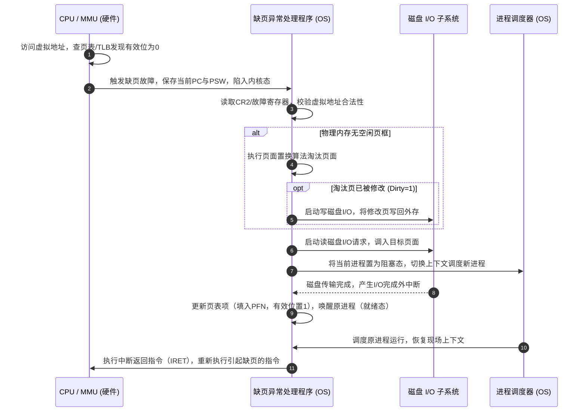

# 408 高频考点精讲：缺页异常

> **模块归属**：操作系统 · 内存管理  
> **考点层级**：微观细分考点（近十年考查 $\ge 3$ 次）  
> **适用对象**：408 计算机考研备考学生  

---

## 一、 考情档案

### 1. 考查频次与题号统计
- **近十年考查频次**：5 次（2019 年第 14 题、2022 年第 29 题、2023 年第 44 题、2024 年第 45 题、2025 年第 43 题）
- **历年总考查频次**：9 次（含 2012 年第 45 题、2015 年第 44 题、2018 年第 44 题、2021 年第 44 题）
- **出题形式**：单项选择题、综合解答题（近三年 2023、2024、2025 连续在大题中深度考查）

### 2. 命题特点分析
- **由概念记忆转向系统协同**：早期试题偏向考查缺页异常的分类归属（内部异常中的故障 Fault）、软硬件执行时机；近五年则全面聚焦于软硬件协同执行全流程（页表项有效位检测、物理页框分配、置换决策、写回开销、指令重新执行）。
- **软硬件跨学科深度融合**：缺页异常常与计算机组成原理中的 Cache 映射策略、TLB 虚实地址变换、流水线中断处理、指令编码寻址深度绑定，考查考生贯通“体系结构-操作系统”的底层系统视野。
- **边界条件与计算严密性增强**：近几年大题高频考查连续数组在虚拟页、物理页框、Cache 行之间的边界对齐与跨越情况，精确计算缺页次数、访存惩罚与缺失率。

### 3. 近十年考查年份分布表

```text
+------+----------------------+------------+------------------------------------------+
| 年份 | 题号                 | 题型       | 核心考查方向                             |
+------+----------------------+------------+------------------------------------------+
| 2016 | --                   | --         | --                                       |
| 2017 | --                   | --         | --                                       |
| 2018 | 第 44 题（综合题）   | 综合解答题 | 虚实地址转换、TLB 与页表项缺页判定       |
| 2019 | 第 14 题             | 单项选择题 | 缺页异常类型、断点保存与指令重新执行时机 |
| 2020 | --                   | --         | --                                       |
| 2021 | 第 44 题（综合题）   | 综合解答题 | 虚拟存储管理、TLB 缺失与缺页异常处理机制 |
| 2022 | 第 29 题             | 单项选择题 | 缺页异常处理流程、必选操作与条件操作辨析 |
| 2023 | 第 44 题             | 综合解答题 | 机器指令执行流、代码段局部性与缺页判定   |
| 2024 | 第 45 题             | 综合解答题 | 页表结构、缺页异常处理与页表项物理/虚地址|
| 2025 | 第 43 题             | 综合解答题 | 数据跨页边界计算、缺页次数与 Cache 开销  |
+------+----------------------+------------+------------------------------------------+
```

---

## 二、 具体考察内容

### 1. 核心概念与工作机制

#### (1) 缺页异常定义与中断分类归属
缺页异常（Page Fault）是指 CPU 在执行指令过程中，由内存管理单元（MMU）进行虚拟地址到物理地址转换时，检测到所需访问的虚拟页面未调入物理主存（页表项中的存在位/有效位为 0），进而触发的一种硬件内部异常。
- **分类属性**：属于**内部异常（Exception）**中的**故障（Fault）**。
- **可恢复性**：故障是一种潜在可恢复的异常。处理程序调入页面后，CPU 重新执行引起该异常的原指令。
- **产生时机**：发生在 CPU 指令执行周期内部（取指、译码或执行阶段的访存操作），属于同步事件。

#### (2) 缺页异常处理生命周期（软硬件协同十步闭环）
缺页异常的处理涉及硬件逻辑、操作系统内核、外设 I/O 控制器的深度协作，其标准生命周期如下：



1. **硬件检测与异常触发**：CPU 发出访存虚拟地址，MMU 查询 TLB/页表，检测到对应页表项的有效位（Valid / Present Bit）为 0，MMU 立即向 CPU 发出缺页故障信号。
2. **硬件断点保存与特权级切换**：CPU 硬件自动将当前执行指令的地址（即断点 PC，指向当前引起缺页的指令）以及程序状态字（PSW/EFLAGS）压入内核栈，将 CPU 模式切换到内核态，并跳转至中断向量表中登记的缺页异常处理程序入口。
3. **故障地址捕获与合法性检验**：操作系统缺页处理程序读取硬件控制寄存器（如 x86 的 CR2 寄存器），获取导致缺页的虚拟地址。操作系统检索进程的虚拟内存区域（VMA）描述符，检查该虚拟地址是否属于合法分配的地址空间：
   - 若非法访问（如访问未映射地址或向只读段执行写入），操作系统向该进程发送段错误信号（如 UNIX 下的 `SIGSEGV`），直接终止进程。
   - 若地址合法，则判定为正常缺页，进入调页流程。
4. **物理页框获取与置换判定**：
   - 检查系统空闲物理页框链表。若存在空闲页框，直接从中分配一个物理页框。
   - 若系统无空闲页框，调用页面置换算法（如 LRU、Clock、FIFO 等）选出一个被淘汰的物理页面（牺牲页）。
5. **牺牲页写回操作（条件性操作）**：
   - 检查被淘汰页的修改位（Dirty Bit）。若该页在内存中曾被写入（Dirty = 1），必须启动磁盘写 I/O 将其写回外存对换区或关联文件。
   - 若该页未被修改（Dirty = 0），则无需写回磁盘，直接释放其占用的物理页框。
6. **启动调页与进程状态转换**：操作系统向磁盘驱动程序发出读请求，启动 DMA 控制器将目标页面由外存读入新分配的物理页框。由于磁盘 I/O 耗时通常在毫秒级，缺页处理程序调用调度器将当前进程置为**阻塞态（Waiting / Blocked）**，让出 CPU 给其他就绪进程执行。
7. **I/O 传输完成与外中断触发**：DMA 控制器将目标页面全部读入主存页框后，向 CPU 发出磁盘 I/O 完成中断（此为外部硬件中断）。
8. **进程唤醒与页表更新**：操作系统在 I/O 中断服务程序中将原阻塞进程唤醒，将其状态转换为**就绪态（Ready）**。
9. **页表项更新与 TLB 维护**：缺页处理程序修改该进程对应的页表项：填入新分配的物理页框号（PFN），将有效位置 1，清除修改位与访问位。同时，根据体系结构规范使该页对应的无效 TLB 条目生效或刷新。
10. **中断返回与指令重新执行**：操作系统执行中断返回指令（如 x86 的 `IRET`），恢复进程现场上下文与 PSW，程序计数器恢复为引起缺页的那条指令地址。CPU **重新执行（Re-execute）**原先发生缺页的指令。此时，MMU 再次翻译该虚拟地址即可在页表或 TLB 中命中。

---

### 2. 核心定理推导与数学/算法模型

#### (1) 有效访存时间（EAT，Effective Access Time）数学模型
在支持虚拟页式存储的系统中，引入缺页异常处理后，内存访问时间由多层级存储开销共同决定。

设：
- $t_{tlb}$：TLB 查找时间；
- $t_{mem}$：物理主存访问时间；
- $h_{tlb}$：TLB 命中率；
- $p$$ \text{：缺页异常发生概率（缺页率，} $$0 \le p \le 1$）；
- $t_{fault}$：缺页异常处理平均耗时（包含中断响应、页面置换、磁盘读写与进程调度开销）；
- $\beta$：被淘汰页面为脏页（需要写回磁盘）的概率。

##### 模型一：二级页表无缺页的访存时间
在不发生缺页（页面均在内存）时，若 TLB 未命中，需访问两次内存查询页表，再加一次物理访存：
$$t_{no\_fault} = t_{tlb} + (1 - h_{tlb}) \times (2 \times t_{mem}) + t_{mem}$$

##### 模型二：引入缺页异常的综合有效访存时间
缺页处理耗时 $t_{fault}$$ \text{远大于主存访问时间（通常} $$t_{mem} \approx 10 \sim 100\text{ ns}$$ \text{，而磁盘读写} $$t_{fault} \approx 5 \sim 10\text{ ms}$$ \text{，相差约} $$10^5$ 倍）：
$$t_{fault} = t_{overhead} + t_{disk\_read} + \beta \times t_{disk\_write} + t_{restart}$$
综合有效访存时间 $EAT$ 表达式为：
$$EAT = (1 - p) \times t_{no\_fault} + p \times t_{fault}$$

若做简化假设（不计 TLB 开销，正常访存为 1 次内存访问时间 $t_{mem}$）：
$$EAT = (1 - p) \times t_{mem} + p \times t_{fault} = t_{mem} + p \times (t_{fault} - t_{mem})$$

> **推论**：由于 $t_{fault} \gg t_{mem}$$ \text{，即便缺页率} $$p$$ \text{仅上升} $$0.1\%$$ \text{，有效访存时间也将呈几何级数增加。因此虚拟内存管理的首要性能目标是极小化} $$p$。

#### (2) 数据跨页与缺页次数计算模型
当程序在内存中连续分配或访问一个长度为 $S$$ \text{字节的数据结构（如连续数组、缓冲区）时，其起始虚拟地址为} $$A$$ \text{。设页面大小为} $$P$（字节）。

##### 模型推导：
1. **起始字节所在虚拟页号**：
   $$ \text{Page_{start} = \lfloor \frac{A}{P} \rfloor = A \gg k \quad (\text{其中 } P = 2^k)} $$
2. **末尾字节虚拟地址**：
   $$A_{end} = A + S - 1$$
3. **末尾字节所在虚拟页号**：
   $$Page_{end} = \lfloor \frac{A + S - 1}{P} \rfloor = (A + S - 1) \gg k$$
4. **该数据结构所跨越的虚拟页面总数** $N_{pages}$：
   $$N_{pages} = Page_{end} - Page_{start} + 1$$
5. **等价页内偏移量判定式**：
   设起始地址在页内的偏移量为 $Offset_{start} = A \bmod P$：
   $$N_{pages} = \left\lceil \frac{Offset_{start} + S}{P} \right\rceil$$

##### 缺页触发频次判定规则：
若该数据结构在访存前均未调入主存，且系统按需分配：
- 顺序遍历该数据结构时，首次进入每个新的虚拟页均会触发且仅触发 1 次缺页异常。
- 该数据结构引起的总缺页次数即为 $N_{pages}$。
- 若该结构起始地址严格页面对齐（$Offset_{start} = 0$$ \text{且} $$S$$ \text{为} $$P$$ \text{的整数倍），则} $$N_{pages} = S / P$$ \text{；若未对齐，即使} $$S \le P$，也极可能跨越 2 个页面产生 2 次缺页。

---

### 3. 核心对比辨析

#### (1) 中断与异常核心类型对比

| 类别属性 | 缺页异常（Page Fault） | 系统调用（Trap） | 算术溢出 / 除零（Fault / Abort） | 外部中断（Interrupt） |
| :--- | :--- | :--- | :--- | :--- |
| **信号来源** | CPU 内部 MMU 硬件检测 | CPU 执行指令显式触发 | CPU 执行 ALU 运算异常 | CPU 外部硬件引脚电平 |
| **同步/异步** | 同步事件（与当前指令相关） | 同步事件 | 同步事件 | 异步事件（与当前指令无关） |
| **断点保存** | **当前引起缺页的指令地址** | **下一条指令地址** | 当前指令或无法恢复 | **下一条即将执行的指令地址** |
| **返回动作** | **重新执行当前指令** | 执行下一条指令 | 终止进程或自定义处理 | 执行下一条指令 |
| **典型用途** | 虚拟存储实现按需调页 | 用户态请求内核服务 | 运行态错误保护 | I/O 完成、时钟周期滴答 |

#### (2) 缺页异常（Page Fault）与 TLB 缺失（TLB Miss）辨析

| 辨析维度 | TLB 缺失（TLB Miss） | 缺页异常（Page Fault） |
| :--- | :--- | :--- |
| **本质问题** | 转换快表（SRAM）缓存未命中 | 物理主存（DRAM）中无此目标页 |
| **处理层次** | 硬件 MMU 或微内核级处理 | 操作系统内核虚拟存储管理程序 |
| **处理主体** | 硬件遍历页表（x86）或软件陷阱（MIPS）| 操作系统缺页异常中断服务例程 |
| **涉及介质** | 快表与物理主存之间 | 物理主存与外部磁盘之间 |
| **耗时量级** | 几十个时钟周期（数十纳秒级） | 数百万个时钟周期（数毫秒级） |
| **进程状态** | **保持运行态**，流水线暂停片刻 | **转为阻塞态**，触发进程上下文切换 |
| **前后因果关系**| TLB 缺失不一定会引发缺页；而**缺页必然先经历 TLB 缺失** |

#### (3) 缺页处理全生命周期中各类操作的“必选性与条件性”

| 处理操作步骤 | 必选 / 条件 | 决定条件与底层运行逻辑 |
| :--- | :---: | :--- |
| **保存 CPU 现场与断点** | **必选** | 硬件异常响应的固有行为，确保异常处理后能正确恢复现场 |
| **获取故障虚拟地址** | **必选** | 必须由 CR2 寄存器获取缺页地址以判定页号与访问合法性 |
| **分配物理页框** | **必选** | 调入新页的前提条件，必须提供承载新页的主存空间 |
| **从外存读入目标页** | **必选** | 按需调页的根本目的，必须将目标数据从外存写入物理页框 |
| **更新页表项与有效位** | **必选** | 必须在页表中建立页号到页框号的映射并置有效位为 1 |
| **重新执行引发缺页的指令** | **必选** | 故障（Fault）类异常的标准返回机制 |
| **淘汰内存中的已有页面** | **条件** | **仅当主存中分配给该进程的页框耗尽且无空闲页框时**才需置换 |
| **将淘汰页写回外存** | **条件** | **仅当被淘汰的页面曾经被修改（Dirty = 1）**时才需写回磁盘 |
| **刷新全部 TLB 条目** | **条件** | 多数体系结构支持单条目失效（如 `INVLPG`），无需整表清空 |

---

## 三、 近十年真题精讲（2016~2025）

### 【真题 1】2019 年 408 第 14 题 · 缺页异常的产生机制与执行时机

**题目**  
下列关于缺页处理的叙述中，错误的是（ ）。  
A. 缺页是在地址转换时 CPU 检测到的一种异常  
B. 缺页处理由操作系统提供的缺页处理程序来完成  
C. 缺页处理程序根据页故障地址从外存读入所缺失的页  
D. 缺页处理完成后回到发生缺页的指令的下一条指令执行  

#### 【解析】
1. **考点定位**：考查缺页异常的本质属性、产生机制、处理流程以及异常返回后的断点执行位置。
2. **各选项逐项分析**：
   - **选项 A 正确**：在进程执行过程中，当逻辑地址被送往 MMU 进行地址转换时，MMU 查询页表若发现对应页表项的“存在位/有效位”为 0，硬件会自动检测并生成缺页异常信号通知 CPU。
   - **选项 B 正确**：缺页异常属于硬件触发、软件响应的机制。CPU 响应缺页异常后陷入内核态，控制权移交给操作系统内建的缺页异常处理程序（Page Fault Handler）。
   - **选项 C 正确**：发生缺页时，CPU 会将引起故障的虚拟线性地址保存在特定寄存器（如 x86 的 CR2 寄存器）中。缺页处理程序据此地址解析出对应的虚拟页号，并定位该页在外存对换区或文件系统中的存储位置，随后发出 I/O 请求调入主存。
   - **选项 D 错误**：按异常分类标准，缺页异常属于**故障（Fault）**。由于引发缺页的指令在执行（或取指）时尚未完成，主存中缺失目标数据或代码，因此在缺页处理程序将缺失页调入内存并更新页表后，中断返回指令必须将断点恢复至**发生缺页的那条指令本身重新执行**，而非返回其下一条指令。若返回下一条指令，当前指令所依赖的计算或数据传送将被遗漏，导致程序逻辑错误。

**正确答案**：**D**

---

### 【真题 2】2022 年 408 第 29 题 · 缺页异常处理流程与软硬件协同操作

**题目**  
某进程访问的页 b 不在内存中，导致产生缺页异常，该缺页异常处理过程中不一定包含的操作是（ ）。  
A. 淘汰内存中的页  
B. 建立页号与页框号的对应关系  
C. 将页 b 从外存读入内存  
D. 修改页表中页 b 对应的存在位  

#### 【解析】
1. **考点定位**：考查缺页异常处理过程中的必选操作与条件操作的判别。
2. **推导分析与选项辨析**：
   - 产生缺页异常后，操作系统必须为页 b 分配一个物理页框，发起磁盘 I/O 将页 b 从外存读入分配的物理内存空间（**选项 C 必选**）；
   - 在页面调入完成后，操作系统必须将页 b 的虚拟页号与所分配的物理页框号记录在页表项中，建立对应映射（**选项 B 必选**）；
   - 必须将该页表项的存在位（有效位）从 0 修改为 1，标明该页面已驻留主存，供后续访存判定（**选项 D 必选**）；
   - **关于选项 A**：是否淘汰内存中的页取决于当前内存中是否有空闲的物理页框可用。如果当前主存（或分配给该进程的工作集配额）中仍有空闲物理页框，操作系统可直接为其分配一个空闲页框存放页 b，无需调用页面置换算法，因而**不需要淘汰内存中的页**。只有在内存页框完全耗尽时，才需要执行页面置换算法淘汰某个旧页面。故淘汰内存中的页是“条件执行”而非“必然包含”的操作。

**正确答案**：**A**

---

### 【真题 3】2023 年 408 第 44 题 · 汇编代码寻址与取指阶段缺页异常判定

**题目**  
上题中 C 程序段在计算机 M 上的部分机器级代码如下，每个机器级代码行中依次包含指令序号、虚拟地址、机器指令和汇编指令。
```assembly
for (i = 0; i < 24; i++)
1   00401072  C7 45 F8 00 00 00 00              mov [ebp-8], 0
2   00401079  EB 09                             jmp 00401084h
3   0040107B  8B 55 F8                          mov eax, [ebp-8]
    ...       ...                               ...
7   00401088  7D 32                             jge 004010bch
    for (j = 0; j < 64; j++)
8   0040108A  C7 45 FC 00 00 00 00              mov [ebp-4], 0
    ...       ...                               ...
        a[i][j] = 10;
    ...       ...                               ...
19  004010AE  C7 84 82 00 20 42 00 0A 00 00 00  mov [ecx+edx*4+00422000h], 0Ah
20  ...       ...
```
请回答下列问题。  
(1) 第 20 条指令的虚拟地址是多少？  
(2) 已知第 2 条 jmp 和第 7 条 jge 都是跳转指令，其操作码分别是 EBH 和 7DH，跳转地址分别为 0040 1084H、0040 10BCH，这两条指令都采用什么寻址方式？给出第 2 条指令 jmp 的跳转目标地址计算过程。  
(3) 已知第 19 条 mov 指令的功能是“`a[i][j]←10`”，其中 ecx 和 edx 为寄存器名，0042 2000H 是数组 a 的首地址，指令中源操作数采用什么寻址方式？已知 edx 中存放的是变量 j，ecx 中存放的是什么？根据该指令的机器码判断计算机 M 采用的是大端还是小端方式。  
(4) 第一次执行第 19 条指令时，取指令过程中是否会发生缺页异常？为什么？  

#### 【解析】
1. **第 (1) 问**：
   第 19 条指令起始虚拟地址为 `0040 10AEH`。观察机器指令字段：`C7 84 82 00 20 42 00 0A 00 00 00`，共包含 11 个字节。
   因此紧随其后的第 20 条指令的起始虚拟地址为：
   $$\text{VA}_{20} = 004010AE\text{H} + 11 = 004010AE\text{H} + 0B\text{H} = 004010B9\text{H}$$

2. **第 (2) 问**：
   - 两条跳转指令的操作码后跟相对位移偏移量，均采用**相对寻址方式**。
   - 第 2 条指令 `jmp 00401084h` 起始地址为 `0040 1079H`，长度为 2 字节（`EB 09`）。CPU 取出该指令后，PC 自动增加 2 指向下一条指令：
     $$\text{PC}_{next} = 00401079\text{H} + 2 = 0040107B\text{H}$$
   - 指令中的偏移量字段为 `09H`，故跳转目标地址为：
     $$ \text{目标地址} = \text{PC}_{next} + \text{偏移量} = 0040107B\text{H} + 09\text{H} = 00401084\text{H} $$

3. **第 (3) 问**：
   - 第 19 条指令源操作数为 `0Ah`，该操作数直接编码在机器指令内部（最后 4 字节为 `0A 00 00 00`），采用**立即寻址（立即数寻址）**方式。
   - 二维数组元素按行优先连续存放，元素地址计算公式为：
     $$ \text{Addr}(a[i][j]) = \text{Base} + (i \times \text{列数} + j) \times \text{元素大小} $$
     已知数组元素大小为 4 字节，外层列数 $N_{col} = 64$$ \text{。机器指令计算目的地址为} $$[ecx + edx \times 4 + 00422000\text{h}]$$ \text{。已知基地址为 `0042 2000H`，} $$edx \times 4 = j \times 4$$ \text{为列偏移字节，因此寄存器} $$ecx$ 中存放的是行偏移量字节：
     $$ecx = i \times 64 \times 4 = i \times 256$$
   - 机器指令中，立即数 `0042 2000H` 存放为字节序列 `00 20 42 00`，最低有效字节 `00H` 存放在最低地址端；立即数 `0000 000Ah` 存放为 `0A 00 00 00`，低字节在低地址。因此计算机 M 采用**小端方式（Little-endian）**。

4. **第 (4) 问（核心缺页考查）**：
   - **结论**：第一次执行第 19 条指令时，**取指令过程中不会发生缺页异常**。
   - **深度原因分析**：
     - 在虚拟页式存储中，通常页大小至少为 1KB（最常见为 4KB，对应低 12 位为页内偏移）。分析该代码段虚拟地址：
       第 1 条指令地址为 `0040 1072H`，第 19 条指令地址为 `0040 10AEH`，其结束地址为 `0040 10B8H`。所有这些指令的高 20 位虚拟地址均为 `00401H`，处于同一个虚拟页面（即页号为 `00401H` 的页面）内部。
     - 程序执行流是按序到达第 19 条指令的。在执行第 19 条指令之前，必须先依序执行第 1 条、第 2 条、第 7 条、第 8 条等指令。
     - 能够成功执行第 1 条及后续指令，证明该指令所在的虚拟页面（页号 `00401H`）已经被操作系统调入主存物理页框中。
     - 由于第 19 条指令与前序指令处于**同一个代码页面**，且在执行内层循环前该页面依然驻留在内存中未被置换，因此在对第 19 条指令执行取指操作时，MMU 可以直接在内存（或代码 Cache/TLB）中命中该代码段，**取指过程绝不会发生缺页异常**。
     - *（注：执行第 19 条指令的写内存操作时，访问的是数组数据区首地址 `0042 2000H`，该数据处于不同页面，可能发生数据缺页异常；但本小问明确限定为“取指令过程中”，故结论为不会发生缺页）。*

**正确答案**：  
(1) `0040 10B9H`  
(2) 相对寻址方式；跳转目标地址 $= 00401079\text{H} + 2 + 09\text{H} = 00401084\text{H}$  
(3) 立即寻址（或立即数寻址）；$ecx$$ \text{中存放的是行偏移量} $$i \times 256$；小端方式  
(4) 不会发生缺页异常。原因：第 19 条指令与先于其执行的指令（如第 1、2、7、8 条指令）均位于虚页号为 `00401H` 的同一个页面中，在执行第 19 条指令之前该页面已装入主存，因此取指令时该页已在主存中，不会发生缺页异常。

---

### 【真题 4】2024 年 408 第 45 题 · 页表结构、缺页异常处理与页表项地址计算

**题目**  
某计算机按字节编址，采用页式虚拟存储管理方式，虚拟地址和物理地址的长度均为 32 位，页表项的大小为 4 字节，页大小为 4MB，虚拟地址结构如下：
$$ \text{页号（10 位）} \quad \text{页内偏移量（22 位）} $$
进程 P 的页表起始虚拟地址为 B8C0 0000H，被装载到从物理地址 6540 0000H 开始的连续主存空间中。请回答下列问题：  
（1）若 CPU 在执行进程 P 的过程中，访问虚拟地址 1234 5678H 时发生了缺页异常，经过缺页异常处理和 MMU 地址转换后得到的物理地址是 BAB4 5678H。在此次缺页异常的处理中，需要为新缺页分配页框并更新相应的页表项，则该页表项的虚拟地址和物理地址分别是什么？该页表项中的页框号更新后的值是什么？（3 分）  
（2）进程 P 的页表所在页的页号是什么？该页对应的页表项的虚拟地址是什么？该页表项中的页框号是多少？（4 分）  

#### 【解析】
1. **地址结构解析**：
   - 页面大小为 $4\text{MB} = 2^{22}\text{ B}$，因此页内偏移量占低 22 位（Bit 21~Bit 0）。
   - 虚拟地址总长 32 位，页号占高 10 位（Bit 31~Bit 22）。
   - 物理地址总长 32 位，物理页框大小等于页大小（4MB），因此物理地址结构同样为：高 10 位为物理页框号（PFN），低 22 位为页内偏移量。

2. **第 (1) 问解析**：
   - **求访问虚拟地址 1234 5678H 的页号**：
     将 `1234 5678H` 展开为二进制：
     $$0001\ 0010\ 0011\ 0100\ 0101\ 0110\ 0111\ 1000_2$$
     高 10 位为页号（即逻辑右移 22 位）：
     $$ \text{页号} = 0001\ 0010\ 00_2 = 048\text{H} \quad (\text{十进制 } 72) $$
     低 22 位为页内偏移量：$11\ 0100\ 0101\ 0110\ 0111\ 1000_2 = 345678\text{H}$。
   - **计算该页表项在页表中的偏移量**：
     每个页表项大小为 4 字节，故页表项在页表内的偏移地址为：
     $$ \text{Offset} = \text{页号} \times 4\text{B} = 048\text{H} \times 4 = 120\text{H} $$
   - **计算页表项的虚拟地址与物理地址**：
     页表起始虚拟地址为 `B8C0 0000H`，因此该页表项的虚拟地址为：
     $$ \text{PTE}_{VA} = \text{页表基虚址} + \text{Offset} = B8C00000\text{H} + 120\text{H} = B8C00120\text{H} $$
     页表起始物理地址为 `6540 0000H`，且页表连续存放，因此该页表项的物理地址为：
     $$ \text{PTE}_{PA} = \text{页表基实址} + \text{Offset} = 65400000\text{H} + 120\text{H} = 65400120\text{H} $$
   - **求更新后的页框号**：
     缺页处理完成后物理地址为 `BAB4 5678H`。页内偏移量保持不变为 `345678H`。
     将物理地址高 10 位提取出来作为物理页框号（逻辑右移 22 位）：
     $$BAB45678\text{H} = 1011\ 1010\ 1011\ 0100\ 0101\ 0110\ 0111\ 1000_2$$
     高 10 位为：$1011\ 1010\ 10_2 = 2EA\text{H}$。
     因此该页表项更新后的页框号值为 `2EAH`。

3. **第 (2) 问解析**：
   - **进程 P 的页表所在页的虚拟页号**：
     进程 P 页表的起始虚拟地址为 `B8C0 0000H`。页表自身也是存放在虚拟空间中的，其所在页号由该虚拟地址的高 10 位决定：
     $$B8C00000\text{H} = 1011\ 1000\ 1100\ 0000\ 0000\ 0000\ 0000\ 0000_2$$
     高 10 位为：$1011\ 1000\ 11_2 = 2E3\text{H}$。
     因此，页表所在页的页号为 `2E3H`。
   - **该页对应的页表项的虚拟地址**：
     该页（页号 `2E3H`）对应的页表项同样位于进程 P 的页表中，其在页表中的偏移为：
     $$\text{Offset}_{2E3} = 2E3\text{H} \times 4\text{B} = 0B8C\text{H}$$
     因此该页表项的虚拟地址为：
     $$\text{PTE}_{VA\_2E3} = B8C00000\text{H} + 0B8C\text{H} = B8C00B8C\text{H}$$
   - **该页表项中的物理页框号**：
     题目明确给出“页表被装载到从物理地址 6540 0000H 开始的连续主存空间中”。
     整个页表包含 $2^{10} = 1024$$ \text{个页表项，总大小为} $$1024 \times 4\text{B} = 4\text{KB}$，完全包含在起始于物理地址 `6540 0000H` 的单一 4MB 物理页框内。
     提取物理地址 `6540 0000H` 的高 10 位即为该页表项对应的页框号：
     $$65400000\text{H} = 0110\ 0101\ 0100\ 0000\ 0000\ 0000\ 0000\ 0000_2$$
     高 10 位为：$0110\ 0101\ 01_2 = 195\text{H}$。
     因此该页表项中的页框号为 `195H`。

**正确答案**：  
（1）页表项的虚拟地址是 `B8C0 0120H`，物理地址是 `6540 0120H`；该页表项中的页框号更新后的值为 `2EAH`。  
（2）进程 P 的页表所在页的页号是 `2E3H`；该页对应的页表项的虚拟地址是 `B8C0 0B8CH`；该页表项中的页框号是 `195H`。

---

### 【真题 5】2025 年 408 第 43 题 · Cache与虚拟存储综合、缺页次数与访存开销推导

**题目**  
计算机 M 字长为 32 位，按字节编址，数据 Cache 的数据区大小为 32KB，采用 8 路组相联，主存块大小为 64B，Cache 命中时间为 2 个时钟周期，缺失损失为 200 个时钟周期，采用页式虚拟存储，页大小为 4KB。数组 d 的起始地址为 0180 0020H（VA31~VA0）。
```c
int x, d[2048], i;
for (i = 0; i < 2048; i++)
    d[i] = d[i] / x;
```
(1) 主存地址中的 Cache 组号、块内地址分别占几位？VA 中哪些位可以作为 Cache 索引。  
(2) d[100] 的 VA 是多少？d[100] 所在主存块中对应的 Cache 组号是多少？  
(3) 设代码已经在 Cache 中，i, x 已装入内存，但不在 Cache，则 d[0] 在其主存块内的偏移量是多少？执行 for 的过程中，访问 d 的 Cache 缺失率和数组元素的平均访问时间分别是多少？（缺失率用百分比表示，保留两位小数）  
(4) d 分布在几个页中？若代码已在主存，d 不在主存，则执行 for 的过程中，访问 d 所引起的缺页次数是？  

#### 【解析】
1. **第 (1) 问解析**：
   - 主存块大小为 $64\text{B} = 2^6\text{ B}$，因此块内地址（偏移量）占 **6 位**。
   - Cache 总容量为 32KB，总块数 $= 32\text{KB} / 64\text{B} = 512$$ \text{块。采用 8 路组相联，Cache 组数} $$= 512 / 8 = 64 = 2^6$ 组。因此 Cache 组号占 **6 位**。
   - 页大小为 $4\text{KB} = 2^{12}\text{ B}$，虚实地址转换过程中低 12 位（VA11~VA0）为页内偏移量，在页转换前后保持严格不变。
   - Cache 块内地址占低 6 位（VA5~VA0），Cache 组号占随后的 6 位（VA11~VA6）。
   - 由于 Cache 索引（组号）所需的 6 位恰好完全落在页内偏移的范围内（$6 + 6 = 12$ 位），因此直接利用虚拟地址中的 **VA11~VA6** 作为 Cache 索引，可以在 MMU 进行页表转换的同时并行查询 Cache（重叠 Cache 寻址 / VIPT 机制）。

2. **第 (2) 问解析**：
   - 数组元素为 `int` 型（32 位 $= 4$ 字节），数组起始地址为 `0180 0020H`。
   - `d[100]` 的虚拟地址为：
     $$\text{VA}(d[100]) = 01800020\text{H} + 100 \times 4 = 01800020\text{H} + 400 = 01800020\text{H} + 190\text{H} = 018001B0\text{H}$$
   - 将低 12 位展开为二进制：$1B0\text{H} = 0001\ 1011\ 0000_2$。
     - 块内地址（VA5~VA0）$= 11\ 0000_2 = 48$；
     - Cache 组号（VA11~VA6）$= 0001\ 10_2 = 6$。
   - 故 `d[100]` 所在主存块对应的 Cache 组号为 **6**。

3. **第 (3) 问解析**：
   - `d[0]` 的起始地址为 `0180 0020H`，低 6 位为 `0020H` 的低 6 位，即 $10\ 0000_2 = 32$。因此 `d[0]` 在主存块内的偏移量是 **32 字节**。
   - **Cache 跨块与缺失分析**：
     - 数组总大小为 $2048 \times 4\text{B} = 8192\text{B} = 8\text{KB}$。
     - 由于起始偏移为 32B，第一个主存块仅容纳 `d[0]~d[7]`（共 8 个元素，占用 32 字节）。
     - 随后的 127 个完整主存块，每个块容纳 $64 / 4 = 16$$ \text{个元素，共存纳} $$127 \times 16 = 2032$ 个元素（`d[8]~d[2039]`）。
     - 剩余最后 8 个元素（`d[2040]~d[2047]`，共 32 字节）落在最后一个主存块的前半部分。
     - 因此数组跨越的主存块总数为 $1 + 127 + 1 = 129$ 个 Cache 块。
   - **访存总次数与缺失率计算**：
     - 循环体中执行 `d[i] = d[i] / x;`，对每个 `d[i]` 产生 1 次读访存和 1 次写访存，总访存次数为：
       $$ \text{N_{access} = 2048 \times 2 = 4096 \text{ 次}} $$
     - 顺序访问时，每个 Cache 块在首次访问其第一个元素时发生 1 次 Cache 读缺失并调入整块，随后的同块数据读取以及写回操作全部命中 Cache。
     - 因此访问数组 d 的 Cache 缺失总次数为 129 次。
     - 访问 d 的 Cache 缺失率为：
       $$\text{Miss Rate} = \frac{129}{4096} \approx 3.1494\% \approx 3.15\%$$
   - **平均访问时间计算**：
     - 单次访存的平均时间为：
       $$ \text{T_{access} = \frac{129 \times 200 + (4096 - 129) \times 2}{4096} = \frac{25800 + 7934}{4096} = \frac{33734}{4096} \approx 8.24 \text{ 个时钟周期}} $$
     - *（注：考场阅卷中，若按“每个数组元素经历 1 读 1 写共 2 次访存的耗时”解答，则元素平均处理时间为 $8.24 \times 2 \approx 16.47$ 周期。教育部标准答案给出的通常为单次访存平均时间 8.24 周期，答题时建议将单次访存平均时间与每个数组元素访问时间均明确列出）。*

4. **第 (4) 问（核心缺页考查）解析**：
   - 页大小为 $4\text{KB} = 4096\text{ B} = 1000\text{H}$。
   - 首元素 `d[0]` 的虚拟地址为 `0180 0020H`，其所在虚拟页号为：
     $$Page_{start} = \lfloor 01800020\text{H} / 1000\text{H} \rfloor = 01800\text{H}$$
   - 末元素 `d[2047]` 占 4 字节，起始地址为：
     $$\text{VA}(d[2047]) = 01800020\text{H} + 2047 \times 4 = 01800020\text{H} + 1FFC\text{H} = 0180201C\text{H}$$
     末元素字节覆盖范围为 `0180 201CH ~ 0180 201FH`。
   - 其末尾字节所在虚拟页号为：
     $$Page_{end} = \lfloor 0180201F\text{H} / 1000\text{H} \rfloor = 01802\text{H}$$
   - 数组所占用的虚拟页号序列为：`01800H`、`01801H`、`01802H`，故数组 d 分布在 **3 个页**中。
   - **缺页次数分析**：
     题目指明“代码已在主存，d 不在主存”。
     在执行 `for` 循环过程中，按序遍历数组元素：
     - 当访问 `d[0]` 时，页号 `01800H` 不在主存，触发第 1 次缺页异常，调入该页；随后属于该页的元素访问均命中；
     - 当遍历跨入第 2 个页（访问 `d[1020]`，对应偏移超过 4096 字节处）时，页号 `01801H` 不在主存，触发第 2 次缺页异常并调入；
     - 当遍历跨入第 3 个页（访问 `d[2040]` 处）时，页号 `01802H` 不在主存，触发第 3 次缺页异常并调入。
     整个循环过程中无跳跃访问，每个页面仅在其首个元素访问时发生 1 次缺页，后续元素均驻留主存。
     因此，访问数组 d 所引起的缺页总次数为 **3** 次。

**正确答案**：  
(1) Cache 组号占 6 位，块内地址占 6 位；VA 中的 VA11~VA6 可以作为 Cache 索引。  
(2) `d[100]` 的 VA 是 `0180 01B0H`；对应 Cache 组号是 6。  
(3) `d[0]` 在其主存块内的偏移量是 32 字节；访问 d 的 Cache 缺失率是 3.15%；数组单次访存平均时间为 8.24 个时钟周期（若按每个元素 2 次访存计算则为 16.48 个时钟周期）。  
(4) 数组 d 分布在 3 个页中；访问 d 引起的缺页次数是 3 次。

---

## 四、 综合考法拓展

### 1. 综合大题三大核心命题范式

```text
               ┌────────────────────────────────────────────────────────┐
               │                缺页异常综合大题核心命题架构            │
               └───────────────────────────┬────────────────────────────┘
                                           │
         ┌─────────────────────────────────┼─────────────────────────────────┐
         ▼                                 ▼                                 ▼
┌──────────────────┐             ┌──────────────────┐             ┌──────────────────┐
│   范式一：系统协同   │             │   范式二：跨科穿透   │             │   范式三：局部性   │
├──────────────────┤             ├──────────────────┤             ├──────────────────┤
│ 多级页表虚实映射 │             │ CPU 流水线断点恢复│             │ 二维数组遍历维度 │
│ 页表项状态位更新 │             │ TLB Miss 与缺页级联│             │ 跨页边界精准切分 │
│ 物理页框分配置换 │             │ Cache/主存多层缺失│             │ 缺页率与EAT综合建模│
└──────────────────┘             └──────────────────┘             └──────────────────┘
```

#### 范式一：虚实地址映射、页表遍历与缺页处理联动（如 2024#45、2018#44）
- **考法特征**：给出多级页表（如两级或倒排页表）与具体虚拟地址，要求考生手动切分逻辑地址（顶级页号、二级页号、页内偏移），追踪 MMU 查表流程。
- **解题模板与规范步骤**：
  1. **切分地址**：根据页面大小 $2^k$$ \text{确定页内偏移占} $$k$ 位，剩余高位划分给页号。
  2. **定位页表项**：根据页表基址和页号计算页表项的虚拟/物理地址（$\text{PTE\_Addr} = \text{Base} + \text{Page\_Num} \times \text{PTE\_Size}$）。
  3. **判定有效位**：若有效位为 0，写出异常响应动作（分配空闲页框、写入 PFN、有效位置 1）。
  4. **合成物理地址**：$\text{PA} = (\text{PFN} \ll k) \mid \text{Offset}$。

#### 范式二：软硬件跨学科穿透（如 2025#43、2021#44、2015#44）
- **考法特征**：将计算机组成的流水线、Cache、TLB 与操作系统的虚拟内存管理熔炼于同一道题目中，考查软硬件状态的阶梯式推进。
- **全链路访问判定链条**：
  - **步骤 1（查 TLB）**：CPU 发出虚拟地址，TLB 命中则直接得到物理页框号；TLB 未命中，进入步骤 2。
  - **步骤 2（查主存页表）**：访问主存页表。若页表项有效位为 1，则将映射装入 TLB 并合成物理地址；若有效位为 0，则由硬件产生缺页异常，进入步骤 3。
  - **步骤 3（缺页处理）**：操作系统介入，调度磁盘 I/O 调页，更新页表项与 TLB，重新执行原指令。
  - **步骤 4（查 Cache）**：得到物理地址后，提取 Cache 标记与索引，若命中则读写 Cache；未命中则向主存发起块读写。

#### 范式三：程序代码与数据访问局部性分析（如 2023#44、2025#43）
- **考法特征**：给出具体的 C 语言循环嵌套或汇编代码，考查数据在二维平面的按行/按列存储与按行/按列遍历对缺页率的巨大差异。
- **得分核心技巧**：
  - **区分指令访存与数据访存**：如 2023 年第 44 题第 (4) 问，明确题目问的是“取指令过程”还是“执行过程访问数据”。代码段通常集中且反复执行，取指缺页极少；数据跨大跨度步长（如大步长列遍历）极易引发频繁缺页。
  - **非对齐边界分析**：首元素偏离页面边界时，切勿简单用“总数据量 / 页大小”，必须通过首末字节地址分别算页号相减加 1。

---

## 五、 考点速记清单

### 1. 核心要点速记口诀
- **缺页本质**：内中断、属故障，地址变换硬件创。
- **断点指向**：非下条、归原桩，调页完成重跑趟。
- **处理步骤**：查合法、配页框，若无空位把旧荡。
- **淘汰写回**：脏页回、净页丢，I/O 阻塞切新郎（新进程）。
- **关系明辨**：TLB 缺未必缺页，缺页必然 TLB 先缺。

### 2. 关键计算公式一览
1. **数据跨越虚页数**：
   $$N_{pages} = \lfloor \frac{Addr_{start} + Size - 1}{PageSize} \rfloor - \lfloor \frac{Addr_{start}}{PageSize} \rfloor + 1$$
2. **页表项在连续空间中的物理地址**：
   $$\text{PTE}_{PA} = \text{PageTable\_Base}_{PA} + \text{PageNo} \times \text{PTE\_Size}$$
3. **有效访存时间（EAT，含缺页率 $p$）**：
   $$EAT = (1 - p) \times t_{mem} + p \times t_{fault}$$
4. **VIPT（虚拟索引物理标记）无别名重叠条件**：
   $$ \text{Cache 块内地址位} + \text{Cache 组号位} \le \text{虚拟页内偏移位} $$

### 3. 高频命题陷阱与避坑指南
- **陷阱一：断点地址选错**  
  *易错点*：误以为缺页异常像外部中断或系统调用一样返回到下一条指令（$PC + 4$）。  
  *正解*：缺页是故障，返回地址为**发生缺页的那条指令本身**。
- **陷阱二：默认置换与写回**  
  *易错点*：认为缺页处理中“必然淘汰旧页”且“必然写回外存”。  
  *正解*：内存有空闲页框则不置换；被淘汰页未修改（Dirty = 0）则无需写回外存。
- **陷阱三：混淆 TLB Miss 与 Page Fault**  
  *易错点*：认为 TLB 没查到就是缺页。  
  *正解*：TLB 只是页表的 SRAM 缓存，TLB Miss 后去查主存页表，若页表中存在位为 1 则调入 TLB 即可，不触发缺页异常。
- **陷阱四：跨页计算漏算尾边界**  
  *易错点*：计算 $8\text{KB}$$ \text{数据在} $$4\text{KB}$$ \text{页下占几个页，直接计算} $$8 / 4 = 2$ 个页。  
  *正解*：若起始地址偏移非 0（如偏移 32 字节），尾地址必然溢出到第 3 个页，实际占用 3 个页面，触发 3 次缺页。
